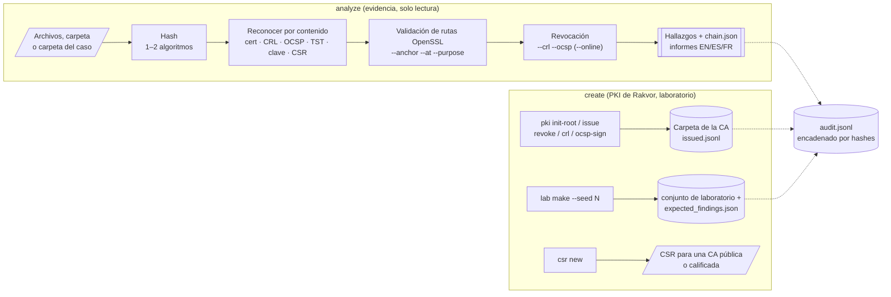
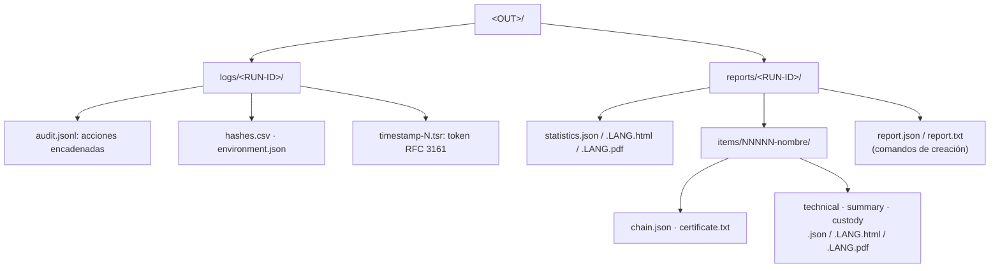

> La versión de referencia es la inglesa ([README.md](README.md)); esta traducción la sigue.

<p align="center"></p>

# RV CertCheck

[English](README.md) · **Español** · [Français](README.fr.md)

<!-- forge:description -->
**Analizador y creador de certificados.** Valida certificados X.509 y sus cadenas, la revocación, los sellos de tiempo y las listas de confianza, y crea la PKI propia de Rakvor, conjuntos de certificados de laboratorio y CSR.
<!-- /forge:description -->

[](https://github.com/Panacota96/rv-certcheck/actions/workflows/ci.yml)


RV CertCheck tiene dos mitades que comparten un motor, un rastro de auditoría y una carpeta del caso:

- **Analizar** (`rv-certcheck analyze`): toma los certificados, paquetes PEM, PKCS#7, PKCS#12, CRL, respuestas OCSP,
  tokens de sello de tiempo RFC 3161, claves privadas y CSR que hay entre la evidencia. Reconoce cada uno por su
  contenido, construye y comprueba cada cadena con OpenSSL 3 en la fecha y para el propósito que usted elige, contra
  las anclas que usted elige, e informa de lo que cada resultado **muestra** y de lo que **no demuestra**.
- **Crear** (`pki`, `csr`, `lab`, `keys`, `tokens`, `trust-list`): la PKI interna de Rakvor (raíz fuera de línea en un
  token PKCS#11, intermedio, firma de código, `.p12` del perito, TSA de prueba, TLS interno), CSR para CA públicas o
  calificadas, conjuntos de certificados de laboratorio reproducibles e instantáneas fechadas de las listas de
  confianza de la UE y de Colombia.



## Qué hace y qué no hace

| Hace | No hace |
| --- | --- |
| Analiza cada campo del certificado (sujeto, emisor, serial, validez, SAN, clave y tamaño, algoritmo de firma, extensiones, OID de política) y escribe un volcado al estilo de OpenSSL (`certificate.txt`) | Decir que un certificado, una firma o un documento es auténtico o falso: cada resultado es una observación para el perito |
| Construye y verifica cada cadena con el verificador de OpenSSL e informa del código de OpenSSL en **cada profundidad** (`chain.json`) | Decidir qué raíces merecen confianza: esa es la elección de `--anchor` del perito, registrada en cada informe |
| Evalúa la cadena en un instante elegido (`--at`) para un propósito elegido (`--purpose`) | Leer la hora de firma de un objeto firmado en v0.1: `--at signing-time` usa genTime solo para los tokens de sello de tiempo; los demás elementos vuelven a *ahora* (se indica en el veredicto de la cadena y en el informe) |
| Comprueba la revocación con las CRL y respuestas OCSP entregadas o encontradas entre la evidencia; solo las descarga con `--online` (cada URL auditada) | Ver una revocación que no se le entregó: sin red, la revocación es tan completa como los archivos entregados |
| Verifica tokens RFC 3161 (firma CMS, ESS signing-certificate, cadena de la TSA en genTime) | Comparar la huella del mensaje de un token con un archivo de evidencia durante `analyze` (v0.1) |
| Empareja en memoria claves privadas con certificados | Copiar, registrar o informar de una clave privada, una contraseña o un PIN |
| Importa listas de confianza de la UE (XML ETSI TS 119 612) y el CSV colombiano curado como instantáneas fechadas y con hash | Verificar la propia firma XAdES de la lista de confianza (v0.2) |
| Crea los certificados internos de Rakvor, marcados **solo para uso interno** | Emitir una *firma digital* (Ley 527 de 1999 art. 28) ni un certificado cualificado (eIDAS) |
| Validar PAdES, XAdES, S/MIME, Authenticode, OpenPGP, JWS o servidores TLS en vivo | Están previstos para v0.2 ([CHANGELOG](CHANGELOG.md)) |

## Instalación

**Windows 10/11**: descárguelo desde la página de [Releases](https://github.com/Panacota96/rv-certcheck/releases):

- `rv-certcheck-<version>-windows-x64-setup.exe`: instalador por usuario (acceso directo en el menú Inicio, CLI opcional en el PATH), o
- `rv-certcheck-<version>-windows-x64.zip`: portable; descomprima y ejecute, no se instala nada.

Compruebe primero la descarga (SHA256SUMS, procedencia, Authenticode frente a la raíz de Rakvor): ver
[docs/installation.es.md](docs/installation.es.md). Desde el código fuente (Rust 1.85+, OpenSSL incluido: en Windows
hace falta Perl): `cargo build --release --locked`.

## Inicio rápido: analizar

```powershell
# Compruebe la compilación: cada algoritmo de hash contra vectores de prueba publicados
rv-certcheck self-test

# Un certificado frente a una raíz en la que decidió confiar, evaluado hoy, cualquier propósito
rv-certcheck analyze -i D:\evidence\signer.cer --anchor D:\roots\ca-root.pem

# Una carpeta de certificados, CRL y tokens, evaluados en la fecha de firma, para firma de documentos,
# con la CRL de la CA y una respuesta OCSP entregadas sin red, informes en español
rv-certcheck analyze -i D:\evidence -r --anchor D:\roots\ca-root.pem --at 2025-03-14 `
  --purpose document-signing --crl D:\rev\ca.crl --ocsp D:\rev\signer.ocsp --lang es --case CASE-2026-014

# Frente a una instantánea de lista de confianza de la UE importada antes
rv-certcheck trust-list import --list eu D:\tl\FR-TL.xml
rv-certcheck analyze -i D:\evidence --anchor tl:eu@latest

# En una carpeta del caso (evidencia registrada en la recepción por rv-hashinv), luego comprobar el caso completo
rv-certcheck analyze --case-dir E:\CASE-014 --anchor D:\roots\ca-root.pem
rv-certcheck verify-case E:\CASE-014

# Más tarde: mostrar que el log de la ejecución no se alteró (también comprueba la firma de la TSA de su sello de tiempo;
# agregue --tsa-ca <raíces de la TSA.pem> para validar la cadena del certificado de la TSA)
rv-certcheck verify-log rakvor-out\logs\<RUN-ID>
```

Las tareas habituales, paso a paso: [docs/quick-guide.es.md](docs/quick-guide.es.md).
La muestra de laboratorio lista para usar y lo que debe informar cada archivo: [examples/](examples/README.md) (en inglés).

## Inicio rápido: la PKI de la empresa

```powershell
# Tokens en esta máquina (módulo PIV de YubiKey)
rv-certcheck tokens list --pkcs11-module "C:\Program Files\Yubico\Yubico PIV Tool\bin\libykcs11.dll"

# Raíz fuera de línea en el token (ceremonia de claves), luego un intermedio cuya clave es un archivo cifrado
rv-certcheck pki init-root --ca E:\rakvor-pki\root-2026 --ca-id rakvor-root-2026 `
  --subject "C=CO,O=Rakvor SAS,CN=Rakvor Root CA 2026" --key-type p-384 `
  --pkcs11-module "C:\Program Files\Yubico\Yubico PIV Tool\bin\libykcs11.dll" --token-serial <SERIAL> `
  --pin-env ROOT_PIN --confirm-root
rv-certcheck pki issue --ca E:\rakvor-pki\root-2026 --ca-pass-env ROOT_PIN --profile intermediate `
  --subject "C=CO,O=Rakvor SAS,CN=Rakvor Issuing CA 2026" --key-type p-384 --key-file E:\rakvor-pki\issuing.key.p8

# Comprobar una carpeta de CA (cadena de hashes de issued.jsonl y cada archivo registrado)
rv-certcheck pki verify --ca E:\rakvor-pki\root-2026

# Un conjunto de laboratorio reproducible para formación y pruebas
rv-certcheck lab make --set full --seed 1 --lab-out D:\lab\full-1
```

El procedimiento completo (ceremonia de claves, intermedio, firma de código de las versiones, `.p12` del perito, TLS
interno, CSR, renovación y revocación) está en [docs/company-pki.md](docs/company-pki.md) (en inglés). **Los
certificados emitidos por esta PKI son solo para uso interno de Rakvor**: no son una *firma digital* según la Ley 527
de 1999 art. 28 ni certificados cualificados según eIDAS. Los certificados de clientes (perfil `client-internal`)
están desactivados hasta que un abogado haya revisado la CP/CPS de Rakvor.

## Salidas



| Código de salida | Significado |
| :-: | --- |
| 0 | Terminado, sin hallazgos de severidad alta |
| 1 | Error de ejecución |
| 2 | Error de uso (opción o valor incorrectos) |
| 3 | Terminado con hallazgos de severidad alta; cadena de auditoría o carpeta de CA rotas; creación rechazada por una regla de seguridad |
| 130 | Cancelado (se escriben informes parciales) |

## Descubrimiento por RV Hub

RV Hub lista las herramientas Rakvor pidiendo a cada una que se describa: `<tool> describe --json`, esquema
`rakvor.describe/1` (herramienta, título, versión, rol, verbo principal, entradas aceptadas, formatos de caso y de log,
ejecutables, códigos de salida). El rol de RV CertCheck es **analysis** (verifica los elementos contra el registro del
caso escrito en la recepción; nunca registra evidencia) y su verbo principal es `analyze`.

> **No incluido en esta compilación.** El subcomando `describe` y `schemas/describe.schema.json` no están implementados en este
> commit (`rv-certcheck describe` responde "unrecognized subcommand"), así que RV Hub todavía no puede descubrir la herramienta
> automáticamente. Hasta que se agregue, regístrela a mano en RV Hub con los valores anteriores.

## Documentación

| Página | Para |
| --- | --- |
| [docs/quick-guide.es.md](docs/quick-guide.es.md) | Las seis tareas habituales (analyze, carpeta del caso, verify-log, verify-case, timestamp, lab make), cada botón de la GUI, códigos de salida |
| [docs/usage.es.md](docs/usage.es.md) | Recorrido: análisis de evidencia de certificados, lectura de cada salida, ejecuciones de creación, solución de problemas |
| [docs/theory.md](docs/theory.md) | Parte en lenguaje sencillo (certificados, cadenas, revocación, sellos de tiempo) y parte experta (validación de rutas RFC 5280 tal como la implementa OpenSSL, reglas de vigencia, RFC 3161, umbrales, listas de confianza, creación de la PKI) (en inglés) |
| [docs/admissibility.md](docs/admissibility.md) | Requisitos de Colombia, Francia/UE, ISO/IEC, EE. UU./Reino Unido frente a la herramienta, límites, lista de brechas, lista de control del perito (borrador pendiente de revisión jurídica; en inglés) |
| [docs/reports.md](docs/reports.md) | Cada código de hallazgo: severidad, lo que muestra, lo que no demuestra; archivos y esquemas de los informes (en inglés) |
| [docs/company-pki.md](docs/company-pki.md) | Los certificados propios de Rakvor paso a paso (solo uso interno; en inglés) |
| [docs/installation.es.md](docs/installation.es.md) | Instalación y verificación de una versión, módulos PKCS#11, compilación desde el código fuente |
| [docs/usage-cli.md](docs/usage-cli.md) | Cada comando y opción (generado a partir de `--help`; en inglés) |
| [docs/usage-gui.es.md](docs/usage-gui.es.md) | La aplicación de escritorio |
| [docs/architecture.md](docs/architecture.md) | Crates, flujo de datos, dónde está OpenSSL (en inglés) |
| [docs/forensic-audit.md](docs/forensic-audit.md) | Rastro de auditoría, `issued.jsonl` de la carpeta de la CA, manejo de la evidencia, correspondencia con ISO/IEC 27037 (en inglés) |
| [docs/case-folder.md](docs/case-folder.md) | Carpeta compartida del caso: registro, log del caso, rol de análisis, `verify-case` (en inglés) |
| [docs/development.md](docs/development.md) | Compilación, pruebas, CI/CD y publicación (en inglés) |
| [docs/adr/](docs/adr/0001-language.md) | Decisiones de arquitectura (lenguaje; en inglés) |

El README, la guía rápida, la guía de uso, la guía de la aplicación de escritorio y la guía de instalación existen
también en español (`.es.md`) y en francés (`.fr.md`); las páginas en inglés son la referencia.

## Estructura del proyecto

```text
rv-certcheck/
├── src/
│   ├── certs/     capa de certificados: análisis (OpenSSL 3 mediante el crate openssl), listas de confianza, creación (PKI, CSR, laboratorio, PKCS#11)
│   ├── core/      motor: recepción, hash, log de auditoría, carpeta del caso, unión con los certificados (certscan.rs), informes
│   ├── cli/       línea de comandos rv-certcheck (clap)
│   └── gui/       aplicación de escritorio rv-certcheck-gui (egui)
├── i18n/          textos de los hallazgos y de los informes: en.json, es.json, fr.json
├── schemas/       esquemas JSON (informes, carpeta del caso, fila de la lista de confianza colombiana)
├── templates/     plantillas HTML de los informes
├── tests/         oráculos independientes (fixtures de la CLI de OpenSSL, Python cryptography), caso de referencia, verificadores
├── scripts/       comprobaciones de la documentación (las traducciones mantienen la forma de las páginas en inglés)
├── examples/      muestra de laboratorio hecha con la CLI de OpenSSL + hallazgos y hashes esperados
└── packaging/     instalador de Windows, raíz de firma de código de Rakvor
```

## Contribuir, seguridad, licencia

- Cómo contribuir: [CONTRIBUTING.md](CONTRIBUTING.md) · Cambios: [CHANGELOG.md](CHANGELOG.md)
- Informe de una vulnerabilidad en privado: [SECURITY.md](SECURITY.md)
- Licencia: ver [Licencia](#licencia). Avisos de terceros: [NOTICE](NOTICE).

## Licencia

Código disponible, no comercial: [PolyForm Noncommercial 1.0.0](LICENSE). Cualquiera puede usar, estudiar, modificar
y compartir RV CertCheck con fines no comerciales. Se exige el crédito en todo uso: "RV CertCheck by Rakvor", y
conservar la línea `Required Notice:` de [LICENSE](LICENSE). El uso comercial (venderlo, servicios de pago, uso en el
trabajo remunerado de una empresa con ánimo de lucro) requiere una licencia escrita de Rakvor: ver
[COMMERCIAL.md](COMMERCIAL.md). Rakvor conserva todos los derechos comerciales como titular de los derechos de autor.
Los textos de licencia de Rakvor ([COMMERCIAL.md](COMMERCIAL.md), [NOTICE](NOTICE), esta sección) son borradores,
pendientes de verificación por un abogado (*to be verified*; Colombia, Francia), y no constituyen asesoría legal. Los
componentes de terceros conservan sus propias licencias: [NOTICE](NOTICE).
