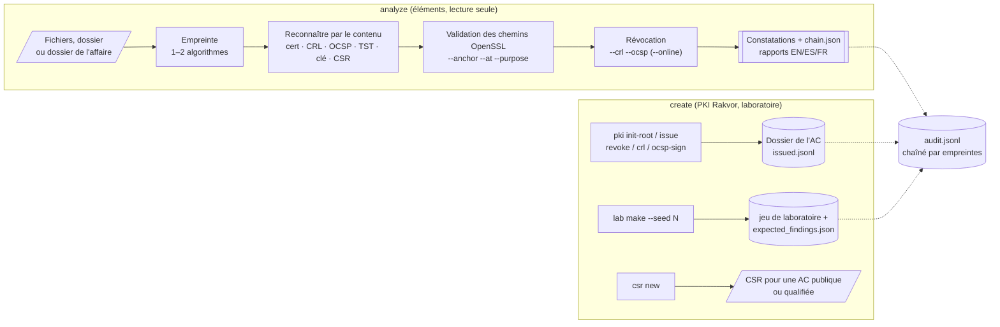
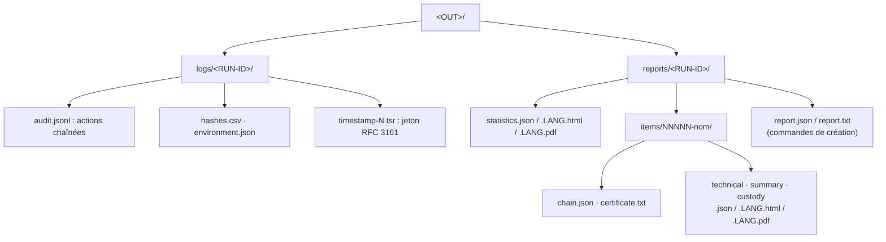

> La version de référence est la version anglaise ([README.md](README.md)) ; cette traduction la suit.

<p align="center"></p>

# RV CertCheck

[English](README.md) · [Español](README.es.md) · **Français**

<!-- forge:description -->
**Analyseur et créateur de certificats.** Valide les certificats X.509 et leurs chaînes, la révocation, les horodatages et les listes de confiance, et crée la PKI propre de Rakvor, des jeux de certificats de laboratoire et des CSR.
<!-- /forge:description -->

[](https://github.com/Panacota96/rv-certcheck/actions/workflows/ci.yml)


RV CertCheck a deux moitiés qui partagent un moteur, une piste d'audit et un dossier de l'affaire :

- **Analyser** (`rv-certcheck analyze`) : prend les certificats, paquets PEM, PKCS#7, PKCS#12, CRL, réponses OCSP,
  jetons d'horodatage RFC 3161, clés privées et CSR trouvés parmi les éléments de preuve. Il reconnaît chacun par son
  contenu, construit et vérifie chaque chaîne avec OpenSSL 3 à la date et pour l'usage que vous choisissez, par
  rapport aux ancres que vous choisissez, et indique ce que chaque résultat **montre** et ce qu'il **ne prouve pas**.
- **Créer** (`pki`, `csr`, `lab`, `keys`, `tokens`, `trust-list`) : la PKI interne de Rakvor (racine hors ligne sur un
  jeton PKCS#11, intermédiaire, signature de code, `.p12` de l'expert, TSA de test, TLS interne), des CSR pour des AC
  publiques ou qualifiées, des jeux de certificats de laboratoire reproductibles et des instantanés datés des listes
  de confiance de l'UE et de la Colombie.



## Ce qu'il fait, et ce qu'il ne fait pas

| Il fait | Il ne fait pas |
| --- | --- |
| Analyse chaque champ du certificat (sujet, émetteur, numéro de série, validité, SAN, clé et taille, algorithme de signature, extensions, OID de politique) et écrit un vidage au format OpenSSL (`certificate.txt`) | Dire qu'un certificat, une signature ou un document est authentique ou faux : chaque résultat est une observation pour l'expert |
| Construit et vérifie chaque chaîne avec le vérificateur d'OpenSSL et indique le code OpenSSL à **chaque profondeur** (`chain.json`) | Décider quelles racines méritent la confiance : c'est le choix de `--anchor` par l'expert, consigné dans chaque rapport |
| Évalue la chaîne à un instant choisi (`--at`) pour un usage choisi (`--purpose`) | Lire l'heure de signature d'un objet signé en v0.1 : `--at signing-time` utilise genTime pour les jetons d'horodatage seulement ; les autres éléments reviennent à *maintenant* (c'est dit dans l'état de la chaîne et dans le rapport) |
| Vérifie la révocation avec les CRL et réponses OCSP fournies ou trouvées parmi les éléments ; ne les télécharge qu'avec `--online` (chaque URL auditée) | Voir une révocation qui ne lui a pas été fournie : hors ligne, la révocation est aussi complète que les fichiers fournis |
| Vérifie les jetons RFC 3161 (signature CMS, ESS signing-certificate, chaîne de la TSA à genTime) | Comparer l'empreinte du message d'un jeton avec un élément pendant `analyze` (v0.1) |
| Rapproche en mémoire des clés privées et des certificats | Copier, journaliser ou rapporter une clé privée, un mot de passe ou un PIN |
| Importe les listes de confiance de l'UE (XML ETSI TS 119 612) et le CSV colombien organisé comme instantanés datés et hachés | Vérifier la signature XAdES de la liste de confiance elle-même (v0.2) |
| Crée les certificats internes de Rakvor, marqués **usage interne uniquement** | Émettre une *firma digital* (Ley 527 de 1999 art. 28) ou un certificat qualifié (eIDAS) |
| Valider PAdES, XAdES, S/MIME, Authenticode, OpenPGP, JWS ou des serveurs TLS en direct | Prévus pour la v0.2 ([CHANGELOG](CHANGELOG.md)) |

## Installation

**Windows 10/11** : téléchargez depuis la page [Releases](https://github.com/Panacota96/rv-certcheck/releases) :

- `rv-certcheck-<version>-windows-x64-setup.exe` : programme d'installation par utilisateur (raccourci dans le menu Démarrer, CLI facultative dans le PATH), ou
- `rv-certcheck-<version>-windows-x64.zip` : portable, à décompresser et lancer, rien n'est installé.

Vérifiez d'abord le téléchargement (SHA256SUMS, provenance, Authenticode par rapport à la racine Rakvor) : voir
[docs/installation.fr.md](docs/installation.fr.md). Depuis les sources (Rust 1.85+, OpenSSL embarqué : Perl est
nécessaire sous Windows) : `cargo build --release --locked`.

## Démarrage rapide : analyser

```powershell
# Vérifiez la version : chaque algorithme d'empreinte avec des vecteurs de test publiés
rv-certcheck self-test

# Un certificat par rapport à une racine que vous avez choisi d'approuver, évalué aujourd'hui, tout usage
rv-certcheck analyze -i D:\evidence\signer.cer --anchor D:\roots\ca-root.pem

# Un dossier de certificats, CRL et jetons, évalués à la date de signature, pour la signature de documents,
# avec la CRL de l'AC et une réponse OCSP fournies hors ligne, rapports en espagnol
rv-certcheck analyze -i D:\evidence -r --anchor D:\roots\ca-root.pem --at 2025-03-14 `
  --purpose document-signing --crl D:\rev\ca.crl --ocsp D:\rev\signer.ocsp --lang es --case CASE-2026-014

# Par rapport à un instantané de liste de confiance de l'UE importé auparavant
rv-certcheck trust-list import --list eu D:\tl\FR-TL.xml
rv-certcheck analyze -i D:\evidence --anchor tl:eu@latest

# Dans un dossier de l'affaire (éléments enregistrés à l'entrée par rv-hashinv), puis vérifier toute l'affaire
rv-certcheck analyze --case-dir E:\CASE-014 --anchor D:\roots\ca-root.pem
rv-certcheck verify-case E:\CASE-014

# Plus tard : montrer que le journal de l'exécution n'a pas été modifié (vérifie aussi la signature de la TSA de son horodatage ;
# ajoutez --tsa-ca <racines de la TSA.pem> pour valider la chaîne du certificat de la TSA)
rv-certcheck verify-log rakvor-out\logs\<RUN-ID>
```

Les tâches courantes, étape par étape : [docs/quick-guide.fr.md](docs/quick-guide.fr.md).
L'exemple de laboratoire prêt à l'emploi et ce que chaque fichier doit signaler : [examples/](examples/README.md) (en anglais).

## Démarrage rapide : la PKI de l'entreprise

```powershell
# Jetons sur cette machine (module PIV de YubiKey)
rv-certcheck tokens list --pkcs11-module "C:\Program Files\Yubico\Yubico PIV Tool\bin\libykcs11.dll"

# Racine hors ligne sur le jeton (cérémonie des clés), puis un intermédiaire dont la clé est un fichier chiffré
rv-certcheck pki init-root --ca E:\rakvor-pki\root-2026 --ca-id rakvor-root-2026 `
  --subject "C=CO,O=Rakvor SAS,CN=Rakvor Root CA 2026" --key-type p-384 `
  --pkcs11-module "C:\Program Files\Yubico\Yubico PIV Tool\bin\libykcs11.dll" --token-serial <SERIAL> `
  --pin-env ROOT_PIN --confirm-root
rv-certcheck pki issue --ca E:\rakvor-pki\root-2026 --ca-pass-env ROOT_PIN --profile intermediate `
  --subject "C=CO,O=Rakvor SAS,CN=Rakvor Issuing CA 2026" --key-type p-384 --key-file E:\rakvor-pki\issuing.key.p8

# Vérifier un dossier d'AC (chaîne d'empreintes d'issued.jsonl et chaque fichier consigné)
rv-certcheck pki verify --ca E:\rakvor-pki\root-2026

# Un jeu de laboratoire reproductible pour la formation et les tests
rv-certcheck lab make --set full --seed 1 --lab-out D:\lab\full-1
```

La procédure complète (cérémonie des clés, intermédiaire, signature de code des versions, `.p12` de l'expert, TLS
interne, CSR, renouvellement et révocation) est dans [docs/company-pki.md](docs/company-pki.md) (en anglais). **Les
certificats émis par cette PKI sont réservés à l'usage interne de Rakvor** : ce ne sont ni une *firma digital* au sens
de la Ley 527 de 1999 art. 28, ni des certificats qualifiés au sens d'eIDAS. Les certificats clients (profil
`client-internal`) sont désactivés tant que la PC/DPC de Rakvor n'a pas été revue par un avocat.

## Sorties



| Code de sortie | Signification |
| :-: | --- |
| 0 | Terminé, aucune constatation de gravité élevée |
| 1 | Erreur d'exécution |
| 2 | Erreur d'utilisation (option ou valeur incorrecte) |
| 3 | Terminé avec des constatations de gravité élevée ; chaîne d'audit ou dossier d'AC rompu ; création refusée par une règle de sécurité |
| 130 | Annulé (rapports partiels écrits) |

## Découverte par RV Hub

RV Hub liste les outils Rakvor en demandant à chacun de se décrire : `<tool> describe --json`, schéma
`rakvor.describe/1` (outil, titre, version, rôle, verbe principal, entrées acceptées, formats d'affaire et de journal,
exécutables, codes de sortie). Le rôle de RV CertCheck est **analysis** (il vérifie les éléments par rapport au
registre de l'affaire écrit à l'entrée ; il n'enregistre jamais d'éléments) et son verbe principal est `analyze`.

> **Absent de cette version.** La sous-commande `describe` et `schemas/describe.schema.json` ne sont pas implémentées dans ce
> commit (`rv-certcheck describe` répond « unrecognized subcommand »), donc RV Hub ne peut pas encore découvrir l'outil
> automatiquement. En attendant, enregistrez-le à la main dans RV Hub avec les valeurs ci-dessus.

## Documentation

| Page | Pour |
| --- | --- |
| [docs/quick-guide.fr.md](docs/quick-guide.fr.md) | Les six tâches courantes (analyze, dossier de l'affaire, verify-log, verify-case, timestamp, lab make), chaque bouton de la GUI, codes de sortie |
| [docs/usage.fr.md](docs/usage.fr.md) | Parcours : analyse d'éléments de type certificat, lecture de chaque sortie, exécutions de création, dépannage |
| [docs/theory.md](docs/theory.md) | Partie en langage courant (certificats, chaînes, révocation, horodatages) et partie experte (validation des chemins RFC 5280 telle qu'OpenSSL l'implémente, règles de fraîcheur, RFC 3161, seuils, listes de confiance, création de la PKI) (en anglais) |
| [docs/admissibility.md](docs/admissibility.md) | Exigences de la Colombie, de la France/UE, de l'ISO/CEI et des États-Unis/Royaume-Uni rapprochées de l'outil, limites, liste des écarts, liste de contrôle de l'expert (projet en attente de revue juridique ; en anglais) |
| [docs/reports.md](docs/reports.md) | Chaque code de constatation : gravité, ce qu'il montre, ce qu'il ne prouve pas ; fichiers et schémas des rapports (en anglais) |
| [docs/company-pki.md](docs/company-pki.md) | Les certificats propres de Rakvor étape par étape (usage interne uniquement ; en anglais) |
| [docs/installation.fr.md](docs/installation.fr.md) | Installer et vérifier une version, modules PKCS#11, compiler depuis les sources |
| [docs/usage-cli.md](docs/usage-cli.md) | Chaque commande et option (généré à partir de `--help` ; en anglais) |
| [docs/usage-gui.fr.md](docs/usage-gui.fr.md) | L'application de bureau |
| [docs/architecture.md](docs/architecture.md) | Crates, flux de données, place d'OpenSSL (en anglais) |
| [docs/forensic-audit.md](docs/forensic-audit.md) | Piste d'audit, `issued.jsonl` du dossier de l'AC, traitement des preuves, correspondance ISO/IEC 27037 (en anglais) |
| [docs/case-folder.md](docs/case-folder.md) | Dossier partagé de l'affaire : registre, journal de l'affaire, rôle d'analyse, `verify-case` (en anglais) |
| [docs/development.md](docs/development.md) | Compilation, tests, CI/CD et publication (en anglais) |
| [docs/adr/](docs/adr/0001-language.md) | Décisions d'architecture (langage ; en anglais) |

Le README, le guide rapide, le guide d'utilisation, le guide de l'application de bureau et le guide d'installation
existent aussi en espagnol (`.es.md`) et en français (`.fr.md`) ; les pages en anglais font référence.

## Organisation du projet

```text
rv-certcheck/
├── src/
│   ├── certs/     couche certificats : analyse (OpenSSL 3 via le crate openssl), listes de confiance, création (PKI, CSR, laboratoire, PKCS#11)
│   ├── core/      moteur : entrée, empreintes, journal d'audit, dossier de l'affaire, liaison avec les certificats (certscan.rs), rapports
│   ├── cli/       ligne de commande rv-certcheck (clap)
│   └── gui/       application de bureau rv-certcheck-gui (egui)
├── i18n/          libellés des constatations et des rapports : en.json, es.json, fr.json
├── schemas/       schémas JSON (rapports, dossier de l'affaire, ligne de la liste de confiance colombienne)
├── templates/     modèles HTML des rapports
├── tests/         oracles indépendants (fixtures de la CLI OpenSSL, Python cryptography), affaire de référence, vérificateurs
├── scripts/       contrôles de la documentation (les traductions gardent la forme des pages anglaises)
├── examples/      exemple de laboratoire fait avec la CLI OpenSSL + constatations et empreintes attendues
└── packaging/     programme d'installation Windows, racine de signature de code Rakvor
```

## Contribuer, sécurité, licence

- Comment contribuer : [CONTRIBUTING.md](CONTRIBUTING.md) · Modifications : [CHANGELOG.md](CHANGELOG.md)
- Signaler une vulnérabilité en privé : [SECURITY.md](SECURITY.md)
- Licence : voir [Licence](#licence). Mentions de tiers : [NOTICE](NOTICE).

## Licence

Code source disponible, usage non commercial : [PolyForm Noncommercial 1.0.0](LICENSE). Chacun peut utiliser, étudier,
modifier et partager RV CertCheck à des fins non commerciales. La mention est obligatoire dans tout usage : « RV
CertCheck by Rakvor », en conservant la ligne `Required Notice:` de [LICENSE](LICENSE). L'usage commercial (le vendre,
des services payants, l'utiliser dans le travail rémunéré d'une entreprise à but lucratif) exige une licence écrite de
Rakvor : voir [COMMERCIAL.md](COMMERCIAL.md). Rakvor conserve tous les droits commerciaux en tant que titulaire du droit
d'auteur. Les textes de licence de Rakvor ([COMMERCIAL.md](COMMERCIAL.md), [NOTICE](NOTICE), cette section) sont des
projets, à faire vérifier par un avocat (*to be verified* ; Colombie, France), et ne constituent pas un avis
juridique. Les composants tiers conservent leurs propres licences : [NOTICE](NOTICE).
