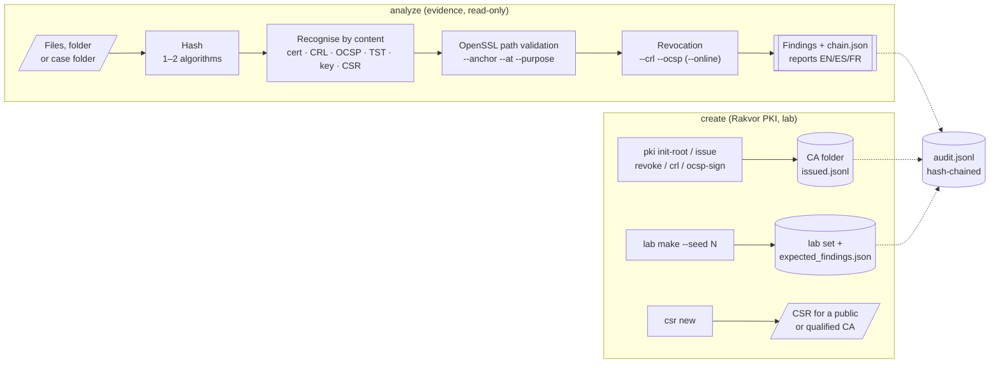
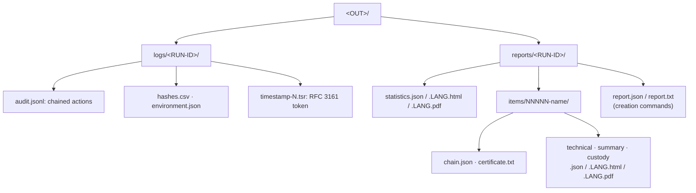

<p align="center"></p>

# RV CertCheck

<!-- forge:description -->
**Certificate analyzer and creator.** Validates X.509 certificates and chains, revocation, timestamps and trust lists, and creates Rakvor's own PKI, lab certificate sets and CSRs.
<!-- /forge:description -->

[](https://github.com/Panacota96/rv-certcheck/actions/workflows/ci.yml)


RV CertCheck has two halves that share one engine, one audit trail and one case folder:

- **Analyze** (`rv-certcheck analyze`): takes certificates, PEM bundles, PKCS#7, PKCS#12, CRLs, OCSP responses,
  RFC 3161 timestamp tokens, private keys and CSRs found among the evidence. It recognises each one by its content,
  builds and checks every chain with OpenSSL 3 at the date and for the purpose you choose, against the anchors you
  choose, and reports what each result **shows** and what it **does not prove**.
- **Create** (`pki`, `csr`, `lab`, `keys`, `tokens`, `trust-list`): Rakvor's internal PKI (offline root on a
  PKCS#11 token, intermediate, code-signing, examiner `.p12`, test TSA, internal TLS), CSRs for public or qualified
  CAs, reproducible lab certificate sets, and dated snapshots of the EU and Colombian trust lists.



## What it does, and what it does not do

| It does | It does not |
| --- | --- |
| Parse every certificate field (subject, issuer, serial, validity, SANs, key and size, signature algorithm, extensions, policy OIDs) and write an OpenSSL-style dump (`certificate.txt`) | Say that a certificate, a signature or a document is genuine or false: every result is an observation for the examiner |
| Build and verify each chain with OpenSSL's verifier and report the OpenSSL code at **every depth** (`chain.json`) | Decide which roots deserve trust: that is the examiner's choice of `--anchor`, recorded in every report |
| Judge the chain at a chosen instant (`--at`) for a chosen purpose (`--purpose`) | Read the signing time out of a signed object in v0.1: `--at signing-time` falls back to *now* (stated in the verdict) |
| Check revocation from CRLs and OCSP responses supplied or found among the evidence; fetch them only with `--online` (every URL audited) | See a revocation it was not given: offline, revocation is as complete as the files supplied |
| Verify RFC 3161 tokens (CMS signature, ESS signing-certificate, TSA chain at genTime) | Compare a token's message imprint with an evidence file during `analyze` (v0.1) |
| Match private keys to certificates in memory | Copy, log or report a private key, a password or a PIN |
| Import EU trust lists (ETSI TS 119 612 XML) and the curated Colombian CSV as dated, hashed snapshots | Verify the trust list's own XAdES signature (v0.2) |
| Create Rakvor's internal certificates, marked **internal use only** | Issue a *firma digital* (Ley 527 de 1999 art. 28) or a qualified certificate (eIDAS) |
| Validate PAdES, XAdES, S/MIME, Authenticode, OpenPGP, JWS or live TLS endpoints | — these are planned for v0.2 ([CHANGELOG](CHANGELOG.md)) |

## Install

**Windows 10/11**: download from the [Releases](https://github.com/Panacota96/rv-certcheck/releases) page:

- `rv-certcheck-<version>-windows-x64-setup.exe`: per-user installer (Start-menu shortcut, optional CLI on PATH), or
- `rv-certcheck-<version>-windows-x64.zip`: portable; unzip and run, nothing is installed.

Check the download first (SHA256SUMS, provenance, Authenticode against the Rakvor root): see
[docs/installation.md](docs/installation.md). From source (Rust 1.85+, vendored OpenSSL: Perl is needed on
Windows): `cargo build --release --locked`.

## Quick start: analyze

```powershell
# Check the build: every hash algorithm against published test vectors
rv-certcheck self-test

# One certificate against a root you chose to trust, judged today, any purpose
rv-certcheck analyze -i D:\evidence\signer.cer --anchor D:\roots\ca-root.pem

# A folder of certificates, CRLs and tokens, judged at the signing date, for document signing,
# with the CA's CRL and an OCSP response supplied offline, Spanish reports
rv-certcheck analyze -i D:\evidence -r --anchor D:\roots\ca-root.pem --at 2025-03-14 `
  --purpose document-signing --crl D:\rev\ca.crl --ocsp D:\rev\signer.ocsp --lang es --case CASE-2026-014

# Against an EU trust-list snapshot imported earlier
rv-certcheck trust-list import --list eu D:\tl\FR-TL.xml
rv-certcheck analyze -i D:\evidence --anchor tl:eu@latest

# In a case folder (evidence registered at intake by rv-hashinv), then check the whole case
rv-certcheck analyze --case-dir E:\CASE-014 --anchor D:\roots\ca-root.pem
rv-certcheck verify-case E:\CASE-014

# Later: show that the run's log was not altered
rv-certcheck verify-log rakvor-out\logs\<RUN-ID>
```

The ready-made lab sample and what each file must report: [examples/](examples/README.md).

## Quick start: the company PKI

```powershell
# Tokens on this machine (YubiKey PIV module)
rv-certcheck tokens list --pkcs11-module "C:\Program Files\Yubico\Yubico PIV Tool\bin\libykcs11.dll"

# Offline root on the token (key ceremony), then an intermediate whose key is an encrypted file
rv-certcheck pki init-root --ca E:\rakvor-pki\root-2026 --ca-id rakvor-root-2026 `
  --subject "C=CO,O=Rakvor SAS,CN=Rakvor Root CA 2026" --key-type p-384 `
  --pkcs11-module "C:\Program Files\Yubico\Yubico PIV Tool\bin\libykcs11.dll" --token-serial <SERIAL> `
  --pin-env ROOT_PIN --confirm-root
rv-certcheck pki issue --ca E:\rakvor-pki\root-2026 --ca-pass-env ROOT_PIN --profile intermediate `
  --subject "C=CO,O=Rakvor SAS,CN=Rakvor Issuing CA 2026" --key-type p-384 --key-file E:\rakvor-pki\issuing.key.p8

# Check a CA folder (issued.jsonl hash chain and every recorded file)
rv-certcheck pki verify --ca E:\rakvor-pki\root-2026

# A reproducible lab set for training and tests
rv-certcheck lab make --set full --seed 1 --lab-out D:\lab\full-1
```

The full procedure (key ceremony, intermediate, release code signing, examiner `.p12`, internal TLS, CSRs, renewal
and revocation) is [docs/company-pki.md](docs/company-pki.md). **Certificates issued by this PKI are for Rakvor's
internal use only**: they are not a *firma digital* under Ley 527 de 1999 art. 28 and not qualified certificates
under eIDAS. Client certificates (profile `client-internal`) are disabled until Rakvor's CP/CPS has been reviewed
by counsel.

## Outputs



| Exit code | Meaning |
| :-: | --- |
| 0 | Completed, no high-severity finding |
| 1 | Runtime error |
| 2 | Usage error (bad option or value) |
| 3 | Completed with high-severity findings; broken audit chain or CA folder; creation refused by a safety rule |
| 130 | Cancelled (partial reports written) |

## RV Hub discovery

RV Hub lists the Rakvor tools by asking each one to describe itself: `<tool> describe --json`, schema
`rakvor.describe/1` (tool, title, version, role, main verb, accepted inputs, case and log formats, executables,
exit codes). RV CertCheck's role is **analysis** (it verifies items against the case registry written at intake;
it never registers evidence) and its main verb is `analyze`.

> **Not in this build.** The `describe` subcommand and `schemas/describe.schema.json` are not implemented in this
> commit (`rv-certcheck describe` answers "unrecognized subcommand"), so RV Hub cannot discover the tool
> automatically yet. Until it is added, register it in RV Hub by hand with the values above.

## Documentation

| Page | For |
| --- | --- |
| [docs/usage.md](docs/usage.md) | Walkthrough: analysing certificate evidence, reading every output, creation runs, troubleshooting |
| [docs/theory.md](docs/theory.md) | Plain-language part (certificates, chains, revocation, timestamps) and expert part (RFC 5280 path validation as OpenSSL implements it, freshness rules, RFC 3161, thresholds, trust lists, PKI creation) |
| [docs/admissibility.md](docs/admissibility.md) | Colombia, France/EU, ISO/IEC, US/UK requirements mapped to the tool, limits, gap list, examiner checklist (draft pending legal review) |
| [docs/reports.md](docs/reports.md) | Every finding code: severity, what it shows, what it does not prove; report files and schemas |
| [docs/company-pki.md](docs/company-pki.md) | Rakvor's own certificates step by step (internal use only) |
| [docs/installation.md](docs/installation.md) | Installing and verifying a release, PKCS#11 modules, building from source |
| [docs/usage-cli.md](docs/usage-cli.md) | Every command and option (generated from `--help`) |
| [docs/usage-gui.md](docs/usage-gui.md) | The desktop app |
| [docs/architecture.md](docs/architecture.md) | Crates, data flow, where OpenSSL sits |
| [docs/forensic-audit.md](docs/forensic-audit.md) | Audit trail, the CA folder's `issued.jsonl`, evidence handling, ISO/IEC 27037 mapping |
| [docs/case-folder.md](docs/case-folder.md) | Shared case folder: registry, case log, the analysis role, `verify-case` |
| [docs/development.md](docs/development.md) | Building, testing, CI/CD and releasing |
| [docs/adr/](docs/adr/0001-language.md) | Architecture decisions (language) |

## Project layout

```text
rv-certcheck/
├── src/
│   ├── certs/     certificate layer: analysis (OpenSSL 3 via the openssl crate), trust lists, creation (PKI, CSR, lab, PKCS#11)
│   ├── core/      engine: intake, hashing, audit log, case folder, certificate glue (certscan.rs), reports
│   ├── cli/       rv-certcheck command line (clap)
│   └── gui/       rv-certcheck-gui desktop app (egui)
├── i18n/          finding and report wording: en.json, es.json, fr.json
├── schemas/       JSON Schemas (reports, case folder, Colombian trust-list row)
├── templates/     HTML report templates
├── tests/         independent oracles (OpenSSL CLI fixtures, Python cryptography), golden case, verifiers
├── examples/      lab sample made with the OpenSSL CLI + expected findings and hashes
└── packaging/     Windows installer, Rakvor code-signing root
```

## Contributing, security, licence

- How to contribute: [CONTRIBUTING.md](CONTRIBUTING.md) · Changes: [CHANGELOG.md](CHANGELOG.md)
- Report a vulnerability privately: [SECURITY.md](SECURITY.md)
- Rakvor Source-Auditable Licence ([LICENSE](LICENSE), draft pending legal review): used locally by Rakvor;
  customers, courts and their experts may inspect and rebuild the source for audit; no redistribution.
  Third-party notices: [NOTICE](NOTICE).
