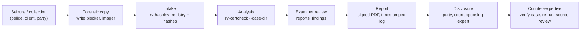
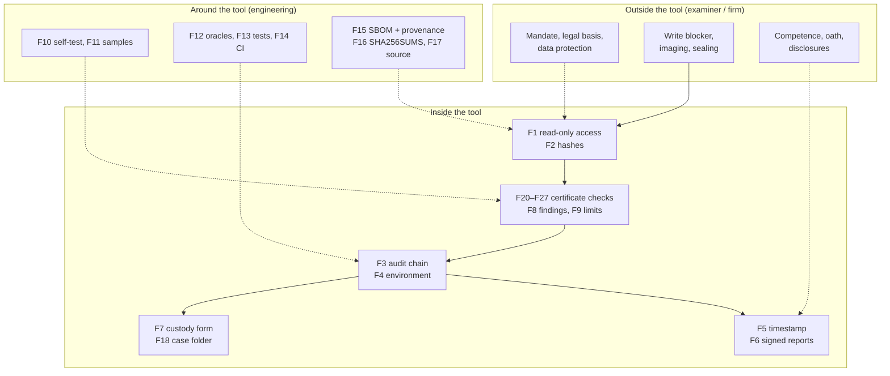
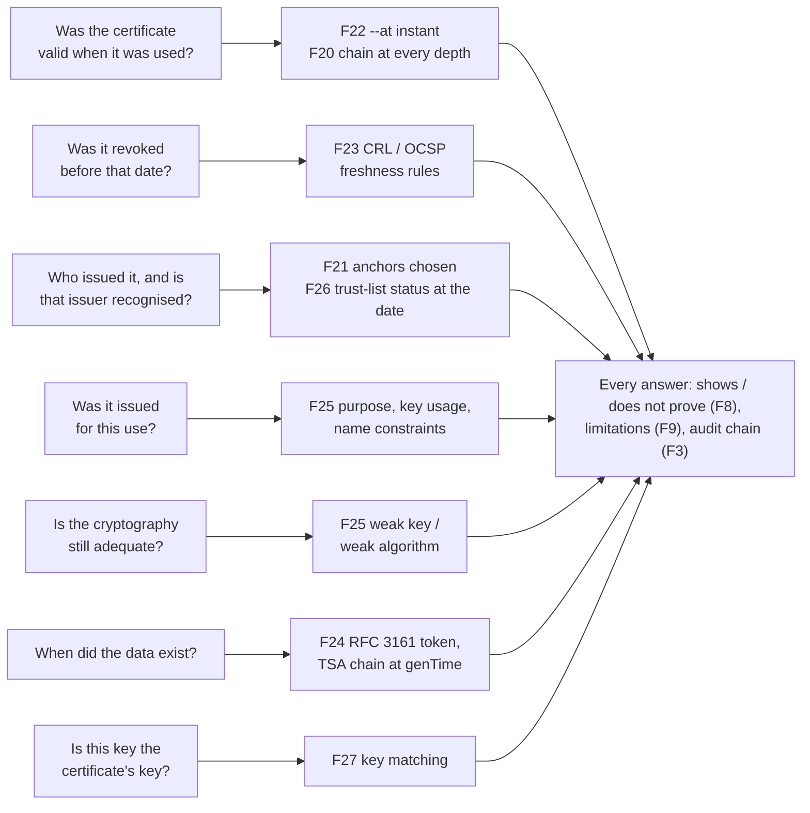

# Admissibility and reliability

> **Draft pending legal review. Not legal advice.** This page maps legal and technical requirements to what RV
> CertCheck actually does, so that a client, a lawyer or an opposing expert can see what the tool checks, how, with
> what limits, and under which legal frame. It was prepared from a sourced research note dated 2026-10-21 (pass 2:
> verification) and from the project's copy of Ley 527 de 1999, and **must be reviewed by counsel in each
> jurisdiction before it is relied on or quoted**. Status: draft for counsel review.

## Contents

- [1. Purpose and how to read this page](#1-purpose-and-how-to-read-this-page)
- [2. Evidence lifecycle and where each control sits](#2-evidence-lifecycle-and-where-each-control-sits)
- [3. The reliability argument](#3-the-reliability-argument)
- [4. Colombia](#4-colombia)
- [5. France and the European Union](#5-france-and-the-european-union)
- [6. International standards](#6-international-standards)
- [7. United States and United Kingdom](#7-united-states-and-united-kingdom)
- [8. Certificate evidence: requirement-to-feature map](#8-certificate-evidence-requirement-to-feature-map)
- [Limitations stated in every report](#limitations-stated-in-every-report)
- [Consolidated gap list](#consolidated-gap-list)
- [Examiner checklist before filing a report](#examiner-checklist-before-filing-a-report)
- [Sources](#sources)

## 1. Purpose and how to read this page

RV CertCheck is used **locally** by Rakvor; it is not distributed. Clients, courts and opposing experts may audit it
and rebuild it from source under the Rakvor Source-Auditable Licence ([LICENSE](../LICENSE), draft pending legal
review). Its results are **observations for an examiner, never a verdict**
([theory.md](theory.md#a1-what-the-tool-is-and-is-not)). Admissibility and weight are decided by a court about the
**examiner's evidence**, of which the tool's output is one part. Status values used below:

| Status | Meaning |
| --- | --- |
| **met** | A tool feature satisfies or directly supports the requirement (the file or command is named) |
| **partial** | Supported, with a named shortfall |
| **examiner** | An obligation of the examiner or of Rakvor as a firm, not a tool feature |
| **gap** | Not met today; listed in the [consolidated gap list](#consolidated-gap-list) with a mitigation and an owner |
| **context** | Background that frames the other rows |

**Verification marks** (kept from the research note; never upgraded here):

| Mark | Meaning |
| --- | --- |
| **[V]** | Article or clause number and substance checked against the primary text (project document, official gazette or faithful mirror). Quoted fragments are verbatim. |
| **[S]** | Checked against a secondary source (Conseil constitutionnel dossier, law-firm note, Rama Judicial cartilla). The number is reliable; check the wording before quoting. |
| [to verify] | Marked UNVERIFIED in the research, or added while writing this page from general professional knowledge without a primary text at hand. **Do not cite before a lawyer or engineer has checked it against the primary source.** |

Research limits that still apply (pass 2 of the research note): the Colombian project PDFs `Ley_906_de_2004.pdf`,
`Ley_1564_de_2012.pdf` and `manualcadena2.pdf` were verified against official web copies, not the project files —
**re-check quoted fragments against the project PDFs before publishing**; Ley 527 de 1999 arts. 2, 28–30, 35–37 and 43
were re-read for this page from the project file `Ley_527_de_1999.pdf` (Función Pública EVA copy; the claude.ai
Project tools were not available in this session, so the local upload copy was used); the ISO/IEC 27037 copy was the free
preview (table of contents and clauses 1–4), and the clause text of 27037 §5–7, 27041 and 27042 is paywalled;
Légifrance refused automated access (CPP, Code civil and décret 2017-1416 read from the Pappers LEGI mirror). Still
[to verify]: Daubert/Kumho citations; CPP art. 427, Code civil art. 1358 and CPC arts. 16, 233, 237, 238,
276; loi Informatique et Libertés art. 46 and Directive 2016/680 applicability; NIST FIPS 180-4/202; Decreto
2364/2012, RNBD thresholds, CSJ penal 29.877 holding, C-604/16 and the CGP art. 226 look-back periods; the ANSSI
PRIS content.

### Tool features referred to in the tables

| Key | Feature | Where it is implemented (file / command) |
| --- | --- | --- |
| F1 | Read-only evidence access (software level): one streamed hashing read per file, then a second read-only read (≤ 16 MiB) for parsing, re-hashed and compared with the first (`EVIDENCE_CHANGED_DURING_READ`) | `File::open` in [src/core/src/run.rs](../src/core/src/run.rs) and [src/core/src/certscan.rs](../src/core/src/certscan.rs); `mtime_unchanged` in `item_hashed`; symbolic links never followed ([src/core/src/input.rs](../src/core/src/input.rs)) |
| F2 | Hashing with 1 or 2 algorithms (md5, sha1, sha256, sha512, sha3-256, blake3) in one read | [src/core/src/hash.rs](../src/core/src/hash.rs); `analyze --hash`; `logs/<RUN-ID>/hashes.csv` |
| F3 | SHA-256 hash-chained audit log + independent verifier | [src/core/src/audit.rs](../src/core/src/audit.rs); `rv-certcheck verify-log`; [tests/verify_chain.py](../tests/verify_chain.py) |
| F4 | `environment.json`: tool, compiler and dependency versions, OS, host, user, command line | [src/core/src/env.rs](../src/core/src/env.rs), [src/core/build.rs](../src/core/build.rs) |
| F5 | RFC 3161 timestamp of the audit chain head | [src/core/src/trust.rs](../src/core/src/trust.rs); `--tsa-url`, `--no-timestamp`, `rv-certcheck timestamp` |
| F6 | PDF reports signed with the examiner's own certificate (CMS, `adbe.pkcs7.detached`) | `--sign-cert`; `PdfSigner` in [src/core/src/trust.rs](../src/core/src/trust.rs); [src/core/src/report/pdf.rs](../src/core/src/report/pdf.rs) |
| F7 | Per-item chain-of-custody form: Colombia (Fiscalía style) or France (scellés), plus English | `--jurisdiction co` or `fr`; `custody.json/.html/.pdf`; [templates/custody.html](../templates/custody.html); [schemas/item-custody.schema.json](../schemas/item-custody.schema.json) |
| F8 | Findings state what they show **and** what they do not prove; observations only | [i18n/en.json](../i18n/en.json) (`findings`), es/fr; [src/core/src/analyzer.rs](../src/core/src/analyzer.rs) |
| F9 | Declared limitations, printed in every report | `LIMITATIONS` in [src/core/src/report/mod.rs](../src/core/src/report/mod.rs); [i18n/en.json](../i18n/en.json) (`limitations`) |
| F10 | Known-answer self-test (hash algorithms only) | `rv-certcheck self-test` |
| F11 | Synthetic sample evidence with expected results | [examples/sample/](../examples/README.md): 13 lab files made with the OpenSSL CLI, `expected_findings.json` (checked by a test), `expected_hashes.csv` (Python `hashlib`/`blake3`) |
| F12 | Test oracles (independent implementations) | Certificate verdicts: the OpenSSL command line on fixtures it made itself, and Python `cryptography`'s path validator (F28); [tests/verify_chain.py](../tests/verify_chain.py) re-checks the chain and re-hashes the evidence with Python (in CI); [tests/validate_reports.py](../tests/validate_reports.py) JSON Schemas (in CI); pyHanko's validator on every signed PDF ([tests/validate_pdf_signature.py](../tests/validate_pdf_signature.py), in CI); OpenSSL for timestamps (manual); the Python profile of this tool: a committed case folder it wrote is verified in CI ([tests/golden/](../tests/golden/regenerate.py)), and the live cross-profile test (case folders and item numbering) runs with `RV_CROSS_PROJECT` |
| F13 | Robustness tests | cancel, unreadable input, missing input, three algorithms, edited/deleted/re-ordered log, tampered case log and registry, lock contention ([src/core/src/run.rs](../src/core/src/run.rs), [src/core/src/case.rs](../src/core/src/case.rs), [src/cli/tests/cli.rs](../src/cli/tests/cli.rs)); no fuzzing |
| F14 | CI on Windows and Linux | [.github/workflows/ci.yml](../.github/workflows/ci.yml) |
| F15 | SBOM and build provenance | [.github/workflows/release.yml](../.github/workflows/release.yml) (CycloneDX, `actions/attest-build-provenance`) |
| F16 | Versioned releases with `SHA256SUMS`; pinned toolchain | [.github/workflows/release.yml](../.github/workflows/release.yml); [rust-toolchain.toml](../rust-toolchain.toml); [installation.md](installation.md#2-verify-the-download) |
| F17 | Source auditable by customers and opposing experts; local use only, no redistribution | [LICENSE](../LICENSE) (Rakvor Source-Auditable Licence, draft pending legal review); [NOTICE](../NOTICE) |
| F18 | Shared case folder: evidence registry, hash-chained case log, cross-linked run chains, `verify-case` | [src/core/src/case.rs](../src/core/src/case.rs); `--case-dir`, `--evidence`, `rv-certcheck verify-case`; [case-folder.md](case-folder.md) |

<!-- forge:domain -->
Certificate features of this tool ([theory.md Part B](theory.md#part-b--for-examiners-and-opposing-experts)):

| Key | Feature | Where it is implemented (file / command) |
| --- | --- | --- |
| F19 | Recognition of cryptographic objects by content (certificate, bundle, PKCS#7, PKCS#12, CRL, OCSP, RFC 3161 token, private key, CSR) and full field extraction; OpenSSL-style dump | [sniff.rs](../src/certs/src/analysis/sniff.rs), [parse.rs](../src/certs/src/analysis/parse.rs); `certificate.txt` |
| F20 | RFC 5280 path validation by OpenSSL 3, with the OpenSSL code at every depth and every error collected | [chain.rs](../src/certs/src/analysis/chain.rs); `chain.json`; [theory.md B4–B5](theory.md#b4-rfc-5280-path-validation-as-openssl-implements-it) |
| F21 | Trust anchors chosen explicitly and recorded with their SHA-256 (`--anchor FILE`, `rakvor`, `system`, `tl:eu@ID`, `tl:co@ID`) | [anchors.rs](../src/certs/src/analysis/anchors.rs); audit entry `validation_options` |
| F22 | Validation at a chosen instant (`--at`), recorded in every verdict | [chain.rs](../src/certs/src/analysis/chain.rs); [theory.md B6](theory.md#b6-the-validation-instant---at) |
| F23 | Revocation from CRL and OCSP with stated freshness rules; offline by default; `--online` fetches audited | [revocation.rs](../src/certs/src/analysis/revocation.rs), [online.rs](../src/certs/src/analysis/online.rs); audit `revocation_fetched` |
| F24 | RFC 3161 token verification (status, CMS signature, ESS signing-certificate, TSA chain at genTime) | [timestamp.rs](../src/certs/src/analysis/timestamp.rs) |
| F25 | Purpose checks (OpenSSL purposes + the tool's document-signing rule), weak-key and weak-algorithm policy, name constraints | [chain.rs](../src/certs/src/analysis/chain.rs), [parse.rs](../src/certs/src/analysis/parse.rs) |
| F26 | Trust-list snapshots: EU (ETSI TS 119 612) and curated Colombian CSV, dated and hashed; service status at the date | [trustlist/](../src/certs/src/trustlist/mod.rs); `trust-list import/list/show` |
| F27 | Private-key matching in memory; keys, passwords and PINs never logged | [keymatch.rs](../src/certs/src/analysis/keymatch.rs), [certscan.rs](../src/core/src/certscan.rs) |
| F28 | Certificate oracles: OpenSSL CLI fixtures, Python `cryptography`, seeded lab set, sample `expected_findings.json` | [theory.md B18](theory.md#b18-oracles-and-validation-status) |
| F29 | Rakvor internal PKI with hash-chained `issued.jsonl`, encrypted keys or PKCS#11 tokens, internal-use policy in every certificate | `pki`, `csr`; [create/](../src/certs/src/create/mod.rs); [company-pki.md](company-pki.md) |
| F30 | Detection of Rakvor internal certificates (`CERT_ISSUED_BY_RAKVOR_INTERNAL`) | [parse.rs](../src/certs/src/analysis/parse.rs), [chain.rs](../src/certs/src/analysis/chain.rs) |
<!-- /forge:domain -->

## 2. Evidence lifecycle and where each control sits

## 3. The reliability argument

Courts in all four traditions ask, in different words, whether the method is **reliable** and whether it was
**reliably applied** in this case. Colombia's Ley 906 art. 422 lists Daubert-like criteria ([V]); France leaves
evidence free but weighs it; ISO/IEC 27041 ([to verify]) asks for validation before use and verification by
each user, and ISO/IEC 17025 §7.2.2 [V] requires a validation record; the US FRE 702 (2023 amendment, [V]) and
Daubert/Kumho ([to verify]) give the vocabulary opposing experts use.

| Factor | What the tool offers (evidence an examiner can show) | Status |
| --- | --- | --- |
| **Testability** — can the method be tested? | Every verdict can be re-run with `openssl verify -attime -purpose -CRLfile` on the same files (F20, F28); deterministic lab sets with expected findings ([theory.md B16](theory.md#b16-lab-sets-and-determinism)); sample with expected findings and independently computed digests (F11); unit, integration and fuzz tests on Windows and Linux (F14) | met |
| **Known or potential error rate, and limits** | Path validation is OpenSSL's, compared with the OpenSSL CLI and with Python `cryptography` on synthetic fixtures (F28); every finding states what it does not prove (F8); limitations in every report (F9), including `NO_VALIDATED_ERROR_RATES_YET`. **No error rate measured on a validated corpus** of real-world certificates (G5) | partial |
| **Peer review / independent oracles** | Source auditable (F17); OpenSSL CLI and Python `cryptography` as independent verdict oracles (F28, in CI); Python re-implementation of the audit chain (F12); pyHanko validation of every signed PDF report (in CI). No publication or external review (G7) | partial |
| **Standards controlling the operation** | RFC 5280 (path validation, CRL), RFC 6960 (OCSP), RFC 3161 / 5816 (timestamps), ETSI TS 119 612 (trust lists), RFC 8018 / 7292 (key protection); FIPS 180-4/202, RFC 1321 for digests; RFC 5652 for signatures; ISO/IEC 27037 principles ([section 6.1](#61-isoiec-270372012--identification-collection-acquisition-and-preservation-of-digital-evidence)); release verification ([installation.md](installation.md)); examiner checklist (below). No enforced hash policy (G11); no formal SOP signed by the firm | partial |
| **General acceptance** | X.509 path validation with OpenSSL is the reference implementation used across the industry; verdicts agree with `openssl verify` (F28); digests agree with standard utilities and Python `hashlib` (F12) | met |
| **Validation for intended use** (ISO/IEC 17025 §7.2.2 [V]; 27041 — [to verify]) | Inputs exist (F10–F14) but there is **no per-release validation report** with plan, acceptance criteria, results and sign-off (G6) | gap |
| **Verification by the user** before casework (17025 §7.2.1 [V]; 27041 — [to verify]) | `self-test` + sample run with known expected summary ([installation.md](installation.md#6-first-run-self-test-and-sample)) | met |
| **Reliable application in this case** (FRE 702(d), 2023 — [V]) | Every step of the run in the audit chain (F3), environment pinned (F4), case-folder cross-links (F18), timestamp (F5), signed report (F6) | met |

## 4. Colombia

### 4.1 Ley 906 de 2004 (Código de Procedimiento Penal)

Context: adversarial criminal procedure; digital items are *elementos materiales probatorios / evidencia física*
(EMP/EF) and data messages are expressly included (art. 275 lit. g). *Autenticidad* rests on the chain of custody
(arts. 254–266, 277); expert evidence is tested orally (arts. 405–423); novel techniques must meet at least one of
four Daubert-like criteria (art. 422). Sources: Secretaría del Senado (arts. 202–286) and the Colpensiones
normograma mirror (arts. 366–453).

| # | Requirement | Source | How the tool meets it | Status |
| --- | --- | --- | --- | --- |
| CO-P1 | Data messages are EMP/EF and enter the chain-of-custody regime | Art. 275 lit. g [V] | F7 per-item custody form; F2 identity by hash; F18 evidence id per item | met |
| CO-P2 | Chain of custody evidences identity, original state, collection, preservation, packaging, sending, places and dates, changes by each custodian, everyone who had contact | Art. 254 [V]: "identidad, estado original, condiciones de recolección, preservación, embalaje y envío" | F2 (identity, state by hash); F3 (who, when, what); F18 (every tool run on the case in the case log); F7; physical packaging by the examiner | met (digital) / examiner (physical) |
| CO-P3 | Everyone who packs, labels, hands over or receives records full name, cédula and position on the form | Art. 264 [V] | F7 transfer rows ask for "name, ID, signature" (cédula fits "ID"); **no field for position (cargo)**; F4 records OS user and host | partial |
| CO-P4 | Recipient inspects the container and records its state; the perito records it on receipt | Arts. 263, 260 [V] | F7 column "Condition of packaging / media"; F2 at intake; analysis tools re-hash against the registry (F18) | met (digital) / examiner (seal) |
| CO-P5 | Each custodian prevents destruction, substitution, alteration, deterioration | Art. 261 [V]: "no pueda ser destruido, suplantado, alterado o deteriorado" | F1, F2, F3; F18 (`EVIDENCE_HASH_MISMATCH_WITH_CASE` in later tools) | met |
| CO-P6 | Police and peritos certify the item is the one collected and was always in custody | Art. 265 [V] | F6 signed report citing F2/F3/F7 | met (support) / examiner (signs) |
| CO-P7 | *Autenticidad* = detected, fixed, collected, packed technically and kept in custody; without it, the proponent must establish it | Art. 277 [V] | F3, F7, F2, F18 | met |
| CO-P8 | Evidence is legal only if collected per Constitution, treaties and law (data recovery: fiscal order + legality hearing) | Art. 276 [V]; arts. 236–237 [V] | None: mandate, consent, authorisation | examiner |
| CO-P9 | Lab report describes EMP, procedures, instruments and their state, scientific principles, interpretation | Art. 210 [V] | F4 (instruments, versions); F10 (instrument state); technical report "Method"; F8; F9; [theory.md](theory.md) for principles | met |
| CO-P10 | Field report describes "la forma, técnica e instrumentos utilizados" | Art. 209 [V] | F3, F4 | met |
| CO-P11 | Perito holds a recognised title or competence | Art. 408 [V] | None | examiner |
| CO-P12 | Party-retained report comes with a "certificación que acredite la idoneidad del perito" | Art. 413 [V] | None | examiner |
| CO-P13 | Summary report disclosed ≥ 5 days before the hearing; inadmissible if the perito does not testify | Art. 415 [V] | F6 produces the report | examiner |
| CO-P14 | Perito examined on instruments, principles, methods, and "corroboración … por otros expertos" | Art. 417 [V] | F4, F9, F12, F17; [theory.md](theory.md); validation dossier missing (G6) | partial |
| CO-P15 | Court weighs competence, acceptance of principles, instruments, consistency | Art. 420 [V] | F12, F16, F17, F28; X.509 validation with OpenSSL is generally accepted; error rates not measured on real material (G5) | partial |
| CO-P16 | Novel technique meets ≥ 1: verifiable; published and peer-reviewed; "se haya acreditado el nivel de confiabilidad"; academic acceptance | Art. 422 [V] | RFC 5280 path validation is not novel; verifiable: F20, F28, F11 (criterion 1 met); the tool's own rules (re-run walk, freshness, document-signing purpose) are published in [theory.md](theory.md) but not peer-reviewed (G7) | partial |
| CO-P17 | Peritos have access to the EMP referred to in reports (enables opposing review) | Art. 416 [V] | F17 auditable source; F11 samples; F16 exact release; F18 registry with every digest | met |
| CO-P18 | Data messages are documents; authenticated by certification of a digital-signature entity or "informe de experto" | Art. 424 #7, art. 426 [V] | F6 (expert report) with F2/F3 integrity evidence; F20–F26 examine the certificates of the *entidad certificadora* route (chain, revocation, accreditation list) | met (expert route) / partial (signed objects themselves in v0.2, G4) |
| CO-P19 | Documentary appraisal: "Que no haya sido alterado en su forma ni en su contenido" | Art. 432 #1 [V] | F2, F3, F18: no change **from intake onward**; earlier changes are outside this tool (F9) | met (from intake) |
| CO-P20 | Best evidence: the original is required where it is part of custody or a technical study | Arts. 433–434 parágrafo [V] | F1 preserves; hashed working copy | examiner (custody of the original) |
| CO-P21 | Defence and non-imputed persons may collect evidence and use private peritos | Arts. 267–268 [V] | F7 | context (Rakvor as defence expert) |
| CO-P22 | Remnants of analysed material kept identified in an evidence store | Art. 262 [V] | F18 registry (evidence ids, paths, digests); F3 keeps the records | met (records) / examiner (storage) |

### 4.2 Ley 1564 de 2012 (Código General del Proceso)

Context: civil, commercial, labour and family litigation. A *dictamen* must be "claro, preciso, exhaustivo y
detallado" with ten disclosures (art. 226), weighed by *sana crítica* (art. 232); data-message documents are
presumed *auténticos* (art. 244) and valued as such only in native or exact format (art. 247); a disowned document
needs its *autenticidad* established, possibly *de oficio* (art. 272).

| # | Requirement | Source | How the tool meets it | Status |
| --- | --- | --- | --- | --- |
| CO-C1 | Report clear, precise, exhaustive, detailed; explains exams, methods, experiments, technical bases | Art. 226 [V] | F6 technical review, F8, F9, F4; [theory.md](theory.md) | met (template) / examiner |
| CO-C2 | Expert declares under oath (by signing) that the opinion is "independiente y corresponde a su real convicción profesional"; attaches documents and proof of competence | Art. 226 [V] | F6 signature; no oath wording in the template | examiner |
| CO-C3 | Ten disclosures (#1–#10), incl. whether methods differ from prior reports (#8) and regular practice (#9) and "Relacionar y adjuntar los documentos e información utilizados" (#10) | Art. 226 #1–10 [V]; look-back periods of #4/#5 [to verify] | #8, #9: F4 and F16 pin the method version; #10: F3 log, `hashes.csv`, F18 intake registry | met (#8–10) / examiner (#1–7) |
| CO-C4 | Dictamen from an "institución o profesional especializado" | Art. 227 [V] | None | examiner |
| CO-C5 | Opposing party may summon the expert or file a competing dictamen; no attendance, no value | Art. 228 [V] | F11, F12, F16, F17 enable reproduction | met (support) |
| CO-C6 | Sana crítica on soundness, clarity, exhaustiveness, precision, foundations, competence | Art. 232 [V] | F8, F9; validation dossier missing (G6) | partial |
| CO-C7 | Objectivity and impartiality; no fees contingent on the outcome | Art. 235 [V]: "se prohíbe pactar cualquier remuneración que penda del resultado del litigio" | None | examiner (commercial terms) |
| CO-C8 | Data messages count only in native format or exact reproduction; a printout is an ordinary document | Art. 247 [V] | F1 native preserved; F2 shows exactness of copies | met / examiner (produce the natives) |
| CO-C9 | Data-message documents presumed *auténticos*; disowned ones need *autenticidad* established, possibly *de oficio* | Arts. 244, 272 [V] | F2, F3, F18 establish integrity from intake; F8 keeps findings non-conclusive | met (support) |
| CO-C10 | *Tacha de falsedad*: judge orders a *cotejo pericial* | Art. 270 [V] | F2 comparison of digests; analysis tools | met (support) |

### 4.3 Ley 527 de 1999 (data messages, e-commerce, digital signatures)

Context: Colombian implementation of the UNCITRAL Model Law; read in full from the project file. Art. 10 still
refers to the repealed Código de Procedimiento Civil, now the CGP.

| # | Requirement | Source | How the tool meets it | Status |
| --- | --- | --- | --- | --- |
| CO-L1 | Evidential effect not denied solely because information is a data message | Arts. 5, 10 [V] | None | context |
| CO-L2 | "Original" satisfied by a "garantía confiable de que se ha conservado la integridad de la información" since first generated in final form | Art. 8 lit. a [V] | F2 at intake; F3 continuity; F5 time anchor; F18 later re-verification | met from intake onward; integrity **before** intake cannot be proven by the tool (F9) |
| CO-L3 | Integrity = "completa e inalterada", except endorsements or changes inherent to communication, storage, display | Art. 9 [V] | F2: any change of one bit changes the digest. The tool cannot tell an inherent change (re-encoding by a transfer) from another; the examiner explains a mismatch | met (detection) / examiner (explanation) |
| CO-L4 | Weight by sana crítica: reliability of generation, archiving, communication, integrity, originator identification | Art. 11 [V] | Integrity: F2, F3, F5. Process: F4, F10–F12. Originator: not attributed | partial — the tool cannot attribute authorship |
| CO-L5 | Retention: accessible; original format or one that "reproduce con exactitud"; origin, destination, date, time kept | Art. 12 [V] | F1; F2; path, size and modification time recorded per item | met |
| CO-L6 | Retention through third parties under the same conditions | Art. 13 [V] | None | examiner (storage contracts) |
| CO-L7 | Signature requirement met by a method that identifies, shows approval, "tanto confiable como apropiado" | Art. 7 [V]; Decreto 2364 de 2012 [to verify] | F6 | met (electronic-signature level) |
| CO-L8 | **Firma digital** equals a handwritten one if unique, verifiable, under sole control, linked so changes invalidate it, and "conforme a las reglamentaciones adoptadas por el Gobierno Nacional" | Art. 28 parágrafo [V] | F6 uses the examiner's own certificate; unless issued by an authorised *entidad de certificación* (arts. 29–30), condition 5 and the presumption are doubtful | gap (G3) |
| CO-L9 | Trusted time-stamping (*estampado cronológico*) is a service of authorised certification entities | Art. 30 #5 [V]; art. 2 lit. d [V] | F5 uses an RFC 3161 TSA (default DigiCert); not a Colombian ECD | gap (G2) |
| CO-L10 | Foreign certificates recognised if a Colombian authorised entity vouches for them | Art. 43 [V] | F5, F6 with a French/EU certificate; F26 can show a foreign certificate's EU trust-list status, not a Colombian cross-recognition | gap unless cross-recognised |

**Digital signatures and certification entities (arts. 2, 28–30, 35–37; project text).** These articles frame both
halves of the tool: what an examiner must establish about a certificate found in evidence, and why the
certificates Rakvor creates have no statutory weight.

- **Art. 2 lit. c** defines a *firma digital* as a numeric value attached to a data message that, "utilizando un
  procedimiento matemático conocido, vinculado a la clave del iniciador y al texto del mensaje", allows one to
  determine that it was obtained exclusively with the originator's key and that the message was not modified
  afterwards [V]. **Lit. d** defines an *entidad de certificación* as one "autorizada conforme a la presente ley"
  to issue certificates on digital signatures and to offer "registro y estampado cronológico" [V].
- **Art. 28** presumes that the subscriber of a *firma digital* affixed to a data message intended to accredit it
  and to be bound by its content; its *parágrafo* gives it "la misma fuerza y efectos que el uso de una firma
  manuscrita" if it (1) is unique to the person using it, (2) "es susceptible de ser verificada", (3) is under that
  person's exclusive control, (4) is linked to the message so that a change invalidates it, and (5) "está conforme
  a las reglamentaciones adoptadas por el Gobierno Nacional" [V].
- **Art. 29** (as modified by art. 160 of Decreto 19 de 2012, per the project text) lets legal persons and chambers
  of commerce be *entidades de certificación* "que previa solicitud sean autorizadas por la Superintendencia de
  Industria y Comercio" and meet the Government's requirements [V]. **Which body authorises or accredits ECDs
  today** (the SIC in this text; accreditation by ONAC under later regulation, e.g. Decreto 333 de 2014 and
  Decreto 1074 de 2015) is **[to verify]**: counsel must confirm the current authority before a report relies on
  it.
- **Art. 30** (as modified by art. 161 of Decreto 19 de 2012) lists what authorised entities may do: issue
  certificates on the digital signatures of natural or legal persons (#1), certify non-alteration between sending
  and receipt (#2), offer creation of certified digital signatures (#4), "registro y estampado cronológico" (#5),
  and archiving (#6) [V].
- **Art. 35** requires a certificate issued by an authorised entity, besides being digitally signed by it, to
  contain at least: (1) name, address and domicile of the subscriber, (2) the subscriber's identification, (3) the
  entity's name, address and place of activity, (4) "la clave pública del usuario", (5) the method for verifying
  the subscriber's signature, (6) "el número de serie del certificado", (7) "fecha de emisión y expiración" [V].
- **Art. 36**: unless agreed otherwise, a subscriber has accepted a certificate when the entity, at the
  subscriber's request, has stored it in a repository [V].
- **Art. 37**: the subscriber may request revocation and must do so on loss of the private key or when it "ha sido
  expuesta o corre peligro de que se le dé un uso indebido"; the entity revokes on the subscriber's request, death,
  liquidation, confirmed false information, compromise of the entity's own key or security system, cessation of
  activities, or "por orden judicial o de entidad administrativa competente" [V].

| # | Requirement | Source | How the tool meets it | Status |
| --- | --- | --- | --- | --- |
| CO-L11 | Attribute 2: the signature "es susceptible de ser verificada" — the examiner must be able to verify the certificate behind it | Art. 28 parágrafo #2 [V] | F19, F20: the certificate and its chain are verified with OpenSSL at a stated instant (F22) against stated anchors (F21) | met (certificate level); the signature over the document itself: v0.2 (G4) |
| CO-L12 | Attribute 5 and art. 29: the certificate comes from an authorised / accredited ECD | Art. 28 #5, art. 29 [V]; current authority (SIC / ONAC) [to verify] | F26: `--anchor tl:co@ID` and `CERT_IN_TRUST_LIST` with the service status at the date, from Rakvor's curated CSV (source URL and check date per row) | partial — the CSV is curated by hand, not an official machine-readable list (G28) |
| CO-L13 | Attribute 3 (exclusive control) and art. 37 (revocation on loss or exposure of the key) | Art. 28 #3, art. 37 [V] | F23: revocation checked from CRLs/OCSP at the date, with reason and revocation date; the tool cannot establish who controlled the key | partial (revocation) / examiner (control) |
| CO-L14 | Certificate content: subscriber, issuer, public key, serial, issue and expiry dates | Art. 35 #1–7 [V] | F19: every field is extracted and printed (`certificate.txt`, `chain.json`); the tool does not judge whether the subject fields satisfy #1–#3 or #5 | met (extraction) / examiner (assessment) |
| CO-L15 | Acceptance by the subscriber (storage in a repository) | Art. 36 [V] | None: a repository's records are outside the certificate | examiner |
| CO-L16 | Estampado cronológico is a service of authorised entities | Art. 2 lit. d, art. 30 #5 [V] | F24 verifies RFC 3161 tokens found in evidence; F26 can show whether the TSA is listed (CSV `service_type` `TSA`) | partial |
| CO-L17 | Certificates Rakvor issues are not *firmas digitales* with the art. 28 presumption: Rakvor is not an authorised entity | Arts. 2 lit. d, 28 #5, 29, 30 [V] | F29 writes the Rakvor internal policy and the statement "Not a firma digital under Ley 527 de 1999 art. 28" into every certificate; F30 reports it on analysis; `client-internal` profile refused until the CP/CPS is reviewed | met (disclosure) |

### 4.4 Fiscalía chain-of-custody manuals

Context: the project doc `manualcadena2.pdf` is the earlier *Manual de Procedimientos para Cadena de Custodia*
(ISBN 958-97542-8-7; cites Res. 0-2869/2003 and Res. 0-6394/2004). The current manual is *Manual del Sistema de
Cadena de Custodia* v4 (2018), adopted by Acuerdo 001 of 18 April 2018 of the Consejo Nacional de Policía
Judicial. **Neither has a procedure specific to digital evidence**; fill that with ISO/IEC 27037 and the Rama
Judicial cartilla. Both read via Fiscalía PDFs ([S]: AI-summarised extraction — check quotes against the PDF).

| # | Requirement | Source | How the tool meets it | Status |
| --- | --- | --- | --- | --- |
| CO-F1 | Nine validity requirements: autenticidad, capacidad demostrativa, identidad, integridad, preservación, seguridad, almacenamiento, continuidad, registro | Manual 2018 §5.3.1–5.3.9 [S]; older manual (integridad, continuidad, autenticidad, identidad, registro) [S] | identidad, integridad: F2; continuidad, registro: F3, F7, F18; preservación: F1; seguridad, almacenamiento: examiner | met / examiner |
| CO-F2 | One Registro de Cadena de Custodia per EMP/EF, a single original, accompanying it to final disposal | Manual 2018 §6 [S]; older manual p. 63 [S] | F7 per item, but a "Fiscalía-style" internal record, not the official form | partial (G9) |
| CO-F3 | Minimum fields: entry/exit date, NUNC, EMP/EF identifier, description, handover parties, ID document type and number | Manual 2018 §7.3 [S] | F7 has NUNC (case ID), description, transfer rows with date/time and "name, ID"; EMP/EF code is the case evidence id (`E0001`) or `<RUN-ID>-<index>`, not the official one; **no ID-type field** | partial (G9) |
| CO-F4 | Label (*rótulo*) filled separately, never on the item; year-month-day; 00:00–24:00; legible, no erasures | Manual 2018 §8.1.5 [S]; older manual pp. 52–53 [S] | F7 dates in ISO 8601 UTC, 24-hour; no separate label output | partial / examiner (physical) |
| CO-F5 | Receiver inspects the container; normally only the designated perito opens it; other openings documented | Manual 2018 §6 [S]; older manual pp. 67–68 [S] | F2; F3 logs each run; F18 case log lists every run on the case | met / examiner |
| CO-F6 | Private entities with their own custody procedures follow the manual; provisional delivery to the defence needs written authorisation | Manual 2018 §2, §6 [S] | F7 | examiner |
| CO-F7 | Photos and video kept in the entity's system and delivered digitally | Manual 2018 §8.1.4 [S] | F2, F3 | context |

### 4.5 Ley 1581 de 2012 (personal data)

Context: evidence nearly always contains personal data, including sensitive data (art. 5). Relevant exceptions:
public entity in its functions or court order (art. 10 lit. a); sensitive data for the "defensa de un derecho en un
proceso judicial" (art. 6 lit. d). Rakvor is usually an *Encargado* for a client *Responsable* (art. 3). Text from
Secretaría del Senado [V].

| # | Requirement | Source | How the tool meets it | Status |
| --- | --- | --- | --- | --- |
| CO-D1 | Principles: legalidad, finalidad, libertad, veracidad, transparencia, acceso y circulación restringida, seguridad, confidencialidad | Art. 4 [V] | Local processing, no telemetry; network only for the optional timestamp, which sends a 32-byte hash, never evidence (F5); F3 records access | met (tool) / examiner (policies) |
| CO-D2 | Sensitive data may be processed for the defence of a right in judicial proceedings | Art. 6 lit. d [V] | None | examiner |
| CO-D3 | No authorisation needed for data requested by a public entity or by court order | Art. 10 lit. a [V] | None | examiner |
| CO-D4 | Keep information "bajo las condiciones de seguridad necesarias"; report breaches to the SIC | Art. 17 lit. d, n; art. 18 lit. b, k [V] | F1, F3 help; outputs hold paths, file names and digests (no file content), without encryption at rest or access control | examiner / gap (G13) |
| CO-D5 | Controller and processor duties (both if one party holds both roles) | Arts. 3 lit. d–e, 18 parágrafo [V] | None | examiner |
| CO-D6 | Registration in the Registro Nacional de Bases de Datos | Art. 25 [V]; thresholds and decree [to verify] | None | examiner |
| CO-D7 | International transfer only to adequate countries, with exceptions | Art. 26 [V]; C-748/11 flagged lit. f [S] | Local processing, no cloud | examiner (Colombia–France flows) |

### 4.6 Colombian case law and judicial-school criteria

Context: the Escuela Judicial cartilla (project file) reproduces the method of **CSJ Sala de Casación Civil,
16 Dec. 2010, M.P. Pedro Octavio Munar Cadena, exp. 11001-3110-005-2004-01074-01** ([S], cartilla §9.11, §9.13),
which separates *autenticidad* from *veracidad* and applies art. 11 Ley 527. The cartilla also cites the Raúl
Reyes computers: the INTERPOL 2008 report (conclusion 3) found "48.055 archivos" with timestamps changed by direct
access without imaging or write-blocking, presented with **CSJ Sala de Casación Penal, proceso 29.877** (auto
18 May 2011; reposición 1 Aug. 2011) ([S]; the holding itself [to verify]). Corte Constitucional
**C-662/2000** and **C-831/2001** upheld Ley 527 ([V]). **C-604/2016** (linked to CGP art. 247 in searches):
content [to verify].

| # | Requirement | Source | How the tool meets it | Status |
| --- | --- | --- | --- | --- |
| CO-J1 | *Integralidad*: received complete | CSJ Civ. 16-12-2010 via cartilla Tabla 9 [S] | F2 (size and digest at intake) | met (from intake) |
| CO-J2 | *Inalterabilidad*: unchanged after its final form | Same [S] | F2, F3, F5, F18 | met (from intake) |
| CO-J3 | *Rastreabilidad*: original source traceable | Same [S] | F18 registry records path, size, digests, run and audit entry of registration; F7, F3. The source **of the copy** must be recorded by the examiner | partial |
| CO-J4 | *Recuperabilidad*: accessible for later consultation | Same [S] | F1; F16 (tool remains re-runnable) | met |
| CO-J5 | *Conservación*: loss and destruction prevented (forensic image) | Same [S] | F2 for images or copies | met / examiner (storage) |
| CO-J6 | *Autenticidad*: mechanisms identify the author and link them to the content | Same [S] | Not attributed by this tool | examiner |
| CO-J7 | Never access original media without write-blocking (access alters metadata — Raúl Reyes/INTERPOL); desynchronised clocks undermine traceability | Cartilla §9.4, §9.5.1, §9.5.2 [V] | F1 is software read-only, **not** a hardware write-blocker; F4 does not record the clock source or offset | partial (G10, G12) |
| CO-J8 | Reliability: tested procedures, known tool error rates, two tools to cross-check, audits of tool efficacy | Cartilla §9.10.1 (Jeimy Cano questions) [V] | F28 (two independent verdict oracles in CI), F12, F10, F11; error rates not measured on real material (G5) | partial |

## 5. France and the European Union

### 5.1 Code de procédure pénale (CPP)

Context: evidence is free in criminal matters (principle of art. 427 — wording [to verify]), so probative
weight and procedural regularity matter more than admissibility. Data are seized as the medium or "une copie
réalisée en présence des personnes qui assistent à la perquisition" (art. 56 al. 5; art. 97), inventoried and
sealed. A *personne qualifiée* may open seals "pour réaliser une ou plusieurs copies … sans porter atteinte à leur
intégrité", reporting "conformément aux articles 163 et 166" (art. 60-3). Experts come from the Cour de cassation
and cour d'appel lists (art. 157); non-listed experts swear each time (art. 160). Texts from justice.pappers.fr
(LEGI mirror) [V] unless marked.

**Recodification.** Ordonnance n° 2025-1091 of 19 Nov. 2025 rewrote the legislative part of the CPP; arts. 56, 60,
60-3, 97, 157, 160, 163 and 166 are shown as "sera abrogé le 1 janvier 2029". **Article numbers change on
1 January 2029.** A concordance table (old → new numbers) must be added here once the new numbering has been
verified ([to verify]; G14).

| # | Requirement | Source | How the tool meets it | Status |
| --- | --- | --- | --- | --- |
| FR-P1 | Data seized as the medium or a copy made in the presence of those attending | Art. 56 al. 5 (loi 2024-582, in force 26-06-2024) [V]; art. 97 (loi 2019-222) [V] | F2 hash of the copy; F7 FR form has transfer rows but **no field for witnesses present** | partial (G9) |
| FR-P2 | Seized items immediately inventoried and sealed (provisional closed seals if needed) | Art. 56 al. 4 [V]; art. 97 [V] | F2 inventory (`hashes.csv`, F18 registry); F7 "Seal number" (generated) and description | examiner (OPJ/JI act); F7 internal record |
| FR-P3 | Seals opened in the presence of the *personne mise en examen* and their lawyer (with exceptions) | Art. 97 [V] | F3 logs each run (each opening of the copy); F18 case log | examiner |
| FR-P4 | Qualified person opens seals and copies data "sans porter atteinte à leur intégrité", reporting under arts. 163, 166 | Art. 60-3 (loi 2023-22, in force 26-01-2023) [V] | F1, F2, F3, F6 | met |
| FR-P5 | Non-listed persons requisitioned under art. 60 swear in writing "d'apporter leur concours à la justice" | Art. 60 al. 3 [V] | None | examiner |
| FR-P6 | Expertise on "une question d'ordre technique"; mission limited to technical questions | Arts. 156, 158 [S] (CC 2018-765 QPC dossier) | F8: technical observations only, no verdict or legal conclusion | met |
| FR-P7 | Experts from the national or cour d'appel lists (loi 71-498); others exceptionally, by reasoned decision | Art. 157 (loi 2004-130) [V] | None | gap for Rakvor experts not yet listed (G8) |
| FR-P8 | Non-listed experts take the loi 71-498 oath at each appointment | Art. 160 [V] | None | examiner |
| FR-P9 | Experts may open and re-seal; must mention it in the report after inventory | Art. 163 al. 2 (loi 2016-731) [V] | F7 FR form (transfer rows, condition of packaging); F3 | partial (no explicit open/re-seal fields) |
| FR-P10 | Report describes operations and conclusions, is signed, names qualified assistants; divergent opinions reasoned; report and seals deposited with the clerk | Art. 166 (loi 2003-239) [V] (the old "attester avoir personnellement accompli" wording applied 1986–2003 only) | F6 signed report; F3 operations; F4 operator; **no "assistants" field** in the templates | partial |
| FR-P11 | Parties receive conclusions and may request a "complément d'expertise ou de contre-expertise" (period ≥ 15 days) | Art. 167 [S] | F11, F12, F16, F17, F18 (`verify-case`) make counter-expertise reproducible | met (support) |
| FR-P12 | At trial, experts swear to assist justice "en leur honneur et en leur conscience" | Art. 168 [S] | F6, F9 | examiner |
| FR-P13 | Results of technical operations under arts. 230-1 ff. come with an attestation "certifiant la sincérité des résultats transmis" | Art. 230-3 [S] (CC 2022-987 QPC) | F6 | context |
| FR-P14 | Plan for renumbering when the recodified CPP takes effect on 1 Jan. 2029 | Ordonnance n° 2025-1091 [S] (search results; Pappers abrogation notes [V]) | This page (versioned in git) | gap (G14) |

### 5.2 Civil side: Code civil, décret 2017-1416, Code de procédure civile

Context: C. civ. art. 1366 (LEGIARTI000032042461) makes an electronic writing equal to paper "sous réserve que puisse
être dûment identifiée la personne dont il émane et qu'il soit établi et conservé dans des conditions de nature à en
garantir l'intégrité" ([V]). Art. 1367 al. 2 (LEGIARTI000032042456) requires "l'usage d'un procédé fiable
d'identification garantissant son lien avec l'acte auquel elle s'attache", presumed reliable "jusqu'à preuve
contraire" under decree conditions ([V]). Décret 2017-1416 art. 1 (JORFTEXT000035676246) limits the presumption to
a procedure that "met en œuvre une signature électronique qualifiée" (eIDAS arts. 26, 28, 29) ([V]). Art. 1368
(LEGIARTI000032042451): "A défaut de dispositions ou de conventions contraires, le juge règle les conflits de preuve
par écrit en déterminant par tout moyen le titre le plus vraisemblable" ([V]). Cass. 1re civ., 7 Oct. 2020,
n° 19-18.135: a signature electronic under eIDAS but not reliable under art. 1367 did not create a valid electronic
writing ([S], via CMS). Art. 1358 and CPC arts. 233, 237, 238, 263–284-1, 145: [to verify].

| # | Requirement | Source | How the tool meets it | Status |
| --- | --- | --- | --- | --- |
| FR-C1 | Electronic writing has probative force only if the author is identifiable and integrity is guaranteed (applies to Rakvor's reports and to the files examined) | C. civ. art. 1366 [V] | Reports: F6 (identity), F2, F3, F5 (integrity). Examined files: integrity from intake (F2, F18); author not attributed | met / partial |
| FR-C2 | Reliable identification process linked to the act; presumption needs decree conditions | C. civ. art. 1367 al. 2 [V] | F6 (CMS, examiner certificate) | partial — no presumption (G3) |
| FR-C3 | Presumption only for qualified electronic signatures (eIDAS arts. 26, 28, 29) | Décret 2017-1416 art. 1 [V] | F6 is not a QES unless a qualified certificate on a QSCD is used (RSA `.p12` files only today) | gap (G3) |
| FR-C4 | Technician acts personally, objectively, impartially; no legal assessment | CPC arts. 233, 237, 238 — [to verify] | F8 (no legal verdict); F4 records the operator | met (support) / examiner |
| FR-C5 | Adversarial principle: parties can discuss the technical bases | CPC arts. 16, 276 — [to verify] | F17, F11, F12; [theory.md](theory.md) | met (support) |

### 5.3 eIDAS — Regulation (EU) 910/2014 as amended by (EU) 2024/1183

Verified [V] against the EUR-Lex consolidated text CELEX 02014R0910-20241018 (includes Regulation (EU) 2024/1183
and the 2025 corrigendum). Changes by 2024/1183 relevant here [V]: arts. 25(3) and 41(3) are **deleted**; art. 26
gained a paragraph 2 (implementing acts); art. 42 gained **paragraph 1a** — "Compliance with the requirements laid
down in paragraph 1 shall be presumed where the binding of date and time to data and the accuracy of the time source
comply with the standards … referred to in paragraph 2"; art. 42(2) now requires a list of reference standards by
implementing act, which is Commission Implementing Regulation (EU) 2025/1929 of 29 Sept. 2025 ([S]; its annex
standards [to verify]).

What an RFC 3161 timestamp from a **non-qualified** TSA does and does not give (legal analysis for counsel; the
quoted article text is [V]):

- **Gives:** cryptographic evidence that the audit chain head existed no later than the TSA time, signed by the TSA
  key; under art. 41(1) it "shall not be denied legal effect and admissibility as evidence in legal proceedings
  solely on the grounds that it is in an electronic form or that it does not meet the requirements of the qualified
  electronic time stamp". With F3, every entry up to the covered one existed by then and was not changed afterwards
  (assuming SHA-256 collision resistance).
- **Does not give:** the art. 41(2) presumption "of the accuracy of the date and the time it indicates and the
  integrity of the data to which the date and time are bound" (qualified ETS from a QTSP on an EU Trusted List,
  art. 42); any statutory status in Colombia (Ley 527 art. 30 #5); proof of anything before intake; proof of when
  individual entries were written (only the head is stamped); coverage of the entries written after the token (the
  statistics report and `run_finished`, [theory.md B8](theory.md#b17-audit-chain-case-folder-timestamp-of-the-log)).
- **Consequence:** Rakvor carries the burden of showing the TSA's reliability: policy OID, clock source,
  certificate chain and revocation at stamping time. `verify-log` verifies the TSA's CMS signature on the token
  and, only with `--tsa-ca <TSA roots>`, the certificate chain at genTime; it does **not** check revocation,
  policy or accuracy (G18): run `verify-log --tsa-ca` and the OpenSSL check in the
  [checklist](#examiner-checklist-before-filing-a-report).

| # | Requirement | Source | How the tool meets it | Status |
| --- | --- | --- | --- | --- |
| EU-1 | Electronic signature not denied effect solely for being electronic or non-qualified; QES equals handwritten | eIDAS art. 25(1)–(2) [V]; art. 25(3) deleted by 2024/1183 | F6 | context |
| EU-2 | Advanced e-signature: uniquely linked, identifies, created with data the signatory can use "with a high level of confidence" under sole control, linked so changes are detectable | eIDAS art. 26(a)–(d) [V] | F6 (CMS over the whole PDF except the signature value; any change is detectable); sole control of the key is the examiner's (today the key comes from a `.p12` file; a hardware token is recommended) | met technically if the key is controlled; not qualified |
| EU-3 | Time stamp not denied effect solely because it is not qualified | eIDAS art. 41(1) [V] | F5 | met (no presumption) |
| EU-4 | Qualified time stamp: presumption of accurate date/time and integrity | eIDAS art. 41(2) [V]; art. 41(3) deleted by 2024/1183 [V] | F5 with a non-qualified TSA (default DigiCert URL) | gap (G2) |
| EU-5 | Qualified ETS binds date/time "in such a manner as to reasonably preclude" undetectable change, uses "an accurate time source linked to Coordinated Universal Time", is signed or sealed by the QTSP; compliance presumed when the CIR 2025/1929 standards are met | eIDAS art. 42(1)(a)–(c) and (1a) [V]; CIR (EU) 2025/1929 [S] | F5 pointed at a QTSP's TSA with `--tsa-url` | gap (configure a QTSP) |
| EU-6 | QES validation confirms the qualified certificate, the provider, the validation data, data integrity, the QSCD and art. 26 at signing | eIDAS art. 32(1)(a)–(h) [V] | Certificate side: F20 (chain at a stated instant), F23 (revocation), F26 (trust-list service and status at the date). Not done in v0.1: the signature over the document (PAdES/XAdES), the "qualified" statements of the certificate (QCStatements), the QSCD indication, and the trust list's own signature | partial (G4, G27) |
| EU-7 | A **qualified** certificate for electronic signatures is issued by a qualified trust service provider and meets Annex I; a QES rests on it | eIDAS arts. 3(15), 28 and Annex I [to verify] | F26 shows the issuing service of an EU trust-list snapshot and its status at the date; the tool does not parse QCStatements or check Annex I | partial (G4) |
| EU-8 | Member States publish **trusted lists** of qualified providers and services; the Commission publishes the list of lists; format by implementing act | eIDAS art. 22 [to verify]; Commission Implementing Decision (EU) 2015/1505 [to verify]; ETSI TS 119 612 [to verify: version] | F26: LOTL/TL XML imported as a dated snapshot with its SHA-256 and source; service history used for the status at the date; **TL signature not verified in v0.1** | partial (G27) |
| EU-9 | Non-qualified certificates and advanced signatures are not denied effect solely for not being qualified, but carry no presumption | eIDAS art. 25(1) [V] | Rakvor's internal certificates (F29) are non-qualified: stated in each certificate and in every report (F30, limitation `RAKVOR_CERTIFICATES_ARE_INTERNAL_USE`) | met (disclosure) |

### 5.4 GDPR (Regulation (EU) 2016/679) and loi Informatique et Libertés

GDPR article text verified [V] against gdpr-info.eu (a faithful reproduction of the OJ text); the adequacy list
against the European Commission page (checked 2026-10-21). The application to forensic work is a reading for
counsel to confirm.

| # | Requirement | Source | How the tool meets it | Status |
| --- | --- | --- | --- | --- |
| EU-D1 | Lawful basis (usually legitimate interest or legal obligation of the client) | GDPR art. 6(1)(c), (e), (f) [V] | None | examiner |
| EU-D2 | Special categories only under an exception, e.g. "establishment, exercise or defence of legal claims" | GDPR art. 9(2)(f) [V] | None | examiner |
| EU-D3 | Offence data processed only under official authority or where authorised by Union or Member State law (France: LIL art. 46) | GDPR art. 10 [V]; loi 78-17 art. 46 — [to verify] | None | examiner (lawyer review) |
| EU-D4 | Data minimisation ("limited to what is necessary") and storage limitation ("no longer than is necessary") | GDPR art. 5(1)(c), (e) [V] | F1: no copy of the evidence is made; outputs hold paths, file names, sizes, times and digests (personal data in names and paths), no content; no retention tooling | examiner / gap (G13) |
| EU-D5 | Processor contract with the client (instructions, confidentiality, security, sub-processors, deletion or return, audits) | GDPR art. 28(3)(a)–(h) [V] | None | examiner |
| EU-D6 | Security "appropriate to the risk", breach notification "not later than 72 hours", records of processing, DPIA where "likely to result in a high risk" | GDPR arts. 32(1), 33(1)–(2), 30, 35(1), 35(3)(b) [V] | F3 access trail; local processing, no telemetry | met (tool) / examiner |
| EU-D7 | Data protection by design and by default | GDPR art. 25 [V] (title) | Local, no telemetry; only a hash leaves the machine (optional timestamp); F1 | met |
| EU-D8 | Third-country transfers: **Colombia is not on the Commission's adequacy list**, so transfers from France to Colombia need standard contractual clauses or another art. 46 safeguard | GDPR art. 46(1), 46(2)(c) [V]; EC adequacy page [V] | Local processing | examiner |
| EU-D9 | Acting for a judicial authority in criminal matters may fall under the Law Enforcement Directive (LIL Title III) | Directive (EU) 2016/680 — [to verify] | None | examiner (lawyer review) |

### 5.5 ANSSI

The ANSSI *Référentiel d'exigences PRIS* (incident-response providers) is at **v3.2** (title and version confirmed
by search). It is a market and regulatory credential, **not** an admissibility condition. Content **to be
verified**. Recorded as optional gap G16.

## 6. International standards

### 6.1 ISO/IEC 27037:2012 — identification, collection, acquisition and preservation of digital evidence

Context: first edition 2012-10-15 [V]; per iso.org [V] published, "last reviewed and confirmed in 2018", a
systematic review in 2023 with no recorded outcome, no successor listed. Its normative reference to
ISO/IEC 17025:2005 [V] is outdated (current: 17025:2017). Definitions verified in the preview [V]: 3.6 "digital
evidence copy" includes "both the digital evidence and verification means"; 3.17 repeatability "on the same
testing environment"; 3.18 reproducibility "on a different testing environment (different computer, hard drive,
operator, etc.)"; 3.25 verification function: "No two non-identical data sets should produce an identical match";
3.19 spoliation; 3.21 tampering. Clause titles 5.3.2 Auditability, 5.3.3 Repeatability, 5.3.4 Reproducibility,
5.3.5 Justifiability verified from the table of contents [V]; their content [S] (DEFR paper). The cartilla presents
27037 as the reference for *relevancia, confiabilidad, suficiencia* (§9.10.1) [V].

| # | Requirement | Source | How the tool meets it | Status |
| --- | --- | --- | --- | --- |
| ISO-1 | Auditability: an independent assessor can evaluate every action | §5.3.2 [V title / S content] | F3 + `verify-log` + [tests/verify_chain.py](../tests/verify_chain.py); F4; F6; F18 + `verify-case` | met |
| ISO-2 | Repeatability: same results, same environment | §3.17 [V]; §5.3.3 | F10, F11; deterministic digests and findings; F4 pins the environment | met |
| ISO-3 | Reproducibility: different environment and operator | §3.18 [V]; §5.3.4 | Digests and chain: F12 (Python, in CI), F14 (Windows + Linux). Whole tool: the Python profile gives identical digests, findings and item numbers (one sort rule), and each profile verifies the other's case folders (in CI); releases not bit-reproducible (G22) | met (digests, chain, numbering) / partial (binaries) |
| ISO-4 | Justifiability: each decision and method documented and justified | §5.3.5 [V title / S content] | F8, F9; [theory.md](theory.md); method-selection rationale belongs in the examiner's report | partial |
| ISO-5 | A copy includes verification means, embedded or independent | §3.6 [V] | F2 digests stored with each item (`hashes.csv`, F18 registry) and each report; F3; independent verifier | met |
| ISO-6 | Verification function must not match non-identical data (collision-resistant) | §3.25 [V] (MD5, SHA-1 cited only as examples) | F2 allows `md5,sha1` with no SHA-2/3 algorithm | gap (G11) |
| ISO-7 | Avoid spoliation and tampering | §3.19, §3.21 [V]; §6.5 "Use reasonable care" [V title] | F1 | met (logical) / partial (G10) |
| ISO-8 | Chain-of-custody record | §6.1 [V title]; content [to verify] | F7, F3, F18 | met (subject to content check) |
| ISO-9 | Documentation of all actions | §6.6 [V title] | F3, F4 | met |
| ISO-10 | Competency of DEFR and DES | §3.7–3.8 [V]; §6.4 [V title] | None | examiner |
| ISO-11 | Acquisition procedures for computers and media | §7.1.3 [V title] | Not an imager: intake of copies already acquired | partial (scope, G15) |

### 6.2 ISO/IEC 27041, 27042, 27043 (2015), ISO 21043, ISO/IEC 17025:2017, Global ACI-TECH-1-004

Editions and statuses verified [V] on iso.org: ISO/IEC 27041:2015 (fitness for purpose of investigation methods;
confirmed 2021; under systematic review in 2026), 27042:2015 ("continuity, validity, reproducibility, and
repeatability" of analysis; confirmed 2021), 27043:2015 (investigation process models; confirmed 2020). Their clause
text is paywalled: [to verify]. ISO 21043 parts 1, 3, 4 and 5 are 2025 editions, part 2 is 2018 ([S]).
ISO/IEC 17025:2017 (confirmed 2023) clause titles and §6.4.13, §7.2.2, §7.11.2 verified [V] in a public copy;
§6.4.13 requires equipment records to include "the identity of equipment, including software and firmware
version". **ILAC G19:06/2022 was withdrawn in June 2026** and replaced, without substantive change, by **Global
ACI-TECH-1-004 *Modules in a Forensic Science Process*** (Global ACI merged ILAC and IAF on 1 Jan. 2026) ([S],
UKAS bulletin 2026-08-17).

| # | Requirement | Source | How the tool meets it | Status |
| --- | --- | --- | --- | --- |
| ISO-12 | Validate methods for intended use before use, against documented requirements; keep the record (procedure, requirements, performance characteristics, results, "a statement on the validity of the method") | 17025:2017 §7.2.2.1, §7.2.2.4 [V]; 27041 — [to verify] | F10–F14 produce evidence; **no formal per-release validation report** | gap (G6) |
| ISO-13 | Re-validate after change: software changes "shall be authorized, documented and validated before implementation" | 17025 §7.11.2, §7.2.2.2 [V]; 27041 — [to verify] | F14 CI; F15 SBOM shows dependency change; F4 per run; F16 | partial (G6) |
| ISO-14 | Verification by the user before casework | 17025 §7.2.1 title [V]; 27041 — [to verify] | `self-test` + sample run ([installation.md](installation.md#6-first-run-self-test-and-sample)) | met |
| ISO-15 | Interpretation states limitations and alternative explanations | 27042 abstract [V]; clause text and ISO 21043-4 — [to verify] | F8 ("does not prove" = alternative explanations), F9 | met |
| ISO-16 | Technical records sufficient to repeat the work; equipment records include the software version | 17025 §7.5 [V title]; §6.4.13 [V] | F3, F4 (tool and dependency versions in every run), F16, F18; hashed reports | met |
| ISO-17 | Measurement uncertainty / error characterisation where relevant | 17025 §7.6 [V title] | Digests: exact. Chain verdicts: agreement with two oracles on synthetic sets (F28); no error rate on a validated corpus | gap (G5) |
| ISO-19 | Methods fit for purpose; the investigation method and its validation documented (27041); interpretation keeps to what the analysis supports and states alternatives (27042) | ISO/IEC 27041:2015, 27042:2015 (titles and scope [V]; clause text [to verify]) | [theory.md](theory.md) documents every rule; F8 (shows / does not prove), F9; F28 | partial (G6) |
| ISO-18 | Accreditation of the laboratory scope (COFRAC, ONAC) | 17025:2017 [V]; Global ACI-TECH-1-004, formerly ILAC G19 [S] | None | gap (G1) |

## 7. United States and United Kingdom

Context: none of these binds a Colombian or French court; opposing experts still use them as the vocabulary of
reliability, and Ley 906 art. 422 closely mirrors Daubert. **FRE 702** [V]: the proponent must show "more likely
than not" that (a)–(d) are met; (d) requires that "the expert's opinion reflects a reliable application of the
principles and methods to the facts of the case" (amendment effective 1 Dec. 2023, [S]). *Daubert v. Merrell Dow*,
509 U.S. 579 (1993) and *Kumho Tire v. Carmichael*, 526 U.S. 137 (1999): citations [to verify]. **FRE 901(b)(9)**
and **902(13)–(14)** [V]; the 2017 note to 902(14) explains that identical hash values show exact duplicates ([S]).
**SWGDE** [V]: 18-Q-001-2.1 v2.1 (2024-03-07, testing tools), 12-f-002 v1.0 (2019-09-29, MD5/SHA1 position), Error
Mitigation Analysis v2.0 (2018-11-20). **NIST CFTT** [V]: hashing and PDF analysis are **not** CFTT categories.
**CPR Part 35** (civil experts) and **Crim PR Part 19** (criminal experts) set the expert's duty to the court
and the content of reports ([to verify]: not in the research note). **UK FSR Code of Practice v2** [V]: in force since 2 Oct. 2025; applies to DIG 100 (digital storage devices);
§24 requires methods to be "fit for purpose" and validated before implementation.

| # | Requirement | Source | How the tool meets it | Status |
| --- | --- | --- | --- | --- |
| US-1 | Opinion based on sufficient facts and data | FRE 702(b) [V] | F3 lists every input and output; F2 | met |
| US-2 | Product of reliable principles and methods | FRE 702(c) [V] | F10–F13 + a validation report (missing) | partial (G6) |
| US-3 | Reliable application to the facts (2023 emphasis) | FRE 702(d), amended 2023 [V] | F3 each step; F4; F10 at installation; F8 (no overreach) | met |
| US-4 | Daubert: testability | Daubert — [to verify] | F11, F12, F13 | met |
| US-5 | Daubert: peer review and publication | Daubert | RFC 5280 / 6960 / 3161 and OpenSSL are published and widely reviewed; the tool's own rules (re-run walk, freshness, document-signing purpose) are published only in [theory.md](theory.md) | partial (G7) |
| US-6 | Daubert: known or potential error rate; SWGDE: "relying solely on error rates is insufficient" — document error sources, mitigations and remaining limitations | Daubert ([to verify]); SWGDE Error Mitigation Analysis v2.0 [V] | Error sources documented per check ([theory.md](theory.md), [reports.md](reports.md)); mitigation by two oracles (F28); **no error rate measured** (`NO_VALIDATED_ERROR_RATES_YET`) | gap (G5) |
| US-7 | Daubert: standards controlling operation | Daubert | F10, F16, the checklist below; hash policy (G11) | partial |
| US-8 | Daubert: general acceptance | Daubert | F28 agreement with `openssl verify` and Python `cryptography`; F12 digests vs standard utilities | met |
| US-9 | Authentication by "evidence describing a process or system and showing that it produces an accurate result" | FRE 901(b)(9) [V] | F10, F11, F12 records | met |
| US-10 | Self-authentication of copied data "authenticated by a process of digital identification" via a qualified person's certification | FRE 902(14) [V]; 2017 note [S] | F2, F18; **no certification template** in the reports | partial (add template) |
| US-11 | Self-authentication of records generated by an electronic process via certification | FRE 902(13) [V] | F6, F3; no certification template | partial (add template) |
| US-12 | Test before casework and re-test at every revision, preferably by a tester independent of the developer, on a dataset other than the development one; record scope, tester, date, procedure, datasets with expected results, anomalies, limitations | SWGDE 18-Q-001-2.1 §4, §5.1.3, §5.6, §6, App. A [V]; NIST CFTT methodology [V] | F10, F11 (known dataset), F12 (comparison), F13, F14, F16. Missing: a §6-style test record per release, independent tester, separate test dataset | partial (G6) |
| US-13 | Hash choice: SWGDE finds MD5 and SHA-1 appropriate for integrity verification if the hash is securely recorded, recommends that "all users transition to SHA2 and SHA3", and requires SHA-2/SHA-3 to identify files without inspection; BLAKE3 is not NIST-approved | SWGDE 12-f-002 v1.0 [V]; NIST FIPS 180-4 / 202 — [to verify] | F2 (default sha256; no enforced policy); duplicates use the first algorithm | partial (G11) |
| UK-1 | Methods fit for purpose and validated before implementation (DIG 100) | FSR Code v2 §24.1.1, §24.3.1, §24.3.7 [V]; Table 1 DIG 100 [V] | F10–F16, F28 | gap (G1, G6) if UK work is in scope |
| UK-2 | Expert's overriding duty to the court; report states the range of opinion, the methods, and any qualification; the instructions are disclosed | Civil Procedure Rules Part 35 and Practice Direction 35 [to verify]; Criminal Procedure Rules Part 19 [to verify] | F8 (shows / does not prove), F9, F4, F21/F22 (the examiner's choices recorded); the statement of truth and of the expert's duty belong to the examiner's report | examiner (support) |

## 8. Certificate evidence: requirement-to-feature map

What a court in either jurisdiction will ask about a certificate found in evidence, and where the answer comes from.

| Requirement (all jurisdictions) | Legal hook | Feature | What the examiner still has to do |
| --- | --- | --- | --- |
| Identify the certificate and its issuer | Ley 527 art. 35 [V]; eIDAS Annex I [to verify] | F19 (every field, fingerprints) | Relate the subject to a person or entity |
| Verify the chain at the relevant time | Ley 527 art. 28 #2 [V]; eIDAS art. 32(1) [V]; RFC 5280 §6 | F20, F22 | Choose and justify the instant (signing time from a timestamp or another reliable record) |
| Choose and justify the trust anchors | Ley 527 arts. 29–30 [V]; eIDAS art. 22 [to verify] | F21, F26 | Explain why each anchor deserves trust; record its origin |
| Check revocation at that time | Ley 527 art. 37 [V]; RFC 5280 §6.3, RFC 6960 | F23 | Obtain the CA's CRL or an OCSP response covering the date; explain `REVOCATION_UNKNOWN` |
| Check the issuer's status (accredited ECD, qualified service) | Ley 527 art. 29 [V], current authority [to verify]; eIDAS arts. 22, 24 [to verify] | F26 | Refresh the snapshot; check the CSV rows against ONAC; read the service type and status |
| Check use and constraints | RFC 5280 §4.2.1.3, §4.2.1.10, §4.2.1.12 | F25 | Pick the `--purpose` that matches the use in the case |
| Date the data | Ley 527 art. 30 #5 [V]; eIDAS arts. 41–42 [V] | F24 | Compare the token's imprint with the file's digest (not automatic in v0.1, G30) |
| Keys found in evidence | Ley 527 art. 28 #3 [V] | F27 | Explain how the key was found and who could use it |
| Disclose internal certificates | Ley 527 art. 28 #5 [V]; eIDAS art. 25(1) [V] | F29, F30 | Never present a Rakvor certificate as a *firma digital* or a qualified certificate |
| Report reproducibly | Ley 906 arts. 209–210, 417 [V]; CPP art. 166 [V]; ISO/IEC 27037 §5.3 [V titles] | F3, F4, F16, F28 | Keep the run folder, the anchors and the revocation files with the case |

## Limitations stated in every report

Printed in every statistics and technical report ([i18n/en.json](../i18n/en.json) `limitations`;
`LIMITATIONS` in [model.rs](../src/certs/src/model.rs)):

| Code | Text (EN) |
| --- | --- |
| `VALIDATION_IS_AS_OF_THE_DATE_GIVEN` | Every chain is judged at one instant (--at, recorded in each report); the same certificate can be valid at one date and expired or revoked at another. |
| `OFFLINE_REVOCATION_DEPENDS_ON_SUPPLIED_FILES` | Offline, revocation is checked only against the CRLs and OCSP responses supplied (--crl, --ocsp, or found among the evidence); a revocation published elsewhere is not seen. |
| `TRUST_LIST_SNAPSHOT_DATED` | Trust lists are used as dated snapshots (date and SHA-256 recorded); services added, suspended or withdrawn after the snapshot are not reflected. |
| `TRUST_LIST_SIGNATURE_NOT_VERIFIED_V01` | In version 0.1 the trust list's own XAdES signature is not verified; the snapshot's source and SHA-256 are recorded so it can be checked independently. The Colombian list is a curated file, because ONAC publishes no machine-readable list. |
| `RAKVOR_CERTIFICATES_ARE_INTERNAL_USE` | Certificates issued by Rakvor's internal PKI are for internal use only: they are not a firma digital under Ley 527 de 1999, art. 28 (Colombia), and not qualified certificates under eIDAS (Regulation (EU) No 910/2014). |
| `NO_VALIDATED_ERROR_RATES_YET` | The tool's results have been compared with OpenSSL and Python reference implementations on test sets, but no error rate has yet been measured on a validated corpus. |
| `CLEAN_RESULT_IS_NOT_AUTHENTICITY` | A result without findings does not prove that a file is authentic or unaltered before acquisition. |
| `TIMESTAMPS_FROM_FILESYSTEM` | Modification times come from the file system of the examined copy and may differ from the original source. |
| `TIMESTAMP_PROVES_EXISTENCE_ONLY` | A trusted timestamp of the audit log shows that the log existed in this exact form at the stated time; it does not show that the examined copy matches the original source. (The code name is shared by every Rakvor tool and RV Hub, so it is kept; the text no longer says "proves".) |

A run with `--at signing-time` also prints `AT_SIGNING_TIME_TOKENS_ONLY_V01`: only timestamp tokens have a signing
time in v0.1; every other item was judged now (G29).

Limits of v0.1 that are **not** printed as a limitation code but matter in court: a timestamp token without an
evidence file of the same stem in the run is not linked to any file (`imprint_checked=no`, G30); the `system`
anchor is not available on Windows (G31).

## Consolidated gap list

G1–G17 come from the research note (numbering shared by every Rakvor tool); G18 onwards were found while
documenting the code of this commit. Owners: **Eng.** = engineering (tool), **Counsel**, **Examiner**, **Firm** =
Rakvor management.

| ID | Gap | Affected | Mitigation now | Remedy | Owner |
| --- | --- | --- | --- | --- | --- |
| G1 | No ISO/IEC 17025 accreditation (COFRAC/ONAC), no scope aligned with Global ACI-TECH-1-004 (formerly ILAC G19) (Ley 906 art. 275 lit. h names "laboratorios … oficialmente aceptados") | ISO-18, UK-1, US-7 | State "not accredited" in the report | Accreditation roadmap | Firm |
| G2 | RFC 3161 TSA not qualified (no eIDAS 41(2) presumption) and not a Colombian ECD (Ley 527 art. 30 #5) | EU-4, EU-5, CO-L9 | `--tsa-url` to a QTSP (France; art. 42(1a) presumption via the CIR 2025/1929 standards) or an ONAC-accredited ECD (Colombia); record the TSA chain in the case file | Dual-stamp cross-border cases; record policy OID and chain in the output | Eng. + Counsel |
| G3 | Reports signed with the examiner's own certificate: not a QES, not a Colombian *firma digital* with the art. 28 presumption | FR-C2, FR-C3, CO-L8, CO-L10 | Publish the certificate fingerprint (logged as `signing_certificate_loaded`) out of band | Support qualified certificates on a QSCD / ECD-issued certificates (today: RSA `.p12` only) | Eng. + Examiner |
| G4 | Signatures inside evidence (PAdES, XAdES, CMS/S-MIME, Authenticode, OpenPGP, JWS) are not validated in v0.1: only the certificates, chains, revocation data and timestamp tokens are; QCStatements and the QSCD indication are not read | EU-6, EU-7, CO-L11, CO-P18 | Validate the signature with a dedicated validator (e.g. EU DSS, Adobe, pyHanko) and use this tool for the certificate side | v0.2: PAdES/XAdES worker, S/MIME, Authenticode, OpenPGP, JWS | Eng. |
| G6 | No per-release validation record (plan, criteria, results, limitations, sign-off), no re-validation trigger | ISO-12, ISO-13, US-2, US-12, UK-1, CO-P14, CO-C6 | Keep CI logs and the sample run of the installed version with the case | CI-generated, signed `validation-report` per tag, listed in SHA256SUMS, following 17025 §7.2.2.4 and SWGDE 18-Q-001-2.1 §6; test dataset separate from development data; independent reviewer where possible (SWGDE §5.6) | Eng. + Firm |
| G7 | No peer-reviewed publication or external review of the tool | CO-P16, US-5, CO-P15 | Offer source review to opposing experts | White paper; external review under NDA | Firm |
| G8 | Examiner status: not on French lists, oath per appointment; Colombian *certificado de idoneidad* and CGP art. 226 disclosures | FR-P5, FR-P7, FR-P8, CO-P11, CO-P12, CO-C3 | Examiner prepares these documents | Add CGP art. 226 #1–10 and CPP art. 166 fields (incl. assistants) to the templates | Examiner + Eng. |
| G9 | F7 are "style" forms, not the official Fiscalía *Registro*; French scellés are created by OPJ/judge/clerk. Missing fields: position (cargo), ID type, witnesses present, official EMP/EF code, seal opening/re-sealing | CO-F2, CO-F3, CO-P3, FR-P1, FR-P2, FR-P9 | Label F7 as an internal custody record; use the official forms alongside | Add the missing fields; map to the official forms | Eng. + Counsel |
| G10 | F1 is software read-only, not a hardware write-blocker (Raúl Reyes / INTERPOL precedent) | CO-J7, ISO-7 | Work only on images or write-blocked devices; record blocker model, serial and test in the case notes | Record write-blocker details in F3 / the case log | Examiner + Eng. |
| G11 | Hash policy allows md5/sha1-only pairs. SWGDE 12-f-002 accepts MD5/SHA-1 for integrity verification but recommends SHA-2/SHA-3 and requires them to identify files without inspection; BLAKE3 is not NIST-approved and less familiar to courts | ISO-6, US-13 | Always select `sha256` (or `sha512`) as one of the two (checklist) | Require SHA-256/512 as one of the two; MD5/SHA-1 only as legacy second hash | Eng. |
| G12 | Audit log uses the host clock; only the chain head is stamped | CO-J7, CO-L4 | Check the workstation's time sync before the run; note it | Record clock source and NTP offset in F4 at start and end; optional stamp at intake | Eng. |
| G13 | Personal data: no retention/deletion tooling, no encryption at rest or access control of outputs | CO-D4, EU-D4, EU-D6 | Encrypted case volume | Firm policies; retention and secure-deletion logs | Firm |
| G14 | Moving legal references: CPP renumbering on 1 Jan. 2029 (ordonnance 2025-1091); Ley 527 art. 10 cites the repealed CPC | FR-P14, CO-L1 | Cite with the version date | Concordance table on this page | Counsel |
| G15 | Scope: no imaging, live, cloud or mobile acquisition | ISO-11 | Declared; use dedicated acquisition tools | — | Examiner |
| G16 | No ANSSI PRIS qualification (market positioning, not admissibility) | §5.5 | — | Optional roadmap item | Firm |
| G17 | Source access offered without a defined protocol; the Rakvor Source-Auditable Licence is a draft pending legal review | CO-P17, FR-P11, CO-C5 | Provide the exact tagged source on request | Standard NDA and inspection protocol (escrow or supervised review); finalise the licence | Firm + Counsel |
| G18 | `verify-log` / `verify-case` check the token's imprint, status, file digest and TSA CMS signature; the TSA certificate chain only with `verify-log --tsa-ca`; **not** revocation, policy or accuracy | EU-4, CO-L9 | `verify-log --tsa-ca <TSA roots>`; revocation with `openssl ts -verify` or rv-certcheck (checklist step 9) | Offline CRL/OCSP checking of the TSA certificate | Eng. |
| G19 | No command re-verifies report files against the digests in the audit log | ISO-1, CO-P2 | Script in [usage.md](usage.md#8-verifying-a-run) | `verify-run` command | Eng. |
| G20 | Truncation of a run's `audit.jsonl` (entries removed from the end) is detectable only against a record kept outside the log. `verify-log` now checks the RFC 3161 timestamp (`covers_seq`) and, for a run in a case folder, the head recorded at `run_finished` in the case log, and reports which entries are anchored. Residual: a standalone run without a timestamp prints `truncation not detectable without a timestamp or case record`; the 3 entries written after a standalone run's timestamp are reported as not provable | ISO-1, CO-P5 | Timestamp every run (or run with `--case-dir`); keep the head printed in the statistics report with the case file | Optional final timestamp after `run_finished` for standalone runs | Eng. |
| G21 | Re-hash of the evidence against the registry — **closed**: `verify-case --rehash` re-hashes every registered item still reachable and reports differences (exit 3); unreachable items are listed as warnings; kept for numbering | — | — | — | — |
| G22 | Release binaries are not bit-for-bit reproducible (no path remapping, PE link data, zip timestamps). The workflows install the toolchain pinned in `rust-toolchain.toml` (`rustup toolchain install`; a test fails if a workflow uses a floating `stable`) | ISO-3, CO-P17 | Provenance attestation + `environment.json` (`tool.rustc`) + functional equivalence ([installation.md](installation.md#8-build-from-source-for-auditors)) | Path remapping, deterministic packaging | Eng. |
| G24 | Independent validation of the report signatures — **closed**: the trust test validates every signed PDF with pyHanko ([tests/validate_pdf_signature.py](../tests/validate_pdf_signature.py): intact and valid; the test CA is not a trusted root); kept for numbering | — | — | — | — |
| G25 | Cross-profile reproducibility of item numbering — **closed**: both profiles sort items by the normalised path, bytewise (UTF-8); the cross-profile test compares the numbering, and CI verifies a case folder written by the Python profile ([tests/golden/](../tests/golden/regenerate.py)) without the other repository; kept for numbering | — | — | — | — |

<!-- forge:domain -->
Gaps specific to this tool's domain (certificates):

| ID | Gap | Affected | Mitigation now | Remedy | Owner |
| --- | --- | --- | --- | --- | --- |
| G5 | **No validated error rates.** Verdicts agree with `openssl verify` and Python `cryptography` on synthetic fixtures and lab sets, but no error rate has been measured on a validated corpus of real-world certificates (unusual encodings, indirect or delta CRLs, policy constraints, cross-certificates) | CO-P15, CO-P16, CO-J8, ISO-17, US-6 | Re-run any relied-on verdict with `openssl verify -attime -purpose -CRLfile` and keep the output (checklist step 21); present findings as observations | Labelled real-world corpus; publish agreement and error rates per release | Eng. |
| G23 | Indirect CRLs, delta CRLs and delegated CRL signers are not supported; RSASSA-PSS with SHA-1 is not flagged as weak | CO-L13, US-6 | Obtain a direct CRL or an OCSP response; check PSS parameters by hand (`certificate.txt`) | Support indirect/delta CRLs; decode PSS parameters | Eng. |
| G26 | Sample scripts checking the tool's output — **closed**: `run.sh` and `run.ps1` compare the tool's `hashes.csv` (size, SHA-256, MD5) with `expected_hashes.csv` and fail on any difference; `src/cli/tests/analyze_sample.rs` checks `expected_findings.json`; kept for numbering | — | — | — | — |
| G27 | **Trust-list signatures not verified in v0.1**: the XAdES signature of an EU TL or LOTL is not checked; the LOTL's pointers are not followed | EU-6, EU-8 | Download the TL from the official location, record its source and SHA-256 (the snapshot does), and verify its signature with a dedicated tool (e.g. EU DSS) | XAdES verification of TLs (v0.2) | Eng. |
| G28 | **The Colombian list is curated by hand**: ONAC publishes no machine-readable list of accredited ECDs; the CSV may be incomplete or out of date | CO-L12, CO-L16 | Check each relied-on row against ONAC's published accreditation on the day; keep `source_url` and `checked_utc`; state the snapshot id in the report | Second-person review of each CSV update; signed CSV; refresh schedule | Firm + Eng. |
| G29 | **`--at signing-time` uses a signing time only for timestamp tokens**: a token's TSA chain is judged at its genTime; every other item has no signing time in v0.1 and is judged now (verdict `at_source` `signing-time-unavailable-now`; the run prints `AT_SIGNING_TIME_TOKENS_ONLY_V01` and audits it as `run_note`) | CO-L11, EU-6 | Give the signing date explicitly with `--at`, from a timestamp token or another reliable record, and explain the choice | Read the signing time from signed objects (v0.2) | Eng. |
| G30 | Timestamp imprint pairing — **partly closed**: a token is compared with the evidence file of the same stem in the run (`data.tsr` ↔ `data`, `data.*`; mismatch → `TIMESTAMP_TOKEN_INVALID` "imprint does not match <file>"). A token without such a file is still valid with `imprint_checked=no` and is not linked to any file | CO-L16, EU-3 | Name the data file after its token (or the reverse), or compare the imprint with `hashes.csv` / `openssl ts -verify -data` | Pair by imprint digest across the case registry | Eng. |
| G31 | **The `system` anchor is Unix-only for now**: on Windows the ROOT store is not read in v0.1 and `--anchor system` is refused; on Unix it reads the distribution CA bundle | — | Export the root and use `--anchor FILE` | Read the Windows ROOT store | Eng. |
| G32 | Trust-list anchors by status and type — **closed**: only certificates of CA/QC or CA/PKC services (and, for timestamping, TSA services) whose status at `--at` is granted, recognised at national level or accredited (history included) are anchors; a path to a withheld one is `CERT_CHAIN_UNTRUSTED` naming the service and its status. Statuses such as `undersupervision` (pre-eIDAS) are not accepted; kept for numbering | — | — | — | — |
| G33 | **Rakvor-issued certificates are internal use only**: not a *firma digital* (Ley 527 art. 28), not qualified (eIDAS); client certificates wait for a CP/CPS reviewed by counsel | CO-L17, EU-9, G3 | Disclosed in every certificate and report (F29, F30) | CP/CPS; for legal effect, certificates from an accredited ECD or a QTSP (CSR route, [company-pki.md](company-pki.md#7-csrs-for-a-public-or-qualified-ca)) | Firm + Counsel |
| G34 | RV Hub discovery — **closed**: `rv-certcheck describe --json` (`rakvor.describe/1`, hidden from `--help`, listed in usage-cli.md) and `rv-certcheck-gui.exe --case-dir`; kept for numbering | — | — | — | — |
| G35 | CA folder integrity — **closed**: `ca.json` is recorded in `issued.jsonl` whenever the tool writes it (`ca_json_written`, SHA-256) and `crl/latest.crl` must be the newest recorded CRL; a hand edit (e.g. `crl_url`, `allowed_profiles`) fails `pki verify` and every operation (exit 3). `pki set --crl-url` is the recorded change. A CA folder created before this check has no such record and is refused | ISO-1, CO-L17 | — | — | — |
| G36 | Unmapped OpenSSL verify errors (13, 14, 24, 25, 32, 34, 37, 79, …) are reported as `CERT_CHAIN_INVALID` with OpenSSL's code and reason — **closed** (they were reported as `CERT_CHAIN_UNTRUSTED`) | — | — | — | — |
<!-- /forge:domain -->

## Examiner checklist before filing a report

1. **Mandate and legal basis** are documented (order, contract, consent; Ley 1581 / GDPR basis; processor
   contract). Fees are not contingent on the outcome (CGP art. 235).
2. **Competence documents** are ready: Colombia — title/competence, *certificado de idoneidad*, CGP art. 226
   disclosures #1–#7; France — list status or oath (CPP arts. 157, 160).
3. **The installed tool was verified**: `SHA256SUMS`, provenance attestation and (if signed) Authenticode checked;
   `rv-certcheck self-test` passed; the sample run gave the expected summary on this workstation
   ([installation.md](installation.md)). Keep the outputs.
4. **The evidence received is a verified copy** (image or write-blocked export); write-blocker model, serial and
   test are in the case notes (G10).
5. **Hash policy**: one of the two algorithms is `sha256` or `sha512` (MD5/SHA-1 only as a second, legacy hash).
6. **The workstation clock** was synchronised before the run; note the time source.
7. **The run is complete**: the audit log ends with `run_finished` (not `run_failed` / `run_cancelled`), and
   `rv-certcheck verify-log <log folder>` prints `OK` with a `truncation:` line naming its anchor (the timestamp or
   the case log), not `truncation not detectable without a timestamp or case record` (G20).
8. **Independent chain check**: `python tests/verify_chain.py <log folder>` exits 0 (it also re-hashes the evidence
   listed in `hashes.csv`).
9. **Timestamp**: `timestamp_obtained` is present (or obtained later with `rv-certcheck timestamp`),
   `rv-certcheck verify-log <log folder> --tsa-ca <TSA roots>` prints `chain validated to …` (not `chain not checked`),
   and, for revocation, the token was verified independently with OpenSSL against the TSA's certificate chain:
   `openssl ts -verify -digest <head> -in
   timestamp-<N>.tsr -CAfile <TSA chain>` ([usage.md](usage.md#6-timestamps)). For proceedings needing a
   presumption, a qualified (EU) or ECD (Colombia) TSA was used.
10. **Outputs match the log**: report files re-hashed against the audited digests ([usage.md](usage.md#8-verifying-a-run)).
11. **Case folder** (when used): `rv-certcheck verify-case <CASE> --rehash` prints `OK` and re-hashes every
    registered item reachable from the workstation (unreachable items are listed); every analysis run shows
    `evidence_verified_against_case` for the items relied on; any `EVIDENCE_HASH_MISMATCH_WITH_CASE` or
    `EVIDENCE_NOT_IN_CASE_REGISTRY` is explained in the report.
12. **Limitations** of the report (F9) are kept, plus case-specific ones.
13. **Custody**: the official custody form (Fiscalía *Registro* or scellés record) is completed alongside the
    tool's internal form; missing fields (cargo, ID type, witnesses, assistants) are filled by hand (G9).
14. **The report is signed** with the examiner's certificate (`--sign-cert`); the certificate's SHA-256
    fingerprint printed on the reports matches the one published out of band; for a presumption of reliability,
    a qualified certificate was used (G3).
15. **The case file keeps together**: evidence copy, the case folder (or `logs/<RUN-ID>/` incl. `.tsr` and
    `reports/<RUN-ID>/`), `environment.json`, the tool release (zip + SHA256SUMS) and this page's version (git
    commit).
16. **Disclosure**: the opposing party can obtain the tool version, the outputs and access to the source under the
    inspection protocol (G17); Colombia: summary report ≥ 5 days before the hearing (Ley 906 art. 415).
17. **Counsel reviewed** the legal statements of the report for the jurisdiction and date (CPP renumbering in 2029,
    G14).

<!-- forge:domain -->
Domain steps for this tool:

18. **Anchors** are justified in the report: where each `--anchor` file came from (and its SHA-256, logged in
    `validation_options`), or which trust-list snapshot was used (id, source, SHA-256, import date).
19. **The instant** (`--at`) is justified: the date of signing from a timestamp token or another reliable record.
    No relied-on verdict shows `at_source` `signing-time-unavailable-now` (G29).
20. **Revocation**: for every relied-on certificate, a CRL or OCSP response covering the instant was supplied, or
    `REVOCATION_UNKNOWN` is explained; every `--online` fetch is listed (`revocation_fetched`).
21. **Second opinion**: each relied-on verdict was re-run with `openssl verify -attime <epoch> -purpose 

    [-crl_check -CRLfile <crl>] -CAfile <anchors> -untrusted <intermediates> <cert>` and the output kept (G5).
22. **Trust lists**: for `CERT_IN_TRUST_LIST`, the service type and the status at the date were read (only
    granted / recognised / accredited CA services, and TSA services for timestamps, anchor a chain); the EU TL
    signature was verified with a separate tool (G27); Colombian rows were re-checked against ONAC (G28).
23. **Timestamp tokens** relied on show `imprint_checked=yes` with the right `imprint_file`, or the imprint was
    compared with the digest of the data by hand (G30).
24. **No Rakvor internal certificate** (`CERT_ISSUED_BY_RAKVOR_INTERNAL`) is presented as a *firma digital* or a
    qualified certificate (G33).
25. **`ANALYSIS_STEP_FAILED`, `CRYPTO_INPUT_UNPARSABLE` and `PKCS12_UNREADABLE`** items were re-examined or
    explained.
<!-- /forge:domain -->

## Sources

Numbering follows the research note (`admissibility-research.md`, 2026-10-21, pass 2). Marks as in the tables.

Project documents (claude.ai Project "Bussiness idea")

1. `Ley_527_de_1999.pdf`: Ley 527 de 1999, Función Pública EVA copy; arts. 1–47 [V]. Arts. 2, 28–30, 35–37 and
   43 re-read for this page from the local upload copy of the project file.
2. `ISOIEC270372012.pdf`: ISO/IEC 27037:2012, iTeh preview (TOC and clauses 1–4) [V].
   <https://standards.iteh.ai/catalog/standards/sist/1a0f0032-a18e-4c41-baef-932b9c410aa5/iso-iec-27037-2012>
3. `ISO27037_DigitalEvidenceforDEFR.pdf`: secondary paper summarising ISO/IEC 27037 [S].
4. `22_cartilla_evidencia_digital__procedimientos_teicnicos.pdf`: Rama Judicial, Escuela Judicial "Rodrigo Lara
   Bonilla", *Guía de aprendizaje autodirigido en evidencia digital y prueba electrónica en Colombia No. 2:
   Procedimientos Técnicos* (2020) [V].
5. `Ley_906_de_2004.pdf`: not readable in the research session; verified via items 8–11.
6. `Ley_1564_de_2012.pdf`: not readable; verified via items 12–13.
7. `manualcadena2.pdf`: read via the Fiscalía URL in item 15.

Colombia

8. Ley 906/2004, arts. 202–244: <https://www.secretariasenado.gov.co/senado/basedoc/ley_0906_2004_pr005.html>
9. Ley 906/2004, arts. 245–286: <https://www.secretariasenado.gov.co/senado/basedoc/ley_0906_2004_pr006.html>
   (also <https://normativa.colpensiones.gov.co/colpens/docs/ley_0906_2004_pr006.htm>)
10. Ley 906/2004, arts. 366–410: <https://normativa.colpensiones.gov.co/colpens/docs/ley_0906_2004_pr009.htm>
11. Ley 906/2004, arts. 411–453: <https://normativa.colpensiones.gov.co/colpens/docs/ley_0906_2004_pr010.htm>
12. Ley 1564/2012 (CGP), arts. 204–247: <https://normativa.colpensiones.gov.co/colpens/docs/ley_1564_2012_pr005.htm>
13. Ley 1564/2012 (CGP), arts. 248–290: <https://normativa.colpensiones.gov.co/colpens/docs/ley_1564_2012_pr006.htm>
14. Ley 1581/2012: <https://www.secretariasenado.gov.co/senado/basedoc/ley_1581_2012.html>
15. Fiscalía, *Manual de Procedimientos para Cadena de Custodia* (older edition, = project doc) [S]:
    <https://www.fiscalia.gov.co/colombia/wp-content/uploads/2012/01/manualcadena2.pdf>
16. Fiscalía, *Manual del Sistema de Cadena de Custodia* v4 (2018) [S]:
    <https://www.fiscalia.gov.co/colombia/wp-content/uploads/MANUAL-DEL-SISTEMA-DE-CADENA-DE-CUSTODIA.pdf>
17. Fiscalía Resolución 0-6394 de 2004 [S]: <https://www.alcaldiabogota.gov.co/sisjur/normas/Norma1.jsp?i=15634>
18. CSJ Sala Civil, 16-12-2010, exp. 11001-3110-005-2004-01074-01, as reproduced in item 4; full text linked by the
    cartilla (not fetched):
    <https://arkhaios.com/wp-content/uploads/2011/07/DOCUMENTO-ELECTRNICO-autenticidad-y-veracidad.pdf>
19. CSJ Sala Penal, proceso 29.877 (2011), as cited in item 4 (not fetched — [to verify]):
    <https://www.ambitojuridico.com/BancoMedios/Documentos%20PDF/auto%2029877%20(01-08-2011)%20reposici%C3%B3n%20wilson%20borja.pdf>
20. Corte Constitucional C-604/16 (content [to verify]):
    <https://www.corteconstitucional.gov.co/relatoria/2016/C-604-16.htm>

France

21. CPP art. 56 (v. loi 2024-582): <https://justice.pappers.fr/loi/LEGITEXT000006071154/article/LEGIARTI000049778813>
22. CPP art. 60 (v. loi 2023-22): <https://justice.pappers.fr/loi/LEGITEXT000006071154/article/LEGIARTI000047052981>
23. CPP art. 60-3 (v. loi 2023-22): <https://justice.pappers.fr/loi/LEGITEXT000006071154/article/LEGIARTI000047052956>
    (Légifrance: <https://www.legifrance.gouv.fr/codes/article_lc/LEGIARTI000047052956>)
24. CPP art. 97 (v. loi 2019-222): <https://justice.pappers.fr/loi/LEGITEXT000006071154/article/LEGIARTI000038312157>
25. CPP art. 157: <https://justice.pappers.fr/loi/LEGITEXT000006071154/article/LEGIARTI000006575366>
26. CPP art. 160: <https://justice.pappers.fr/loi/LEGITEXT000006071154/article/LEGIARTI000006575370>
27. CPP art. 163 (v. loi 2016-731): <https://justice.pappers.fr/loi/LEGITEXT000006071154/article/LEGIARTI000032655631>
28. CPP art. 166 (v. loi 2003-239): <https://justice.pappers.fr/loi/LEGITEXT000006071154/article/LEGIARTI000006575383>
    (older "attester" version: LEGIARTI000006575380)
29. Conseil constitutionnel 2018-765 QPC, dossier documentaire [S]:
    <https://webview-ccfr.sites.prod.conseilconstitutionnel.aquaray.com/sites/default/files/as/root/bank_mm/decisions/2018765qpc/2018765qpc_doc.pdf>
30. Conseil constitutionnel 2022-987 QPC [S]: <https://www.conseil-constitutionnel.fr/decision/2022/2022987QPC.htm>
31. Ordonnance n° 2025-1091 of 19-11-2025 (not fetched; existence from search):
    <https://www.actu-juridique.fr/procedure-penale/la-reecriture-du-code-de-procedure-penale-enjeux-methode-et-architecture-de-lordonnance-n-2025-1091-du-19-novembre-2025/>
    and Conseil d'État opinion
    <https://conseil-etat.fr/avis-consultatifs/derniers-avis-rendus/au-gouvernement/avis-relatif-a-un-projet-de-loi-ratifiant-l-ordonnance-n-2025-1091-du-19-novembre-2025-portant-reecriture-du-code-de-procedure-penale-partie-legi>
32. Cass. 1re civ. 11-07-2018 n° 17-10.458 and 07-10-2020 n° 19-18.135, via CMS [S]:
    <https://cms.law/en/fra/news-information/le-regime-de-l-ecrit-electronique-a-la-lumiere-de-la-jurisprudence-recente>
33. Code civil art. 1366 [V]: <https://justice.pappers.fr/loi/LEGITEXT000006070721/article/LEGIARTI000032042461>;
    art. 1367: …/LEGIARTI000032042456; art. 1368: …/LEGIARTI000032042451
34. Décret n° 2017-1416 of 28-09-2017 [V]: <https://justice.pappers.fr/loi/JORFTEXT000035676246> (Légifrance
    <https://www.legifrance.gouv.fr/jorf/id/JORFTEXT000035676246> not reachable)
35. ANSSI, Référentiel PRIS v3.2 (not fetched):
    <https://cyber.gouv.fr/sites/default/files/document/PRIS_Referentiel-exigences_v3.2.pdf>

EU

36. Regulation (EU) 910/2014 (eIDAS), consolidated text 2024-10-18 including Regulation (EU) 2024/1183 and the 2025
    corrigendum [V]: <https://eur-lex.europa.eu/legal-content/EN/TXT/HTML/?uri=CELEX:02014R0910-20241018>
37. Regulation (EU) 2024/1183: <https://eur-lex.europa.eu/eli/reg/2024/1183/oj> (amendments read through item 36)
    — 37a. Commission Implementing Regulation (EU) 2025/1929 of 29-09-2025 (QETS reference standards; title and date
    only, annex not read) [S]: <https://eur-lex.europa.eu/eli/reg_impl/2025/1929/oj/eng>
38. Regulation (EU) 2016/679 (GDPR): <https://eur-lex.europa.eu/eli/reg/2016/679/oj>; articles read via
    <https://gdpr-info.eu/> [V] — 38a. European Commission, adequacy decisions (checked 2026-10-21; Colombia not
    listed) [V]:
    <https://commission.europa.eu/law/law-topic/data-protection/international-dimension-data-protection/adequacy-decisions_en>
39. Directive (EU) 2016/680: <https://eur-lex.europa.eu/eli/dir/2016/680/oj> (not fetched)
39a. eIDAS arts. 3(15), 22, 24, 28 and Annex I (qualified certificates, trusted lists): not in the research note
     [to verify] against item 36.
39b. Commission Implementing Decision (EU) 2015/1505 (trusted-list technical specifications) and ETSI TS 119 612
     (trusted-list format): [to verify] (number, version and current applicability).
39c. Decreto 19 de 2012 arts. 160–161 (as cited in item 1); Decreto 333 de 2014 and Decreto 1074 de 2015 (ONAC
     accreditation of ECDs): [to verify].

International standards

40. iso.org catalogue pages [V]: ISO/IEC 27037 <https://www.iso.org/standard/44381.html>, 27041
    <https://www.iso.org/standard/44405.html>, 27042 <https://www.iso.org/standard/44406.html>, 27043
    <https://www.iso.org/standard/44407.html>, 17025 <https://www.iso.org/standard/66912.html> — 40a. ISO/IEC
    17025:2017 public copy (clause titles, 6.4.13, 7.2.2, 7.11.2) [V]:
    <https://law.resource.org/pub/us/cfr/ibr/inc/iec/iec.17025.2017.pdf> — 40b. ISO 21043 parts and editions [S]:
    <https://connect.snv.ch/en/ics/forensic-science>
41. UKAS Technical Bulletin 2026-08-17 (ILAC G19 withdrawn, replaced by Global ACI-TECH-1-004) [S]:
    <https://www.ukas.com/wp-content/uploads/2026/08/2026.08.17-Technical-Bulletin-Modules-in-a-forensic-science-process.pdf>;
    earlier ILAC notice: <https://ilac.org/latest_ilac_news/revised-ilac-g19-document-published/>

US and UK

42. FRE 702 text and 2023 note [V]: <https://www.law.cornell.edu/rules/fre/rule_702>; effective date [S]:
    <https://www.sidley.com/en/insights/newsupdates/2023/12/an-amendment-to-federal-rule-of-evidence-702>
43. FRE 902(13)–(14) and 2017 notes [V]: <https://www.law.cornell.edu/rules/fre/rule_902>; background [S]:
    <https://www.americanbar.org/groups/litigation/resources/newsletters/trial-evidence/new-rules-self-authenticating-electronic-evidence/>
44. FRE 901(b)(9) [V]: <https://www.law.cornell.edu/rules/fre/rule_901>
45. SWGDE 18-Q-001-2.1 v2.1 (2024-03-07) [V]:
    <https://www.swgde.org/wp-content/uploads/2024/04/2024-03-07-SWGDE-Minimum-Requirements-for-Testing-Tools-Used-in-Digital-and-Multimedia-Forensics-18-Q-001-2.1.pdf>
46. SWGDE 12-f-002 v1.0 (2019-09-29), MD5/SHA1 position [V]:
    <https://www.swgde.org/documents/published-complete-listing/swgde-position-on-the-use-of-md5-and-sha1-hash-algorithms-in-digital-and-multimedia-forensics/>
47. SWGDE Error Mitigation Analysis v2.0 (2018-11-20) [V]:
    <https://www.swgde.org/wp-content/uploads/2023/11/2018-11-20-SWGDE-Establishing-Confidence-in-DME.pdf>
48. NIST CFTT programme page [V]: <https://www.nist.gov/itl/ssd/software-quality-group/computer-forensics-tool-testing-program-cftt>
49. UK FSR Code of Practice v2 (in force 2025-10-02) [V]:
    <https://www.gov.uk/government/publications/forensic-science-activities-statutory-code-of-practice-version-2/forensic-science-activities-statutory-code-of-practice-version-2-accessible>;
    PDF <https://assets.publishing.service.gov.uk/media/68401f4be550203c8209cce9/2025_05_20_Code_of_Practice_final.pdf>;
    v1 (withdrawn):
    <https://assets.publishing.service.gov.uk/media/69aaf8756827004e30b8a4d9/WITHDRAWN_FINAL_2023.1.18_Code_of_Practice.pdf>
50a. Civil Procedure Rules Part 35 and Practice Direction 35; Criminal Procedure Rules Part 19 (England and Wales):
     [to verify].
50. Daubert v. Merrell Dow Pharmaceuticals, 509 U.S. 579 (1993); Kumho Tire Co. v. Carmichael, 526 U.S. 137
    (1999). Citations [to verify].
