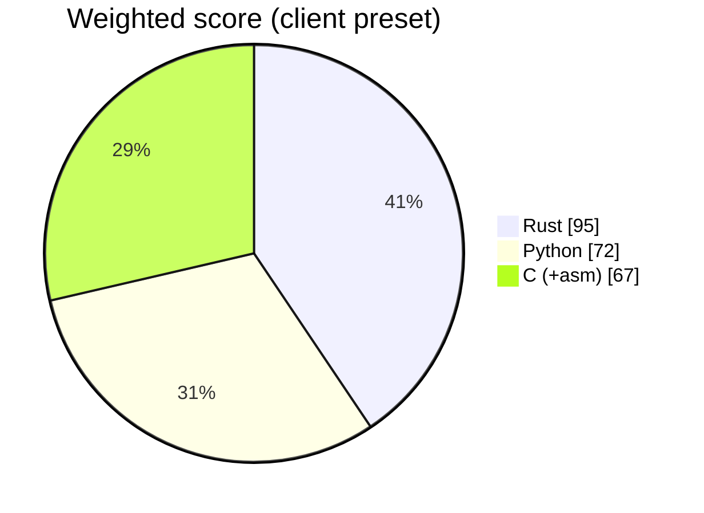

# ADR 0001 — Implementation language: Profile C, hybrid (pure Rust in v0.1)

- Status: accepted
- Date: 2026-10-29
- Deciders: language council (Rust, Python and C/assembly advocates + rebuttal round), approved by the project owner

## Context

Certificate creator and analyzer for Rakvor (Colombia/France): validates X.509 chains to a chosen anchor at a chosen date, CRL/OCSP offline by default, eIDAS and ONAC trust-list snapshots, PAdES/XAdES (DIAN and French e-invoices), S/MIME, Authenticode, OpenPGP, JWS, RFC 3161, live TLS; creates Rakvor's PKI (offline root, intermediate, code signing, examiner .p12), lab/test certificate sets with CRLs and OCSP responses, CSRs, and signs client CSRs under a CP/CPS. Keys in encrypted PKCS#12/PEM files and on PKCS#11 tokens. Shares the case folder and audit chain with four Rust tools and RV Hub; results go to clients and courts; 8 GB Windows laptops.

Weight preset: **client**. Score overrides argued by the council:

- Rust · Team velocity: 3 → 2 (PAdES/XAdES (and long-term validation) must be bridged or built; ASN.1 work with der is verbose)
- Rust · DFIR library ecosystem: 4 → 3 (X.509, PKCS#11 (cryptoki), OpenPGP (rPGP) and TLS (rustls) are strong, but no mature crate validates PAdES or XAdES)
- Rust · Memory safety / court auditability: 5 → 4 (path validation and CMS go through OpenSSL's C code via the openssl crate, so the memory-safety claim is partial)
- Python · Transferability (Win10/11 x64 + ARM64, Linux): 4 → 3 (the other four tools and RV Hub are Rust; a Python tool cannot share their crates)
- Python · Memory safety / court auditability: 3 → 2 (larger dependency tree (asn1crypto, lxml, PySide6) and harder reproducible builds to show a court)
- Python · Speed (throughput, startup): 3 → 4 (the heavy work (signatures, hashing) runs in OpenSSL through cryptography; chain validation takes milliseconds)
- C (+asm) · Windows GUI maturity: 2 → 1 (no egui; GTK is LGPL (house rule), leaving raw Win32)
- C (+asm) · Memory safety / court auditability: 2 → 1 (parsing hostile client ASN.1, XML and PDF in memory-unsafe code for court-facing results)
- C (+asm) · Transferability (Win10/11 x64 + ARM64, Linux): 3 → 2 (cannot reuse the suite's Rust case-folder, audit and report crates)

## Options scored (1–5, weighted)

| Criterion | Weight | Rust | Python | C (+asm) |
| --- | :-: | :-: | :-: | :-: |
| Speed (throughput, startup) | 3 | 5 | 4 | 5 |
| Transferability (Win10/11 x64 + ARM64, Linux) | 3 | 5 | 3 | 2 |
| Storage (executable / installer size) | 2 | 4 | 2 | 5 |
| Hardware / RAM (8 GB laptops, VMs without GPU) | 2 | 5 | 3 | 5 |
| Windows GUI maturity | 2 | 4 | 4 | 1 |
| CLI --help quality | 2 | 5 | 5 | 2 |
| Packaging, signing, antivirus false positives | 2 | 4 | 2 | 4 |
| Memory safety / court auditability | 3 | 4 | 2 | 1 |
| Team velocity | 2 | 2 | 5 | 3 |
| CI/CD complexity (5 = simple) | 1 | 5 | 3 | 3 |
| **Weighted total** (max 110) | | **95** | 72 | 67 |

## Decision

Profile A (Rust workspace: core + clap CLI + egui GUI). 

## Consequences

- Two static executables (CLI + GUI), no runtime to install; one core library powers both.
- Contributors need Rust; Windows binaries are built on GitHub's `windows-latest` runners.
- No hand-written assembly: hash and parsing crates already use SIMD/CPU intrinsics.

## Rebuttal round

All three advocates reached the same picture:

- **Strong in Rust:** X.509 parsing (`x509-cert`, `x509-parser`), certificate creation (`rcgen`), PKCS#11 tokens (`cryptoki`, mature, YubiKey), OpenPGP (rPGP, audited), TLS chain capture (`rustls` with a capturing verifier), and CMS, PKCS#12, OCSP and CRL through the `openssl` crate (OpenSSL 3, Apache-2.0).
- **Missing in Rust and in C:** a mature validator for signed documents, PAdES (PDF) and XAdES (XML, including the Colombian DIAN and French e-invoices). Python has pyHanko (MIT, PAdES B-B to B-LTA, RFC 3161, certificate validation) and signxml (Apache-2.0, XML-DSig with basic XAdES).
- **C:** only as wrapped dependencies (OpenSSL), never as application code: no GUI, and parsing hostile ASN.1, XML and PDF without memory safety.

**Rejected overrides:**
- `rust.packaging=3` (vendored OpenSSL needs Perl/NASM on Windows): it is a build-environment cost that the Windows runners already meet, not an antivirus or signing risk. It stays 4.
- `python.dfir_ecosystem=5`: the client preset weights this criterion 0, so the advantage is captured by the hybrid decision below rather than by the score.
- `c.dfir_ecosystem=5`, `c.packaging=3`, `c.velocity=2`: these go beyond the three-override cap, and they do not change the ranking.

## Decision and boundary (Profile C, hybrid C3, per decision rule 4)

- **v0.1 is pure Rust:**
  - certificate and chain analysis, with path validation by OpenSSL 3's verifier, which reports the error at each depth;
  - revocation (CRL/OCSP from files, online only on an explicit option, which is audited);
  - RFC 3161 tokens, key and certificate matching, trust-list snapshots;
  - creation: Rakvor PKI, lab sets and CSRs. Root and code-signing keys go through PKCS#11.
- **v0.2 adds a Python worker** for PAdES and XAdES only:
  - pyHanko and signxml in a hash-pinned, python-build-standalone runtime;
  - shipped as an optional, separately signed module;
  - JSON Lines over stdin/stdout, using the suite's event schema;
  - the worker never writes the audit log; the Rust core records its inputs, outputs and version.
- **Test oracles in CI:**
  - Python `cryptography` and pyhanko-certvalidator for chain verdicts;
  - `openssl verify`, `ocsp` and `crl`;
  - for v0.2, EU DSS (LGPL, used only as a test tool, never shipped).
- **Licences:** cargo-deny allow-list. sequoia-openpgp (LGPL) and osslsigncode (GPL) are excluded. Authenticode is verified through WinVerifyTrust and signed through Windows signtool.
