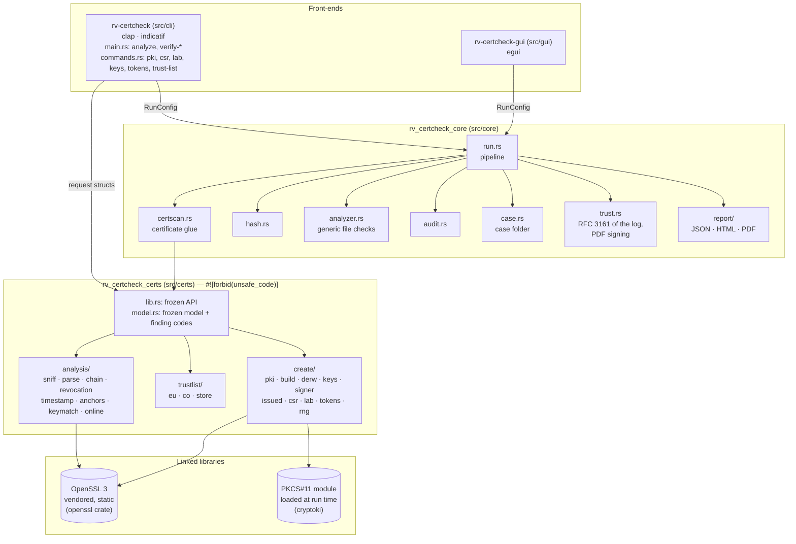
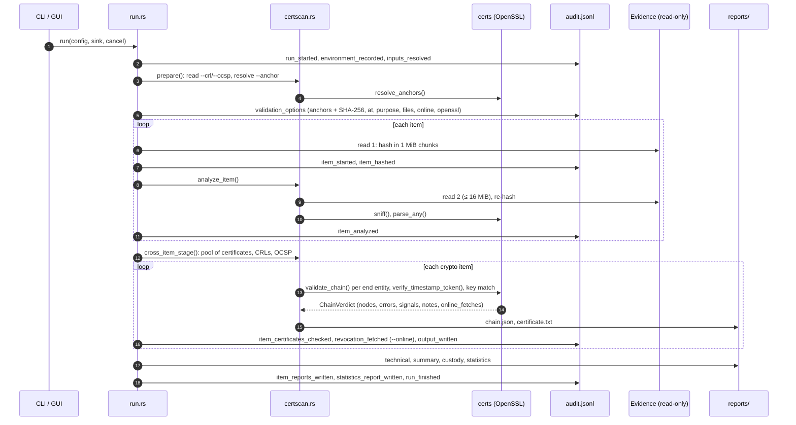
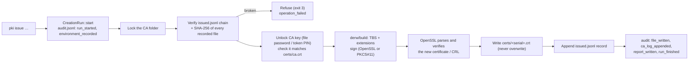
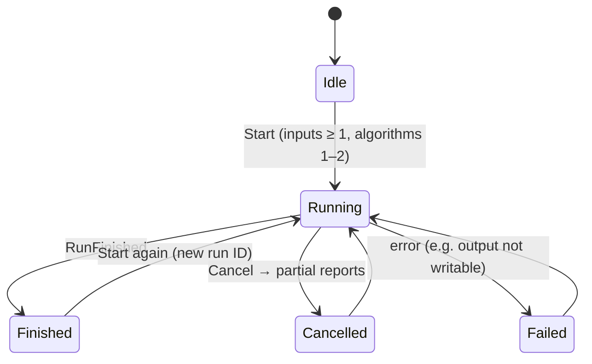

# Architecture

One engine, two front-ends, and a certificate layer underneath. The certificate layer (`src/certs`) knows X.509,
CMS, CRL, OCSP, RFC 3161, trust lists, CA folders and PKCS#11; it has no dependency on the engine and forbids
`unsafe` code. The engine (`src/core`) reads the evidence, hashes it, writes the audit chain, the case folder and
the reports, and turns the certificate layer's signals into findings; it never prints. The CLI and the GUI turn
user input into a `RunConfig` (analysis) or a request struct (creation) and render the results, so both
interfaces produce identical logs and reports.

## Crates

| Crate | Path | Responsibility |
| --- | --- | --- |
| `rv-certcheck-certs` | [src/certs](../src/certs/src/lib.rs) | The certificate layer. **Analysis**: content sniffing, field extraction, path building and verification, CRL/OCSP evaluation, `--online` fetching, RFC 3161, key matching, anchor resolution. **Trust lists**: EU XML and Colombian CSV import, snapshot store, lookup. **Creation**: CA folders and profiles, DER writer, key generation and protection, PKCS#11, CSRs, lab sets. Its API (`lib.rs`) and model (`model.rs`) are frozen: fields may be added, never renamed. |
| `rv-certcheck-core` | [src/core](../src/core/src/lib.rs) | Intake of inputs, one-pass dual hashing, generic file checks, the audit chain, the case folder (`CASE_ROLE` = analysis), the certificate glue (`certscan.rs`), reports in three languages, RFC 3161 timestamping of the audit log, PDF signing with the examiner's certificate. |
| `rv-certcheck-cli` | [src/cli](../src/cli/src/main.rs) | `analyze`, `verify-log`, `verify-case`, `timestamp`, `self-test`, `docs-cli` (hidden) in `main.rs`; the creation commands and `trust-list` in `commands.rs`, each writing its own audited run. |
| `rv-certcheck-gui` | [src/gui](../src/gui/src/lib.rs) | Desktop app; see [usage-gui.md](usage-gui.md). |

## Where OpenSSL sits

OpenSSL 3 is compiled from source by `openssl-src` (feature `vendored`) and linked statically; no system OpenSSL
is used, on any platform. The version linked is printed in `environment.json`, every `chain.json` and every verdict.

| Used for | Through | Not used for |
| --- | --- | --- |
| Path building and verification (`X509_verify_cert`, `X509_STORE`, `X509_VERIFY_PARAM`) | `openssl::x509::store`, `X509StoreContext` | — |
| Certificate, CRL, CSR, PKCS#12 decoding; names, times, fingerprints, `X509_print` | `openssl::x509`, `openssl::pkcs12` | Extensions decoding (x509-parser) |
| CRL signature checks, OCSP (`OCSP_basic_verify`, CertID), PKCS#7 signature over TSTInfo | `openssl::ocsp`, `openssl::pkcs7` | Parsing TSTInfo, ESS attributes (cms + a DER walk) |
| Key generation (non-lab), signing with file keys, PBKDF2, AES-256-CBC, HMAC, `RAND_bytes` | `openssl::pkey`, `pkcs5`, `symm`, `rand` | Writing DER (the tool's own `derw.rs`); the randomness of lab keys (candidates come from a seeded ChaCha20 stream; OpenSSL `BIGNUM` only tests primality and builds the key) |

What is **not** OpenSSL: the DER writer for everything the creation side signs (`derw.rs`), the trust-list
parsers (quick-xml, own CSV reader), PKCS#11 (cryptoki), the HTTP client for `--online` and RFC 3161 (ureq), legacy
PKCS#12 reading (p12-keystore), and the audit chain and reports (core).

## Data flow of an analysis run

## Data flow of a creation command

## Run states (as the GUI sees them)

## Concurrency and cancellation

- Items are processed sequentially on purpose: the order of audit entries equals the order of work. The
  certificate stage runs after the hashing loop because a chain may need certificates, CRLs or OCSP responses
  found in later items.
- Cancellation is an `AtomicBool` checked between hashing chunks; the engine still writes partial reports and
  `run_cancelled`.
- A CA folder is locked during every mutating operation; two `pki` commands on the same folder cannot interleave.
- PKCS#11: one module context per module path for the life of the process (`C_Initialize` once).

## Why Rust

See [ADR 0001](adr/0001-language.md): v0.1 is pure Rust with OpenSSL 3 through FFI for path validation, CMS,
OCSP, CRL and PKCS#12; v0.2 adds an optional, separately signed Python worker for PAdES and XAdES only.
