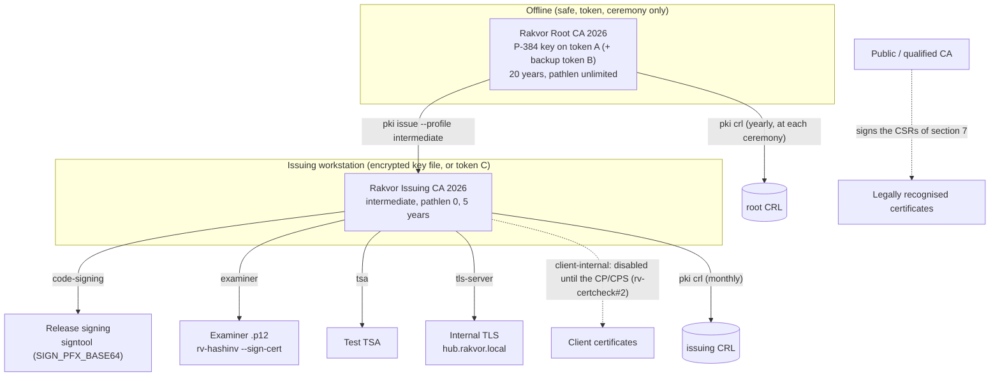

# Rakvor company PKI: step-by-step

This guide sets up Rakvor's internal certificate hierarchy with `rv-certcheck`: an offline root on a hardware token,
an issuing intermediate, the release code-signing certificate, examiner certificates for signed reports, internal
TLS, CSRs for public or qualified CAs, and renewal and revocation. Every command shown writes an audited run
(`rakvor-out/logs/<RUN-ID>/audit.jsonl`, checked with `rv-certcheck verify-log`) and appends a hash-chained record to
the CA folder's `issued.jsonl` (checked with `rv-certcheck pki verify`). The option reference is
[usage-cli.md](usage-cli.md).

> **Legal status: internal use only.** Certificates issued by this PKI are **not a *firma digital* under Ley 527 de
> 1999 art. 28** (Colombia: only an authorised *entidad de certificación* issues those) and **not qualified
> certificates under eIDAS** (EU 910/2014). Every certificate carries the Rakvor internal policy
> `2.25.130074246409705057913773883974790544206.1.1` with that statement as its user notice, and `rv-certcheck
> analyze` reports `CERT_ISSUED_BY_RAKVOR_INTERNAL`. A Rakvor signature shows that a Rakvor key signed; its weight
> in court rests on Rakvor's procedures and records (this guide, the audit logs, `issued.jsonl`), not on a legal
> presumption. **Certificates for clients (profile `client-internal`) are disabled** until Rakvor's Certificate
> Policy / CPS has been reviewed by the lawyer (rv-certcheck#2). For legally recognised signatures, use the CSR
> procedure of section 7 with an accredited CA.

## The hierarchy



The root signs only intermediates and its own CRL, a few times in its life, and is otherwise kept offline. All
day-to-day certificates come from the intermediate, so a compromised intermediate is revoked by the root without
replacing the root on every Rakvor machine.

Folder layout used below (any drive works; keep CA folders out of shared or synced folders):

```text
E:\rakvor-pki\root-2026\       root CA folder (ca.json, issued.jsonl, certs\, crl\; the key is on the token)
E:\rakvor-pki\issuing-2026\    intermediate CA folder (keys\ holds nothing: its key file is issuing-2026.key.p8)
E:\rakvor-pki\runs\            audit logs and reports of every command (--out)
```

Secrets are never typed on the command line: each command reads them from an environment variable named by
`--pass-env`, `--pin-env` or `--ca-pass-env`, or prompts for them without echo. In PowerShell, set them for the
session only and clear them afterwards:

```powershell
$env:ROOT_PIN = Read-Host -MaskInput "Root token PIN"     # cleared with: Remove-Item Env:ROOT_PIN
```

## 1. The offline root on a token (key ceremony)

The root key is generated **on** a PKCS#11 token (YubiKey 5 with the Yubico PIV module `libykcs11`, or an HSM) and
never leaves it. `rv-certcheck` refuses to create a root key on a token without `--confirm-root`.

### Key ceremony checklist

Before:

- [ ] Two people present (the operator and a witness); a written agenda; the ceremony is filmed or minuted.
- [ ] An offline machine (network unplugged, Wi-Fi off) with the verified `rv-certcheck` release (see
      [installation.md](installation.md), checksums and signature).
- [ ] Two new tokens (A = primary, B = backup), each with its PIN, PUK and management key changed from the factory
      values. PINs are generated on the spot and written on paper sealed in tamper-evident envelopes.
- [ ] The subject agreed in writing, e.g. `C=CO,O=Rakvor SAS,CN=Rakvor Root CA 2026`.

During:

1. List the tokens and note their serials:

   ```powershell
   rv-certcheck tokens list --pkcs11-module "C:\Program Files\Yubico\Yubico PIV Tool\bin\libykcs11.dll" --out E:\rakvor-pki\runs
   ```

2. Create the root on token A:

   ```powershell
   rv-certcheck pki init-root --ca E:\rakvor-pki\root-2026 --ca-id rakvor-root-2026 `
     --subject "C=CO,O=Rakvor SAS,CN=Rakvor Root CA 2026" --key-type p-384 --validity-days 7300 `
     --pkcs11-module "C:\Program Files\Yubico\Yubico PIV Tool\bin\libykcs11.dll" --token-serial <SERIAL-A> `
     --pin-env ROOT_PIN --key-label rakvor-root-2026 --confirm-root --out E:\rakvor-pki\runs
   ```

   The key is created non-extractable (CKA_SENSITIVE, CKA_EXTRACTABLE false); its label records
   `[root, --confirm-root]`. `ca.json` references the token serial and key id, never the PIN.

3. Check the folder and print the summary for the minutes:

   ```powershell
   rv-certcheck pki verify --ca E:\rakvor-pki\root-2026 --out E:\rakvor-pki\runs
   rv-certcheck pki show   --ca E:\rakvor-pki\root-2026 --out E:\rakvor-pki\runs
   ```

4. Record the root certificate's SHA-256 (printed by `pki show`) in the minutes, signed by both people.

### Backup

A non-extractable key cannot be copied, so the backup is decided before the ceremony:

- **Second root key (recommended with YubiKeys).** Repeat step 2 on token B in a second folder
  (`root-2026-b`). Both roots are distributed; either can sign the next intermediate. Losing one token costs
  nothing.
- **HSM with wrapped backup.** HSMs that support key backup (wrapped under a backup key, M-of-N cards) follow the
  vendor's procedure; record it in the minutes.

The root folder itself (`E:\rakvor-pki\root-2026`) holds only public data and the hash-chained log: copy it to two
write-once media and store one with each token, in separate safes.

### After

- [ ] Tokens and PIN envelopes in separate safes; access logged.
- [ ] `certs\ca.crt` distributed to Rakvor machines (Group Policy or `Import-Certificate -CertStoreLocation
      Cert:\LocalMachine\Root`) and to `packaging/signing/` of the tool repositories (section 3).
- [ ] The run folders of the ceremony (`E:\rakvor-pki\runs\logs\...`) archived with the minutes; optionally
      timestamped later with `rv-certcheck timestamp <LOG>`.

## 2. The intermediate (issuing CA)

At the same ceremony, the root signs the issuing CA. Its key goes to an encrypted file on the issuing workstation
(or to token C: add the `--pkcs11-module ... --token-serial ... --key-label ...` options instead of `--key-file`).

```powershell
$env:ISSUING_KEY_PASS = Read-Host -MaskInput "New issuing CA key password"
rv-certcheck pki issue --ca E:\rakvor-pki\root-2026 --ca-pass-env ROOT_PIN --profile intermediate `
  --subject "C=CO,O=Rakvor SAS,CN=Rakvor Issuing CA 2026" --key-type p-384 --validity-days 1825 `
  --key-file E:\rakvor-pki\issuing-2026.key.p8 --pass-env ISSUING_KEY_PASS --out E:\rakvor-pki\runs
```

The intermediate has `CA:TRUE, pathlen:0` (it can only certify end entities) and keyCertSign + cRLSign. The
encrypted key is PKCS#8 with PBES2 (PBKDF2-HMAC-SHA256, 600 000 iterations, AES-256-CBC), written owner-only and
never overwritten. Bring it under management as its own CA folder:

```powershell
rv-certcheck pki import --ca E:\rakvor-pki\issuing-2026 --ca-id rakvor-issuing-2026 `
  --cert E:\rakvor-pki\root-2026\certs\<SERIAL>.crt `
  --key-file E:\rakvor-pki\issuing-2026.key.p8 --pass-env ISSUING_KEY_PASS --out E:\rakvor-pki\runs
```

`pki import` refuses a key that does not match the certificate. The intermediate's certificate is distributed with
the root (every chain sent to a verifier includes it).

Optional: to publish CRLs over HTTP, add `"crl_url": "http://pki.rakvor.co/issuing-2026.crl"` to the issuing CA's
`ca.json`; every certificate issued afterwards carries it as its CRL distribution point.

## 3. The code-signing certificate for releases

Today the release workflows sign with a PFX stored in the `SIGN_PFX_BASE64` repository secret (password in
`SIGN_PFX_PASSWORD`), chained to `packaging/signing/rakvor-code-signing-root.cer`. To replace it with a certificate
from this PKI:

1. Issue the certificate (RSA keeps every signtool and Windows version happy):

   ```powershell
   $env:CS_KEY_PASS = Read-Host -MaskInput "Code-signing key password"
   rv-certcheck pki issue --ca E:\rakvor-pki\issuing-2026 --ca-pass-env ISSUING_KEY_PASS --profile code-signing `
     --subject "C=CO,O=Rakvor SAS,CN=Rakvor Release Signing 2026" --key-type rsa-3072 --validity-days 730 `
     --key-file E:\rakvor-pki\code-signing-2026.key.p8 --pass-env CS_KEY_PASS --out E:\rakvor-pki\runs
   ```

2. Build the PFX that signtool reads (AES-256, SHA-256 MAC), with the intermediate in it:

   ```powershell
   openssl pkcs12 -export -inkey E:\rakvor-pki\code-signing-2026.key.p8 -passin env:CS_KEY_PASS `
     -in E:\rakvor-pki\issuing-2026\certs\<SERIAL>.crt -certfile E:\rakvor-pki\issuing-2026\certs\ca.crt `
     -keypbe AES-256-CBC -certpbe AES-256-CBC -macalg sha256 -passout env:SIGN_PFX_PASSWORD -out rakvor-release.pfx
   ```

3. Replace the secrets: `SIGN_PFX_BASE64` = `[Convert]::ToBase64String([IO.File]::ReadAllBytes("rakvor-release.pfx"))`,
   `SIGN_PFX_PASSWORD` = the PFX password. Delete `rakvor-release.pfx` afterwards.

4. Replace `packaging/signing/rakvor-code-signing-root.cer` with the new root (`root-2026\certs\ca.crt`, DER:
   `openssl x509 -in ca.crt -outform DER -out rakvor-code-signing-root.cer`) in each tool repository, and install
   the new root on Rakvor machines **before** the first release signed with it. The release workflow checks each
   signature against that file.

Keeping the existing root instead: `pki import` brings `rakvor-code-signing-root.cer` and its offline key under
management (`--key-file` accepts the `.pfx` or an encrypted PKCS#8), then `pki issue --profile code-signing` from it.
That root has `pathlen:0`, so it issues code-signing certificates directly and refuses intermediates.

A key in a repository secret is a software key: anyone who can change the workflows can use it. That is acceptable
for internal releases; a publicly trusted certificate requires an HSM-held key (Azure Artifact Signing).

## 4. Examiner certificates for signed reports

Each examiner gets a certificate with digitalSignature + nonRepudiation and the EKUs emailProtection and
documentSigning (RFC 9336 and Microsoft), delivered as a `.p12` that `rv-hashinv --sign-cert` loads:

```powershell
$env:EXAMINER_KEY_PASS = Read-Host -MaskInput "Key file password"
$env:EXAMINER_P12_PASS = Read-Host -MaskInput ".p12 password for Ana"
rv-certcheck pki issue --ca E:\rakvor-pki\issuing-2026 --ca-pass-env ISSUING_KEY_PASS --profile examiner `
  --subject "C=CO,O=Rakvor SAS,CN=Ana Ruiz" --san email:ana.ruiz@rakvor.co --key-type rsa-3072 --validity-days 730 `
  --key-file E:\examiners\ana-ruiz.key.p8 --pass-env EXAMINER_KEY_PASS --p12-pass-env EXAMINER_P12_PASS `
  --out E:\rakvor-pki\runs
```

The `.p12` (`E:\examiners\<SERIAL>.p12`) holds the key, the examiner certificate and the issuing CA certificate.
Hand it over in person with the password given separately. The examiner signs reports with:

```powershell
rv-hashinv scan --input D:\evidence --sign-cert ana-ruiz.p12 --sign-pass-env RV_SIGN_PASSWORD ...
```

rv-hashinv signs PDFs with RSA keys only: keep `--key-type rsa-2048`, `rsa-3072` or `rsa-4096` for examiners.

## 5. Internal TLS

For internal services (RV Hub dashboard, file servers):

```powershell
rv-certcheck pki issue --ca E:\rakvor-pki\issuing-2026 --ca-pass-env ISSUING_KEY_PASS --profile tls-server `
  --subject "C=CO,O=Rakvor SAS,CN=hub.rakvor.local" --san dns:hub.rakvor.local --san ip:10.0.0.20 `
  --key-type p-256 --validity-days 397 --key-file E:\tls\hub.key.p8 --pass-env TLS_KEY_PASS --out E:\rakvor-pki\runs
```

At least one `dns:` or `ip:` SAN is required. If the server generates its own key, have it produce a CSR and certify
that instead (`--csr hub.csr`; the CSR's self-signature must verify). Clients trust the service once the Rakvor root
is installed.

## 6. Timestamping (test TSA)

`--profile tsa` issues a certificate with the timeStamping EKU marked critical (RFC 3161), for a Rakvor test TSA.
Production timestamps of audit logs come from a public RFC 3161 TSA (`--tsa-url`).

## 7. CSRs for a public or qualified CA

For certificates that must be recognised outside Rakvor (a public TLS certificate for `www.rakvor.co`, a *firma
digital* from an accredited Colombian *entidad de certificación*, a qualified certificate from an EU trust service
provider), create the key and the CSR here and send only the CSR:

```powershell
rv-certcheck csr new --subject "C=CO,O=Rakvor SAS,CN=www.rakvor.co" --san dns:www.rakvor.co --san dns:rakvor.co `
  --key-type p-256 --csr-out www-rakvor-co.csr --pass-env WWW_KEY_PASS --out E:\rakvor-pki\runs
rv-certcheck csr show www-rakvor-co.csr --out E:\rakvor-pki\runs
```

Qualified and *firma digital* providers usually require the key on a token: use `--pkcs11-module`,
`--token-serial` and `--key-label` so the key is generated on it. The provider decides the certificate's content and
legal status; follow its identification procedure.

## 8. Renewal and revocation

**Renewal.** Certificates are never extended: issue a new one before the old one expires (`pki show` lists every
certificate with its expiry), deploy it, then revoke the old one with reason `superseded`. Suggested lifetimes:
root 20 years, intermediate 5 years (renew after 4), code signing 2 years, examiners 2 years, TLS 397 days. Signed
releases stay verifiable after expiry because signtool adds an RFC 3161 timestamp (`/tr`). Signed PDF reports carry
no signature timestamp of their own in this version: their time rests on the RFC 3161 timestamp of the run's audit
log, which records each report's SHA-256.

A new intermediate is a root ceremony (section 2 with the root token). A new root is a full ceremony; run old and new
roots side by side until every machine trusts the new one.

**Revocation.** Revoke immediately on loss, theft or suspicion (`keyCompromise`), when someone leaves
(`affiliationChanged`), or when a certificate is replaced (`superseded`), then publish a CRL:

```powershell
rv-certcheck pki revoke --ca E:\rakvor-pki\issuing-2026 --serial <SERIAL> --reason keyCompromise --out E:\rakvor-pki\runs
rv-certcheck pki crl    --ca E:\rakvor-pki\issuing-2026 --ca-pass-env ISSUING_KEY_PASS --next-update-days 30 --out E:\rakvor-pki\runs
```

`crl\latest.crl` is what verifiers use (`rv-certcheck analyze --crl`, `openssl verify -crl_check -CRLfile`; publish it
at `crl_url` if set). Issue a CRL at least every `--next-update-days`, even with nothing new revoked. The root issues
its own CRL at each ceremony (for revoked intermediates). For lab and test work, `pki ocsp-sign` writes a signed OCSP
response for one serial; there is no OCSP server.

**Integrity.** Run `rv-certcheck pki verify --ca <FOLDER>` before each session. It checks the `issued.jsonl` hash
chain, `certs\ca.crt` and the SHA-256 of every certificate, CRL and OCSP file recorded; an edited, deleted or
re-ordered record, or a modified file, stops the CA (exit 3) until it is investigated.

## Quick reference

| Task | Command |
| --- | --- |
| Tokens and their keys | `tokens list --pkcs11-module LIB [--token-serial S --pin-env VAR]` |
| Root on a token | `pki init-root ... --pkcs11-module LIB --token-serial S --confirm-root` |
| Intermediate | `pki issue --ca ROOT --profile intermediate ...` then `pki import` |
| Code signing / examiner / TLS / TSA | `pki issue --ca ISSUING --profile code-signing / examiner / tls-server / tsa` |
| From a CSR | `pki issue --ca ISSUING --profile tls-server --csr FILE` |
| CSR for an external CA | `csr new ... --csr-out FILE` |
| Revoke, CRL | `pki revoke --serial S --reason R`, `pki crl` |
| State and integrity | `pki show`, `pki verify`, `verify-log <RUN>` |
| Training material | `lab make --set full --seed N --lab-out DIR` |
