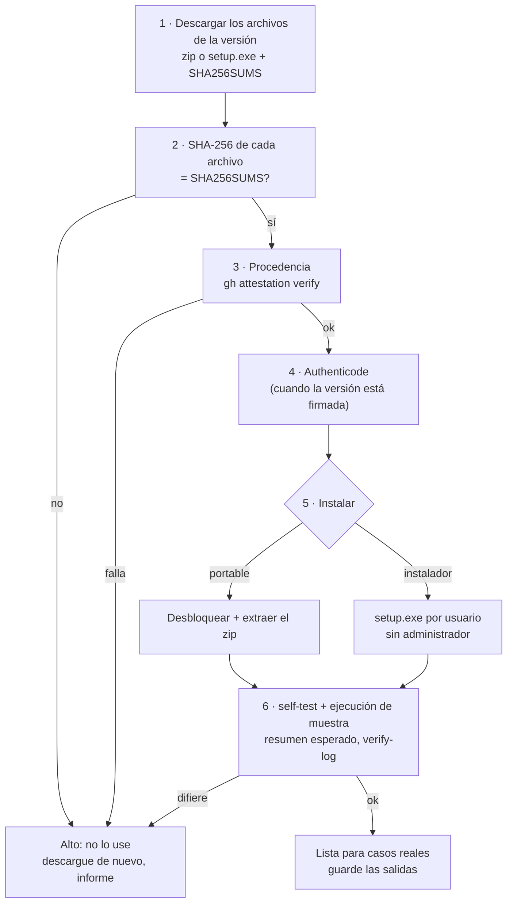

> La versión de referencia es la inglesa ([installation.md](installation.md)); esta traducción la sigue.

# Instalación y verificación (Windows 10/11)

RV CertCheck se ejecuta **localmente** en el PC con Windows 10 u 11 del perito (x64). No necesita derechos de
administrador, ni runtime (runtime de C estático, OpenSSL enlazado dentro), ni red, salvo para el sello de tiempo
RFC 3161 opcional y la opción explícita de revocación `--online`. Esta página cubre: obtener una versión, **comprobar
que es la compilación que Rakvor publicó** (sumas de verificación, procedencia, Authenticode frente a la raíz de
Rakvor), SmartScreen, instalarla (zip portable o instalador por usuario), los módulos PKCS#11 para tokens físicos, el
self-test de la primera ejecución, el uso sin red, la compilación desde el código fuente para auditores (OpenSSL
incluido), dónde quedan los archivos y la desinstalación.

Por qué importa la verificación: un tribunal puede preguntar cómo sabe que el programa que ejecutó es aquel cuyo
código revisó un experto. Los pasos 2–4 y 6 dan esa respuesta; guarde su salida con el expediente
([admissibility.md](admissibility.md#examiner-checklist-before-filing-a-report), paso 3, en inglés).



## Requisitos

| Elemento | Requisito |
| --- | --- |
| Sistema operativo | Windows 10 u 11, x64 (`MinVersion=10.0`, `ArchitecturesAllowed=x64compatible` en el instalador). Linux/macOS: compilar desde el código fuente. |
| Derechos | Usuario estándar. El instalador es por usuario (`PrivilegesRequired=lowest`). |
| Disco | Los dos ejecutables y la documentación (unos pocos MB); las salidas necesitan unos 11 archivos de informe por elemento para un idioma (19 con `--lang all`) más los logs. |
| Memoria | Los archivos se leen por bloques de 1 MiB: el uso de memoria no crece con el tamaño del archivo. |
| Gráficos | No se necesita nada: la GUI también funciona en máquinas virtuales sin controlador de GPU (renderizado por software). |
| Red | Ninguna, salvo la solicitud opcional de sello de tiempo y `analyze --online` (ver el [paso 7](#7-uso-sin-red-y-en-equipos-aislados)). |
| Comprobación de versiones | Opcional, solo avisa: la aplicación de escritorio al arrancar y `rv-certcheck update-check` leen la página pública de la última versión en github.com ([Comprobación de versiones](#comprobación-de-versiones)); `RV_NO_UPDATE_CHECK=1` la desactiva. |
| Token físico (opcional) | Un módulo PKCS#11 para el token: YubiKey 5 con el Yubico PIV Tool (`libykcs11.dll`), un módulo de un fabricante de HSM, o SoftHSM2 para pruebas (ver [5d](#5d-módulos-pkcs11-tokens-físicos)). |

## 1. Descarga

Los archivos de la versión están en la página Releases de GitHub del repositorio (`rakvor/rv-certcheck`):

| Archivo | Qué es |
| --- | --- |
| `rv-certcheck-X.Y.Z-windows-x64.zip` | Portable: `rv-certcheck.exe`, `rv-certcheck-gui.exe`, README, LICENSE, COMMERCIAL.md, NOTICE, CHANGELOG, `docs/`, `examples/` |
| `rv-certcheck-X.Y.Z-windows-x64-setup.exe` | Instalador Inno Setup, por usuario |
| `SHA256SUMS` | SHA-256 del zip, del instalador y del SBOM (formato `sha256sum`: `<hash>  ./<file>`) |
| `sbom.cdx.json` | Lista de materiales de software CycloneDX (cada dependencia de Rust y su versión) |

Póngalos en una carpeta, p. ej. `C:\Rakvor\downloads\rv-certcheck-0.1.0\`.

## 2. Verificar la descarga

```powershell
cd C:\Rakvor\downloads\rv-certcheck-0.1.0
Get-Content .\SHA256SUMS | ForEach-Object {
    $hash, $name = $_ -split '\s+', 2
    $name = $name.TrimStart('*').Replace('./', '')
    if (Test-Path $name) {
        $actual = (Get-FileHash -Algorithm SHA256 $name).Hash.ToLower()
        if ($actual -eq $hash) { "OK    $name" } else { "FAIL  $name  (got $actual)" }
    } else { "skip  $name (not downloaded)" }
}
```

```bash
sha256sum -c --ignore-missing SHA256SUMS      # Linux, o Git Bash en Windows
```

Cada archivo descargado debe imprimir `OK`. `SHA256SUMS` lo produce el mismo flujo de trabajo y no tiene atestación
propia: el paso 3 es la comprobación más fuerte.

## 3. Verificar la procedencia de la compilación

Cada zip e instalador lleva una atestación de procedencia de compilación de GitHub (`actions/attest-build-provenance`):
una declaración firmada de que ese archivo exacto lo compiló el flujo de publicación del repositorio a partir de un
commit dado. En una máquina con acceso a internet y la CLI de GitHub:

```powershell
gh attestation verify .\rv-certcheck-0.1.0-windows-x64.zip --repo rakvor/rv-certcheck
gh attestation verify .\rv-certcheck-0.1.0-windows-x64-setup.exe --repo rakvor/rv-certcheck
```

La salida nombra el flujo de trabajo (`.github/workflows/release.yml`) y el commit de origen; anote ambos. Para un
laboratorio aislado, verifique en una máquina conectada y lleve los archivos verificados en un soporte protegido contra
escritura (la CLI de GitHub también puede descargar el paquete de atestación y la raíz de confianza para
comprobaciones sin red; ver `gh attestation verify --help`). `SHA256SUMS` y el SBOM no tienen atestación.

## 4. Verificar la firma Authenticode (versiones firmadas)

El flujo de publicación firma `rv-certcheck.exe`, `rv-certcheck-gui.exe` y el instalador **solo cuando hay un
certificado de firma de código configurado** para el repositorio (secreto `SIGN_PFX_BASE64`; signtool con SHA-256 y un
sello de tiempo RFC 3161). Cómo crea Rakvor ese certificado y su raíz, incluida la ceremonia de claves, está en
[company-pki.md](company-pki.md) (en inglés). Compruebe:

```powershell
Get-AuthenticodeSignature .\rv-certcheck-0.1.0-windows-x64-setup.exe |
    Format-List Status, StatusMessage, SignerCertificate, TimeStamperCertificate
# después de extraer el zip:
Get-AuthenticodeSignature .\rv-certcheck.exe, .\rv-certcheck-gui.exe | Format-Table Status, Path
```

| Estado | Significado |
| --- | --- |
| `Valid` | Firmado e intacto; compruebe que el firmante es la entidad de Rakvor esperada |
| `NotSigned` | La versión se compiló sin certificado de firma: apóyese en los pasos 2–3; Windows SmartScreen avisará |
| `HashMismatch` / otro | Alto: el archivo se alteró después de firmarse |

Con el SDK de Windows, `signtool verify /pa /v rv-certcheck.exe` muestra la cadena completa.

### 4b. Comprobar que el firmante encadena con la raíz de Rakvor

Las versiones se firman con el certificado de firma de código **interno** de Rakvor, que encadena con
`packaging/signing/rakvor-code-signing-root.cer` (`CN=Rakvor Internal Code Signing Root CA, O=Rakvor`, huella SHA-256
`dc9ba1a2fcd4f0633c5214b7cceb25bed8f3f7d9ebaf111590250cbcaa83df60`). El flujo de publicación importa esa raíz y
ejecuta `signtool verify /pa /tw` sobre cada archivo firmado antes de publicar. Para comprobarlo en su máquina, sin
instalar la raíz:

```powershell
$sig  = Get-AuthenticodeSignature .\rv-certcheck.exe
$root = New-Object System.Security.Cryptography.X509Certificates.X509Certificate2 C:\Rakvor\rakvor-code-signing-root.cer
$chain = New-Object System.Security.Cryptography.X509Certificates.X509Chain
$chain.ChainPolicy.RevocationMode = 'NoCheck'
$chain.ChainPolicy.VerificationFlags = 'AllowUnknownCertificateAuthority'
$chain.ChainPolicy.ExtraStore.Add($root) | Out-Null
$chain.Build($sig.SignerCertificate) | Out-Null
$top = $chain.ChainElements[$chain.ChainElements.Count - 1].Certificate
$top.GetCertHashString('SHA256')   # debe imprimir DC9BA1A2FCD4F0633C5214B7CCEB25BED8F3F7D9EBAF111590250CBCAA83DF60
```

(Use la copia de la raíz del árbol de código fuente o de una máquina de Rakvor, no una que venga junto a la
descarga.) La misma comprobación con esta herramienta: exporte la cadena del firmante (`certutil -dump`, o la pestaña
*Firmas digitales* → *Ver certificado* → *Copiar en archivo*), luego
`rv-certcheck analyze -i signer.cer -i intermediate.cer --anchor rakvor --purpose code-signing --at <signing date>`
debe informar `CERT_CHAIN_VALID` y `CERT_ISSUED_BY_RAKVOR_INTERNAL`. La herramienta solo verifica las propias firmas
Authenticode a partir de v0.2.

**Esta es una raíz interna.** Windows no confía en ella salvo que se haya instalado en la máquina (directiva de grupo o
`Import-Certificate -CertStoreLocation Cert:\LocalMachine\Root`, ver [company-pki.md](company-pki.md)); en otras
máquinas `Get-AuthenticodeSignature` indica `UnknownError` / raíz no confiable aunque el archivo esté intacto. Apóyese
en la comprobación de la huella de arriba.

### 4c. SmartScreen

SmartScreen juzga una descarga por la reputación de su firmante ante Microsoft, que un certificado interno no tiene.
En una máquina sin la raíz de Rakvor, o para una versión nueva, Windows muestra *"Windows protegió su PC"*. Solo
después de que pasen los pasos 2–4b: *Más información → Ejecutar de todas formas*, o `Unblock-File` sobre el zip antes
de extraerlo (paso 5a). Nunca salte el aviso para un archivo que haya fallado alguna comprobación.

## 5. Instalar

### 5a. Zip portable

```powershell
# solo después de los pasos 2–4
Unblock-File .\rv-certcheck-0.1.0-windows-x64.zip
Expand-Archive .\rv-certcheck-0.1.0-windows-x64.zip -DestinationPath C:\Rakvor\tools\rv-certcheck-0.1.0
cd C:\Rakvor\tools\rv-certcheck-0.1.0
.\rv-certcheck.exe --version
```

Conserve una carpeta por versión para poder volver a ejecutar un caso pasado con la versión exacta registrada en su
`environment.json`. Opcional, solo para la sesión actual: `$env:Path += ";C:\Rakvor\tools\rv-certcheck-0.1.0"`.

### 5b. Instalador (por usuario, sin administrador)

Haga doble clic en `rv-certcheck-X.Y.Z-windows-x64-setup.exe` (asistente en inglés, español o francés). Instala en
`%LOCALAPPDATA%\Programs\Rakvor\RV CertCheck\`, crea un grupo *Rakvor* en el menú Inicio (aplicación + documentación)
y ofrece dos tareas: **Add the rv-certcheck command to PATH** (PATH del usuario, marcada en la primera instalación) y un
icono en el escritorio. Abra después un terminal **nuevo** para que se aplique el PATH.

Sin intervención:

```powershell
.\rv-certcheck-0.1.0-windows-x64-setup.exe /VERYSILENT /SUPPRESSMSGBOXES /NORESTART /TASKS="addtopath"
```

El instalador copia los ejecutables, README, LICENSE, COMMERCIAL.md, NOTICE, CHANGELOG, `docs\` y la evidencia de
muestra (`examples\sample\evidence\`), no los scripts de muestra ni `expected_hashes.csv` (están en el zip y en el
árbol de código fuente).

<!-- forge:domain -->
### 5c. Bibliotecas nativas

No hay ninguna que instalar. **OpenSSL 3** se compila desde el código fuente durante la compilación (crate `openssl`
con la característica `vendored`, `openssl-src`) y se enlaza estáticamente en ambos ejecutables; no se usa ningún
OpenSSL del sistema ni ninguna DLL, y su versión queda registrada en cada ejecución (`environment.json`,
`chain.json`). El hash, el generador de PDF, el cliente RFC 3161 y el firmante CMS de los informes son crates de Rust
(listados en el SBOM); el runtime de C se enlaza estáticamente (`.cargo/config.toml`).

### 5d. Módulos PKCS#11 (tokens físicos)

Solo los comandos de creación que usan un token (`tokens list`, `pki init-root`/`issue`/`import`, `csr new` con
`--pkcs11-module`) cargan un módulo PKCS#11, en tiempo de ejecución, desde la ruta que usted indique. RV CertCheck no
instala nada; el módulo lo proporciona el fabricante del token.

| Token | Módulo | Notas |
| --- | --- | --- |
| YubiKey 5 (PIV) | Yubico PIV Tool: `C:\Program Files\Yubico\Yubico PIV Tool\bin\libykcs11.dll` (Linux: `libykcs11.so`) | Cambie el PIN, el PUK y la clave de gestión de sus valores de fábrica antes de usarlo. El uso real de una YubiKey es una comprobación manual: no se ejercita en CI |
| HSM | La biblioteca PKCS#11 del fabricante | Siga el procedimiento de copia de seguridad del fabricante para las claves raíz |
| SoftHSM2 (solo pruebas) | `/usr/lib/softhsm/libsofthsm2.so` (Debian/Ubuntu `apt install softhsm2`), `softhsm2.dll` en Windows | Token por software; nunca para claves reales |

Compruebe el módulo y anote el serial del token:

```powershell
rv-certcheck tokens list --pkcs11-module "C:\Program Files\Yubico\Yubico PIV Tool\bin\libykcs11.dll"
```

SoftHSM2 para las pruebas de tokens:

```bash
sudo apt install softhsm2
softhsm2-util --init-token --free --label rv-test --so-pin 0000 --pin 1234
softhsm2-util --show-slots            # anote el serial del token
export RV_TEST_PKCS11_MODULE=/usr/lib/softhsm/libsofthsm2.so RV_TEST_PKCS11_SERIAL=<serial> RV_TEST_PKCS11_PIN=1234
cargo test -p rv-certcheck-certs --test acceptance_creation --test create_lab_tokens
```

Sin esas tres variables, las pruebas de tokens imprimen un mensaje de omisión; el flujo de CI de este commit no las
define.

### 5e. Ceremonia de claves

Una clave de CA raíz solo se crea en un token con `--confirm-root` (el mensaje de rechazo remite aquí). La lista de
control de la ceremonia (dos personas, máquina fuera de línea, dos tokens, PIN sellados, acta, copia de seguridad) está
en [company-pki.md](company-pki.md#key-ceremony-checklist) (en inglés).
<!-- /forge:domain -->

## 6. Self-test de la primera ejecución y muestra

```powershell
rv-certcheck --version
rv-certcheck self-test
```

`self-test` imprime `PASS` para md5, sha1, sha256, sha512, sha3-256 y blake3 (respuestas conocidas para `"abc"`), con código de salida
0. Solo prueba las implementaciones de hash. Después ejecute la muestra de laboratorio, que pone a
prueba el reconocimiento, la validación de cadenas, la revocación, los tokens de sello de tiempo, el emparejamiento de
claves, los informes y la cadena de auditoría:

```powershell
# zip portable (script incluido): self-test, analyze de la muestra, verify-log, hashes.csv frente a expected_hashes.csv
.\examples\sample\run.ps1 -Bin .\rv-certcheck.exe

# instalador (no se instala el script): ejecútelo a mano en una carpeta temporal
$app = "$env:LOCALAPPDATA\Programs\Rakvor\RV CertCheck"
$out = Join-Path $env:TEMP "rv-certcheck-check"
rv-certcheck analyze -i "$app\examples\sample\evidence" --anchor "$app\examples\sample\anchors\rakvor-lab-root.crt" `
  --at 2026-06-01T00:00:00Z --hash sha256,md5 --out $out --progress none --no-timestamp
$LASTEXITCODE                                  # 3 (hallazgos altos esperados: caducado, revocado, raíz equivocada, clave que no corresponde)
rv-certcheck verify-log (Get-ChildItem "$out\logs" | Select-Object -Last 1).FullName   # OK … chain intact
```

<!-- forge:domain -->
Resumen esperado: **13 items, 0 errors, findings high 4, medium 4, low 0, info 9**, código de salida **3**. Por
código: `CERT_CHAIN_VALID` 7, `REVOCATION_UNKNOWN` 2, y uno de cada uno de `CERT_CHAIN_UNTRUSTED`,
`CERT_EXPIRED_AT_DATE`, `CERT_REVOKED`, `KEY_DOES_NOT_MATCH`, `CERT_WEAK_KEY`, `CERT_WEAK_SIGNATURE_ALGORITHM`,
`TIMESTAMP_TOKEN_VALID` y `CRYPTO_INPUT_NOT_RECOGNISED` (informe de estadísticas, *hallazgos por código*). Lo esperado
por archivo está en [examples/README.md](../examples/README.md) (en inglés) y en
`examples/sample/expected_findings.json`; el SHA-256 y el MD5 de los 13 archivos están en
`examples/sample/expected_hashes.csv` (calculados de forma independiente con Python).

`run.ps1` / `run.sh` aceptan el código 0 o 3 de `analyze`, luego leen el `logs\<RUN-ID>\hashes.csv` de la herramienta
y comparan el tamaño, el SHA-256 y el MD5 de cada archivo con `expected_hashes.csv`, imprimen
`hashes.csv matches expected_hashes.csv (13 files: size, SHA-256, MD5)` y salen con el código 3 ante cualquier
diferencia. Para el instalador (no se instala el script), compare `expected_hashes.csv` con
`$out\logs\<RUN-ID>\hashes.csv`, o ejecute `python tests\verify_chain.py <log folder>` desde el árbol de código
fuente, que vuelve a calcular el hash de cada archivo de `hashes.csv` y de cada salida que registra el log de
auditoría.
<!-- /forge:domain -->

Guarde la salida de la consola y la carpeta de la ejecución como registro de esta verificación.

## 7. Uso sin red y en equipos aislados

El acceso a la red en el código se limita a: la solicitud de sello de tiempo RFC 3161 del log de auditoría (un HTTP
POST de un hash de 32 bytes a la TSA, [src/core/src/trust.rs](../src/core/src/trust.rs)) y, **solo con
`analyze --online`**, solicitudes GET a los puntos de distribución de CRL y POST a los respondedores OCSP nombrados en
los certificados examinados ([src/certs/src/analysis/online.rs](../src/certs/src/analysis/online.rs); cada URL, hora y
SHA-256 de la respuesta queda auditado). `trust-list import` solo lee un archivo local. No hay telemetría ni
comprobación de licencia.

| Para desactivar el sello de tiempo | Cómo |
| --- | --- |
| Una ejecución de la CLI | `--no-timestamp` |
| Todas las ejecuciones de la CLI en este PC / sesión | `$env:RV_NO_TIMESTAMP = "1"` (o defínala como variable de entorno del usuario) |
| GUI | desmarque **4. Confianza → Sello de tiempo confiable** antes de *Iniciar revisión* |

Una ejecución sin red con el sello de tiempo activado termina igualmente: registra `timestamp_pending` y el informe de
estadísticas muestra una advertencia. Más tarde, en una máquina que pueda llegar a la TSA, ejecute
`rv-certcheck timestamp <log folder>` (vuelve a verificar la cadena y después agrega `timestamp_obtained`). Para usar
una TSA interna o cualificada, pase `--tsa-url` (ver
[admissibility.md](admissibility.md#53-eidas--regulation-eu-9102014-as-amended-by-eu-20241183), en inglés). El sello
de tiempo solo es cualificado en el sentido de eIDAS si la dirección de la TSA es la de un prestador cualificado de
servicios de confianza (QTSP) inscrito en una lista de confianza de la UE; la dirección por defecto (DigiCert) no lo
es. El sistema operativo no impone la restricción de red; en un puesto conectado, una regla de salida del Firewall de
Windows para `rv-certcheck.exe` / `rv-certcheck-gui.exe` que solo permita el host de la TSA la impone.

## 8. Compilar desde el código fuente para auditores

### Cadena de herramientas

| Elemento | Versión |
| --- | --- |
| Rust | Fijado por [rust-toolchain.toml](../rust-toolchain.toml): **1.97.0** con rustfmt y clippy; `rustup` lo instala y lo selecciona automáticamente dentro del árbol de código fuente. `Cargo.toml` declara `rust-version = "1.88"` (edición 2024) como mínimo. Para igualar exactamente una versión, use el compilador registrado en el `environment.json` de esa versión → `tool.rustc` (p. ej. `rustc 1.97.0 (2d8144b78 2026-07-07)`). |
| Enlazador de Windows | Visual Studio 2022 Build Tools, carga de trabajo *Desktop development with C++* (MSVC + Windows SDK); destino `x86_64-pc-windows-msvc`. El CRT estático se fija en `.cargo/config.toml`. |
| OpenSSL (incluido) | Lo compila desde el código fuente `openssl-src` durante `cargo build`: necesita un compilador de C (MSVC en Windows, con su `nmake`; `make` en los demás sistemas) y **Perl**. **Windows: Strawberry Perl** (`choco install strawberryperl`; el perl de Git Bash no puede configurar OpenSSL para MSVC). Si hay varios perl en el PATH, indique Strawberry a la compilación: `$env:OPENSSL_SRC_PERL = "C:\Strawberry\perl\bin\perl.exe"` (lo que hace CI). No hace falta NASM (compilación `no-asm` sin él). |
| Linux | `gcc` (o `clang`), `make` y `perl` para el OpenSSL incluido; nada más para compilar la CLI. |
| Opcional | La línea de comandos `openssl` para las pruebas del oráculo OpenSSL (obligatoria en CI); Python `cryptography` (instalado con `pyhanko`) para el segundo oráculo. |
| Opcional | Python 3.12 con `blake3 jsonschema pyhanko` para los verificadores independientes y las pruebas de confianza (`RV_TEST_PYTHON=python`). |

### Compilación

```powershell
git clone https://github.com/Panacota96/rv-certcheck.git
cd rv-certcheck
git checkout v0.1.0                       # la etiqueta de la versión bajo revisión
rustc --version                           # debe imprimir la 1.97.0 fijada
cargo build --release --locked -p rv-certcheck-cli -p rv-certcheck-gui
.\target\release\rv-certcheck.exe self-test
.\examples\sample\run.ps1 -Bin .\target\release\rv-certcheck.exe
cargo test --workspace --locked            # pruebas unitarias + de integración (las pruebas de confianza se omiten sin pyhanko)
```

```bash
# Linux
cargo build --release --locked -p rv-certcheck-cli
target/release/rv-certcheck self-test && examples/sample/run.sh target/release/rv-certcheck
python3 tests/verify_chain.py examples/sample/out/logs/$(ls examples/sample/out/logs | tail -n 1)
# entre perfiles: una carpeta del caso escrita por el perfil de Python debe verificarse con esta compilación
python3 tests/golden/unpack.py tests/golden/case-by-python.zip.b64 /tmp/golden
target/release/rv-certcheck verify-case /tmp/golden/CASE-GOLDEN
```

`--locked` se niega a compilar si `Cargo.lock` cambiaría, así que el conjunto de dependencias es igual al que figura en
`environment.json` → `dependencies` y en `sbom.cdx.json`. La versión del producto viene de `version.txt`; las
versiones de los crates en `Cargo.toml` no cambian, así que una versión publicada nunca cambia el archivo de bloqueo.

### Reproducir los hashes de la versión

Sea preciso sobre qué puede y qué no puede coincidir bit a bit en esta versión (brecha G22):

| Artefacto | ¿Idéntico bit a bit a la versión? | Cómo comprobarlo |
| --- | --- | --- |
| Archivos de `docs/`, `examples/` | Sí (desde git; finales de línea LF salvo `*.ps1`, `*.iss`) | `git ls-files` + `Get-FileHash` contra el zip extraído |
| `rv-certcheck.exe`, `rv-certcheck-gui.exe` | **No garantizado**: las rutas no se reasignan y la cabecera PE lleva datos del momento del enlazado. El compilador es el fijado en `rust-toolchain.toml` (ambos flujos de trabajo ejecutan `rustup toolchain install`, que lee ese archivo; confírmelo con `environment.json` → `tool.rustc` de una ejecución de la versión) | La atestación de procedencia (paso 3) vincula el binario publicado con el flujo de trabajo y el commit; luego compare el comportamiento (abajo) |
| zip, instalador | No (marcas de tiempo del archivo) | Atestación (paso 3) |

**Equivalencia funcional**: ejecute la muestra con el binario publicado y con su compilación, y compare los hashes y
los hallazgos de cada elemento:

```bash
python - "<release-out>/reports/<RUN-ID>" "<your-out>/reports/<RUN-ID>" <<'EOF'
import glob, json, sys
def load(run):
    out = {}
    for p in sorted(glob.glob(f"{run}/items/*/technical.json")):
        t = json.load(open(p, encoding="utf-8"))
        out[t["item"]["file_name"]] = (t["hashes"], t["item"]["detected_type"],
                                       [(f["code"], f["severity"], f["params"]) for f in t["findings"]])
    return out
a, b = load(sys.argv[1]), load(sys.argv[2])
print("identical findings and digests" if a == b else "DIFFERENT: " + ", ".join(k for k in a if a.get(k) != b.get(k)))
EOF
```

El mismo script compara esta compilación con el perfil de Python de la herramienta (medido idéntico sobre la muestra).

## 9. Dónde quedan las cosas

| Qué | Ubicación |
| --- | --- |
| Programa (instalador) | `%LOCALAPPDATA%\Programs\Rakvor\RV CertCheck\` (`rv-certcheck.exe`, `rv-certcheck-gui.exe`, `docs\`, `examples\sample\evidence\`, `unins000.exe`) |
| Programa (portable) | la carpeta que extrajo |
| Entrada del PATH (tarea del instalador) | variable de entorno de usuario `Path` (`HKCU\Environment`) |
| Salidas de las ejecuciones | `--out` (por defecto `.\rakvor-out` **relativo a la carpeta actual**): `logs\<RUN-ID>\`, `reports\<RUN-ID>\`. Con `--case-dir`: `<CASE>\runs\rv-certcheck\<RUN-ID>\`. La GUI usa su campo *Carpeta de salida* (o la carpeta del caso) |
| Carpeta del caso | donde la cree con `--case-dir` (`case.json`, `case-log.jsonl`, `evidence\`, `runs\`) |
| Ajustes de la GUI | no se guardan: cada arranque usa los valores por defecto; cada cambio hecho antes de una ejecución queda registrado en el log de auditoría de esa ejecución (`ui_*`) |
| Certificado de firma | donde usted lo guarde; solo se registran su ruta, su sujeto y su huella SHA-256, nunca la contraseña |
| Instantáneas de listas de confianza | `%LOCALAPPDATA%\Rakvor\rv-certcheck\trust-lists\<eu|co>\<id>.json` (+ `.sha256`); `RV_CERTCHECK_DATA` sustituye la carpeta base |
| Carpetas de CA, archivos de clave, conjuntos de laboratorio | donde los cree (`--ca`, `--key-file`, `--lab-out`); los archivos de clave, solo para su propietario |
| Archivos temporales | las CRL entregadas a OpenSSL durante la comprobación de una cadena, escritas en PEM en la carpeta temporal del sistema y borradas tras la llamada |

## 10. Desinstalar

- **Instalador:** *Configuración → Aplicaciones → Aplicaciones instaladas → RV CertCheck → Desinstalar*, o ejecute
  `"%LOCALAPPDATA%\Programs\Rakvor\RV CertCheck\unins000.exe"`. Quita los archivos instalados y los accesos directos.
  En esta versión **la entrada del PATH del usuario no se quita**; quítela con:

  ```powershell
  $dir = "$env:LOCALAPPDATA\Programs\Rakvor\RV CertCheck"
  $p = [Environment]::GetEnvironmentVariable("Path", "User").Split(";") | Where-Object { $_ -and $_ -ne $dir }
  [Environment]::SetEnvironmentVariable("Path", ($p -join ";"), "User")
  ```

- **Portable:** borre la carpeta.
- **Se conservan a propósito** (en ambos casos): las salidas de las ejecuciones y las carpetas de caso (material del
  caso). Conserve el zip de la versión y el `SHA256SUMS` de cada versión usada en un caso, para poder volver a
  ejecutarlo.

## 11. Solución de problemas de instalación

| Síntoma | Causa y solución |
| --- | --- |
| SmartScreen "Windows protegió su PC" | Versión sin firmar (paso 4 `NotSigned`). Solo después de que pasen los pasos 2–3: *Más información → Ejecutar de todas formas*. |
| `rv-certcheck` no se reconoce | No se eligió la tarea de PATH, o el terminal se abrió antes de instalar: abra un terminal nuevo o use la ruta completa. |
| `self-test` imprime `FAIL` | No use esta compilación para evidencia; descárguela de nuevo y repita los pasos 2–4. |
| El resumen de la muestra difiere del paso 6 | Versión equivocada o archivos de muestra modificados; compare `environment.json` con las notas de la versión y los hashes de la muestra con `expected_hashes.csv`. |
| La ventana de la GUI queda en blanco o va muy lenta en una máquina virtual | Sin controlador de GPU: se usa el renderizado por software; dé más CPU a la máquina virtual. |
| La compilación falla en `openssl-sys` / `openssl-src` en Windows (el paso de configuración de OpenSSL no puede ejecutar Perl) | Instale Strawberry Perl y defina `OPENSSL_SRC_PERL` (paso 8). |
| `--anchor system` rechazado en Windows | No disponible en Windows en v0.1: exporte la raíz y use `--anchor FILE`. |
| `tokens list` no carga el módulo | Ruta equivocada o un módulo de 32 bits: use el `libykcs11.dll` de 64 bits del Yubico PIV Tool. |
| Compilar desde el código fuente descarga otro compilador | Esperado: rustup instala la 1.97.0 fijada en `rust-toolchain.toml`. Sin red, instálela antes (`rustup toolchain install 1.97.0 --profile minimal`). |

## Comprobación de versiones

¿Hay publicada una versión más reciente? La herramienta puede decírselo; nunca se actualiza sola.

| | |
| --- | --- |
| Cuándo | La aplicación de escritorio comprueba una vez al arrancar, en segundo plano (solo aparece un aviso con la página de la versión cuando existe una más reciente). La CLI solo comprueba con `rv-certcheck update-check` (`--json` para scripts; código 0 = la última, 3 = versión más reciente, 1 = no se pudo comprobar). Ningún otro comando contacta la red para esto. RV Hub comprueba cada herramienta que lista. |
| Qué se envía | Un HTTPS GET de `https://github.com/Panacota96/rv-certcheck/releases/latest` (la redirección se lee, no se sigue) con `User-Agent: rv-certcheck/<version>` y ninguna otra cabecera, cookie ni parámetro: nada sobre el caso, la evidencia, el perito ni la máquina. |
| Qué hace | Nombra la versión más reciente y su página. Nunca descarga ni instala nada: descargue la versión y verifíquela (`SHA256SUMS`, cadena Authenticode hasta la raíz de Rakvor) como en [Verificar la descarga](#2-verificar-la-descarga) antes de usarla. |
| Auditoría | La comprobación no forma parte de una ejecución y no se escribe en ningún log de auditoría; una comprobación fallida o lenta (sin red, tiempo límite de 5 s) nunca bloquea la herramienta. |
| Desactivarla | `RV_NO_UPDATE_CHECK=1` (cualquier valor salvo vacío o `0`), o el archivo `update-check-off` en `%APPDATA%\Rakvor` (lo escribe el ajuste de RV Hub): desactivada para todas las herramientas Rakvor de este PC. |
| Código | [src/core/src/update.rs](../src/core/src/update.rs) (compartido, idéntico byte a byte, por todas las herramientas Rakvor) |
