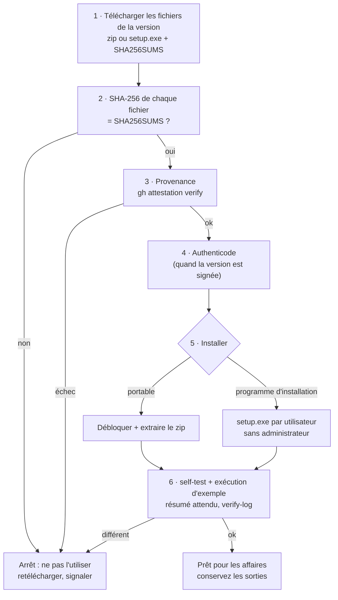

> La version de référence est la version anglaise ([installation.md](installation.md)) ; cette traduction la suit.

# Installation et vérification (Windows 10/11)

RV CertCheck s'exécute **localement** sur le PC Windows 10 ou 11 de l'expert (x64). Il n'a besoin ni de droits
d'administrateur, ni d'environnement d'exécution (runtime C statique, OpenSSL lié dans l'exécutable), ni de réseau,
sauf pour l'horodatage RFC 3161 facultatif et l'option explicite de révocation `--online`. Cette page couvre : obtenir
une version, **vérifier qu'il s'agit de la compilation publiée par Rakvor** (sommes de contrôle, provenance,
Authenticode par rapport à la racine Rakvor), SmartScreen, l'installer (zip portable ou programme d'installation par
utilisateur), les modules PKCS#11 pour les jetons matériels, l'autotest de la première exécution, l'usage hors ligne,
la compilation depuis les sources pour les auditeurs (OpenSSL embarqué), l'emplacement des fichiers et la
désinstallation.

Pourquoi la vérification compte : un tribunal peut demander comment vous savez que le programme exécuté est celui dont
un expert a examiné le code source. Les étapes 2–4 et 6 apportent cette réponse ; conservez leur sortie avec le
dossier ([admissibility.md](admissibility.md#examiner-checklist-before-filing-a-report), étape 3, en anglais).



## Prérequis

| Élément | Exigence |
| --- | --- |
| Système d'exploitation | Windows 10 ou 11, x64 (`MinVersion=10.0`, `ArchitecturesAllowed=x64compatible` dans le programme d'installation). Linux/macOS : compiler depuis les sources. |
| Droits | Utilisateur standard. Le programme d'installation est par utilisateur (`PrivilegesRequired=lowest`). |
| Disque | Les deux exécutables et la documentation (quelques Mo) ; les sorties demandent environ 11 fichiers de rapport par élément pour une langue (19 avec `--lang all`) plus les journaux. |
| Mémoire | Les fichiers sont lus par blocs de 1 Mio : la mémoire utilisée ne croît pas avec la taille du fichier. |
| Graphisme | Rien n'est requis : la GUI fonctionne aussi sur des machines virtuelles sans pilote GPU (rendu logiciel). |
| Réseau | Aucun, sauf la demande d'horodatage facultative et `analyze --online` (voir l'[étape 7](#7-usage-hors-ligne-et-sur-poste-isolé)). |
| Vérification des versions | Facultative, simple notification : l'application de bureau au démarrage et `rv-certcheck update-check` lisent la page publique de la dernière version sur github.com ([Vérification des versions](#vérification-des-versions)) ; `RV_NO_UPDATE_CHECK=1` la désactive. |
| Jeton matériel (facultatif) | Un module PKCS#11 pour le jeton : YubiKey 5 avec le Yubico PIV Tool (`libykcs11.dll`), un module de fabricant de HSM, ou SoftHSM2 pour les tests (voir [5d](#5d-modules-pkcs11-jetons-matériels)). |

## 1. Téléchargement

Les fichiers de la version sont sur la page Releases GitHub du dépôt (`rakvor/rv-certcheck`) :

| Fichier | Ce que c'est |
| --- | --- |
| `rv-certcheck-X.Y.Z-windows-x64.zip` | Portable : `rv-certcheck.exe`, `rv-certcheck-gui.exe`, README, LICENSE, COMMERCIAL.md, NOTICE, CHANGELOG, `docs/`, `examples/` |
| `rv-certcheck-X.Y.Z-windows-x64-setup.exe` | Programme d'installation Inno Setup, par utilisateur |
| `SHA256SUMS` | SHA-256 du zip, du programme d'installation et du SBOM (format `sha256sum` : `<hash>  ./<file>`) |
| `sbom.cdx.json` | Nomenclature logicielle CycloneDX (chaque dépendance Rust et sa version) |

Placez-les dans un même dossier, par ex. `C:\Rakvor\downloads\rv-certcheck-0.1.0\`.

## 2. Vérifier le téléchargement

```powershell
cd C:\Rakvor\downloads\rv-certcheck-0.1.0
Get-Content .\SHA256SUMS | ForEach-Object {
    $hash, $name = $_ -split '\s+', 2
    $name = $name.TrimStart('*').Replace('./', '')
    if (Test-Path $name) {
        $actual = (Get-FileHash -Algorithm SHA256 $name).Hash.ToLower()
        if ($actual -eq $hash) { "OK    $name" } else { "FAIL  $name  (got $actual)" }
    } else { "skip  $name (not downloaded)" }
}
```

```bash
sha256sum -c --ignore-missing SHA256SUMS      # Linux, ou Git Bash sous Windows
```

Chaque fichier téléchargé doit afficher `OK`. `SHA256SUMS` est produit par le même workflow et n'est pas attesté
lui-même : l'étape 3 est le contrôle le plus fort.

## 3. Vérifier la provenance de la compilation

Chaque zip et programme d'installation porte une attestation de provenance de compilation GitHub
(`actions/attest-build-provenance`) : une déclaration signée que ce fichier exact a été compilé par le workflow de
publication du dépôt à partir d'un commit donné. Sur une machine avec accès à internet et la CLI GitHub :

```powershell
gh attestation verify .\rv-certcheck-0.1.0-windows-x64.zip --repo rakvor/rv-certcheck
gh attestation verify .\rv-certcheck-0.1.0-windows-x64-setup.exe --repo rakvor/rv-certcheck
```

La sortie nomme le workflow (`.github/workflows/release.yml`) et le commit source ; consignez les deux. Pour un
laboratoire isolé, vérifiez sur une machine connectée et transportez les fichiers vérifiés sur un support protégé en
écriture (la CLI GitHub peut aussi télécharger le paquet d'attestation et la racine de confiance pour une vérification
hors ligne ; voir `gh attestation verify --help`). `SHA256SUMS` et le SBOM ne sont pas attestés.

## 4. Vérifier la signature Authenticode (versions signées)

Le workflow de publication signe `rv-certcheck.exe`, `rv-certcheck-gui.exe` et le programme d'installation
**seulement quand un certificat de signature de code est configuré** pour le dépôt (secret `SIGN_PFX_BASE64` ; signtool
avec SHA-256 et un horodatage RFC 3161). La façon dont Rakvor crée ce certificat et sa racine, cérémonie des clés
comprise, est décrite dans [company-pki.md](company-pki.md) (en anglais). Vérifiez :

```powershell
Get-AuthenticodeSignature .\rv-certcheck-0.1.0-windows-x64-setup.exe |
    Format-List Status, StatusMessage, SignerCertificate, TimeStamperCertificate
# après extraction du zip :
Get-AuthenticodeSignature .\rv-certcheck.exe, .\rv-certcheck-gui.exe | Format-Table Status, Path
```

| État | Signification |
| --- | --- |
| `Valid` | Signé et intact ; vérifiez que le signataire est l'entité Rakvor attendue |
| `NotSigned` | La version a été compilée sans certificat de signature : appuyez-vous sur les étapes 2–3 ; Windows SmartScreen avertira |
| `HashMismatch` / autre | Arrêt : le fichier a été modifié après la signature |

Avec le SDK Windows, `signtool verify /pa /v rv-certcheck.exe` affiche la chaîne complète.

### 4b. Vérifier que le signataire remonte à la racine Rakvor

Les versions sont signées avec le certificat de signature de code **interne** de Rakvor, qui remonte à
`packaging/signing/rakvor-code-signing-root.cer` (`CN=Rakvor Internal Code Signing Root CA, O=Rakvor`, empreinte
SHA-256 `dc9ba1a2fcd4f0633c5214b7cceb25bed8f3f7d9ebaf111590250cbcaa83df60`). Le workflow de publication importe cette
racine et lance `signtool verify /pa /tw` sur chaque fichier signé avant de publier. Pour vérifier sur votre machine,
sans installer la racine :

```powershell
$sig  = Get-AuthenticodeSignature .\rv-certcheck.exe
$root = New-Object System.Security.Cryptography.X509Certificates.X509Certificate2 C:\Rakvor\rakvor-code-signing-root.cer
$chain = New-Object System.Security.Cryptography.X509Certificates.X509Chain
$chain.ChainPolicy.RevocationMode = 'NoCheck'
$chain.ChainPolicy.VerificationFlags = 'AllowUnknownCertificateAuthority'
$chain.ChainPolicy.ExtraStore.Add($root) | Out-Null
$chain.Build($sig.SignerCertificate) | Out-Null
$top = $chain.ChainElements[$chain.ChainElements.Count - 1].Certificate
$top.GetCertHashString('SHA256')   # doit afficher DC9BA1A2FCD4F0633C5214B7CCEB25BED8F3F7D9EBAF111590250CBCAA83DF60
```

(Utilisez la copie de la racine de l'arbre des sources ou d'une machine Rakvor, pas une copie livrée à côté du
téléchargement.) Le même contrôle avec cet outil : exportez la chaîne du signataire (`certutil -dump`, ou l'onglet
*Signatures numériques* → *Afficher le certificat* → *Copier dans un fichier*), puis
`rv-certcheck analyze -i signer.cer -i intermediate.cer --anchor rakvor --purpose code-signing --at <signing date>`
doit signaler `CERT_CHAIN_VALID` et `CERT_ISSUED_BY_RAKVOR_INTERNAL`. L'outil ne vérifie les signatures Authenticode
elles-mêmes qu'à partir de la v0.2.

**C'est une racine interne.** Windows ne lui fait pas confiance si elle n'a pas été installée sur la machine
(stratégie de groupe ou `Import-Certificate -CertStoreLocation Cert:\LocalMachine\Root`, voir
[company-pki.md](company-pki.md)) ; sur les autres machines, `Get-AuthenticodeSignature` indique `UnknownError` /
racine non approuvée même si le fichier est intact. Appuyez-vous sur le contrôle d'empreinte ci-dessus.

### 4c. SmartScreen

SmartScreen juge un téléchargement sur la réputation de son signataire auprès de Microsoft, qu'un certificat interne
n'a pas. Sur une machine sans la racine Rakvor, ou pour une nouvelle version, Windows affiche *« Windows a protégé
votre ordinateur »*. Seulement après la réussite des étapes 2–4b : *Informations complémentaires → Exécuter quand
même*, ou `Unblock-File` sur le zip avant de l'extraire (étape 5a). Ne contournez jamais l'avertissement pour un
fichier qui a échoué à un contrôle.

## 5. Installer

### 5a. Zip portable

```powershell
# seulement après les étapes 2–4
Unblock-File .\rv-certcheck-0.1.0-windows-x64.zip
Expand-Archive .\rv-certcheck-0.1.0-windows-x64.zip -DestinationPath C:\Rakvor\tools\rv-certcheck-0.1.0
cd C:\Rakvor\tools\rv-certcheck-0.1.0
.\rv-certcheck.exe --version
```

Gardez un dossier par version, pour pouvoir relancer une ancienne affaire avec la version exacte consignée dans son
`environment.json`. Facultatif, pour la session en cours seulement : `$env:Path += ";C:\Rakvor\tools\rv-certcheck-0.1.0"`.

### 5b. Programme d'installation (par utilisateur, sans administrateur)

Double-cliquez sur `rv-certcheck-X.Y.Z-windows-x64-setup.exe` (assistant en anglais, espagnol ou français). Il
installe dans `%LOCALAPPDATA%\Programs\Rakvor\RV CertCheck\`, crée un groupe *Rakvor* dans le menu Démarrer
(application + documentation) et propose deux tâches : **Add the rv-certcheck command to PATH** (PATH de l'utilisateur,
cochée à la première installation) et une icône sur le bureau. Ouvrez ensuite un **nouveau** terminal pour que le PATH
s'applique.

Sans intervention :

```powershell
.\rv-certcheck-0.1.0-windows-x64-setup.exe /VERYSILENT /SUPPRESSMSGBOXES /NORESTART /TASKS="addtopath"
```

Le programme d'installation copie les exécutables, README, LICENSE, COMMERCIAL.md, NOTICE, CHANGELOG, `docs\` et les
éléments d'exemple (`examples\sample\evidence\`), pas les scripts d'exemple ni `expected_hashes.csv` (ils sont dans le
zip et l'arbre des sources).

<!-- forge:domain -->
### 5c. Bibliothèques natives

Aucune à installer. **OpenSSL 3** est compilé depuis les sources pendant la compilation (crate `openssl` avec la
fonctionnalité `vendored`, `openssl-src`) et lié statiquement dans les deux exécutables ; aucun OpenSSL du système ni
aucune DLL n'est utilisé, et sa version est consignée à chaque exécution (`environment.json`, `chain.json`). Les
empreintes, le générateur de PDF, le client RFC 3161 et le signataire CMS des rapports sont des crates Rust (listés
dans le SBOM) ; le runtime C est lié statiquement (`.cargo/config.toml`).

### 5d. Modules PKCS#11 (jetons matériels)

Seules les commandes de création qui utilisent un jeton (`tokens list`, `pki init-root`/`issue`/`import`, `csr new`
avec `--pkcs11-module`) chargent un module PKCS#11, à l'exécution, depuis le chemin que vous donnez. RV CertCheck
n'installe rien ; le module vient du fabricant du jeton.

| Jeton | Module | Remarques |
| --- | --- | --- |
| YubiKey 5 (PIV) | Yubico PIV Tool : `C:\Program Files\Yubico\Yubico PIV Tool\bin\libykcs11.dll` (Linux : `libykcs11.so`) | Changez le PIN, le PUK et la clé de gestion de leurs valeurs d'usine avant usage. L'usage réel d'une YubiKey est un contrôle manuel : il n'est pas exercé en CI |
| HSM | La bibliothèque PKCS#11 du fabricant | Suivez la procédure de sauvegarde du fabricant pour les clés racine |
| SoftHSM2 (tests seulement) | `/usr/lib/softhsm/libsofthsm2.so` (Debian/Ubuntu `apt install softhsm2`), `softhsm2.dll` sous Windows | Jeton logiciel ; jamais pour de vraies clés |

Vérifiez le module et notez le numéro de série du jeton :

```powershell
rv-certcheck tokens list --pkcs11-module "C:\Program Files\Yubico\Yubico PIV Tool\bin\libykcs11.dll"
```

SoftHSM2 pour les tests de jetons :

```bash
sudo apt install softhsm2
softhsm2-util --init-token --free --label rv-test --so-pin 0000 --pin 1234
softhsm2-util --show-slots            # notez le numéro de série du jeton
export RV_TEST_PKCS11_MODULE=/usr/lib/softhsm/libsofthsm2.so RV_TEST_PKCS11_SERIAL=<serial> RV_TEST_PKCS11_PIN=1234
cargo test -p rv-certcheck-certs --test acceptance_creation --test create_lab_tokens
```

Sans ces trois variables, les tests de jetons affichent un message d'omission ; le workflow de CI de ce commit ne les
définit pas.

### 5e. Cérémonie des clés

Une clé d'AC racine n'est créée sur un jeton qu'avec `--confirm-root` (le message de refus renvoie ici). La liste de
contrôle de la cérémonie (deux personnes, machine hors ligne, deux jetons, PIN sous scellés, procès-verbal, sauvegarde)
est dans [company-pki.md](company-pki.md#key-ceremony-checklist) (en anglais).
<!-- /forge:domain -->

## 6. Autotest de la première exécution et exemple

```powershell
rv-certcheck --version
rv-certcheck self-test
```

`self-test` affiche `PASS` pour md5, sha1, sha256, sha512, sha3-256 et blake3 (réponses connues pour `"abc"`), avec le code de sortie
0. Il ne teste que les implémentations d'empreinte. Lancez ensuite l'exemple de laboratoire, qui met en
œuvre la reconnaissance, la validation des chaînes, la révocation, les jetons d'horodatage, le rapprochement des clés,
les rapports et la chaîne d'audit :

```powershell
# zip portable (script inclus) : self-test, analyze de l'exemple, verify-log, hashes.csv contre expected_hashes.csv
.\examples\sample\run.ps1 -Bin .\rv-certcheck.exe

# programme d'installation (le script n'est pas installé) : lancez-le à la main dans un dossier temporaire
$app = "$env:LOCALAPPDATA\Programs\Rakvor\RV CertCheck"
$out = Join-Path $env:TEMP "rv-certcheck-check"
rv-certcheck analyze -i "$app\examples\sample\evidence" --anchor "$app\examples\sample\anchors\rakvor-lab-root.crt" `
  --at 2026-06-01T00:00:00Z --hash sha256,md5 --out $out --progress none --no-timestamp
$LASTEXITCODE                                  # 3 (constatations élevées attendues : expiré, révoqué, mauvaise racine, clé discordante)
rv-certcheck verify-log (Get-ChildItem "$out\logs" | Select-Object -Last 1).FullName   # OK … chain intact
```

<!-- forge:domain -->
Résumé attendu : **13 items, 0 errors, findings high 4, medium 4, low 0, info 9**, code de sortie **3**. Par code :
`CERT_CHAIN_VALID` 7, `REVOCATION_UNKNOWN` 2, et un de chacun de `CERT_CHAIN_UNTRUSTED`, `CERT_EXPIRED_AT_DATE`,
`CERT_REVOKED`, `KEY_DOES_NOT_MATCH`, `CERT_WEAK_KEY`, `CERT_WEAK_SIGNATURE_ALGORITHM`, `TIMESTAMP_TOKEN_VALID` et
`CRYPTO_INPUT_NOT_RECOGNISED` (rapport de statistiques, *constatations par code*). Les attentes par fichier sont dans
[examples/README.md](../examples/README.md) (en anglais) et `examples/sample/expected_findings.json` ; le SHA-256 et le
MD5 des 13 fichiers sont dans `examples/sample/expected_hashes.csv` (calculés indépendamment avec Python).

`run.ps1` / `run.sh` acceptent le code 0 ou 3 d'`analyze`, puis lisent le `logs\<RUN-ID>\hashes.csv` de l'outil et
comparent la taille, le SHA-256 et le MD5 de chaque fichier avec `expected_hashes.csv`, affichent
`hashes.csv matches expected_hashes.csv (13 files: size, SHA-256, MD5)` et sortent avec le code 3 à la moindre
différence. Pour le programme d'installation (le script n'est pas installé), comparez `expected_hashes.csv` avec
`$out\logs\<RUN-ID>\hashes.csv`, ou lancez `python tests\verify_chain.py <log folder>` depuis l'arbre des sources, qui
recalcule l'empreinte de chaque fichier de `hashes.csv` et de chaque sortie consignée par le journal d'audit.
<!-- /forge:domain -->

Conservez la sortie de la console et le dossier de l'exécution comme trace de cette vérification.

## 7. Usage hors ligne et sur poste isolé

L'accès réseau du code se limite à : la demande d'horodatage RFC 3161 du journal d'audit (un HTTP POST d'une empreinte
de 32 octets vers la TSA, [src/core/src/trust.rs](../src/core/src/trust.rs)) et, **seulement avec
`analyze --online`**, des requêtes GET vers les points de distribution de CRL et POST vers les répondeurs OCSP nommés
dans les certificats examinés ([src/certs/src/analysis/online.rs](../src/certs/src/analysis/online.rs) ; chaque URL,
heure et SHA-256 de la réponse est audité). `trust-list import` ne lit qu'un fichier local. Il n'y a ni télémétrie ni
contrôle de licence.

| Pour désactiver l'horodatage | Comment |
| --- | --- |
| Une exécution de la CLI | `--no-timestamp` |
| Toutes les exécutions de la CLI sur ce PC / cette session | `$env:RV_NO_TIMESTAMP = "1"` (ou définissez-la comme variable d'environnement utilisateur) |
| GUI | décochez **4. Confiance → Horodatage qualifié** avant *Lancer l'analyse* |

Une exécution hors ligne avec l'horodatage activé se termine quand même : elle consigne `timestamp_pending` et le
rapport de statistiques affiche un avertissement. Plus tard, sur une machine qui peut joindre la TSA, lancez
`rv-certcheck timestamp <log folder>` (il revérifie la chaîne, puis ajoute `timestamp_obtained`). Pour utiliser une
TSA interne ou qualifiée, passez `--tsa-url` (voir
[admissibility.md](admissibility.md#53-eidas--regulation-eu-9102014-as-amended-by-eu-20241183), en anglais). Malgré
son libellé dans l'interface, cet horodatage n'est qualifié au sens d'eIDAS que si l'adresse est celle d'un
prestataire de services de confiance qualifié (QTSP) inscrit sur une liste de confiance de l'UE ; l'adresse par défaut
(DigiCert) ne l'est pas. Le système d'exploitation n'impose pas la restriction réseau ; sur un poste connecté, une
règle sortante du Pare-feu Windows pour `rv-certcheck.exe` / `rv-certcheck-gui.exe` qui n'autorise que l'hôte de la
TSA l'impose.

## 8. Compiler depuis les sources pour les auditeurs

### Chaîne de compilation

| Élément | Version |
| --- | --- |
| Rust | Fixé par [rust-toolchain.toml](../rust-toolchain.toml) : **1.97.0** avec rustfmt et clippy ; `rustup` l'installe et le choisit automatiquement dans l'arbre des sources. `Cargo.toml` déclare `rust-version = "1.88"` (édition 2024) comme minimum. Pour reproduire exactement une version, utilisez le compilateur consigné dans l'`environment.json` de cette version → `tool.rustc` (par ex. `rustc 1.97.0 (2d8144b78 2026-07-07)`). |
| Éditeur de liens Windows | Visual Studio 2022 Build Tools, charge de travail *Desktop development with C++* (MSVC + Windows SDK) ; cible `x86_64-pc-windows-msvc`. Le CRT statique est fixé dans `.cargo/config.toml`. |
| OpenSSL (embarqué) | Compilé depuis les sources par `openssl-src` pendant `cargo build` : il faut un compilateur C (MSVC sous Windows, avec son `nmake` ; `make` ailleurs) et **Perl**. **Windows : Strawberry Perl** (`choco install strawberryperl` ; le perl de Git Bash ne peut pas configurer OpenSSL pour MSVC). S'il y a plusieurs perl dans le PATH, désignez Strawberry à la compilation : `$env:OPENSSL_SRC_PERL = "C:\Strawberry\perl\bin\perl.exe"` (ce que fait la CI). NASM n'est pas nécessaire (compilation `no-asm` sans lui). |
| Linux | `gcc` (ou `clang`), `make` et `perl` pour l'OpenSSL embarqué ; rien d'autre pour compiler la CLI. |
| Facultatif | La ligne de commande `openssl` pour les tests de l'oracle OpenSSL (obligatoire en CI) ; Python `cryptography` (installé avec `pyhanko`) pour le second oracle. |
| Facultatif | Python 3.12 avec `blake3 jsonschema pyhanko` pour les vérificateurs indépendants et les tests de confiance (`RV_TEST_PYTHON=python`). |

### Compilation

```powershell
git clone https://github.com/Panacota96/rv-certcheck.git
cd rv-certcheck
git checkout v0.1.0                       # l'étiquette de la version examinée
rustc --version                           # doit afficher la 1.97.0 fixée
cargo build --release --locked -p rv-certcheck-cli -p rv-certcheck-gui
.\target\release\rv-certcheck.exe self-test
.\examples\sample\run.ps1 -Bin .\target\release\rv-certcheck.exe
cargo test --workspace --locked            # tests unitaires + d'intégration (les tests de confiance sont ignorés sans pyhanko)
```

```bash
# Linux
cargo build --release --locked -p rv-certcheck-cli
target/release/rv-certcheck self-test && examples/sample/run.sh target/release/rv-certcheck
python3 tests/verify_chain.py examples/sample/out/logs/$(ls examples/sample/out/logs | tail -n 1)
# entre profils : un dossier d'affaire écrit par le profil Python doit se vérifier avec cette compilation
python3 tests/golden/unpack.py tests/golden/case-by-python.zip.b64 /tmp/golden
target/release/rv-certcheck verify-case /tmp/golden/CASE-GOLDEN
```

`--locked` refuse de compiler si `Cargo.lock` devait changer : l'ensemble des dépendances est donc celui listé dans
`environment.json` → `dependencies` et dans `sbom.cdx.json`. La version du produit vient de `version.txt` ; les
versions des crates dans `Cargo.toml` restent fixes, donc une publication ne change jamais le fichier de verrouillage.

### Reproduire les empreintes de la version

Soyez précis sur ce qui peut ou non correspondre bit à bit dans cette version (écart G22) :

| Artefact | Identique bit à bit à la version ? | Comment le vérifier |
| --- | --- | --- |
| Fichiers de `docs/`, `examples/` | Oui (depuis git ; fins de ligne LF sauf `*.ps1`, `*.iss`) | `git ls-files` + `Get-FileHash` contre le zip extrait |
| `rv-certcheck.exe`, `rv-certcheck-gui.exe` | **Non garanti** : les chemins ne sont pas remappés et l'en-tête PE porte des données de l'édition de liens. Le compilateur est celui fixé dans `rust-toolchain.toml` (les deux workflows lancent `rustup toolchain install`, qui lit ce fichier ; confirmez-le avec `environment.json` → `tool.rustc` d'une exécution de la version) | L'attestation de provenance (étape 3) relie le binaire publié au workflow et au commit ; comparez ensuite le comportement (ci-dessous) |
| zip, programme d'installation | Non (horodatages de l'archive) | Attestation (étape 3) |

**Équivalence fonctionnelle** : lancez l'exemple avec le binaire publié et avec votre compilation, puis comparez les
empreintes et les constatations de chaque élément :

```bash
python - "<release-out>/reports/<RUN-ID>" "<your-out>/reports/<RUN-ID>" <<'EOF'
import glob, json, sys
def load(run):
    out = {}
    for p in sorted(glob.glob(f"{run}/items/*/technical.json")):
        t = json.load(open(p, encoding="utf-8"))
        out[t["item"]["file_name"]] = (t["hashes"], t["item"]["detected_type"],
                                       [(f["code"], f["severity"], f["params"]) for f in t["findings"]])
    return out
a, b = load(sys.argv[1]), load(sys.argv[2])
print("identical findings and digests" if a == b else "DIFFERENT: " + ", ".join(k for k in a if a.get(k) != b.get(k)))
EOF
```

Le même script compare cette compilation avec le profil Python de l'outil (mesuré identique sur l'exemple).

## 9. Où se trouvent les choses

| Quoi | Emplacement |
| --- | --- |
| Programme (programme d'installation) | `%LOCALAPPDATA%\Programs\Rakvor\RV CertCheck\` (`rv-certcheck.exe`, `rv-certcheck-gui.exe`, `docs\`, `examples\sample\evidence\`, `unins000.exe`) |
| Programme (portable) | le dossier que vous avez extrait |
| Entrée du PATH (tâche du programme d'installation) | variable d'environnement utilisateur `Path` (`HKCU\Environment`) |
| Sorties des exécutions | `--out` (par défaut `.\rakvor-out` **relatif au dossier courant**) : `logs\<RUN-ID>\`, `reports\<RUN-ID>\`. Avec `--case-dir` : `<CASE>\runs\rv-certcheck\<RUN-ID>\`. La GUI utilise son champ *Dossier de sortie* (ou le dossier de l'affaire) |
| Dossier de l'affaire | là où vous le créez avec `--case-dir` (`case.json`, `case-log.jsonl`, `evidence\`, `runs\`) |
| Réglages de la GUI | non conservés : chaque démarrage utilise les valeurs par défaut ; chaque modification faite avant une exécution est consignée dans le journal d'audit de cette exécution (`ui_*`) |
| Certificat de signature | là où vous le rangez ; seuls son chemin, son sujet et son empreinte SHA-256 sont journalisés, jamais le mot de passe |
| Instantanés de listes de confiance | `%LOCALAPPDATA%\Rakvor\rv-certcheck\trust-lists\<eu|co>\<id>.json` (+ `.sha256`) ; `RV_CERTCHECK_DATA` remplace le dossier de base |
| Dossiers d'AC, fichiers de clé, jeux de laboratoire | là où vous les créez (`--ca`, `--key-file`, `--lab-out`) ; fichiers de clé réservés au propriétaire |
| Fichiers temporaires | les CRL données à OpenSSL pendant la vérification d'une chaîne, écrites en PEM dans le dossier temporaire du système et supprimées après l'appel |

## 10. Désinstaller

- **Programme d'installation :** *Paramètres → Applications → Applications installées → RV CertCheck → Désinstaller*,
  ou lancez `"%LOCALAPPDATA%\Programs\Rakvor\RV CertCheck\unins000.exe"`. Il retire les fichiers installés et les
  raccourcis. Dans cette version, **l'entrée du PATH de l'utilisateur n'est pas retirée** ; retirez-la avec :

  ```powershell
  $dir = "$env:LOCALAPPDATA\Programs\Rakvor\RV CertCheck"
  $p = [Environment]::GetEnvironmentVariable("Path", "User").Split(";") | Where-Object { $_ -and $_ -ne $dir }
  [Environment]::SetEnvironmentVariable("Path", ($p -join ";"), "User")
  ```

- **Portable :** supprimez le dossier.
- **Conservés volontairement** (dans les deux cas) : les sorties des exécutions et les dossiers d'affaire (pièces de
  l'affaire). Conservez le zip de la version et le `SHA256SUMS` de chaque version utilisée dans une affaire, pour
  pouvoir la relancer.

## 11. Dépannage de l'installation

| Symptôme | Cause et solution |
| --- | --- |
| SmartScreen « Windows a protégé votre ordinateur » | Version non signée (étape 4 `NotSigned`). Seulement après la réussite des étapes 2–3 : *Informations complémentaires → Exécuter quand même*. |
| `rv-certcheck` n'est pas reconnu | La tâche PATH n'a pas été choisie, ou le terminal a été ouvert avant l'installation : ouvrez un nouveau terminal ou utilisez le chemin complet. |
| `self-test` affiche `FAIL` | N'utilisez pas cette version pour des éléments de preuve ; retéléchargez-la et refaites les étapes 2–4. |
| Le résumé de l'exemple diffère de l'étape 6 | Mauvaise version ou fichiers d'exemple modifiés ; comparez `environment.json` aux notes de version et les empreintes de l'exemple à `expected_hashes.csv`. |
| Fenêtre de la GUI vide ou très lente sur une machine virtuelle | Pas de pilote GPU : le rendu logiciel est utilisé ; donnez plus de CPU à la machine virtuelle. |
| La compilation échoue dans `openssl-sys` / `openssl-src` sous Windows (l'étape de configuration d'OpenSSL ne peut pas lancer Perl) | Installez Strawberry Perl et définissez `OPENSSL_SRC_PERL` (étape 8). |
| `--anchor system` refusé sous Windows | Indisponible sous Windows en v0.1 : exportez la racine et utilisez `--anchor FILE`. |
| `tokens list` ne parvient pas à charger le module | Mauvais chemin ou module 32 bits : utilisez le `libykcs11.dll` 64 bits du Yubico PIV Tool. |
| La compilation depuis les sources télécharge un autre compilateur | Attendu : rustup installe la 1.97.0 fixée dans `rust-toolchain.toml`. Hors ligne, installez-la d'abord (`rustup toolchain install 1.97.0 --profile minimal`). |

## Vérification des versions

Une version plus récente est-elle publiée ? L'outil peut vous le dire ; il ne se met jamais à jour lui-même.

| | |
| --- | --- |
| Quand | L'application de bureau vérifie une fois au démarrage, en arrière-plan (un bandeau avec la page de la version n'apparaît que si une version plus récente existe). La CLI ne vérifie qu'avec `rv-certcheck update-check` (`--json` pour les scripts ; code 0 = la dernière, 3 = version plus récente, 1 = vérification impossible). Aucune autre commande ne contacte le réseau pour cela. RV Hub vérifie chaque outil qu'il liste. |
| Ce qui est envoyé | Un HTTPS GET de `https://github.com/Panacota96/rv-certcheck/releases/latest` (la redirection est lue, pas suivie) avec `User-Agent: rv-certcheck/<version>` et aucun autre en-tête, cookie ni paramètre : rien sur l'affaire, les éléments, l'expert ou la machine. |
| Ce qu'elle fait | Elle nomme la version plus récente et sa page. Elle ne télécharge ni n'installe jamais rien : téléchargez la version et vérifiez-la (`SHA256SUMS`, chaîne Authenticode jusqu'à la racine Rakvor) comme dans [Vérifier le téléchargement](#2-vérifier-le-téléchargement) avant usage. |
| Audit | La vérification ne fait pas partie d'une exécution et n'est écrite dans aucun journal d'audit ; une vérification en échec ou lente (hors ligne, délai de 5 s) ne bloque jamais l'outil. |
| La désactiver | `RV_NO_UPDATE_CHECK=1` (toute valeur sauf vide ou `0`), ou le fichier `update-check-off` dans `%APPDATA%\Rakvor` (le réglage de RV Hub l'écrit) : désactivée pour tous les outils Rakvor de ce PC. |
| Code | [src/core/src/update.rs](../src/core/src/update.rs) (partagé, identique octet pour octet, par tous les outils Rakvor) |
