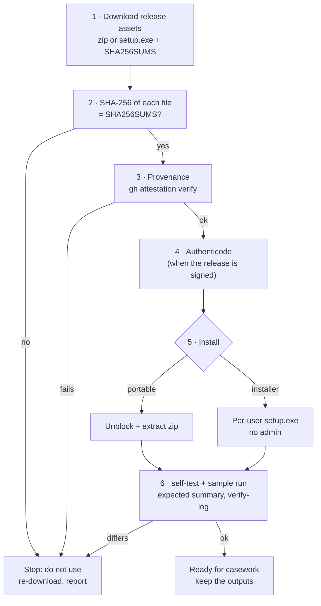

# Installation and verification (Windows 10/11)

RV CertCheck runs **locally** on the examiner's Windows 10 or 11 PC (x64). It needs no administrator rights, no
runtime (static C runtime, OpenSSL linked in) and no network, except for the optional RFC 3161 timestamp and the
explicit `--online` revocation option. This page covers: getting a release, **checking that it is the build
Rakvor published** (checksums, provenance, Authenticode against the Rakvor root), SmartScreen, installing it
(portable zip or per-user installer), PKCS#11 modules for hardware tokens, the first-run self-test, offline use,
building from source for auditors (vendored OpenSSL), where files live, and uninstalling.

Why verification matters: a court may ask how you know the program you ran is the one whose source an expert
reviewed. Steps 2–4 and 6 produce that answer; keep their output with the case file
([admissibility.md](admissibility.md#examiner-checklist-before-filing-a-report), step 3).



## Requirements

| Item | Requirement |
| --- | --- |
| Operating system | Windows 10 or 11, x64 (`MinVersion=10.0`, `ArchitecturesAllowed=x64compatible` in the installer). Linux/macOS: build from source. |
| Rights | Standard user. The installer is per-user (`PrivilegesRequired=lowest`). |
| Disk | The two executables and the docs (a few MB); outputs need about 11 report files per item for one language (19 with `--lang all`) plus the logs. |
| Memory | Files are streamed in 1 MiB chunks: memory use does not grow with file size. |
| Graphics | None required: the GUI also runs on VMs without a GPU driver (software rendering). |
| Network | None, except the optional timestamp request and `analyze --online` (see [step 7](#7-offline-and-air-gapped-use)). |
| Hardware token (optional) | A PKCS#11 module for the token: YubiKey 5 with the Yubico PIV Tool (`libykcs11.dll`), an HSM vendor module, or SoftHSM2 for tests (see [5d](#5d-pkcs11-modules-hardware-tokens)). |

## 1. Download

Release assets on the GitHub Releases page of the repository (`rakvor/rv-certcheck`):

| Asset | What it is |
| --- | --- |
| `rv-certcheck-X.Y.Z-windows-x64.zip` | Portable: `rv-certcheck.exe`, `rv-certcheck-gui.exe`, README, LICENSE, NOTICE, CHANGELOG, `docs/`, `examples/` |
| `rv-certcheck-X.Y.Z-windows-x64-setup.exe` | Inno Setup installer, per-user |
| `SHA256SUMS` | SHA-256 of the zip, the installer and the SBOM (`sha256sum` format: `<hash>  ./<file>`) |
| `sbom.cdx.json` | CycloneDX software bill of materials (every Rust dependency and version) |

Put them in one folder, e.g. `C:\Rakvor\downloads\rv-certcheck-0.1.0\`.

## 2. Verify the download

```powershell
cd C:\Rakvor\downloads\rv-certcheck-0.1.0
Get-Content .\SHA256SUMS | ForEach-Object {
    $hash, $name = $_ -split '\s+', 2
    $name = $name.TrimStart('*').Replace('./', '')
    if (Test-Path $name) {
        $actual = (Get-FileHash -Algorithm SHA256 $name).Hash.ToLower()
        if ($actual -eq $hash) { "OK    $name" } else { "FAIL  $name  (got $actual)" }
    } else { "skip  $name (not downloaded)" }
}
```

```bash
sha256sum -c --ignore-missing SHA256SUMS      # Linux, or Git Bash on Windows
```

Every downloaded file must print `OK`. `SHA256SUMS` is produced by the same workflow and is not attested itself:
step 3 is the stronger check.

## 3. Verify build provenance

Each zip and installer carries a GitHub build-provenance attestation (`actions/attest-build-provenance`): a signed
statement that this exact file was built by the repository's release workflow from a given commit. On a machine
with internet access and the GitHub CLI:

```powershell
gh attestation verify .\rv-certcheck-0.1.0-windows-x64.zip --repo rakvor/rv-certcheck
gh attestation verify .\rv-certcheck-0.1.0-windows-x64-setup.exe --repo rakvor/rv-certcheck
```

The output names the workflow (`.github/workflows/release.yml`) and the source commit; record both. For an
air-gapped lab, verify on a connected machine and carry the verified files on write-protected media (the GitHub CLI
can also download the attestation bundle and trusted root for offline checks; see `gh attestation verify --help`).
`SHA256SUMS` and the SBOM are not attested.

## 4. Verify the Authenticode signature (signed releases)

The release workflow signs `rv-certcheck.exe`, `rv-certcheck-gui.exe` and the installer **only when a code-signing
certificate is configured** for the repository (`SIGN_PFX_BASE64` secret; signtool with SHA-256 and an RFC 3161
timestamp). How Rakvor creates that certificate and its root, including the key ceremony, is in
[company-pki.md](company-pki.md). Check:

```powershell
Get-AuthenticodeSignature .\rv-certcheck-0.1.0-windows-x64-setup.exe |
    Format-List Status, StatusMessage, SignerCertificate, TimeStamperCertificate
# after extracting the zip:
Get-AuthenticodeSignature .\rv-certcheck.exe, .\rv-certcheck-gui.exe | Format-Table Status, Path
```

| Status | Meaning |
| --- | --- |
| `Valid` | Signed and intact; check that the signer is the expected Rakvor entity |
| `NotSigned` | The release was built without a signing certificate: rely on steps 2–3; Windows SmartScreen will warn |
| `HashMismatch` / other | Stop: the file was altered after signing |

With the Windows SDK, `signtool verify /pa /v rv-certcheck.exe` shows the full chain.

### 4b. Check that the signer chains to the Rakvor root

Releases are signed with Rakvor's **internal** code-signing certificate, which chains to
`packaging/signing/rakvor-code-signing-root.cer` (`CN=Rakvor Internal Code Signing Root CA, O=Rakvor`, SHA-256
fingerprint `dc9ba1a2fcd4f0633c5214b7cceb25bed8f3f7d9ebaf111590250cbcaa83df60`). The release workflow imports that
root and runs `signtool verify /pa /tw` on every signed file before publishing. To check on your machine, without
installing the root:

```powershell
$sig  = Get-AuthenticodeSignature .\rv-certcheck.exe
$root = New-Object System.Security.Cryptography.X509Certificates.X509Certificate2 C:\Rakvor\rakvor-code-signing-root.cer
$chain = New-Object System.Security.Cryptography.X509Certificates.X509Chain
$chain.ChainPolicy.RevocationMode = 'NoCheck'
$chain.ChainPolicy.VerificationFlags = 'AllowUnknownCertificateAuthority'
$chain.ChainPolicy.ExtraStore.Add($root) | Out-Null
$chain.Build($sig.SignerCertificate) | Out-Null
$top = $chain.ChainElements[$chain.ChainElements.Count - 1].Certificate
$top.GetCertHashString('SHA256')   # must print DC9BA1A2FCD4F0633C5214B7CCEB25BED8F3F7D9EBAF111590250CBCAA83DF60
```

(Use the copy of the root from the source tree or from a Rakvor machine, not one shipped next to the download.)
The same check with this tool: export the signer chain (`certutil -dump`, or the *Digital Signatures* tab →
*View Certificate* → *Copy to File*), then
`rv-certcheck analyze -i signer.cer -i intermediate.cer --anchor rakvor --purpose code-signing --at <signing date>`
should report `CERT_CHAIN_VALID` and `CERT_ISSUED_BY_RAKVOR_INTERNAL`. Authenticode signatures themselves are
verified by the tool only from v0.2.

**This is an internal root.** Windows does not trust it unless it was installed on the machine (Group Policy or
`Import-Certificate -CertStoreLocation Cert:\LocalMachine\Root`, see [company-pki.md](company-pki.md)); on other
machines `Get-AuthenticodeSignature` reports `UnknownError` / untrusted root even though the file is intact. Rely on
the fingerprint check above.

### 4c. SmartScreen

SmartScreen judges a download by the reputation of its signer with Microsoft, which an internal certificate does
not have. On a machine without the Rakvor root, or for a new release, Windows shows *"Windows protected your PC"*.
Only after steps 2–4b pass: *More info → Run anyway*, or `Unblock-File` on the zip before extracting it (step 5a).
Never bypass the warning for a file that failed any check.

## 5. Install

### 5a. Portable zip

```powershell
# only after steps 2–4
Unblock-File .\rv-certcheck-0.1.0-windows-x64.zip
Expand-Archive .\rv-certcheck-0.1.0-windows-x64.zip -DestinationPath C:\Rakvor\tools\rv-certcheck-0.1.0
cd C:\Rakvor\tools\rv-certcheck-0.1.0
.\rv-certcheck.exe --version
```

Keep one folder per version so a past case can be re-run with the exact version recorded in its
`environment.json`. Optional, current session only: `$env:Path += ";C:\Rakvor\tools\rv-certcheck-0.1.0"`.

### 5b. Installer (per-user, no administrator)

Double-click `rv-certcheck-X.Y.Z-windows-x64-setup.exe` (English, Spanish or French wizard). It installs to
`%LOCALAPPDATA%\Programs\Rakvor\RV CertCheck\`, creates a *Rakvor* Start-menu group (app + documentation), and offers
two tasks: **Add the rv-certcheck command to PATH** (user PATH, checked on first install) and a desktop icon. Open a
**new** terminal afterwards for PATH to apply.

Unattended:

```powershell
.\rv-certcheck-0.1.0-windows-x64-setup.exe /VERYSILENT /SUPPRESSMSGBOXES /NORESTART /TASKS="addtopath"
```

The installer copies the executables, README, LICENSE, NOTICE, CHANGELOG, `docs\` and the sample evidence
(`examples\sample\evidence\`), not the sample scripts or `expected_hashes.csv` (those are in the zip and the source
tree).

<!-- forge:domain -->
### 5c. Native libraries

None to install. **OpenSSL 3** is compiled from source during the build (`openssl` crate with the `vendored`
feature, `openssl-src`) and linked statically into both executables; no system OpenSSL or DLL is used, and its
version is recorded in every run (`environment.json`, `chain.json`). Hashing, the PDF writer, the RFC 3161 client
and the CMS signer of the reports are Rust crates (listed in the SBOM); the C runtime is linked statically
(`.cargo/config.toml`).

### 5d. PKCS#11 modules (hardware tokens)

Only the creation commands that use a token (`tokens list`, `pki init-root`/`issue`/`import`, `csr new` with
`--pkcs11-module`) load a PKCS#11 module, at run time, from the path you give. Nothing is installed by RV
CertCheck; the module comes from the token vendor.

| Token | Module | Notes |
| --- | --- | --- |
| YubiKey 5 (PIV) | Yubico PIV Tool: `C:\Program Files\Yubico\Yubico PIV Tool\bin\libykcs11.dll` (Linux: `libykcs11.so`) | Change the PIN, PUK and management key from the factory values before use. Real YubiKey use is a manual check: it is not exercised in CI |
| HSM | The vendor's PKCS#11 library | Follow the vendor's backup procedure for root keys |
| SoftHSM2 (tests only) | `/usr/lib/softhsm/libsofthsm2.so` (Debian/Ubuntu `apt install softhsm2`), `softhsm2.dll` on Windows | Software token; never for real keys |

Check the module and note the token serial:

```powershell
rv-certcheck tokens list --pkcs11-module "C:\Program Files\Yubico\Yubico PIV Tool\bin\libykcs11.dll"
```

SoftHSM2 for the token tests:

```bash
sudo apt install softhsm2
softhsm2-util --init-token --free --label rv-test --so-pin 0000 --pin 1234
softhsm2-util --show-slots            # note the token serial
export RV_TEST_PKCS11_MODULE=/usr/lib/softhsm/libsofthsm2.so RV_TEST_PKCS11_SERIAL=<serial> RV_TEST_PKCS11_PIN=1234
cargo test -p rv-certcheck-certs --test acceptance_creation --test create_lab_tokens
```

Without those three variables the token tests print a skip message; the CI workflow of this commit does not set
them.

### 5e. Key ceremony

A root CA key is created on a token only with `--confirm-root` (the refusal message points here). The ceremony
checklist (two people, offline machine, two tokens, sealed PINs, minutes, backup) is in
[company-pki.md](company-pki.md#key-ceremony-checklist).
<!-- /forge:domain -->

## 6. First-run self-test and sample

```powershell
rv-certcheck --version
rv-certcheck self-test
```

`self-test` prints `PASS` for md5, sha1, sha256, sha512, sha3-256 and blake3 (known answers for `"abc"`), exit code
0. It tests the hash implementations only. Then run the lab sample, which exercises recognition, chain validation,
revocation, timestamp tokens, key matching, reports and the audit chain:

```powershell
# portable zip (script included): self-test, sample analyze, verify-log, hashes.csv vs expected_hashes.csv
.\examples\sample\run.ps1 -Bin .\rv-certcheck.exe

# installer (no script installed): run it by hand into a temporary folder
$app = "$env:LOCALAPPDATA\Programs\Rakvor\RV CertCheck"
$out = Join-Path $env:TEMP "rv-certcheck-check"
rv-certcheck analyze -i "$app\examples\sample\evidence" --anchor "$app\examples\sample\anchors\rakvor-lab-root.crt" `
  --at 2026-06-01T00:00:00Z --hash sha256,md5 --out $out --progress none --no-timestamp
$LASTEXITCODE                                  # 3 (high findings expected: expired, revoked, wrong root, key mismatch)
rv-certcheck verify-log (Get-ChildItem "$out\logs" | Select-Object -Last 1).FullName   # OK … chain intact
```

<!-- forge:domain -->
Expected summary: **13 items, 0 errors, findings high 4, medium 4, low 0, info 9**, exit code **3**. By code:
`CERT_CHAIN_VALID` 7, `REVOCATION_UNKNOWN` 2, and one each of `CERT_CHAIN_UNTRUSTED`, `CERT_EXPIRED_AT_DATE`,
`CERT_REVOKED`, `KEY_DOES_NOT_MATCH`, `CERT_WEAK_KEY`, `CERT_WEAK_SIGNATURE_ALGORITHM`, `TIMESTAMP_TOKEN_VALID` and
`CRYPTO_INPUT_NOT_RECOGNISED` (statistics report, *findings by code*). The per-file expectations are in
[examples/README.md](../examples/README.md) and `examples/sample/expected_findings.json`; the SHA-256 and MD5 of the
13 files are in `examples/sample/expected_hashes.csv` (computed independently with Python).

`run.ps1` / `run.sh` accept exit 0 or 3 from `analyze`, then read the tool's `logs\<RUN-ID>\hashes.csv` and compare
size, SHA-256 and MD5 of every file with `expected_hashes.csv`, print
`hashes.csv matches expected_hashes.csv (13 files: size, SHA-256, MD5)` and exit 3 on any difference. For the
installer (no script installed), compare `expected_hashes.csv` with `$out\logs\<RUN-ID>\hashes.csv`, or run
`python tests\verify_chain.py <log folder>` from the source tree, which re-hashes every file of `hashes.csv`.
<!-- /forge:domain -->

Keep the console output and the run folder as the record of this verification.

## 7. Offline and air-gapped use

Network access in the code is limited to: the RFC 3161 timestamp request for the audit log (one HTTP POST of a
32-byte hash to the TSA, [src/core/src/trust.rs](../src/core/src/trust.rs)), and, **only with `analyze --online`**,
GET requests to the CRL distribution points and POST requests to the OCSP responders named in the certificates
examined ([src/certs/src/analysis/online.rs](../src/certs/src/analysis/online.rs); each URL, time and response
SHA-256 is audited). `trust-list import` reads a local file only. There is no telemetry, update check or licence
check.

| To disable the timestamp | How |
| --- | --- |
| One CLI run | `--no-timestamp` |
| All CLI runs on this PC / session | `$env:RV_NO_TIMESTAMP = "1"` (or set it as a user environment variable) |
| GUI | untick **4. Trust → Trusted timestamp** before *Start review* |

An offline run with the timestamp enabled still completes: it logs `timestamp_pending` and the statistics report
shows a warning. Later, on a machine that can reach the TSA, run `rv-certcheck timestamp <log folder>` (it
re-verifies the chain, then appends `timestamp_obtained`). To use an internal or qualified TSA, pass `--tsa-url`
(see [admissibility.md](admissibility.md#53-eidas--regulation-eu-9102014-as-amended-by-eu-20241183)). The network
restriction is not enforced by the OS; on a connected workstation, a Windows Firewall outbound rule for
`rv-certcheck.exe` / `rv-certcheck-gui.exe` allowing only the TSA host enforces it.

## 8. Build from source for auditors

### Toolchain

| Item | Version |
| --- | --- |
| Rust | Pinned by [rust-toolchain.toml](../rust-toolchain.toml): **1.97.0** with rustfmt and clippy; `rustup` installs and selects it automatically inside the source tree. `Cargo.toml` declares `rust-version = "1.85"` (edition 2024) as the minimum. To match a release exactly, use the compiler recorded in that release's `environment.json` → `tool.rustc` (e.g. `rustc 1.97.0 (2d8144b78 2026-07-07)`). |
| Windows linker | Visual Studio 2022 Build Tools, workload *Desktop development with C++* (MSVC + Windows SDK); target `x86_64-pc-windows-msvc`. Static CRT is set in `.cargo/config.toml`. |
| OpenSSL (vendored) | Built from source by `openssl-src` during `cargo build`: needs a C compiler (MSVC on Windows, with its `nmake`; `make` elsewhere) and **Perl**. **Windows: Strawberry Perl** (`choco install strawberryperl`; Git Bash's perl cannot configure OpenSSL for MSVC). If several perls are on PATH, point the build at Strawberry: `$env:OPENSSL_SRC_PERL = "C:\Strawberry\perl\bin\perl.exe"` (what CI does). NASM is not needed (`no-asm` build without it). |
| Linux | `gcc` (or `clang`), `make` and `perl` for the vendored OpenSSL; nothing else to build the CLI. |
| Optional | The `openssl` command line for the OpenSSL oracle tests (mandatory in CI); Python `cryptography` (installed with `pyhanko`) for the second oracle. |
| Optional | Python 3.12 with `blake3 jsonschema pyhanko` for the independent verifiers and the trust tests (`RV_TEST_PYTHON=python`). |

### Build

```powershell
git clone https://github.com/Panacota96/rv-certcheck.git
cd rv-certcheck
git checkout v0.1.0                       # the tag of the release under review
rustc --version                           # must print the pinned 1.97.0
cargo build --release --locked -p rv-certcheck-cli -p rv-certcheck-gui
.\target\release\rv-certcheck.exe self-test
.\examples\sample\run.ps1 -Bin .\target\release\rv-certcheck.exe
cargo test --workspace --locked            # unit + integration tests (trust tests skip without pyhanko)
```

```bash
# Linux
cargo build --release --locked -p rv-certcheck-cli
target/release/rv-certcheck self-test && examples/sample/run.sh target/release/rv-certcheck
python3 tests/verify_chain.py examples/sample/out/logs/$(ls examples/sample/out/logs | tail -n 1)
# cross-profile: a case folder written by the Python profile must verify with this build
python3 tests/golden/unpack.py tests/golden/case-by-python.zip.b64 /tmp/golden
target/release/rv-certcheck verify-case /tmp/golden/CASE-GOLDEN
```

`--locked` refuses to build if `Cargo.lock` would change, so the dependency set equals the one listed in
`environment.json` → `dependencies` and in `sbom.cdx.json`. The product version comes from `version.txt`; the
crate versions in `Cargo.toml` stay fixed, so a release never changes the lock file.

### Reproducing the release hashes

Be precise about what can and cannot match bit for bit in this version (gap G22):

| Artefact | Bit-identical to the release? | How to check |
| --- | --- | --- |
| `docs/`, `examples/` files | Yes (from git; LF line endings except `*.ps1`, `*.iss`) | `git ls-files` + `Get-FileHash` against the extracted zip |
| `rv-certcheck.exe`, `rv-certcheck-gui.exe` | **Not guaranteed**: paths are not remapped and the PE header carries link-time data. The compiler is the one pinned in `rust-toolchain.toml` (both workflows run `rustup toolchain install`, which reads that file; confirm with `environment.json` → `tool.rustc` of a release run) | Provenance attestation (step 3) binds the released binary to the workflow and commit; then compare behaviour (below) |
| zip, installer | No (archive timestamps) | Attestation (step 3) |

**Functional equivalence** — run the sample with the release binary and with your build, then compare the digests
and findings of every item:

```bash
python - "<release-out>/reports/<RUN-ID>" "<your-out>/reports/<RUN-ID>" <<'EOF'
import glob, json, sys
def load(run):
    out = {}
    for p in sorted(glob.glob(f"{run}/items/*/technical.json")):
        t = json.load(open(p, encoding="utf-8"))
        out[t["item"]["file_name"]] = (t["hashes"], t["item"]["detected_type"],
                                       [(f["code"], f["severity"], f["params"]) for f in t["findings"]])
    return out
a, b = load(sys.argv[1]), load(sys.argv[2])
print("identical findings and digests" if a == b else "DIFFERENT: " + ", ".join(k for k in a if a.get(k) != b.get(k)))
EOF
```

The same script compares this build with the Python profile of the tool (measured identical on the sample).

## 9. Where things live

| What | Location |
| --- | --- |
| Program (installer) | `%LOCALAPPDATA%\Programs\Rakvor\RV CertCheck\` (`rv-certcheck.exe`, `rv-certcheck-gui.exe`, `docs\`, `examples\sample\evidence\`, `unins000.exe`) |
| Program (portable) | the folder you extracted |
| PATH entry (installer task) | user environment variable `Path` (`HKCU\Environment`) |
| Run outputs | `--out` (default `.\rakvor-out` **relative to the current folder**): `logs\<RUN-ID>\`, `reports\<RUN-ID>\`. With `--case-dir`: `<CASE>\runs\rv-certcheck\<RUN-ID>\`. The GUI uses its *Output folder* field (or the case folder) |
| Case folder | wherever you create it with `--case-dir` (`case.json`, `case-log.jsonl`, `evidence\`, `runs\`) |
| GUI settings | not persisted: each start uses the defaults; every change made before a run is recorded in that run's audit log (`ui_*`) |
| Signing certificate | wherever you keep it; only its path, subject and SHA-256 fingerprint are logged, never the password |
| Trust-list snapshots | `%LOCALAPPDATA%\Rakvor\rv-certcheck\trust-lists\<eu|co>\<id>.json` (+ `.sha256`); `RV_CERTCHECK_DATA` overrides the base folder |
| CA folders, key files, lab sets | wherever you create them (`--ca`, `--key-file`, `--lab-out`); key files owner-only |
| Temporary files | the CRLs given to OpenSSL during a chain check, written as PEM to the system temp folder and deleted after the call |

## 10. Uninstall

- **Installer:** *Settings → Apps → Installed apps → RV CertCheck → Uninstall*, or run
  `"%LOCALAPPDATA%\Programs\Rakvor\RV CertCheck\unins000.exe"`. It removes the installed files and shortcuts. The user
  **PATH entry is not removed** in this version; remove it with:

  ```powershell
  $dir = "$env:LOCALAPPDATA\Programs\Rakvor\RV CertCheck"
  $p = [Environment]::GetEnvironmentVariable("Path", "User").Split(";") | Where-Object { $_ -and $_ -ne $dir }
  [Environment]::SetEnvironmentVariable("Path", ($p -join ";"), "User")
  ```

- **Portable:** delete the folder.
- **Kept on purpose** (both cases): run outputs and case folders (case material). Keep the release zip and
  `SHA256SUMS` of every version used in a case, so it can be re-run.

## 11. Installation troubleshooting

| Symptom | Cause and fix |
| --- | --- |
| SmartScreen "Windows protected your PC" | Unsigned release (step 4 `NotSigned`). Only after steps 2–3 pass: *More info → Run anyway*. |
| `rv-certcheck` is not recognised | PATH task not selected, or the terminal was opened before installing: open a new terminal or use the full path. |
| `self-test` prints `FAIL` | Do not use this build for evidence; re-download and repeat steps 2–4. |
| Sample summary differs from step 6 | Wrong version or modified sample files; compare `environment.json` with the release notes and the sample digests with `expected_hashes.csv`. |
| GUI window blank or very slow on a VM | No GPU driver: software rendering is used; give the VM more CPU. |
| Build fails in `openssl-sys` / `openssl-src` on Windows (OpenSSL configure step cannot run Perl) | Install Strawberry Perl and set `OPENSSL_SRC_PERL` (step 8). |
| `--anchor system` refused on Windows | Not available on Windows in v0.1: export the root and use `--anchor FILE`. |
| `tokens list` fails to load the module | Wrong path or a 32-bit module: use the 64-bit `libykcs11.dll` of the Yubico PIV Tool. |
| Building from source downloads another compiler | Expected: rustup installs the pinned 1.97.0 from `rust-toolchain.toml`. Offline, install it beforehand (`rustup toolchain install 1.97.0 --profile minimal`). |
