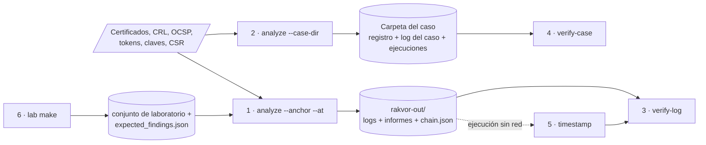
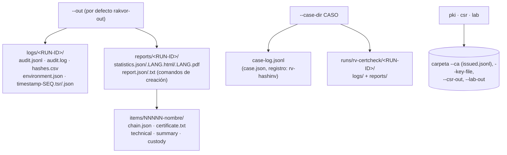

> La versión de referencia es la inglesa ([quick-guide.md](quick-guide.md)); esta traducción la sigue.

# Guía rápida

RV CertCheck examina certificados y otra evidencia criptográfica: certificados X.509 y paquetes PEM, PKCS#7, PKCS#12,
CRL, respuestas OCSP, tokens de sello de tiempo RFC 3161, claves privadas y CSR. Lee cada evidencia que se le entrega
(un archivo, una carpeta o una lista de archivos) sin cambiarla, calcula su hash, la reconoce por su contenido, y
construye y comprueba cada cadena de certificados con OpenSSL 3 en el instante (`--at`) y para el propósito
(`--purpose`) que usted elige, frente a las anclas de confianza que usted elige (`--anchor`), con los datos de
revocación que usted entrega. Escribe informes para el perito y para el cliente, y registra cada acción en un log de
auditoría encadenado por hashes. Sus hallazgos son **señales, no veredictos**: cada uno dice lo que muestra y lo que no
demuestra. Una cadena válida no prueba que el titular firmó un documento ni que el ancla merece confianza, y una cadena
inválida o no confiable no prueba que un certificado sea falso. La misma herramienta crea también los certificados
internos de Rakvor (solo uso interno), CSR y conjuntos de laboratorio reproducibles. Esta página cubre las seis tareas
habituales. La guía completa es [usage.es.md](usage.es.md), y todas las opciones están en [usage-cli.md](usage-cli.md)
(en inglés).



## Dos formas de usarlo

| Modo | Programa | Cuándo usarlo |
| --- | --- | --- |
| Aplicación de escritorio (GUI) | `rv-certcheck-gui.exe` (menú Inicio: *RV CertCheck*) | Windows 10/11. Tres pestañas: **Analizar** (elija la evidencia y las comprobaciones, pulse **Iniciar revisión** y luego lea cada cadena), **Crear** (la PKI interna, CSR, conjuntos de laboratorio) y **Listas de confianza**. |
| Línea de comandos (CLI) | `rv-certcheck.exe` | Scripts, lotes, los comandos de verificación (`verify-log`, `verify-case`, `timestamp`) y cada comando de creación (`pki`, `csr`, `lab`, `keys`, `tokens`, `trust-list`). |

Ambos usan el mismo motor. Con la misma evidencia y las mismas opciones dan los mismos hashes y hallazgos, y ambos
escriben los mismos archivos.

## Aplicación de escritorio: qué hace cada botón

No se escribe nada en el disco hasta que empieza una ejecución o una operación. Cada cambio que haga antes se guarda en
memoria y se escribe en el log de auditoría de esa ejecución como una entrada `ui_*`. Las contraseñas y los PIN se
escriben solo en campos enmascarados y nunca se escriben en ningún sitio.

| Botón o casilla | Qué hace | Qué escribe |
| --- | --- | --- |
| **Agregar archivos…** (Analizar) | Abre el selector de archivos de Windows y agrega los archivos elegidos a la lista de evidencia. | `ui_input_added` (una por archivo) |
| **Agregar carpeta…** (Analizar) | Agrega una carpeta completa. | `ui_input_added` |
| **Agregar ruta** | Agrega la ruta escrita en el cuadro de al lado (pulsar Enter hace lo mismo): evidencia, un archivo de ancla, una CRL o una respuesta OCSP, según la fila. | `ui_input_added`, `ui_anchor_changed`, `ui_revocation_file_added` |
| Arrastrar y soltar | Los archivos o carpetas soltados en la ventana se agregan a la lista de evidencia, como con **Agregar archivos…**. | `ui_input_added` |
| **x** (junto a una entrada) | Quita esa entrada (evidencia, ancla, ancla de lista de confianza, archivo CRL u OCSP). | `ui_input_removed`, `ui_anchor_changed`, `ui_revocation_file_removed` |
| **Incluir subcarpetas** | Activada por defecto: las carpetas se leen con sus subcarpetas. | `ui_recursive_changed` |
| **Examinar…** junto a **Carpeta del caso** | Elige la carpeta compartida del caso. La carpeta de salida pasa a ser `<case>/runs/rv-certcheck/<RUN-ID>` y ya no se puede editar. | `ui_case_dir_changed` |
| **Raíz Rakvor (incluida)** y **Almacén del sistema** (Anclas de confianza) | Confiar en la raíz interna de Rakvor incluida, o en el almacén del sistema operativo (no se lee en Windows en v0.1). Sin ningún ancla, cada cadena se informa como no confiable. | `ui_anchor_changed` |
| **Examinar…** junto a una fila de ancla, CRL u OCSP | Elige un archivo de certificado raíz (PEM, DER, PKCS#7), una CRL o una respuesta OCSP. El selector *Añadir una instantánea de lista de confianza…* agrega como ancla una instantánea importada. | `ui_anchor_changed`, `ui_revocation_file_added` |
| **Evaluar en** y **Propósito** (selectores) | El instante en que se evalúan las cadenas (ahora, una fecha o la hora de firma) y el propósito que se comprueba frente al uso de clave y al EKU. | `ui_at_changed`, `ui_purpose_changed` |
| **Descargar CRL y OCSP desde las URL de los certificados** | Desactivada por defecto. Descarga los datos de revocación en línea; cada URL, hora y SHA-256 de la respuesta va al log de auditoría y a `chain.json`. | `ui_online_revocation_changed` |
| **Examinar…** junto a **Carpeta de salida** | Elige dónde se escriben `logs/` y `reports/` (por defecto `rakvor-out`). | Nada hasta la ejecución: la carpeta usada se registra en `environment.json` |
| **Perito** e **ID del caso** (campos de texto) | El nombre del perito (por defecto, su usuario de Windows) y una referencia de caso opcional. | Nada hasta la ejecución: el perito se escribe en cada entrada de auditoría y en cada informe, el ID del caso en los informes |
| **Sello de tiempo confiable** (casilla y dirección) | Activado por defecto. Pide a la autoridad RFC 3161 de esa dirección un sello de tiempo para el log de auditoría. | `ui_timestamp_changed` |
| **Examinar…** junto a **Certificado de firma (.p12/.pfx)** | Elige su certificado. Cada informe PDF se firma entonces con él. Escriba la **Contraseña del certificado** en el campo de debajo. La contraseña solo se guarda en memoria y nunca se registra. | `ui_signing_certificate_changed` (solo la ruta) |
| **Iniciar revisión** | Inicia la ejecución con los ajustes mostrados. | `ui_start_clicked` y luego toda la ejecución (ver [Dónde van las salidas](#dónde-van-las-salidas)) |
| **Cancelar** | Se detiene tras el bloque actual y escribe informes parciales. | `item_cancelled`, `run_cancelled` |
| **Abrir informe** | Abre el informe de estadísticas de la ejecución terminada (o el informe de una operación de Crear). | Nada |
| **Abrir carpeta de logs** | Abre la carpeta de logs de la ejecución. | Nada |
| Una fila de la tabla Resultados | Abre la vista de la cadena de ese elemento: cada cadena desde la hoja hasta su ancla, el código y el motivo de OpenSSL en cada profundidad, la revocación, los campos analizados y `certificate.txt`. | `ui_item_selected` |
| **Examinar…** junto a **Carpeta de la CA**, **Abrir (pki show)**, **Verificar (pki verify)** (Crear) | Abre una carpeta de CA (sus certificados y su estado de revocación) o comprueba la cadena de hashes de su `issued.jsonl` y los archivos registrados. | `ui_ca_folder_opened`, luego la ejecución auditada de `pki show` / `pki verify` |
| **Examinar…** junto a **Carpeta de ejecuciones (registros y reportes)** (Crear) | Donde cada operación de Crear escribe su log de auditoría y su informe. | Nada hasta que se ejecuta una operación |
| **Listar tokens** (Crear) | Lista los tokens que ve un módulo PKCS#11 (no hace falta PIN); sus seriales aparecen entonces en cada opción de clave en token. | `ui_token_selected` cuando se elige uno, luego la ejecución auditada de `tokens list` |
| **Confirmo: crear la clave RAÍZ en este token (--confirm-root)** | Necesaria en el asistente Nueva raíz para crear una clave raíz en un token. | `ui_confirm_root_changed` |
| **Desde un CSR** (casilla, asistente Emitir) | Certifica la clave de un CSR en lugar de crear una clave nueva. | Parte de los parámetros de la operación |
| **Ejecutar** (Crear) | Ejecuta en segundo plano el asistente elegido (Nueva raíz, Importar CA existente, Emitir, Revocar, CRL, CSR, Conjunto de laboratorio). | `ui_wizard_submitted`, `ui_operation_started`, luego la ejecución auditada de `pki`, `csr` o `lab` |
| **Abrir carpeta** (resultado de Crear) | Abre la carpeta en la que escribió la operación. | Nada |
| **Actualizar** y **Examinar…** junto a **Carpeta de instantáneas** (Listas de confianza) | Vuelve a leer la carpeta de instantáneas, o elige el archivo XML o CSV que importar. | Nada |
| **Importar** (Listas de confianza) | Importa el XML de la UE o el CSV colombiano elegido como instantánea fechada y con hash. | `ui_trust_list_kind_changed`, luego la ejecución auditada de `trust-list import` |
| **ancla** (casilla de una instantánea) | Usa esa instantánea como ancla de confianza en la pestaña Analizar (`tl:<list>@<id>`). | `ui_anchor_changed`; examinar una instantánea escribe `ui_trust_list_inspected` |
| **ID de evidencia** (panel de resultado) | Tras una ejecución en una carpeta del caso, lista el ID de evidencia de cada elemento (E0001…) y su control contra el registro. Solo lectura. | Nada |
| **Advertencias** (panel de resultado) | Lista los errores encontrados durante la ejecución. Solo lectura. | Nada aquí: la ejecución registra cada error como `item_error` |

El sello de tiempo solo es cualificado en el sentido de eIDAS si la dirección de la TSA es la de un prestador
cualificado de servicios de confianza (QTSP) inscrito en una lista de confianza de la UE; la dirección por defecto
(DigiCert) no lo es. Los certificados creados en la pestaña Crear son solo para uso interno de Rakvor: no son una
*firma digital* (Ley 527 de 1999 art. 28) ni certificados cualificados (eIDAS).

Los selectores (algoritmos de hash, idioma de los informes, idioma de la interfaz, formato de custodia, pestaña)
también se registran: `ui_hash_selection_changed`, `ui_language_changed`, `ui_interface_language_changed`,
`ui_jurisdiction_changed` y `ui_tab_changed`; en la pestaña Crear, `ui_wizard_opened`, `ui_profile_changed` y
`ui_key_mode_changed`.

## Tarea 1: Analizar evidencia de certificados

1. Compruebe la compilación una vez en este PC: `rv-certcheck self-test` debe imprimir `PASS` para cada algoritmo
   (código de salida 0).
2. Elija en qué confía y cuándo: obtenga cada raíz del repositorio oficial de su CA (o de una lista de confianza de la
   UE) y entréguela con `--anchor`; indique la fecha de firma con `--at`. No se confía en nada si usted no lo indica.
3. Ejecute el análisis sobre una copia verificada de la evidencia. Omita `--no-timestamp` cuando el PC pueda llegar a
   la TSA: la ejecución obtiene entonces también el sello de tiempo (`timestamp: ok …`).

   ```powershell
   rv-certcheck analyze -i evidence --anchor anchors\rakvor-lab-root.crt --at 2026-06-01 --hash sha256,md5 --lang es --case CASE-2026-014 --actor "Ana Ruiz" --no-timestamp
   ```

4. Lea el resumen. Sobre una copia de la muestra de laboratorio (`examples\sample\evidence` en `evidence`,
   `examples\sample\anchors` en `anchors`, 13 archivos), sin red (`--no-timestamp`), el comando anterior imprime:

   ```text
   DONE (high-severity findings)  run 20261126T141703Z-8228fd
     items: 13  bytes: 18185  errors: 0  elapsed: 0.3 s
     findings: high 4, medium 4, low 0, info 9
     timestamp: off
     report: rakvor-out\reports\20261126T141703Z-8228fd\statistics.es.html
     logs:   rakvor-out\logs\20261126T141703Z-8228fd
   ```

5. Abra el archivo `report:`. Luego, para cada elemento, abra `technical.<LANG>.html` (para el perito) o
   `summary.<LANG>.html` (para el cliente), y `chain.json`: lea primero `at` y `anchors`, luego `status`, cada error con
   su profundidad y la revocación de cada nodo.

**Qué escribe:** `rakvor-out/logs/<RUN-ID>/` (log de auditoría, `hashes.csv`, `environment.json`) y
`rakvor-out/reports/<RUN-ID>/` (informe de estadísticas y, por elemento, `chain.json`, `certificate.txt`, una revisión
técnica, un resumen y un formato de custodia).

**Cómo leer el resultado:** `DONE` con código de salida 0 significa que no hay hallazgos de severidad alta.
`DONE (high-severity findings)` con código de salida 3 es un resultado normal para una evidencia, no un error: la
muestra contiene un certificado caducado, uno revocado y uno de raíz equivocada, y una clave que no corresponde. Cada
hallazgo indica lo que muestra y lo que no demuestra; [usage.es.md](usage.es.md#4-interpretar-cada-hallazgo) dice qué
comprobar después para cada código. Sin red, la revocación es tan completa como las CRL y respuestas OCSP entregadas:
`REVOCATION_UNKNOWN` significa que no se estableció.

Opciones del análisis:

| Opción | Qué fija |
| --- | --- |
| `--input` (`-i`) | Un archivo o una carpeta que revisar. Repítala para varios. |
| `--input-list` (`-L`) | Un archivo de texto con una ruta por línea. |
| `--recursive` (`-r`) | Leer también las subcarpetas. |
| `--hash` (`-H`) | Uno o dos de md5, sha1, sha256, sha512, sha3-256, blake3 (por defecto sha256). |
| `--out` (`-o`) | Carpeta de salida (por defecto `rakvor-out`). |
| `--lang` (`-l`) | Idioma de los informes: en, es, fr o all. |
| `--actor` (`-a`) | Nombre del perito en el log de auditoría y en los informes. |
| `--case` (`-c`) | Identificador del caso impreso en los informes. |
| `--progress` (`-p`) | bar, jsonl (un evento JSON por línea) o none. |
| `--jurisdiction` (`-j`) | Formato de custodia: co (Colombia) o fr (Francia). |
| `--tsa-url` | Autoridad RFC 3161 (por defecto `http://timestamp.digicert.com`). |
| `--no-timestamp` | Sin solicitud de sello de tiempo (laboratorios sin red). |
| `--sign-cert` | Su certificado `.p12`/`.pfx`: cada informe PDF se firma con él. |
| `--sign-pass-env` | La variable de entorno que contiene su contraseña (por defecto `RV_SIGN_PASSWORD`). |
| `--anchor` | En qué se confía: un archivo raíz, `rakvor`, `system` o una instantánea de lista de confianza `tl:eu@latest`. Repítala para varias. |
| `--at` | El instante en que se evalúan las cadenas: now (por defecto), una fecha, una hora RFC 3339 o signing-time. |
| `--purpose` | any (por defecto), tls-server, tls-client, code-signing, document-signing, email o timestamping. |
| `--crl` | Un archivo CRL para la revocación. Repítala para varios. |
| `--ocsp` | Un archivo de respuesta OCSP para la revocación. Repítala para varios. |
| `--online` | Descargar las CRL y respuestas OCSP desde las URL de los certificados (cada URL auditada); desactivada por defecto. |
| `--p12-pass-env` | La variable de entorno que contiene la contraseña de los elementos PKCS#12 (por defecto `RV_P12_PASSWORD`). |
| `--case-dir` | La carpeta compartida del caso (Tarea 2). |
| `--evidence` (`-E`) | ID de evidencias registradas que examinar de nuevo (Tarea 2). |

## Tarea 2: Analizar evidencia en una carpeta del caso

1. Elija una carpeta para el caso, en el volumen del caso, por ejemplo `cases\CASE-2026-014`. rv-certcheck es una
   herramienta de análisis: verifica cada archivo contra el registro de evidencias que escribe la herramienta de
   recepción, rv-hashinv. Nunca escribe el registro.
2. Registre la evidencia con rv-hashinv (crea el caso, así que indique `--case` y `--jurisdiction`):

   ```powershell
   rv-hashinv scan --case-dir cases\CASE-2026-014 --case CASE-2026-014 --jurisdiction co -i evidence --no-timestamp --progress none
   ```

3. Analice cada elemento registrado:

   ```powershell
   rv-certcheck analyze --case-dir cases\CASE-2026-014 --anchor anchors\rakvor-lab-root.crt --at 2026-06-01 --no-timestamp
   ```

4. Lea la última línea del resumen:

   ```text
     case:   CASE-2026-014 (analysis) registered 0 (new 0), verified 13, mismatched 0, not in registry 0
   ```

5. Más adelante, para examinar de nuevo algunos elementos registrados (aquí el certificado caducado y el que no
   corresponde con su clave), indique sus ID:

   ```powershell
   rv-certcheck analyze --case-dir cases\CASE-2026-014 --evidence E0005,E0006 --anchor anchors\rakvor-lab-root.crt --at 2026-06-01 --no-timestamp
   ```

**Qué escribe:** la ejecución en `runs/rv-certcheck/<RUN-ID>/logs` y `/reports`, y sus entradas `run_started` y
`run_finished` en `case-log.jsonl` (la recepción escribe `case.json`, el registro `evidence/registry.json` y `.csv` y
su propia ejecución en `runs/rv-hashinv/`).

**Cómo leer el resultado:** `verified` cuenta los archivos cuyos hashes coinciden con el registro. Un archivo que
difiere del registro recibe el hallazgo alto `EVIDENCE_HASH_MISMATCH_WITH_CASE` (se analiza igualmente); un archivo
que no está en el registro recibe `EVIDENCE_NOT_IN_CASE_REGISTRY` (medio). El código de salida 3 antes de leer nada
significa que la carpeta del caso no pasó la verificación: no se escribió nada en ella (ejecute la Tarea 4). El código
de salida 2 indica un error de uso, por ejemplo una carpeta que pertenece a otro caso o un ID de evidencia
desconocido.

## Tarea 3: Verificar el log de auditoría de una ejecución

1. Indique a `verify-log` la carpeta de logs de la ejecución (o el `audit.jsonl` que contiene):

   ```powershell
   rv-certcheck verify-log rakvor-out\logs\20261126T141703Z-8228fd
   ```

2. Lea la salida:

   ```text
   OK  92 entries, chain intact: rakvor-out\logs\20261126T141703Z-8228fd\audit.jsonl
       truncation not detectable without a timestamp or case record
       outputs: 169 verified of 169 recorded (md5, sha256)
   ```

3. Si la ejecución tiene sello de tiempo, agregue `--tsa-ca <raíces de la TSA.pem>` para comprobar también la cadena
   de certificados de la TSA contra los certificados raíz de la propia TSA.

**Qué escribe:** nada. Solo lee.

**Cómo leer el resultado:** `OK` (código de salida 0) significa que ninguna entrada se editó, borró ni reordenó, que
cada token de sello de tiempo coincide, y que cada informe, `chain.json`, `hashes.csv` y `environment.json` sigue
teniendo el hash que registró el log. La línea `truncation` dice qué demuestra que el log está completo: sin sello de
tiempo ni registro del caso, no se pueden detectar entradas finales eliminadas. `BROKEN` (código de salida 3) lista un
problema por línea. El código de salida 1 significa que no se puede leer el log o el archivo `--tsa-ca`. La revocación
del certificado de la TSA nunca se comprueba.

## Tarea 4: Verificar un caso completo

1. Ejecute `verify-case` sobre la carpeta que contiene `case.json`, con `--rehash` para volver a leer cada archivo
   registrado:

   ```powershell
   rv-certcheck verify-case cases\CASE-2026-014 --rehash
   ```

2. Lea la salida (después de la Tarea 2: la ejecución de recepción de rv-hashinv y las dos ejecuciones de
   rv-certcheck):

   ```text
   OK  case CASE-2026-014: 8 case-log entries, 13 registered items, 3 runs verified: cases\CASE-2026-014
       outputs: 348 verified of 348 recorded by the runs' audit logs
       re-hashed 13 of 13 registered items: 13 match the registry
   ```

**Qué escribe:** nada. Solo lee.

**Cómo leer el resultado:** `OK` (código de salida 0) significa que el log del caso, el registro, el log de auditoría
de cada ejecución (de cualquier herramienta Rakvor) y las salidas registradas por las ejecuciones están intactos. Las
advertencias (por ejemplo, una ejecución todavía en curso, o un archivo registrado no accesible para `--rehash`) se
imprimen pero no hacen fallar la comprobación. Un archivo que difiere del registro es un problema. `BROKEN` (código de
salida 3) lista cada comprobación fallida. El código de salida 1 significa que la carpeta no es una carpeta de caso
(no tiene `case.json`).

## Tarea 5: Agregar el sello de tiempo después de trabajar sin red

1. Sin red, ejecute el análisis como siempre, o con `--no-timestamp` (o `RV_NO_TIMESTAMP=1`) para que no se envíe
   ninguna solicitud. Sin `--no-timestamp`, el resumen muestra `timestamp: pending`.

   ```powershell
   rv-certcheck analyze -i evidence\leaf.crt -i evidence\intermediate.crt --anchor anchors\rakvor-lab-root.crt -o offline --no-timestamp
   ```

2. Cuando vuelva la red, agregue el sello de tiempo a la carpeta de logs de la ejecución:

   ```powershell
   rv-certcheck timestamp offline\logs\20261126T141705Z-40f951
   ```

3. Lea el resultado: `OK  timestamp 2026-11-26T14:17:06Z by http://timestamp.digicert.com covers entry #21`. Use
   `--tsa-url` para elegir otra autoridad y `--actor` para nombrar al perito en la nueva entrada de auditoría.
4. Ejecute la Tarea 3 sobre la misma carpeta. Ahora muestra la línea del sello de tiempo, `TSA signature valid` y lo
   que ancla el sello de tiempo:

   ```text
   OK  22 entries, chain intact: offline\logs\20261126T141705Z-40f951\audit.jsonl
       timestamp 2026-11-26T14:17:06Z by http://timestamp.digicert.com covers entry #21: TSA signature valid (signer: CN=DigiCert SHA256 RSA4096 Timestamp Responder 2026 1,O=DigiCert\, Inc.,C=US); chain not checked (pass --tsa-ca <CA bundle> to validate it)
       truncation: entries up to #21 are anchored by the RFC 3161 timestamp (timestamp-00021.json); 1 entry after it (timestamp_obtained) cannot be proven complete
       outputs: 31 verified of 32 recorded (sha256), 1 skipped
       not re-hashed: logs/timestamp-00021.tsr (RFC 3161 token: checked by the timestamp verification)
   ```

**Qué escribe:** `timestamp-<SEQ>.tsr` (el token RFC 3161) y `timestamp-<SEQ>.json` en la carpeta de logs, y la
entrada `timestamp_obtained` en `audit.jsonl`.

**Cómo leer el resultado:** el código de salida 0 significa que el sello de tiempo se obtuvo y se registró. El código
de salida 1 significa que no se pudo contactar con la autoridad; no cambió nada, así que vuelva a intentarlo más
tarde. El código de salida 3 significa que el log falta o está roto; a un log roto no se le agrega ningún sello de
tiempo. El sello de tiempo prueba cuándo existía el log, no que la evidencia sea auténtica.

## Tarea 6: Crear un conjunto de laboratorio y comprobarlo

1. Escriba un conjunto de laboratorio reproducible (la misma semilla, conjunto y hora base dan un conjunto idéntico
   byte a byte). Las claves de laboratorio son públicas: nunca las use para nada real.

   ```powershell
   rv-certcheck lab make --set full --seed 1 --lab-out lab-full-1
   ```

2. Lea el resultado (primeras líneas; sigue una línea por caso, con el código de `openssl verify` y el hallazgo que
   espera el caso):

   ```text
   Lab set 'full' (seed 1, base time 2026-01-01T00:00:00Z) written: 13 cases, 22 files.
     folder:      lab-full-1
     valid-chain                openssl verify  0  expects CERT_CHAIN_VALID
   ```

3. Analice un caso con los archivos, el ancla, la CRL y el instante que `lab-full-1\expected_findings.json` lista para
   él:

   ```powershell
   rv-certcheck analyze -i lab-full-1\revoked-by-crl\leaf.crt -i lab-full-1\ca\intermediate.crt --anchor lab-full-1\ca\root.crt --crl lab-full-1\ca\intermediate.crl --at 2026-01-01T00:00:00Z --no-timestamp
   ```

4. Compruebe que el informe técnico lista el código esperado (aquí `CERT_REVOKED`, con
   `CERT_ISSUED_BY_RAKVOR_INTERNAL`: los certificados de laboratorio llevan la política de laboratorio de Rakvor). El
   resumen es `findings: high 1, medium 1, low 0, info 6`.

Opciones del laboratorio: `--set` (full o minimal), `--seed` (por defecto 1), `--base-time` (por defecto
`2026-01-01T00:00:00Z`, nunca el reloj del sistema), `--lab-out` (una carpeta vacía o inexistente), y las opciones de
todo comando de creación: `--out` (donde van el log de auditoría y el informe de la ejecución, por defecto
`rakvor-out`), `--json` (imprimir el resultado en JSON) y `--actor`.

**Qué escribe:** el conjunto de laboratorio en `--lab-out` (`ca/`, una carpeta por caso, `expected_findings.json`) y una
ejecución auditada en `--out` (`logs/<RUN-ID>/` y `reports/<RUN-ID>/report.json` y `.txt`).

**Cómo leer el resultado:** el código de salida 0 significa que se escribió el conjunto. El código de salida 3 indica
un rechazo (por ejemplo, una carpeta `--lab-out` que no está vacía: no se sobrescribe nada). Un conjunto de
laboratorio es material de formación y de prueba: sus resultados dicen cómo se comporta la herramienta en casos
conocidos, nada sobre evidencia real.

## Otros comandos

| Comando | Qué hace |
| --- | --- |
| `rv-certcheck self-test` | Comprueba cada algoritmo de hash contra valores de prueba publicados. |
| `rv-certcheck pki` | La PKI interna de Rakvor ([company-pki.md](company-pki.md), en inglés): `rv-certcheck pki init-root`, `rv-certcheck pki import`, `rv-certcheck pki issue`, `rv-certcheck pki revoke`, `rv-certcheck pki crl`, `rv-certcheck pki ocsp-sign`, `rv-certcheck pki show`, `rv-certcheck pki set`, `rv-certcheck pki verify`. Solo uso interno. |
| `rv-certcheck csr` | `rv-certcheck csr new` crea una clave y un CSR para una CA pública o calificada; `rv-certcheck csr show` muestra un CSR y comprueba su autofirma. |
| `rv-certcheck lab` | `rv-certcheck lab make` (Tarea 6). |
| `rv-certcheck keys` | `rv-certcheck keys match KEY CERT`: ¿esta clave privada pertenece a este certificado (código 0 sí, 3 no)? |
| `rv-certcheck tokens` | `rv-certcheck tokens list --pkcs11-module LIB`: los tokens PKCS#11 y sus claves en esta máquina. |
| `rv-certcheck trust-list` | `rv-certcheck trust-list import`, `rv-certcheck trust-list list`, `rv-certcheck trust-list show`: instantáneas fechadas y con hash de las listas de confianza de la UE y de Colombia, para `--anchor tl:eu@latest`. |
| `rv-certcheck update-check` | Le dice si hay publicada una versión más reciente. Solo avisa: no se descarga nada. `RV_NO_UPDATE_CHECK=1` lo desactiva. |
| `rv-certcheck describe --json` | Imprime la descripción de la herramienta para RV Hub. No lee ni escribe nada. |

## Códigos de salida

| Código | Significado | Lo devuelve |
| --- | --- | --- |
| 0 | Terminado; ningún hallazgo de severidad alta (comandos de verificación: todo lo comprobado está intacto; comandos de creación: hecho). | todos los comandos |
| 1 | Error de ejecución: entrada no encontrada, salida no escribible, log del caso bloqueado, contraseña o PIN incorrectos, fallo del token o criptográfico, TSA inalcanzable (solo `timestamp`; `analyze` muestra `timestamp: pending` y continúa), carpeta que no es de caso, un self-test fallido, o una comprobación de actualizaciones que no se pudo hacer. | `analyze`, `verify-log`, `verify-case`, `timestamp`, `self-test`, `pki`, `csr`, `lab`, `keys`, `tokens`, `trust-list`, `update-check` |
| 2 | Error de uso: opción desconocida, valor incorrecto (`--anchor`, `--at`, `--purpose`), más de dos algoritmos, carpeta de caso de otro caso, ID de evidencia desconocido, sujeto vacío, perfil o motivo desconocidos. | todos los comandos (opción desconocida); `analyze`, comandos de creación |
| 3 | Al menos un hallazgo de severidad alta, un log roto o truncado, una comprobación del caso fallida, una creación rechazada por una regla de seguridad o una carpeta de CA que no se verifica, una clave que no corresponde (`keys match`), o (para `update-check`) una versión más reciente. | `analyze`, `verify-log`, `verify-case`, `timestamp`, `pki`, `csr`, `lab`, `keys`, `tokens`, `trust-list`, `update-check` |
| 130 | Cancelado con Ctrl+C: se escriben informes parciales y la cancelación queda en el log de auditoría. | `analyze` |

## Dónde van las salidas



Sin `--case-dir`, cada ejecución crea `logs/<RUN-ID>/` y `reports/<RUN-ID>/` dentro de `--out` (por defecto
`.\rakvor-out`, relativo a la carpeta actual). Con `--case-dir`, van a `<CASE>/runs/rv-certcheck/<RUN-ID>/`. Las
carpetas de CA, los archivos de clave, los CSR y los conjuntos de laboratorio van donde usted indique. Las instantáneas
de listas de confianza van a `%LOCALAPPDATA%\Rakvor\rv-certcheck\trust-lists\` (`RV_CERTCHECK_DATA` lo sustituye).
Guarde la carpeta de logs junto con los informes: es la prueba de lo que se hizo.
