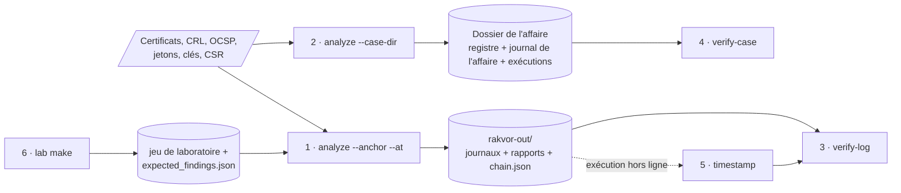
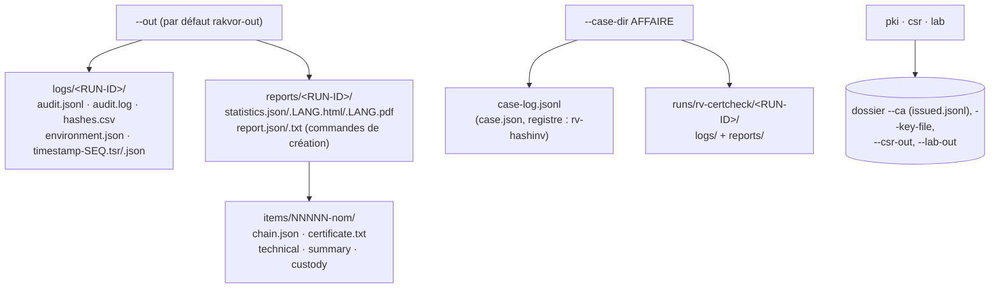

> La version de référence est la version anglaise ([quick-guide.md](quick-guide.md)) ; cette traduction la suit.

# Guide rapide

RV CertCheck examine des certificats et d'autres éléments de preuve cryptographiques : certificats X.509 et paquets
PEM, PKCS#7, PKCS#12, CRL, réponses OCSP, jetons d'horodatage RFC 3161, clés privées et CSR. Il lit chaque élément de
preuve que vous lui donnez (un fichier, un dossier ou une liste de fichiers) sans le modifier, en calcule l'empreinte,
le reconnaît par son contenu, puis construit et vérifie chaque chaîne de certificats avec OpenSSL 3 à l'instant
(`--at`) et pour l'usage (`--purpose`) que vous choisissez, par rapport aux ancres de confiance que vous choisissez
(`--anchor`), avec les données de révocation que vous fournissez. Il écrit des rapports pour l'expert et pour le
client, et inscrit chaque action dans un journal d'audit chaîné par empreintes. Ses constatations sont des **signaux,
pas des verdicts** : chacune dit ce qu'elle montre et ce qu'elle ne prouve pas. Une chaîne valide ne prouve pas que le
titulaire a signé un document ni que l'ancre mérite la confiance, et une chaîne invalide ou non approuvée ne prouve
pas qu'un certificat est faux. Le même outil crée aussi les certificats internes de Rakvor (usage interne uniquement),
des CSR et des jeux de laboratoire reproductibles. Cette page couvre les six tâches courantes. Le guide complet est
[usage.fr.md](usage.fr.md), et toutes les options sont dans [usage-cli.md](usage-cli.md) (en anglais).



## Deux façons de l'utiliser

| Mode | Programme | Quand l'utiliser |
| --- | --- | --- |
| Application de bureau (GUI) | `rv-certcheck-gui.exe` (menu Démarrer : *RV CertCheck*) | Windows 10/11. Trois onglets : **Analyser** (choisissez les éléments et les contrôles, appuyez sur **Lancer l'analyse**, puis lisez chaque chaîne), **Créer** (la PKI interne, les CSR, les jeux de laboratoire) et **Listes de confiance**. |
| Ligne de commande (CLI) | `rv-certcheck.exe` | Scripts, lots, commandes de vérification (`verify-log`, `verify-case`, `timestamp`) et chaque commande de création (`pki`, `csr`, `lab`, `keys`, `tokens`, `trust-list`). |

Les deux utilisent le même moteur. Avec les mêmes éléments et les mêmes options, ils donnent les mêmes empreintes et
les mêmes constatations, et écrivent les mêmes fichiers.

## Application de bureau : ce que fait chaque bouton

Rien n'est écrit sur le disque avant le début d'une exécution ou d'une opération. Chaque modification faite avant est
gardée en mémoire, puis inscrite dans le journal d'audit de cette exécution comme une entrée `ui_*`. Les mots de passe
et les PIN ne se saisissent que dans des champs masqués et ne sont jamais écrits nulle part.

| Bouton ou case | Ce qu'il fait | Ce qu'il écrit |
| --- | --- | --- |
| **Ajouter des fichiers…** (Analyser) | Ouvre le sélecteur de fichiers de Windows et ajoute les fichiers choisis à la liste des éléments. | `ui_input_added` (une par fichier) |
| **Ajouter un dossier…** (Analyser) | Ajoute un dossier entier. | `ui_input_added` |
| **Ajouter le chemin** | Ajoute le chemin saisi dans la zone voisine (appuyer sur Entrée fait de même) : un élément, un fichier d'ancre, une CRL ou une réponse OCSP, selon la ligne. | `ui_input_added`, `ui_anchor_changed`, `ui_revocation_file_added` |
| Glisser-déposer | Les fichiers ou dossiers déposés sur la fenêtre sont ajoutés à la liste des éléments, comme avec **Ajouter des fichiers…**. | `ui_input_added` |
| **x** (à côté d'une entrée) | Retire cette entrée (élément, ancre, ancre de liste de confiance, fichier CRL ou OCSP). | `ui_input_removed`, `ui_anchor_changed`, `ui_revocation_file_removed` |
| **Inclure les sous-dossiers** | Coché par défaut : les dossiers sont lus avec leurs sous-dossiers. | `ui_recursive_changed` |
| **Parcourir…** à côté de **Dossier de l'affaire** | Choisit le dossier partagé de l'affaire. Le dossier de sortie devient alors `<case>/runs/rv-certcheck/<RUN-ID>` et n'est plus modifiable. | `ui_case_dir_changed` |
| **Racine Rakvor (fournie)** et **Magasin du système** (Ancres de confiance) | Approuver la racine interne Rakvor fournie, ou le magasin du système d'exploitation (non lu sous Windows en v0.1). Sans aucune ancre, chaque chaîne est déclarée non approuvée. | `ui_anchor_changed` |
| **Parcourir…** à côté d'une ligne d'ancre, de CRL ou d'OCSP | Choisit un fichier de certificat racine (PEM, DER, PKCS#7), une CRL ou une réponse OCSP. Le sélecteur *Ajouter un instantané de liste de confiance…* ajoute comme ancre un instantané importé. | `ui_anchor_changed`, `ui_revocation_file_added` |
| **Évaluer à** et **Usage** (sélecteurs) | L'instant auquel les chaînes sont évaluées (maintenant, une date, ou l'heure de signature) et l'usage vérifié par rapport à l'usage de clé et à l'EKU. | `ui_at_changed`, `ui_purpose_changed` |
| **Télécharger CRL et OCSP depuis les URL des certificats** | Décoché par défaut. Télécharge les données de révocation en ligne ; chaque URL, heure et SHA-256 de la réponse va dans le journal d'audit et dans `chain.json`. | `ui_online_revocation_changed` |
| **Parcourir…** à côté de **Dossier de sortie** | Choisit où sont écrits `logs/` et `reports/` (par défaut `rakvor-out`). | Rien jusqu'à l'exécution : le dossier utilisé est consigné dans `environment.json` |
| **Expert** et **Référence du dossier** (champs de texte) | Le nom de l'expert (par défaut : votre utilisateur Windows) et une référence d'affaire facultative. | Rien jusqu'à l'exécution : l'expert est écrit dans chaque entrée d'audit et chaque rapport, la référence sur les rapports |
| **Horodatage qualifié** (case et adresse) | Coché par défaut. Demande à l'autorité RFC 3161 de cette adresse d'horodater le journal d'audit. | `ui_timestamp_changed` |
| **Parcourir…** à côté de **Certificat de signature (.p12/.pfx)** | Choisit votre certificat. Chaque rapport PDF est alors signé avec lui. Saisissez le **Mot de passe du certificat** dans le champ en dessous. Le mot de passe est gardé en mémoire seulement et n'est jamais journalisé. | `ui_signing_certificate_changed` (le chemin seulement) |
| **Lancer l'analyse** | Lance l'exécution avec les réglages affichés. | `ui_start_clicked`, puis toute l'exécution (voir [Où vont les sorties](#où-vont-les-sorties)) |
| **Annuler** | S'arrête après le bloc en cours et écrit des rapports partiels. | `item_cancelled`, `run_cancelled` |
| **Ouvrir le rapport** | Ouvre le rapport de statistiques de l'exécution terminée (ou le rapport d'une opération de Créer). | Rien |
| **Ouvrir le dossier des journaux** | Ouvre le dossier des journaux de l'exécution. | Rien |
| Une ligne du tableau Résultats | Ouvre la vue de la chaîne de cet élément : chaque chaîne de la feuille à son ancre, le code et la raison d'OpenSSL à chaque profondeur, la révocation, les champs analysés et `certificate.txt`. | `ui_item_selected` |
| **Parcourir…** à côté de **Dossier de l'AC**, **Ouvrir (pki show)**, **Vérifier (pki verify)** (Créer) | Ouvre un dossier d'AC (ses certificats et leur état de révocation) ou vérifie la chaîne d'empreintes de son `issued.jsonl` et les fichiers consignés. | `ui_ca_folder_opened`, puis l'exécution auditée de `pki show` / `pki verify` |
| **Parcourir…** à côté de **Dossier des exécutions (journaux et rapports)** (Créer) | Là où chaque opération de Créer écrit son journal d'audit et son rapport. | Rien jusqu'à l'exécution d'une opération |
| **Lister les jetons** (Créer) | Liste les jetons que voit un module PKCS#11 (aucun PIN n'est nécessaire) ; leurs numéros de série apparaissent alors dans chaque choix de clé sur jeton. | `ui_token_selected` quand l'un est choisi, puis l'exécution auditée de `tokens list` |
| **Je confirme : créer la clé RACINE sur ce jeton (--confirm-root)** | Exigée par l'assistant Nouvelle racine pour créer une clé racine sur un jeton. | `ui_confirm_root_changed` |
| **Depuis un CSR** (case, assistant Émettre) | Certifie la clé d'un CSR au lieu de créer une nouvelle clé. | Fait partie des paramètres de l'opération |
| **Exécuter** (Créer) | Exécute en arrière-plan l'assistant choisi (Nouvelle racine, Importer une AC existante, Émettre, Révoquer, CRL, CSR, Jeu de laboratoire). | `ui_wizard_submitted`, `ui_operation_started`, puis l'exécution auditée de `pki`, `csr` ou `lab` |
| **Ouvrir le dossier** (résultat de Créer) | Ouvre le dossier où l'opération a écrit. | Rien |
| **Actualiser** et **Parcourir…** à côté de **Dossier des instantanés** (Listes de confiance) | Relit le dossier des instantanés, ou choisit le fichier XML ou CSV à importer. | Rien |
| **Importer** (Listes de confiance) | Importe le XML de l'UE ou le CSV colombien choisi comme instantané daté et haché. | `ui_trust_list_kind_changed`, puis l'exécution auditée de `trust-list import` |
| **ancre** (case d'un instantané) | Utilise cet instantané comme ancre de confiance dans l'onglet Analyser (`tl:<list>@<id>`). | `ui_anchor_changed` ; examiner un instantané écrit `ui_trust_list_inspected` |
| **ID des éléments** (panneau de résultat) | Après une exécution dans un dossier de l'affaire, liste l'identifiant de chaque élément (E0001…) et son contrôle contre le registre. Lecture seule. | Rien |
| **Avertissements** (panneau de résultat) | Liste les erreurs rencontrées pendant l'exécution. Lecture seule. | Rien ici : l'exécution journalise chaque erreur comme `item_error` |

Malgré son libellé, cet horodatage n'est qualifié au sens d'eIDAS que si l'adresse est celle d'un prestataire de
services de confiance qualifié (QTSP) inscrit sur une liste de confiance de l'UE ; l'adresse par défaut (DigiCert) ne
l'est pas. Les certificats créés dans l'onglet Créer sont réservés à l'usage interne de Rakvor : ce ne sont ni une
*firma digital* (Ley 527 de 1999 art. 28) ni des certificats qualifiés (eIDAS).

Les sélecteurs (algorithmes d'empreinte, langue des rapports, langue de l'interface, fiche de traçabilité, onglet) sont
aussi consignés : `ui_hash_selection_changed`, `ui_language_changed`, `ui_interface_language_changed`,
`ui_jurisdiction_changed` et `ui_tab_changed` ; dans l'onglet Créer, `ui_wizard_opened`, `ui_profile_changed` et
`ui_key_mode_changed`.

## Tâche 1 : Analyser des éléments de type certificat

1. Vérifiez une fois la version installée sur ce PC : `rv-certcheck self-test` doit afficher `PASS` pour chaque
   algorithme (code de sortie 0).
2. Choisissez ce que vous approuvez et à quel moment : obtenez chaque racine depuis le dépôt officiel de son AC (ou
   d'une liste de confiance de l'UE) et passez-la avec `--anchor` ; passez la date de signature avec `--at`. Rien n'est
   approuvé si vous ne le dites pas.
3. Lancez l'analyse sur une copie vérifiée des éléments. Omettez `--no-timestamp` quand le PC peut joindre la TSA :
   l'exécution obtient alors aussi l'horodatage (`timestamp: ok …`).

   ```powershell
   rv-certcheck analyze -i evidence --anchor anchors\rakvor-lab-root.crt --at 2026-06-01 --hash sha256,md5 --lang es --case CASE-2026-014 --actor "Ana Ruiz" --no-timestamp
   ```

4. Lisez le résumé. Sur une copie de l'exemple de laboratoire (`examples\sample\evidence` dans `evidence`,
   `examples\sample\anchors` dans `anchors`, 13 fichiers), hors ligne (`--no-timestamp`), la commande ci-dessus
   affiche :

   ```text
   DONE (high-severity findings)  run 20261126T141703Z-8228fd
     items: 13  bytes: 18185  errors: 0  elapsed: 0.3 s
     findings: high 4, medium 4, low 0, info 9
     timestamp: off
     report: rakvor-out\reports\20261126T141703Z-8228fd\statistics.es.html
     logs:   rakvor-out\logs\20261126T141703Z-8228fd
   ```

5. Ouvrez le fichier `report:`. Puis, pour chaque élément, ouvrez `technical.<LANG>.html` (pour l'expert) ou
   `summary.<LANG>.html` (pour le client), et `chain.json` : lisez d'abord `at` et `anchors`, puis `status`, chaque
   erreur avec sa profondeur et la révocation de chaque nœud.

**Ce qu'elle écrit :** `rakvor-out/logs/<RUN-ID>/` (journal d'audit, `hashes.csv`, `environment.json`) et
`rakvor-out/reports/<RUN-ID>/` (rapport de statistiques et, par élément, `chain.json`, `certificate.txt`, un examen
technique, une synthèse et une fiche de traçabilité).

**Comment lire le résultat :** `DONE` avec le code de sortie 0 signifie aucune constatation de gravité élevée.
`DONE (high-severity findings)` avec le code de sortie 3 est un résultat normal pour des éléments de preuve, pas une
erreur : l'exemple contient un certificat expiré, un révoqué et un de mauvaise racine, et une clé qui ne correspond
pas. Chaque constatation indique ce qu'elle montre et ce qu'elle ne prouve pas ;
[usage.fr.md](usage.fr.md#4-interpréter-chaque-constatation) dit quoi vérifier ensuite pour chaque code. Hors ligne, la
révocation n'est aussi complète que les CRL et réponses OCSP fournies : `REVOCATION_UNKNOWN` signifie qu'elle n'a pas
été établie.

Options de l'analyse :

| Option | Ce qu'elle règle |
| --- | --- |
| `--input` (`-i`) | Un fichier ou un dossier à examiner. Répétez-la pour plusieurs. |
| `--input-list` (`-L`) | Un fichier texte avec un chemin par ligne. |
| `--recursive` (`-r`) | Lire aussi les sous-dossiers. |
| `--hash` (`-H`) | Un ou deux parmi md5, sha1, sha256, sha512, sha3-256, blake3 (par défaut sha256). |
| `--out` (`-o`) | Dossier de sortie (par défaut `rakvor-out`). |
| `--lang` (`-l`) | Langue des rapports : en, es, fr ou all. |
| `--actor` (`-a`) | Nom de l'expert dans le journal d'audit et les rapports. |
| `--case` (`-c`) | Identifiant de l'affaire imprimé sur les rapports. |
| `--progress` (`-p`) | bar, jsonl (un événement JSON par ligne) ou none. |
| `--jurisdiction` (`-j`) | Fiche de traçabilité : co (Colombie) ou fr (France). |
| `--tsa-url` | Autorité RFC 3161 (par défaut `http://timestamp.digicert.com`). |
| `--no-timestamp` | Pas de demande d'horodatage (laboratoires hors ligne). |
| `--sign-cert` | Votre certificat `.p12`/`.pfx` : chaque rapport PDF est signé avec lui. |
| `--sign-pass-env` | La variable d'environnement qui contient son mot de passe (par défaut `RV_SIGN_PASSWORD`). |
| `--anchor` | Ce qui est approuvé : un fichier racine, `rakvor`, `system` ou un instantané de liste de confiance `tl:eu@latest`. Répétez-la pour plusieurs. |
| `--at` | L'instant auquel les chaînes sont évaluées : now (par défaut), une date, une heure RFC 3339 ou signing-time. |
| `--purpose` | any (par défaut), tls-server, tls-client, code-signing, document-signing, email ou timestamping. |
| `--crl` | Un fichier CRL pour la révocation. Répétez-la pour plusieurs. |
| `--ocsp` | Un fichier de réponse OCSP pour la révocation. Répétez-la pour plusieurs. |
| `--online` | Télécharger les CRL et réponses OCSP depuis les URL des certificats (chaque URL auditée) ; désactivée par défaut. |
| `--p12-pass-env` | La variable d'environnement qui contient le mot de passe des éléments PKCS#12 (par défaut `RV_P12_PASSWORD`). |
| `--case-dir` | Le dossier partagé de l'affaire (Tâche 2). |
| `--evidence` (`-E`) | Identifiants des éléments enregistrés à réexaminer (Tâche 2). |

## Tâche 2 : Analyser des éléments dans un dossier de l'affaire

1. Choisissez un dossier pour l'affaire, sur le volume de l'affaire, par exemple `cases\CASE-2026-014`. rv-certcheck
   est un outil d'analyse : il vérifie chaque fichier par rapport au registre des preuves écrit par l'outil d'entrée,
   rv-hashinv. Il n'écrit jamais le registre lui-même.
2. Enregistrez les éléments avec rv-hashinv (il crée l'affaire, donnez donc `--case` et `--jurisdiction`) :

   ```powershell
   rv-hashinv scan --case-dir cases\CASE-2026-014 --case CASE-2026-014 --jurisdiction co -i evidence --no-timestamp --progress none
   ```

3. Analysez chaque élément enregistré :

   ```powershell
   rv-certcheck analyze --case-dir cases\CASE-2026-014 --anchor anchors\rakvor-lab-root.crt --at 2026-06-01 --no-timestamp
   ```

4. Lisez la dernière ligne du résumé :

   ```text
     case:   CASE-2026-014 (analysis) registered 0 (new 0), verified 13, mismatched 0, not in registry 0
   ```

5. Plus tard, pour réexaminer certains éléments enregistrés (ici le certificat expiré et celui qui ne correspond pas à
   sa clé), donnez leurs identifiants :

   ```powershell
   rv-certcheck analyze --case-dir cases\CASE-2026-014 --evidence E0005,E0006 --anchor anchors\rakvor-lab-root.crt --at 2026-06-01 --no-timestamp
   ```

**Ce qu'elle écrit :** l'exécution sous `runs/rv-certcheck/<RUN-ID>/logs` et `/reports`, et ses entrées `run_started`
et `run_finished` dans `case-log.jsonl` (l'entrée écrit `case.json`, le registre `evidence/registry.json` et `.csv` et
sa propre exécution sous `runs/rv-hashinv/`).

**Comment lire le résultat :** `verified` compte les fichiers dont les empreintes correspondent au registre. Un
fichier qui diffère du registre reçoit la constatation élevée `EVIDENCE_HASH_MISMATCH_WITH_CASE` (il est quand même
analysé) ; un fichier absent du registre reçoit `EVIDENCE_NOT_IN_CASE_REGISTRY` (moyenne). Le code de sortie 3 avant
toute lecture signifie que le dossier de l'affaire n'a pas passé la vérification : rien n'y a été écrit (lancez la
Tâche 4). Le code de sortie 2 signale une erreur d'utilisation, par exemple un dossier qui appartient à une autre
affaire ou un identifiant d'élément inconnu.

## Tâche 3 : Vérifier le journal d'audit d'une exécution

1. Donnez à `verify-log` le dossier des journaux de l'exécution (ou le `audit.jsonl` qu'il contient) :

   ```powershell
   rv-certcheck verify-log rakvor-out\logs\20261126T141703Z-8228fd
   ```

2. Lisez la sortie :

   ```text
   OK  92 entries, chain intact: rakvor-out\logs\20261126T141703Z-8228fd\audit.jsonl
       truncation not detectable without a timestamp or case record
       outputs: 169 verified of 169 recorded (md5, sha256)
   ```

3. Si l'exécution est horodatée, ajoutez `--tsa-ca <racines de la TSA.pem>` pour vérifier aussi la chaîne de
   certificats de la TSA par rapport aux certificats racine de la TSA elle-même.

**Ce qu'elle écrit :** rien. Elle lit seulement.

**Comment lire le résultat :** `OK` (code de sortie 0) signifie qu'aucune entrée n'a été modifiée, supprimée ni
réordonnée, que chaque jeton d'horodatage correspond, et que chaque rapport, `chain.json`, `hashes.csv` et
`environment.json` a toujours l'empreinte consignée par le journal. La ligne `truncation` dit ce qui prouve que le
journal est complet : sans horodatage ni registre de l'affaire, des entrées finales supprimées ne peuvent pas être
détectées. `BROKEN` (code de sortie 3) liste un problème par ligne. Le code de sortie 1 signifie que le journal ou le
fichier `--tsa-ca` ne peut pas être lu. La révocation du certificat de la TSA n'est jamais vérifiée.

## Tâche 4 : Vérifier une affaire entière

1. Lancez `verify-case` sur le dossier qui contient `case.json`, avec `--rehash` pour relire chaque fichier
   enregistré :

   ```powershell
   rv-certcheck verify-case cases\CASE-2026-014 --rehash
   ```

2. Lisez la sortie (après la Tâche 2 : l'exécution d'entrée de rv-hashinv et les deux exécutions de rv-certcheck) :

   ```text
   OK  case CASE-2026-014: 8 case-log entries, 13 registered items, 3 runs verified: cases\CASE-2026-014
       outputs: 348 verified of 348 recorded by the runs' audit logs
       re-hashed 13 of 13 registered items: 13 match the registry
   ```

**Ce qu'elle écrit :** rien. Elle lit seulement.

**Comment lire le résultat :** `OK` (code de sortie 0) signifie que le journal de l'affaire, le registre, le journal
d'audit de chaque exécution (de tout outil Rakvor) et les sorties consignées par les exécutions sont intacts. Les
avertissements (par exemple une exécution encore en cours, ou un fichier enregistré inaccessible pour `--rehash`) sont
affichés mais ne font pas échouer la vérification. Un fichier qui diffère du registre est un problème. `BROKEN` (code
de sortie 3) liste chaque contrôle en échec. Le code de sortie 1 signifie que le dossier n'est pas un dossier
d'affaire (pas de `case.json`).

## Tâche 5 : Ajouter l'horodatage après un travail hors ligne

1. Hors ligne, lancez l'analyse comme d'habitude, ou avec `--no-timestamp` (ou `RV_NO_TIMESTAMP=1`) pour qu'aucune
   demande ne soit envoyée. Sans `--no-timestamp`, le résumé affiche `timestamp: pending`.

   ```powershell
   rv-certcheck analyze -i evidence\leaf.crt -i evidence\intermediate.crt --anchor anchors\rakvor-lab-root.crt -o offline --no-timestamp
   ```

2. Une fois le réseau revenu, horodatez le dossier des journaux de l'exécution :

   ```powershell
   rv-certcheck timestamp offline\logs\20261126T141705Z-40f951
   ```

3. Lisez le résultat : `OK  timestamp 2026-11-26T14:17:06Z by http://timestamp.digicert.com covers entry #21`.
   Utilisez `--tsa-url` pour choisir une autre autorité et `--actor` pour nommer l'expert dans la nouvelle entrée
   d'audit.
4. Lancez la Tâche 3 sur le même dossier. Elle affiche maintenant la ligne d'horodatage, `TSA signature valid` et ce
   que l'horodatage ancre :

   ```text
   OK  22 entries, chain intact: offline\logs\20261126T141705Z-40f951\audit.jsonl
       timestamp 2026-11-26T14:17:06Z by http://timestamp.digicert.com covers entry #21: TSA signature valid (signer: CN=DigiCert SHA256 RSA4096 Timestamp Responder 2026 1,O=DigiCert\, Inc.,C=US); chain not checked (pass --tsa-ca <CA bundle> to validate it)
       truncation: entries up to #21 are anchored by the RFC 3161 timestamp (timestamp-00021.json); 1 entry after it (timestamp_obtained) cannot be proven complete
       outputs: 31 verified of 32 recorded (sha256), 1 skipped
       not re-hashed: logs/timestamp-00021.tsr (RFC 3161 token: checked by the timestamp verification)
   ```

**Ce qu'elle écrit :** `timestamp-<SEQ>.tsr` (le jeton RFC 3161) et `timestamp-<SEQ>.json` dans le dossier des
journaux, et l'entrée `timestamp_obtained` dans `audit.jsonl`.

**Comment lire le résultat :** le code de sortie 0 signifie que l'horodatage a été obtenu et journalisé. Le code de
sortie 1 signifie que l'autorité n'a pas pu être jointe ; rien n'a changé, réessayez plus tard. Le code de sortie 3
signifie que le journal est absent ou rompu ; aucun horodatage n'est ajouté à un journal rompu. L'horodatage prouve
quand le journal existait, pas que les éléments de preuve sont authentiques.

## Tâche 6 : Créer un jeu de laboratoire et le vérifier

1. Écrivez un jeu de laboratoire reproductible (la même graine, le même jeu et la même heure de base donnent un jeu
   identique octet pour octet). Les clés de laboratoire sont publiques : ne les utilisez jamais pour quoi que ce soit
   de réel.

   ```powershell
   rv-certcheck lab make --set full --seed 1 --lab-out lab-full-1
   ```

2. Lisez le résultat (premières lignes ; une ligne par cas suit, avec le code d'`openssl verify` et la constatation
   attendue par le cas) :

   ```text
   Lab set 'full' (seed 1, base time 2026-01-01T00:00:00Z) written: 13 cases, 22 files.
     folder:      lab-full-1
     valid-chain                openssl verify  0  expects CERT_CHAIN_VALID
   ```

3. Analysez un cas avec les fichiers, l'ancre, la CRL et l'instant que `lab-full-1\expected_findings.json` liste pour
   lui :

   ```powershell
   rv-certcheck analyze -i lab-full-1\revoked-by-crl\leaf.crt -i lab-full-1\ca\intermediate.crt --anchor lab-full-1\ca\root.crt --crl lab-full-1\ca\intermediate.crl --at 2026-01-01T00:00:00Z --no-timestamp
   ```

4. Vérifiez que le rapport technique liste le code attendu (ici `CERT_REVOKED`, avec `CERT_ISSUED_BY_RAKVOR_INTERNAL` :
   les certificats de laboratoire portent la politique de laboratoire Rakvor). Le résumé est
   `findings: high 1, medium 1, low 0, info 6`.

Options du laboratoire : `--set` (full ou minimal), `--seed` (par défaut 1), `--base-time` (par défaut
`2026-01-01T00:00:00Z`, jamais l'horloge du système), `--lab-out` (un dossier vide ou inexistant), et les options de
toute commande de création : `--out` (où vont le journal d'audit et le rapport de l'exécution, par défaut
`rakvor-out`), `--json` (afficher le résultat en JSON) et `--actor`.

**Ce qu'elle écrit :** le jeu de laboratoire sous `--lab-out` (`ca/`, un dossier par cas, `expected_findings.json`) et
une exécution auditée sous `--out` (`logs/<RUN-ID>/` et `reports/<RUN-ID>/report.json` et `.txt`).

**Comment lire le résultat :** le code de sortie 0 signifie que le jeu a été écrit. Le code de sortie 3 signale un
refus (par exemple un dossier `--lab-out` qui n'est pas vide : rien n'est écrasé). Un jeu de laboratoire est du
matériel de formation et de test : ses résultats disent comment l'outil se comporte sur des cas connus, rien sur des
éléments de preuve réels.

## Autres commandes

| Commande | Ce qu'elle fait |
| --- | --- |
| `rv-certcheck self-test` | Vérifie chaque algorithme d'empreinte avec des valeurs de test publiées. |
| `rv-certcheck pki` | La PKI interne de Rakvor ([company-pki.md](company-pki.md), en anglais) : `rv-certcheck pki init-root`, `rv-certcheck pki import`, `rv-certcheck pki issue`, `rv-certcheck pki revoke`, `rv-certcheck pki crl`, `rv-certcheck pki ocsp-sign`, `rv-certcheck pki show`, `rv-certcheck pki set`, `rv-certcheck pki verify`. Usage interne uniquement. |
| `rv-certcheck csr` | `rv-certcheck csr new` crée une clé et un CSR pour une AC publique ou qualifiée ; `rv-certcheck csr show` affiche un CSR et vérifie son autosignature. |
| `rv-certcheck lab` | `rv-certcheck lab make` (Tâche 6). |
| `rv-certcheck keys` | `rv-certcheck keys match KEY CERT` : cette clé privée appartient-elle à ce certificat (code 0 oui, 3 non) ? |
| `rv-certcheck tokens` | `rv-certcheck tokens list --pkcs11-module LIB` : les jetons PKCS#11 et leurs clés sur cette machine. |
| `rv-certcheck trust-list` | `rv-certcheck trust-list import`, `rv-certcheck trust-list list`, `rv-certcheck trust-list show` : instantanés datés et hachés des listes de confiance de l'UE et de la Colombie, pour `--anchor tl:eu@latest`. |
| `rv-certcheck update-check` | Indique si une version plus récente est publiée. Elle ne fait que prévenir : rien n'est téléchargé. `RV_NO_UPDATE_CHECK=1` la désactive. |
| `rv-certcheck describe --json` | Affiche la description de l'outil pour RV Hub. Elle ne lit et n'écrit rien. |

## Codes de sortie

| Code | Signification | Renvoyé par |
| --- | --- | --- |
| 0 | Terminé ; aucune constatation de gravité élevée (commandes de vérification : tout ce qui est vérifié est intact ; commandes de création : fait). | toutes les commandes |
| 1 | Erreur d'exécution : entrée introuvable, sortie non inscriptible, journal de l'affaire verrouillé, mauvais mot de passe ou PIN, échec du jeton ou cryptographique, TSA injoignable (`timestamp` seulement ; `analyze` affiche `timestamp: pending` et continue), dossier qui n'est pas une affaire, autotest en échec, ou vérification des mises à jour impossible. | `analyze`, `verify-log`, `verify-case`, `timestamp`, `self-test`, `pki`, `csr`, `lab`, `keys`, `tokens`, `trust-list`, `update-check` |
| 2 | Erreur d'utilisation : option inconnue, valeur incorrecte (`--anchor`, `--at`, `--purpose`), plus de deux algorithmes, dossier d'une autre affaire, identifiant d'élément inconnu, sujet vide, profil ou raison inconnus. | toutes les commandes (option inconnue) ; `analyze`, commandes de création |
| 3 | Au moins une constatation de gravité élevée, un journal rompu ou tronqué, un contrôle de l'affaire en échec, une création refusée par une règle de sécurité ou un dossier d'AC qui ne se vérifie pas, une clé qui ne correspond pas (`keys match`), ou (pour `update-check`) une version plus récente. | `analyze`, `verify-log`, `verify-case`, `timestamp`, `pki`, `csr`, `lab`, `keys`, `tokens`, `trust-list`, `update-check` |
| 130 | Annulé avec Ctrl+C : des rapports partiels sont écrits et l'annulation figure dans le journal d'audit. | `analyze` |

## Où vont les sorties



Sans `--case-dir`, chaque exécution crée `logs/<RUN-ID>/` et `reports/<RUN-ID>/` sous `--out` (par défaut
`.\rakvor-out`, relatif au dossier courant). Avec `--case-dir`, ils vont dans `<CASE>/runs/rv-certcheck/<RUN-ID>/`.
Les dossiers d'AC, les fichiers de clé, les CSR et les jeux de laboratoire vont là où vous les nommez. Les instantanés
de listes de confiance vont dans `%LOCALAPPDATA%\Rakvor\rv-certcheck\trust-lists\` (`RV_CERTCHECK_DATA` le remplace).
Gardez le dossier des journaux avec les rapports : c'est la preuve de ce qui a été fait.
