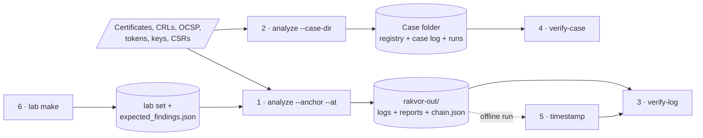
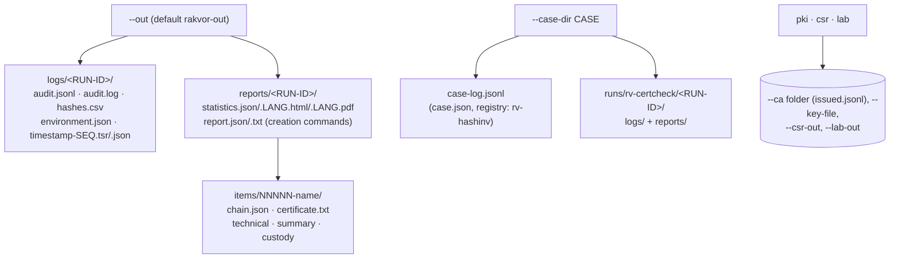

# Quick guide

RV CertCheck examines certificates and other cryptographic evidence: X.509 certificates and PEM bundles, PKCS#7,
PKCS#12, CRLs, OCSP responses, RFC 3161 timestamp tokens, private keys and CSRs. It reads each piece of evidence you
give it (one file, a folder or a list of files) without changing it, hashes it, recognises it by its content, and
builds and checks every certificate chain with OpenSSL 3 at the instant (`--at`) and for the purpose (`--purpose`)
you choose, against the trust anchors you choose (`--anchor`), with the revocation data you supply. It writes reports
for the examiner and for the client, and records every action in a hash-chained audit log. Its findings are
**signals, not verdicts**: each one says what it shows and what it does not prove. A valid chain does not prove that
the holder signed a document or that the anchor deserves trust, and an invalid or untrusted chain does not prove that
a certificate is false. The same tool also creates Rakvor's internal certificates (internal use only), CSRs and
reproducible lab sets. This page covers the six common tasks. The full guide is [usage.md](usage.md), and every option
is in [usage-cli.md](usage-cli.md).



## Two ways to use it

| Mode | Program | When to use it |
| --- | --- | --- |
| Desktop app (GUI) | `rv-certcheck-gui.exe` (Start menu: *RV CertCheck*) | Windows 10/11. Three tabs: **Analyze** (pick the evidence and the checks, press **Start review**, then read each chain), **Create** (the internal PKI, CSRs, lab sets) and **Trust lists**. |
| Command line (CLI) | `rv-certcheck.exe` | Scripts, batches, the verification commands (`verify-log`, `verify-case`, `timestamp`) and every creation command (`pki`, `csr`, `lab`, `keys`, `tokens`, `trust-list`). |

Both use the same engine. With the same evidence and options they give the same hashes and findings, and both write
the same files.

## Desktop app: what each button does

Nothing is written to disk until a run or an operation starts. Each change you make before that is kept in memory,
then written to that run's audit log as a `ui_*` entry. Passwords and PINs are typed into masked fields only and are
never written anywhere.

| Button or box | What it does | What it writes |
| --- | --- | --- |
| **Add files…** (Analyze) | Opens the Windows file picker and adds the chosen files to the evidence list. | `ui_input_added` (one per file) |
| **Add folder…** (Analyze) | Adds a whole folder. | `ui_input_added` |
| **Add path** | Adds the path typed in the box next to it (pressing Enter does the same): evidence, an anchor file, a CRL or an OCSP response, depending on the row. | `ui_input_added`, `ui_anchor_changed`, `ui_revocation_file_added` |
| Drag and drop | Files or folders dropped onto the window are added to the evidence list, as with **Add files…**. | `ui_input_added` |
| **x** (next to an entry) | Removes that entry (evidence, anchor, trust-list anchor, CRL or OCSP file). | `ui_input_removed`, `ui_anchor_changed`, `ui_revocation_file_removed` |
| **Include subfolders** | On by default: the folders are read with their subfolders. | `ui_recursive_changed` |
| **Browse…** next to **Case folder** | Chooses the shared case folder. The output folder then becomes `<case>/runs/rv-certcheck/<RUN-ID>` and you can no longer edit it. | `ui_case_dir_changed` |
| **Rakvor root (bundled)** and **System store** (Trust anchors) | Trust the bundled Rakvor internal root, or the operating system's store (not read on Windows in v0.1). With no anchor at all, every chain is reported untrusted. | `ui_anchor_changed` |
| **Browse…** next to an anchor, CRL or OCSP row | Picks a root certificate file (PEM, DER, PKCS#7), a CRL or an OCSP response. The *Add a trust-list snapshot…* selector adds an imported snapshot as an anchor. | `ui_anchor_changed`, `ui_revocation_file_added` |
| **Judge at** and **Purpose** (selectors) | The instant the chains are judged at (now, a date, or the signing time) and the purpose checked against key usage and EKU. | `ui_at_changed`, `ui_purpose_changed` |
| **Fetch CRLs and OCSP from the certificates' URLs** | Off by default. Fetches revocation data online; every URL, time and response SHA-256 goes to the audit log and `chain.json`. | `ui_online_revocation_changed` |
| **Browse…** next to **Output folder** | Chooses where `logs/` and `reports/` are written (default `rakvor-out`). | Nothing until the run: the folder used is recorded in `environment.json` |
| **Examiner** and **Case ID** (text fields) | The examiner's name (default: your Windows user) and an optional case reference. | Nothing until the run: the examiner is written in every audit entry and report, the case ID on the reports |
| **Trusted timestamp** (tick box and address) | On by default. Asks the RFC 3161 authority at that address to timestamp the audit log. | `ui_timestamp_changed` |
| **Browse…** next to **Signing certificate (.p12/.pfx)** | Chooses your certificate. Each PDF report is then signed with it. Type the **Certificate password** in the field below it. The password is kept in memory only and is never logged. | `ui_signing_certificate_changed` (the path only) |
| **Start review** | Starts the run with the settings shown. | `ui_start_clicked`, then the whole run (see [Where the outputs go](#where-the-outputs-go)) |
| **Cancel** | Stops after the current chunk and writes partial reports. | `item_cancelled`, `run_cancelled` |
| **Open report** | Opens the statistics report of the finished run (or the report of a Create operation). | Nothing |
| **Open log folder** | Opens the run's log folder. | Nothing |
| A row of the Results table | Opens the chain view of that item: each chain from the leaf to its anchor, OpenSSL's code and reason at every depth, revocation, parsed fields and `certificate.txt`. | `ui_item_selected` |
| **Browse…** next to **CA folder**, **Open (pki show)**, **Verify (pki verify)** (Create) | Opens a CA folder (its certificates and their revocation state) or checks its `issued.jsonl` hash chain and recorded files. | `ui_ca_folder_opened`, then the audited `pki show` / `pki verify` run |
| **Browse…** next to **Runs folder (audit logs and reports)** (Create) | Where each Create operation writes its audit log and report. | Nothing until an operation runs |
| **List tokens** (Create) | Lists the tokens a PKCS#11 module sees (no PIN needed); their serials then appear in every token key choice. | `ui_token_selected` when one is chosen, then the audited `tokens list` run |
| **I confirm: create the ROOT key on this token (--confirm-root)** | Required by the New root wizard to create a root key on a token. | `ui_confirm_root_changed` |
| **From a CSR** (tick box, Issue wizard) | Certifies the key of a CSR instead of making a new key. | Part of the operation's parameters |
| **Run** (Create) | Runs the chosen wizard (New root, Import existing CA, Issue, Revoke, CRL, CSR, Lab set) in the background. | `ui_wizard_submitted`, `ui_operation_started`, then the audited `pki`, `csr` or `lab` run |
| **Open folder** (Create result) | Opens the folder the operation wrote to. | Nothing |
| **Refresh** and **Browse…** next to **Snapshot folder** (Trust lists) | Re-reads the snapshot folder, or picks the XML or CSV file to import. | Nothing |
| **Import** (Trust lists) | Imports the chosen EU XML or Colombian CSV as a dated, hashed snapshot. | `ui_trust_list_kind_changed`, then the audited `trust-list import` run |
| **anchor** (tick box on a snapshot) | Uses that snapshot as a trust anchor in the Analyze tab (`tl:<list>@<id>`). | `ui_anchor_changed`; inspecting a snapshot writes `ui_trust_list_inspected` |
| **Evidence IDs** (result panel) | After a run in a case folder, lists each item's evidence id (E0001…) and its registry check. Read-only. | Nothing |
| **Warnings** (result panel) | Lists the errors met during the run. Read-only. | Nothing here: the run logs each error as `item_error` |

The timestamp is eIDAS-qualified only if the TSA address is that of a qualified trust service provider (QTSP) on an EU
trusted list; the default address (DigiCert) is not one. Certificates created by the Create tab are for Rakvor's
internal use only: they are not a *firma digital* (Ley 527 de 1999 art. 28) and not qualified certificates (eIDAS).

The selectors (hash algorithms, report language, interface language, custody form, tab) are recorded too:
`ui_hash_selection_changed`, `ui_language_changed`, `ui_interface_language_changed`, `ui_jurisdiction_changed` and
`ui_tab_changed`; in the Create tab, `ui_wizard_opened`, `ui_profile_changed` and `ui_key_mode_changed`.

## Task 1: Analyse certificate evidence

1. Check the build once on this PC: `rv-certcheck self-test` must print `PASS` for every algorithm (exit code 0).
2. Choose what you trust and when: obtain each root from its CA's official repository (or an EU trusted list) and
   pass it with `--anchor`; pass the signing date with `--at`. Nothing is trusted unless you say so.
3. Run the analysis on a verified copy of the evidence. Leave out `--no-timestamp` when the PC can reach the TSA: the
   run then also obtains the timestamp (`timestamp: ok …`).

   ```powershell
   rv-certcheck analyze -i evidence --anchor anchors\rakvor-lab-root.crt --at 2026-06-01 --hash sha256,md5 --lang es --case CASE-2026-014 --actor "Ana Ruiz" --no-timestamp
   ```

4. Read the summary. On a copy of the lab sample (`examples\sample\evidence` in `evidence`, `examples\sample\anchors`
   in `anchors`, 13 files), offline (`--no-timestamp`), the command above prints:

   ```text
   DONE (high-severity findings)  run 20261126T141703Z-8228fd
     items: 13  bytes: 18185  errors: 0  elapsed: 0.3 s
     findings: high 4, medium 4, low 0, info 9
     timestamp: off
     report: rakvor-out\reports\20261126T141703Z-8228fd\statistics.es.html
     logs:   rakvor-out\logs\20261126T141703Z-8228fd
   ```

5. Open the `report:` file. Then, for each item, open `technical.<LANG>.html` (for the examiner) or
   `summary.<LANG>.html` (for the client), and `chain.json`: read `at` and `anchors` first, then `status`, every
   error with its depth, and each node's revocation.

**What it writes:** `rakvor-out/logs/<RUN-ID>/` (audit log, `hashes.csv`, `environment.json`) and
`rakvor-out/reports/<RUN-ID>/` (statistics report, and per item `chain.json`, `certificate.txt`, a technical review,
a summary and a custody form).

**How to read the result:** `DONE` with exit code 0 means no high-severity finding. `DONE (high-severity findings)`
with exit code 3 is a normal outcome for evidence, not an error: the sample holds an expired, a revoked and a
wrong-root certificate and a key that does not match. Each finding states what it shows and what it does not prove;
[usage.md](usage.md#4-interpreting-each-finding) says what to check next for each code. Offline, revocation is only as
complete as the CRLs and OCSP responses supplied: `REVOCATION_UNKNOWN` means it was not established.

Analysis options:

| Option | What it sets |
| --- | --- |
| `--input` (`-i`) | A file or folder to review. Repeat it for several. |
| `--input-list` (`-L`) | A text file with one path per line. |
| `--recursive` (`-r`) | Also read subfolders. |
| `--hash` (`-H`) | One or two of md5, sha1, sha256, sha512, sha3-256, blake3 (default sha256). |
| `--out` (`-o`) | Output folder (default `rakvor-out`). |
| `--lang` (`-l`) | Report language: en, es, fr or all. |
| `--actor` (`-a`) | Examiner name in the audit log and the reports. |
| `--case` (`-c`) | Case identifier printed on the reports. |
| `--progress` (`-p`) | bar, jsonl (one JSON event per line) or none. |
| `--jurisdiction` (`-j`) | Custody form: co (Colombia) or fr (France). |
| `--tsa-url` | RFC 3161 authority (default `http://timestamp.digicert.com`). |
| `--no-timestamp` | No timestamp request (offline labs). |
| `--sign-cert` | Your `.p12`/`.pfx` certificate: each PDF report is signed with it. |
| `--sign-pass-env` | The environment variable that holds its password (default `RV_SIGN_PASSWORD`). |
| `--anchor` | What is trusted: a root file, `rakvor`, `system`, or a trust-list snapshot `tl:eu@latest`. Repeat it for several. |
| `--at` | The instant the chains are judged at: now (default), a date, an RFC 3339 time, or signing-time. |
| `--purpose` | any (default), tls-server, tls-client, code-signing, document-signing, email or timestamping. |
| `--crl` | A CRL file used for revocation. Repeat it for several. |
| `--ocsp` | An OCSP response file used for revocation. Repeat it for several. |
| `--online` | Fetch CRLs and OCSP responses from the certificates' URLs (every URL audited); off by default. |
| `--p12-pass-env` | The environment variable that holds the password of PKCS#12 items (default `RV_P12_PASSWORD`). |
| `--case-dir` | The shared case folder (Task 2). |
| `--evidence` (`-E`) | Registered evidence ids to examine again (Task 2). |

## Task 2: Analyse evidence in a case folder

1. Choose one folder for the case, on the case volume, for example `cases\CASE-2026-014`. rv-certcheck is an analysis
   tool: it verifies each file against the evidence registry that the intake tool, rv-hashinv, writes. It never writes
   the registry itself.
2. Register the evidence with rv-hashinv (it creates the case, so give `--case` and `--jurisdiction`):

   ```powershell
   rv-hashinv scan --case-dir cases\CASE-2026-014 --case CASE-2026-014 --jurisdiction co -i evidence --no-timestamp --progress none
   ```

3. Analyse every registered item:

   ```powershell
   rv-certcheck analyze --case-dir cases\CASE-2026-014 --anchor anchors\rakvor-lab-root.crt --at 2026-06-01 --no-timestamp
   ```

4. Read the last line of the summary:

   ```text
     case:   CASE-2026-014 (analysis) registered 0 (new 0), verified 13, mismatched 0, not in registry 0
   ```

5. Later, to examine some registered items again (here the expired and the mismatched certificates), give their ids:

   ```powershell
   rv-certcheck analyze --case-dir cases\CASE-2026-014 --evidence E0005,E0006 --anchor anchors\rakvor-lab-root.crt --at 2026-06-01 --no-timestamp
   ```

**What it writes:** the run under `runs/rv-certcheck/<RUN-ID>/logs` and `/reports`, and its `run_started` and
`run_finished` entries in `case-log.jsonl` (the intake writes `case.json`, the registry `evidence/registry.json` and
`.csv` and its own run under `runs/rv-hashinv/`).

**How to read the result:** `verified` counts the files whose hashes match the registry. A file that differs from the
registry gets the high finding `EVIDENCE_HASH_MISMATCH_WITH_CASE` (it is still analysed); a file not in the registry
gets `EVIDENCE_NOT_IN_CASE_REGISTRY` (medium). Exit code 3 before anything is read means that the case folder failed
verification: nothing was written to it (run Task 4). Exit code 2 means a usage error, for example a folder that
belongs to another case or an unknown evidence id.

## Task 3: Verify a run's audit log

1. Point `verify-log` at the run's log folder (or at the `audit.jsonl` in it):

   ```powershell
   rv-certcheck verify-log rakvor-out\logs\20261126T141703Z-8228fd
   ```

2. Read the output:

   ```text
   OK  92 entries, chain intact: rakvor-out\logs\20261126T141703Z-8228fd\audit.jsonl
       truncation not detectable without a timestamp or case record
       outputs: 169 verified of 169 recorded (md5, sha256)
   ```

3. If the run has a timestamp, add `--tsa-ca <TSA roots.pem>` to also check the TSA certificate chain against the
   TSA's own root certificates.

**What it writes:** nothing. It only reads.

**How to read the result:** `OK` (exit code 0) means that no entry was edited, deleted or re-ordered, that each
timestamp token matches, and that each report, `chain.json`, `hashes.csv` and `environment.json` still has the digest
the log recorded. The `truncation` line says what proves the log is complete: with neither a timestamp nor a case
record, removed final entries cannot be detected. `BROKEN` (exit code 3) lists one problem per line. Exit code 1 means
that the log or the `--tsa-ca` file cannot be read. Revocation of the TSA certificate is never checked.

## Task 4: Verify a whole case

1. Run `verify-case` on the folder that holds `case.json`, with `--rehash` to read every registered file again:

   ```powershell
   rv-certcheck verify-case cases\CASE-2026-014 --rehash
   ```

2. Read the output (after Task 2: the rv-hashinv intake run and the two rv-certcheck runs):

   ```text
   OK  case CASE-2026-014: 8 case-log entries, 13 registered items, 3 runs verified: cases\CASE-2026-014
       outputs: 348 verified of 348 recorded by the runs' audit logs
       re-hashed 13 of 13 registered items: 13 match the registry
   ```

**What it writes:** nothing. It only reads.

**How to read the result:** `OK` (exit code 0) means that the case log, the registry, every run's audit log (of
every Rakvor tool) and the runs' recorded outputs are intact. Warnings (for example a run still in progress, or a
registered file not reachable for `--rehash`) are printed but do not fail the check. A file that differs from the
registry is a problem. `BROKEN` (exit code 3) lists each failed check. Exit code 1 means that the folder is not a case
folder (no `case.json`).

## Task 5: Add the timestamp after offline work

1. Offline, run the analysis as usual, or with `--no-timestamp` (or `RV_NO_TIMESTAMP=1`) so that no request is sent.
   Without `--no-timestamp`, the summary shows `timestamp: pending`.

   ```powershell
   rv-certcheck analyze -i evidence\leaf.crt -i evidence\intermediate.crt --anchor anchors\rakvor-lab-root.crt -o offline --no-timestamp
   ```

2. Once the network is back, timestamp the run's log folder:

   ```powershell
   rv-certcheck timestamp offline\logs\20261126T141705Z-40f951
   ```

3. Read the result: `OK  timestamp 2026-11-26T14:17:06Z by http://timestamp.digicert.com covers entry #21`. Use
   `--tsa-url` to choose another authority, and `--actor` to name the examiner in the new audit entry.
4. Run Task 3 on the same folder. It now shows the timestamp line, `TSA signature valid` and what the timestamp
   anchors:

   ```text
   OK  22 entries, chain intact: offline\logs\20261126T141705Z-40f951\audit.jsonl
       timestamp 2026-11-26T14:17:06Z by http://timestamp.digicert.com covers entry #21: TSA signature valid (signer: CN=DigiCert SHA256 RSA4096 Timestamp Responder 2026 1,O=DigiCert\, Inc.,C=US); chain not checked (pass --tsa-ca <CA bundle> to validate it)
       truncation: entries up to #21 are anchored by the RFC 3161 timestamp (timestamp-00021.json); 1 entry after it (timestamp_obtained) cannot be proven complete
       outputs: 31 verified of 32 recorded (sha256), 1 skipped
       not re-hashed: logs/timestamp-00021.tsr (RFC 3161 token: checked by the timestamp verification)
   ```

**What it writes:** `timestamp-<SEQ>.tsr` (the RFC 3161 token) and `timestamp-<SEQ>.json` in the log folder, and
the `timestamp_obtained` entry in `audit.jsonl`.

**How to read the result:** exit code 0 means that the timestamp was obtained and logged. Exit code 1 means that the
authority could not be reached; nothing changed, so try again later. Exit code 3 means that the log is missing or
broken; no timestamp is added to a broken log. The timestamp proves when the log existed, not that the evidence is
authentic.

## Task 6: Make a lab set and check it

1. Write a reproducible lab set (same seed, set and base time give a byte-identical set). Lab keys are public: never
   use them for anything real.

   ```powershell
   rv-certcheck lab make --set full --seed 1 --lab-out lab-full-1
   ```

2. Read the result (first lines; one line per case follows, with the `openssl verify` code and the finding the case
   expects):

   ```text
   Lab set 'full' (seed 1, base time 2026-01-01T00:00:00Z) written: 13 cases, 22 files.
     folder:      lab-full-1
     valid-chain                openssl verify  0  expects CERT_CHAIN_VALID
   ```

3. Analyse one case with the files, anchor, CRL and instant that `lab-full-1\expected_findings.json` lists for it:

   ```powershell
   rv-certcheck analyze -i lab-full-1\revoked-by-crl\leaf.crt -i lab-full-1\ca\intermediate.crt --anchor lab-full-1\ca\root.crt --crl lab-full-1\ca\intermediate.crl --at 2026-01-01T00:00:00Z --no-timestamp
   ```

4. Check that the technical report lists the expected code (`CERT_REVOKED` here, with `CERT_ISSUED_BY_RAKVOR_INTERNAL`:
   lab certificates carry the Rakvor lab policy). The summary is `findings: high 1, medium 1, low 0, info 6`.

Lab options: `--set` (full or minimal), `--seed` (default 1), `--base-time` (default `2026-01-01T00:00:00Z`, never the
wall clock), `--lab-out` (an empty or missing folder), and the options of every creation command: `--out` (where the
run's audit log and report go, default `rakvor-out`), `--json` (print the result as JSON) and `--actor`.

**What it writes:** the lab set under `--lab-out` (`ca/`, one folder per case, `expected_findings.json`) and an
audited run under `--out` (`logs/<RUN-ID>/` and `reports/<RUN-ID>/report.json` and `.txt`).

**How to read the result:** exit code 0 means that the set was written. Exit code 3 means a refusal (for example a
`--lab-out` folder that is not empty: nothing is overwritten). A lab set is training and test material: its results
say how the tool behaves on known cases, not anything about real evidence.

## Other commands

| Command | What it does |
| --- | --- |
| `rv-certcheck self-test` | Checks every hash algorithm against published test values. |
| `rv-certcheck pki` | Rakvor's internal PKI ([company-pki.md](company-pki.md)): `rv-certcheck pki init-root`, `rv-certcheck pki import`, `rv-certcheck pki issue`, `rv-certcheck pki revoke`, `rv-certcheck pki crl`, `rv-certcheck pki ocsp-sign`, `rv-certcheck pki show`, `rv-certcheck pki set`, `rv-certcheck pki verify`. Internal use only. |
| `rv-certcheck csr` | `rv-certcheck csr new` creates a key and a CSR for a public or qualified CA; `rv-certcheck csr show` displays a CSR and checks its self-signature. |
| `rv-certcheck lab` | `rv-certcheck lab make` (Task 6). |
| `rv-certcheck keys` | `rv-certcheck keys match KEY CERT`: does this private key belong to this certificate (exit 0 yes, 3 no)? |
| `rv-certcheck tokens` | `rv-certcheck tokens list --pkcs11-module LIB`: the PKCS#11 tokens and keys on this machine. |
| `rv-certcheck trust-list` | `rv-certcheck trust-list import`, `rv-certcheck trust-list list`, `rv-certcheck trust-list show`: dated, hashed snapshots of the EU and Colombian trust lists, for `--anchor tl:eu@latest`. |
| `rv-certcheck update-check` | Tells you whether a newer release is published. It only notifies: nothing is downloaded. `RV_NO_UPDATE_CHECK=1` turns it off. |
| `rv-certcheck describe --json` | Prints the tool's description for RV Hub. It reads and writes nothing. |

## Exit codes

| Code | Meaning | Returned by |
| --- | --- | --- |
| 0 | Completed; no high-severity finding (verification commands: everything checked is intact; creation commands: done). | every command |
| 1 | Runtime error: input not found, output not writable, case log locked, wrong password or PIN, token or crypto failure, TSA unreachable (`timestamp` only; `analyze` shows `timestamp: pending` and goes on), not a case folder, a failed self-test, or an update check that could not be made. | `analyze`, `verify-log`, `verify-case`, `timestamp`, `self-test`, `pki`, `csr`, `lab`, `keys`, `tokens`, `trust-list`, `update-check` |
| 2 | Usage error: unknown option, bad value (`--anchor`, `--at`, `--purpose`), more than two algorithms, case folder of another case, unknown evidence id, empty subject, unknown profile or reason. | every command (unknown option); `analyze`, creation commands |
| 3 | At least one high-severity finding, a broken or truncated log, a failed case check, a creation refused by a safety rule or a CA folder that does not verify, a key that does not match (`keys match`), or (for `update-check`) a newer release. | `analyze`, `verify-log`, `verify-case`, `timestamp`, `pki`, `csr`, `lab`, `keys`, `tokens`, `trust-list`, `update-check` |
| 130 | Cancelled with Ctrl+C: partial reports are written and the cancellation is in the audit log. | `analyze` |

## Where the outputs go



Without `--case-dir`, each run creates `logs/<RUN-ID>/` and `reports/<RUN-ID>/` under `--out` (default
`.\rakvor-out`, relative to the current folder). With `--case-dir`, they go to `<CASE>/runs/rv-certcheck/<RUN-ID>/`.
CA folders, key files, CSRs and lab sets go where you name them. Trust-list snapshots go to
`%LOCALAPPDATA%\Rakvor\rv-certcheck\trust-lists\` (`RV_CERTCHECK_DATA` overrides it). Keep the log folder with the
reports: it is the proof of what was done.
