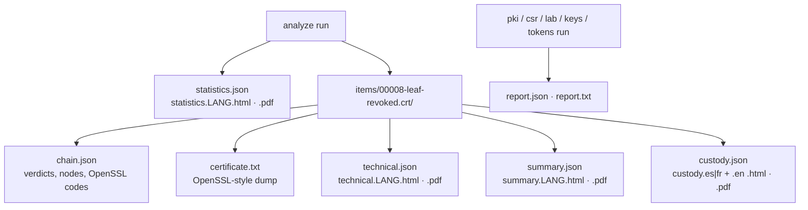
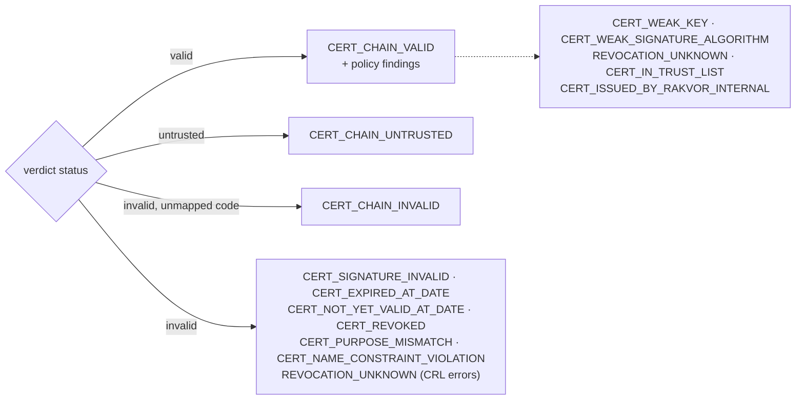

# Reports

Every `analyze` run produces one **statistics report**. Every item produces a **technical review** for
examiners, lawyers and opposing experts, a **customer summary** in plain language, a **chain-of-custody form**,
and, for every cryptographic item, **`chain.json`** and (when it holds certificates) **`certificate.txt`**. Each
review exists as JSON (machine-readable, language-neutral) plus HTML and PDF in each selected language. The
creation commands (`pki`, `csr`, `lab`, `keys`, `tokens`) write a short **creation report** instead.

**Brand.** HTML and PDF reports carry the Rakvor header band (RV mark, descriptor
*FORENSICS | INCIDENT RESPONSE | SECURITY* and the tagline in the report language) on a printable page. With
`--sign-cert`, each report shows the signer's certificate subject and SHA-256 fingerprint (logged at
`signing_certificate_loaded`, also `run.pdf_signer_certificate_sha256` in the JSON), and each PDF carries a
digital signature that Acrobat or `pyhanko sign validate` can check.

## What each report contains

| Section | Statistics | Technical review | Customer summary |
| --- | :-: | :-: | :-: |
| Run ID, case, examiner, start/end, duration, interface | ✔ | ✔ (run ID, case) | case, date |
| Hash algorithms, totals, throughput | ✔ | | |
| Findings by severity and code, items by detected type | ✔ | | |
| Full path, size, modified time, detected type (e.g. "X.509 certificate", "RFC 3161 timestamp token") | | ✔ | file name |
| All digests | | ✔ | primary only |
| Certificate stage: kind, number of certificates, one line per verdict (status, OpenSSL code and reason, depths), online fetches | | ✔ (`certificates`) | |
| Findings with **what it shows / what it does not prove** | | ✔ | plain sentence |
| Audit entries covering the item | | ✔ | |
| Limitations | ✔ | ✔ | |
| Status and next step | | ✔ | ✔ |

## `chain.json` (schema `rakvor.cert-chain/1`)

One file per cryptographic item, written by [certscan.rs](../src/core/src/certscan.rs) and hashed in the audit
log (`output_written`):

| Field | Content |
| --- | --- |
| `item`, `kind` | Item number and kind (`certificate`, `cert_bundle`, `pkcs7`, `pkcs12`, `crl`, `ocsp_response`, `timestamp_token`, `private_key`, `csr`) |
| `at`, `purpose`, `anchors`, `openssl` | The options as given (`--at` as typed; the instant actually used is in each verdict) and the OpenSSL version linked |
| `certificates` | Every certificate of the item: subject, issuer (and their RDNs), serial, validity, SANs, key (algorithm, bits, curve, SPKI SHA-256), signature algorithm and OID, key usage, EKU, basic and name constraints, policy OIDs, AIA and CDP URLs, SKI/AKI, SHA-256 and SHA-1, self-signed, extension list |
| `verdicts[]` | One per end-entity certificate: `status` (`valid` / `untrusted` / `invalid`), `at` (RFC 3339 UTC) and `at_source` (`now`, `given`, `signing-time`, `signing-time-unavailable-now`), `purpose`, `anchors`, `openssl_code` / `openssl_reason` (OpenSSL's first answer), `errors[]` (every error: depth, code, reason), `nodes[]`, `signals[]`, `notes[]` (how the verdict was reached), `online_fetches[]`, `openssl_version` |
| `verdicts[].nodes[]` | Depth 0 first: `cert`, `status` (`ok` / `error` / `incomplete`), `openssl_code`, `openssl_reason`, `anchor` (which `--anchor` it matched), `revocation` (`good` / `revoked` / `unknown`, with the source's origin, SHA-256, thisUpdate, nextUpdate), `revocation_note`, `trust_list` (list, snapshot, provider, service, type, status at the date) |
| `timestamp` | For a token: TSTInfo (genTime, policy, serial, hash algorithm, imprint, TSA name, nonce, accuracy, ordering, status), `signature_valid`, `imprint_matches` and `imprint_file` (the paired evidence file; `null` when no file of the same stem was in the run, see [theory.md B8](theory.md#b8-rfc-3161-tokens-and-ess-signing-certificate)), `signer_chain` |
| `key_match` | For a private key: `matches`, the certificates it matches or was paired with |
| `errors[]` | Every certificate-layer call that failed (operation, error) |

`certificate.txt` holds OpenSSL's `X509_print` of every certificate of the item (`openssl x509 -text -noout`),
each preceded by its position and SHA-256.

## Status and severity

| Severity | Item status | Exit code of the run |
| --- | --- | --- |
| high | `problem` | 3 (at least one high finding in the run) |
| medium, low | `attention` | 0 |
| info | `ok` | 0 |

**Severity describes the signal, not the dispute.** `CERT_EXPIRED_AT_DATE` is high because a chain judged at that
instant fails; it is routine for an old signature checked today ([theory.md A5](theory.md#a5-valid-at-a-date)).
Read the instant (`at`, `at_source`) before reading the severity.

## Findings catalogue

Default severities from `codes::FINDINGS` in [model.rs](../src/certs/src/model.rs); wording from
[i18n/en.json](../i18n/en.json) (es and fr carry the same keys, enforced by a test). "Shows" and "does not prove"
below summarise the catalogue sentences printed in every technical review.

### Certificates and chains

| Code | Severity | What it shows | What it does not prove |
| --- | --- | --- | --- |
| `CERT_CHAIN_VALID` | info | OpenSSL built a path from the certificate to one of the chosen anchors and the chain verified at the instant given: signatures, validity dates, purpose and constraints. **Revocation is reported separately**: `CERT_REVOKED`, or `REVOCATION_UNKNOWN` when it could not be determined (the two can coexist with this finding) | That the certificate was not revoked; that the holder signed or approved any document; that the anchor deserves trust (the examiner's choice); that the result holds at another date |
| `CERT_CHAIN_UNTRUSTED` | high | No path to any chosen anchor could be completed (OpenSSL code 2, 18–21, 27, 28 at the depth given). With a `tl:` anchor, a path that ends in a listed certificate whose service is not granted / recognised / accredited at the instant names the list, the service and its status (`trust_list`, `service`, `service_status`) | That the certificate is forged or invalid: the issuing CA may not be among the anchors, or an intermediate may be missing |
| `CERT_CHAIN_INVALID` | high | OpenSSL examined the path and rejected it with an error the tool does not map to a more specific finding (e.g. 13/14 bad notBefore/notAfter field, 24 issuer key unreadable, 25 path length exceeded, 32 issuer lacks keyCertSign, 34, 37, 79 invalid CA), with OpenSSL's code, reason and depth | Forgery or who produced the certificate: a malformed certificate or a misconfigured CA gives the same result |
| `CERT_SIGNATURE_INVALID` | high | The signature on the certificate at that depth does not verify with its issuer's key (codes 4, 6, 7) | Who altered it or why; a damaged copy or a certificate attributed to the wrong issuer gives the same result |
| `CERT_EXPIRED_AT_DATE` | high | notAfter is before the instant checked | That a signature made with it is invalid: what matters is validity at signing time |
| `CERT_NOT_YET_VALID_AT_DATE` | high | notBefore is after the instant checked | Back-dating or forgery: a wrong `--at`, a wrong clock or a time-zone error gives the same result |
| `CERT_REVOKED` | high | A covering CRL or OCSP answer lists it as revoked on or before the instant, with reason, revocation date and source (any depth) | Wrongdoing by the holder, or that signatures made before the revocation date are invalid |
| `REVOCATION_UNKNOWN` | medium | No CRL or OCSP response covering the target was usable for the instant (with every reason); also raised when OpenSSL reports a CRL problem | Revoked, or not revoked |
| `CERT_PURPOSE_MISMATCH` | medium | Key usage / EKU do not allow the purpose chosen with `--purpose` (OpenSSL's purpose, or the tool's document-signing rule) | Deliberate misuse; software often accepts such certificates |
| `CERT_NAME_CONSTRAINT_VIOLATION` | high | A name in the certificate is outside the names a CA above it may certify (OpenSSL codes 47–49, 51–53), naming the entry and the CA | That the certificate is malicious |
| `CERT_WEAK_KEY` | medium | RSA < 2048 bits, any DSA key, or an elliptic curve below 256 bits (tool policy) | That the key was broken or that signatures made with it are false |
| `CERT_WEAK_SIGNATURE_ALGORITHM` | medium | Signed with MD2, MD4, MD5 or SHA-1 (tool policy; RSASSA-PSS with SHA-1 is not detected) | That this certificate was forged; only that a collision forgery was feasible for a well-resourced attacker |
| `CERT_SELF_SIGNED` | info | A certificate of the item is signed by its own key (subject = issuer, signature verifies with its own key); a chain verdict reports it for the target only, not for a self-signed anchor above it | That it is untrustworthy: every root is self-signed |
| `CERT_IN_TRUST_LIST` | info | A certificate of the chain is a service identity in the trust-list snapshot used, with the provider, service and its **status at the instant** | That the certificate or a signature is qualified or legally valid; that the snapshot is current; the list's own signature is not verified in v0.1 |
| `CERT_NOT_IN_TRUST_LIST` | low | No certificate of the chain is a service identity of the snapshot used | That the certificate is invalid: most certificates are legitimately outside these lists |
| `CERT_ISSUED_BY_RAKVOR_INTERNAL` | info | Issued by Rakvor's internal PKI (policy OID under the Rakvor arc, or chain to the bundled Rakvor root): internal use only, not a *firma digital* under Ley 527 art. 28, not qualified under eIDAS | Any legal effect equivalent to a handwritten signature; the identity of a signer beyond Rakvor's records |

### Keys, timestamps, key stores

| Code | Severity | What it shows | What it does not prove |
| --- | --- | --- | --- |
| `KEY_MATCHES_CERTIFICATE` | info | The private key's public half equals the public key of the certificates named | Who held or used the key, or that it was not copied elsewhere |
| `KEY_DOES_NOT_MATCH` | high | The key is not the key of the certificate supplied with it (same item, or same file stem) | Which key is the right one, or tampering: keys and certificates are often mixed up when exported |
| `KEY_NOT_PAIRED` | info | No certificate examined in the run has this key's public key | That the key is foreign or suspicious |
| `TIMESTAMP_TOKEN_VALID` | info | The RFC 3161 token's status, CMS signature and ESS signing-certificate check out, and the TSA chain was valid at genTime for timestamping. The imprint is compared with the evidence file of the same stem in the run (`data.tsr` ↔ `data`, `data.*`): `imprint_checked=yes` with `imprint_file`; without such a file `imprint_checked=no`, `imprint_file=none`, and the token is **not linked to any file** | That the timestamped data is genuine or who submitted it; with `imprint_checked=no`, which file it covers |
| `TIMESTAMP_TOKEN_INVALID` | high | One or more verification steps failed, all listed; a paired file whose digest differs gives the reason `imprint does not match <file>` | That the time is false or the token forged: a missing TSA certificate or anchor gives the same result |
| `PKCS12_UNREADABLE` | medium | The PKCS#12 could not be opened (no password, wrong password, or an encryption this build cannot read); only what is readable without the password was examined | Damage or suspicious content; the password is never recorded |

### Glue and run integrity

| Code | Severity | What it shows | What it does not prove |
| --- | --- | --- | --- |
| `CRYPTO_INPUT_NOT_RECOGNISED` | info | The content is not one of the supported cryptographic kinds (or is larger than 16 MiB); only the general file checks applied | That the file is irrelevant or harmless |
| `CRYPTO_INPUT_UNPARSABLE` | medium | The content looks like a cryptographic kind but could not be decoded | Tampering: truncation or an unsupported encoding gives the same result |
| `ANALYSIS_STEP_FAILED` | medium | A step (resolve_anchors, validate_chain, certificate_text, verify_timestamp_token, read…) stopped with the error shown; other results stand | Anything about what the step would have found |
| `ANALYSIS_NOT_IMPLEMENTED` | info | Kept in the catalogue; no code path raises it in this build | — |
| `EVIDENCE_CHANGED_DURING_READ` | high | The second read for parsing has a different digest from the hashing read moments before | Who or what changed the file |

### Shared with every Rakvor tool

| Code | Severity | What it shows | What it does not prove |
| --- | --- | --- | --- |
| `EMPTY_FILE` | info | The file has 0 bytes | Whether it was emptied on purpose |
| `EXTENSION_MISMATCH` | medium | Name and content signature disagree (not applied to cryptographic objects: `.cer`, `.p7b`… carry many encodings) | Intent to hide anything |
| `EXECUTABLE_CONTENT` | high | A program is stored under a non-program name (not applied to cryptographic objects) | That the program is malicious |
| `DUPLICATE` | info | Identical content (same primary hash) in several files | Who copied it or when |
| `UNREADABLE` | high | Reading failed, with the OS error | That the file is damaged |
| `EVIDENCE_HASH_MISMATCH_WITH_CASE` | high (case folder) | The file differs from the evidence registered at intake | Who changed it, when, or why |
| `EVIDENCE_NOT_IN_CASE_REGISTRY` | medium (case folder) | No registered item has this path or content | That the file is altered or irrelevant |
| `REGISTRY_PATH_CONTENT_CHANGED` | medium (intake tools only) | A registered path now holds other content | Which version is the original |

Limitations printed in every report: see [admissibility.md](admissibility.md#limitations-stated-in-every-report).
A run with `--at signing-time` also prints `AT_SIGNING_TIME_TOKENS_ONLY_V01` (and records it as `run_note` in the
audit log): only timestamp tokens have a signing time in v0.1; every other item was judged now.

## Creation reports

Every creation command writes `reports/<RUN-ID>/report.json` (schema `rakvor.certcheck-creation-report/1`: tool,
version, run id, command, result, every file written with its role, path and SHA-256, the internal-use notice) and
`report.txt` (the same, readable). With `--json` the result is also printed on stdout. Key files, passwords and
PINs never appear; key *locations* do.

## JSON schemas

| File | `schema` value | Schema |
| --- | --- | --- |
| `statistics.json` | `rakvor.statistics/1` | [schemas/statistics.schema.json](../schemas/statistics.schema.json) |
| `technical.json` | `rakvor.item-technical/1` | [schemas/item-technical.schema.json](../schemas/item-technical.schema.json) |
| `summary.json` | `rakvor.item-summary/1` | [schemas/item-summary.schema.json](../schemas/item-summary.schema.json) |
| `custody.json` | `rakvor.item-custody/1` | [schemas/item-custody.schema.json](../schemas/item-custody.schema.json) |
| `chain.json` | `rakvor.cert-chain/1` | none yet (fields above; serialized names frozen in `model.rs`) |
| trust-list snapshot | `rakvor.trust-list/1` | none yet; one Colombian CSV row: [schemas/trustlist-co.schema.json](../schemas/trustlist-co.schema.json) |
| `ca.json` / `issued.jsonl` | `rakvor.ca/1` | none yet ([theory.md B15](theory.md#b15-pki-creation)) |
| `expected_findings.json` (lab set) | `rakvor.lab-set/1` | none yet ([theory.md B16](theory.md#b16-lab-sets-and-determinism)) |

Adding a field is a minor change; removing or renaming one bumps the `/N` version.

## PDF notes

PDFs are generated by a small built-in writer (A4, Helvetica/Courier, WinAnsi encoding), so no external program is
needed. WinAnsi covers English, Spanish and French. Every report file's digest is recorded in the audit log
(`item_reports_written`, `statistics_report_written`, `output_written`), so a report altered after the run can be
detected.
