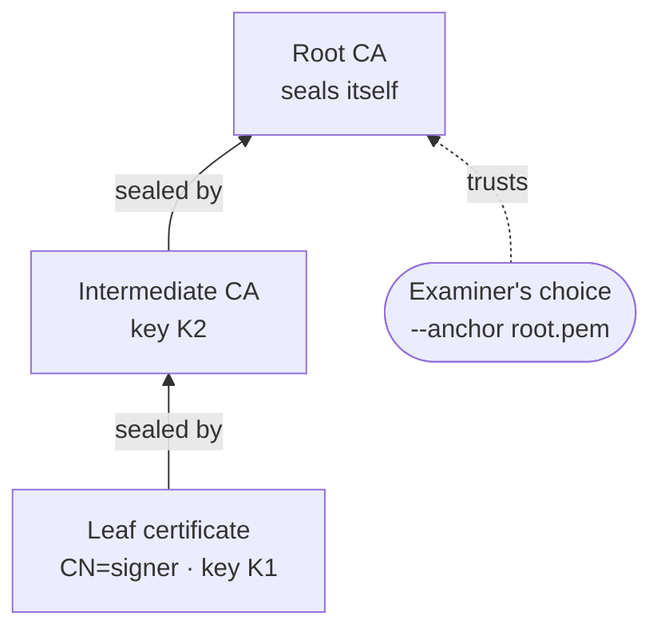
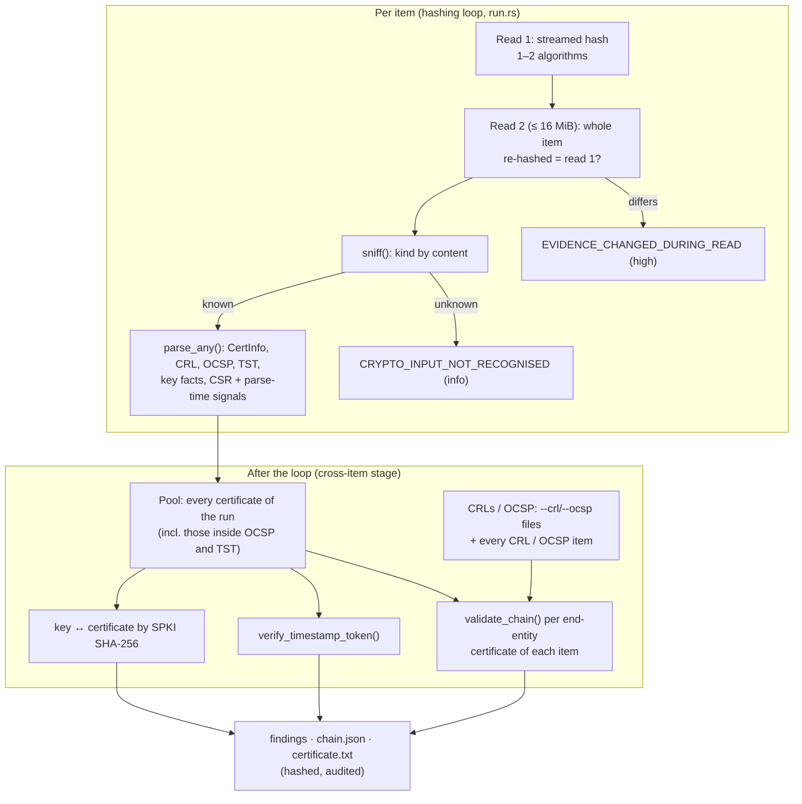
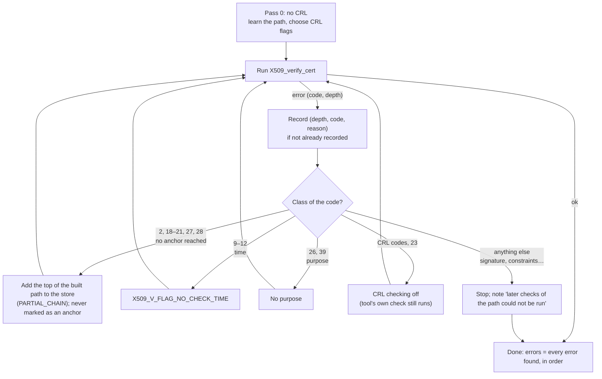

# Theory of operation

This page explains **why** each step of RV CertCheck works, at two levels:

- **[Part A — For clients, lawyers and judges](#part-a--for-clients-lawyers-and-judges)**: plain language,
  everyday analogies, and what a result can and cannot mean. No knowledge of cryptography is needed.
- **[Part B — For examiners and opposing experts](#part-b--for-examiners-and-opposing-experts)**: the standards,
  the exact rules and thresholds, and the source file that implements each one. Every rule in Part B is read from
  the code of this commit; where the code departs from a standard or from OpenSSL's own behaviour, Part B says so.

It describes what the tool **does**, not what it should do. Known limits are stated where they apply and collected
in [admissibility.md](admissibility.md#consolidated-gap-list). How to run the tool: [usage.md](usage.md). The
meaning of every finding code: [reports.md](reports.md#findings-catalogue).

## Contents

- Part A: [A1 What the tool is](#a1-what-the-tool-is-and-is-not) ·
  [A2 Keys and signatures](#a2-keys-and-signatures-a-seal-only-one-person-holds) ·
  [A3 Certificates](#a3-certificates-an-id-card-for-a-key) ·
  [A4 Chains and anchors](#a4-chains-and-anchors-who-vouches-for-whom) ·
  [A5 Valid at a date](#a5-valid-at-a-date) ·
  [A6 Revocation](#a6-revocation-the-list-of-cancelled-cards) ·
  [A7 Timestamps](#a7-trusted-timestamps-a-notary-for-a-fingerprint) ·
  [A8 Purpose](#a8-purpose-a-driving-licence-is-not-a-passport) ·
  [A9 Trust lists](#a9-trust-lists-the-official-register-of-issuers) ·
  [A10 Rakvor's own certificates](#a10-rakvors-own-certificates) ·
  [A11 The tool's own diary](#a11-the-tools-own-diary) ·
  [A12 Reading a result](#a12-reading-a-result)
- Part B: [B1 Source map](#b1-source-map) ·
  [B2 Pipeline](#b2-pipeline-and-reads-of-the-evidence) ·
  [B3 Recognising inputs](#b3-recognising-inputs-by-content) ·
  [B4 Path validation](#b4-rfc-5280-path-validation-as-openssl-implements-it) ·
  [B5 Collecting every error](#b5-collecting-every-error-the-re-run-approach) ·
  [B6 The validation instant](#b6-the-validation-instant---at) ·
  [B7 Revocation](#b7-revocation-crl-and-ocsp-rules) ·
  [B8 RFC 3161 tokens](#b8-rfc-3161-tokens-and-ess-signing-certificate) ·
  [B9 Weak cryptography](#b9-weak-key-and-signature-thresholds) ·
  [B10 Purposes](#b10-purpose-rules) ·
  [B11 Name constraints](#b11-name-constraints) ·
  [B12 Key matching](#b12-private-key-matching) ·
  [B13 Rakvor internal certificates](#b13-rakvor-internal-certificates) ·
  [B14 Trust lists](#b14-trust-list-formats-and-snapshots) ·
  [B15 PKI creation](#b15-pki-creation) ·
  [B16 Lab sets](#b16-lab-sets-and-determinism) ·
  [B17 Audit chain and case folder](#b17-audit-chain-case-folder-timestamp-of-the-log) ·
  [B18 Validation status](#b18-oracles-and-validation-status) ·
  [B19 References](#b19-references)

---

# Part A — For clients, lawyers and judges

## A1 What the tool is (and is not)

RV CertCheck reads the cryptographic material found in a case: certificates, revocation lists, timestamp tokens,
key files. It answers precise, narrow questions such as *"did this certificate chain lead to the root the examiner
chose, at this date, for this use?"* or *"is this private key the one that belongs to that certificate?"*. Each
answer comes with two sentences: what the result **shows** and what it **does not prove**.

It does not say that a document was signed by a person, that a signature is genuine, or that a certificate is
false. Those are conclusions an examiner or a court draws from many facts; the tool supplies some of them.

It also **creates** certificates for Rakvor's own use (signing its software releases and its examiners' reports)
and test certificates for training. Those certificates are internal: they carry no legal presumption in Colombia
or in the EU ([A10](#a10-rakvors-own-certificates)).

## A2 Keys and signatures: a seal only one person holds

A digital signature works like a wax seal whose stamp only one person owns. The stamp is the **private key**; it
must stay secret. Anyone can check a seal with the matching **public key**, which can be handed out freely. If the
sealed document changes by a single character, the seal no longer matches.

A signature therefore tells you two things at most: the document has not changed since it was sealed, and it was
sealed with a particular private key. It does not tell you **who** was holding the stamp.

## A3 Certificates: an ID card for a key

A public key on its own is just a number. A **certificate** is an ID card that binds that number to a name
(a person, a company, a web site) for a period of time, and is itself sealed by an issuer, a **certification
authority (CA)**. Like an ID card it has a holder, an issuer, a serial number, a "valid from" and "valid until"
date, and remarks about what it may be used for.

## A4 Chains and anchors: who vouches for whom

The CA that sealed a certificate has its own certificate, sealed by a higher CA, and so on up to a **root**, which
seals itself. This is a **chain**: *leaf → intermediate → root*. Checking a chain means checking every seal on the
way up and every date and remark.

Nothing in the chain itself says the root deserves trust: anybody can make a root. Trust starts from a decision:
the examiner names the roots to rely on (the **trust anchors**, option `--anchor`). The same certificate can lead
to a trusted root for one examiner and to an unknown one for another; the report always names the anchors used.



## A5 Valid at a date

An ID card can be checked "today" or "on the day of the contract". The answer may differ. RV CertCheck checks a
chain **at one instant**, which the examiner chooses (`--at`), and prints that instant in every report.

This matters because **an expired certificate can be perfectly normal for an old signature**. A contract signed
in 2023 with a certificate valid until 2024 was signed with a valid card; checking it "today" says *expired*,
which is true and irrelevant. What matters for a signature is whether the card was valid **when the signature was
made**. To know when it was made, you need a reliable time: a trusted timestamp ([A7](#a7-trusted-timestamps-a-notary-for-a-fingerprint)),
not the date the signer typed. In this version the examiner gives that date with `--at`; `--at signing-time`
uses the time of a timestamp token for the token's own TSA, but cannot yet read a time from other signed objects:
those fall back to *now*, and the report says so.

## A6 Revocation: the list of cancelled cards

A card can be cancelled before its end date: the key was lost or stolen, the employee left. The CA then publishes
the cancellation in a **certificate revocation list (CRL)**, a dated list of cancelled serial numbers, or answers
questions one by one through **OCSP** (an "is this card still good?" service).

Offline, the tool knows only the lists it is given. If it was given none that covers the certificate, it says
*"revocation status unknown"*, which means exactly that: not revoked, not good, unknown. A revocation also has a
date: a card cancelled in June does not invalidate a signature made in March.

## A7 Trusted timestamps: a notary for a fingerprint

A **timestamp authority (TSA)** receives the fingerprint (hash) of some data, never the data itself, and returns a
signed token saying "this fingerprint existed at 10:42 UTC on this day". The tool checks the TSA's seal, that the
token names the TSA's certificate, and that the TSA's own chain was valid **at the time stated**. A valid token
shows that data with that fingerprint existed by then. It says nothing about who made the data or whether it is
true.

## A8 Purpose: a driving licence is not a passport

Certificates carry remarks about their use: web server, code signing, e-mail, timestamping, document signing.
A web-server certificate used to sign a contract is like a driving licence shown at a border. The examiner chooses
the use to check (`--purpose`); a mismatch is reported as such. Software often accepts such mismatches, so a
mismatch is a fact to explain, not evidence of misuse.

## A9 Trust lists: the official register of issuers

In the EU, each Member State publishes a **trusted list** of the providers it supervises and of their services
(for example "issues qualified certificates"), with each service's status over time. The tool can import such a
list and say whether a certificate of the chain belongs to a listed service, and what that service's status was
at the date checked. Colombia publishes no machine-readable list of its accredited certification entities, so
Rakvor keeps a hand-curated file with its sources. In both cases the tool works on a **dated copy** (a snapshot)
and records its fingerprint; in this version it does not check the EU list's own signature.

Being on a list is one condition among several for a certificate to have a special legal status; it is not that
status.

## A10 Rakvor's own certificates

Rakvor uses this tool to make certificates for itself: one to sign its software releases, one per examiner to
sign reports, internal web servers, test material. Rakvor is not an authorised *entidad de certificación* in
Colombia and not a qualified trust service provider in the EU, so these certificates are **not a *firma digital*
under Ley 527 de 1999 art. 28 and not qualified certificates under eIDAS**. Every one of them carries that
statement inside it, and `analyze` reports it whenever it meets one. A Rakvor signature shows that a Rakvor key
was used; its weight rests on Rakvor's procedures and records.

## A11 The tool's own diary

Every action of every run (each file read, each fingerprint, each result, each certificate created) is written
to a diary in which every line carries the fingerprint of the line before. Changing, removing or reordering a line
breaks the sequence, and `verify-log` finds it. The CA folder has its own diary of every certificate issued or
revoked (`issued.jsonl`), built the same way, and the tool refuses to issue anything if that diary does not check
out.

## A12 Reading a result

| You read | It means | It does not mean |
| --- | --- | --- |
| Chain valid at the date checked | Every seal, date, use and constraint checked out, up to the anchor the examiner chose | That a person signed something, or that the anchor deserves trust |
| Chain does not reach a trusted anchor | No path to the chosen roots could be completed | That the certificate is false: the right root or an intermediate may simply be missing |
| Expired at the date checked | The card's end date is before the instant checked | That an older signature made with it is invalid |
| Revoked | A list or answer covering the certificate cancels it, from a stated date | That the holder did anything wrong, or that earlier signatures are invalid |
| Revocation unknown | No list covering it was available | Revoked, or not revoked |
| Timestamp token valid | The TSA sealed this fingerprint at this time, with a chain valid then | Who made the data, or that it is true |
| Rakvor internal certificate | Issued by Rakvor's internal PKI | Any legal presumption |
| No finding | None of the checks of [reports.md](reports.md) fired | That the material is genuine or unaltered before it was received |

---

# Part B — For examiners and opposing experts

## B1 Source map

| Concern | File |
| --- | --- |
| Frozen model, finding codes and default severities, Rakvor OIDs | [src/certs/src/model.rs](../src/certs/src/model.rs) |
| Public API of the certificate layer, bundled Rakvor root, data folder | [src/certs/src/lib.rs](../src/certs/src/lib.rs) |
| Content sniffing | [src/certs/src/analysis/sniff.rs](../src/certs/src/analysis/sniff.rs) |
| Field extraction, weak-crypto policy, Rakvor policy detection, PKCS#12 | [src/certs/src/analysis/parse.rs](../src/certs/src/analysis/parse.rs) |
| Path building and verification, error collection, purposes, name constraints | [src/certs/src/analysis/chain.rs](../src/certs/src/analysis/chain.rs) |
| CRL and OCSP evaluation | [src/certs/src/analysis/revocation.rs](../src/certs/src/analysis/revocation.rs) |
| `--online` fetching | [src/certs/src/analysis/online.rs](../src/certs/src/analysis/online.rs) |
| RFC 3161 | [src/certs/src/analysis/timestamp.rs](../src/certs/src/analysis/timestamp.rs) |
| `--anchor` resolution | [src/certs/src/analysis/anchors.rs](../src/certs/src/analysis/anchors.rs) |
| Key matching | [src/certs/src/analysis/keymatch.rs](../src/certs/src/analysis/keymatch.rs) |
| Trust lists (EU XML, Colombian CSV, snapshot store) | [src/certs/src/trustlist/](../src/certs/src/trustlist/mod.rs) |
| CA folders, profiles, issue/revoke/CRL/OCSP | [src/certs/src/create/pki.rs](../src/certs/src/create/pki.rs), [build.rs](../src/certs/src/create/build.rs), [derw.rs](../src/certs/src/create/derw.rs) |
| Key protection (PBES2, PKCS#12), seeded lab keys | [src/certs/src/create/keys.rs](../src/certs/src/create/keys.rs), [rng.rs](../src/certs/src/create/rng.rs) |
| `issued.jsonl` | [src/certs/src/create/issued.rs](../src/certs/src/create/issued.rs) |
| Lab sets | [src/certs/src/create/lab.rs](../src/certs/src/create/lab.rs) |
| PKCS#11 | [src/certs/src/create/tokens.rs](../src/certs/src/create/tokens.rs) |
| Glue: per-item and cross-item stages, findings, chain.json | [src/core/src/certscan.rs](../src/core/src/certscan.rs) |
| Finding wording (shows / does not prove) | [i18n/en.json](../i18n/en.json), es, fr |

OpenSSL is the vendored OpenSSL 3 built from source by `openssl-src` (the version linked is recorded in every
`chain.json`, in every verdict and in `environment.json`; this commit links `OpenSSL 3.6.3 9 Jun 2026`). The
certificate layer forbids `unsafe` code (`#![forbid(unsafe_code)]`); OpenSSL is reached through the safe API of
the `openssl` crate.

## B2 Pipeline and reads of the evidence



- Items larger than 16 MiB (`MAX_CRYPTO_BYTES`) are hashed but not parsed (`CRYPTO_INPUT_NOT_RECOGNISED`, kind
  "larger than 16 MiB, not read").
- **Targets.** In each item, the certificates that issue no other certificate of the same item are the end
  entities (`targets()` in certscan.rs). A single certificate is its own target. Each target gets one verdict.
- **Untrusted pool.** Every certificate of every item of the run may complete a path (`ChainRequest::untrusted_der`).
  Being in the pool never makes a certificate trusted: only `--anchor` does.
- **Revocation sources.** Every CRL and OCSP response of the run, labelled `item:<index>`, plus the `--crl` /
  `--ocsp` files, labelled `file:<path>` and hashed in the audit entry `validation_options`.
- A failing certificate-layer call becomes `ANALYSIS_STEP_FAILED` (medium) with the operation and the reason; a
  decoding error becomes `CRYPTO_INPUT_UNPARSABLE`; a PKCS#12 that cannot be opened becomes `PKCS12_UNREADABLE`.

## B3 Recognising inputs by content

`sniff()` never looks at the file name. DER objects are recognised by OpenSSL's own decoders (`d2i_X509`,
`d2i_X509_CRL`, `d2i_X509_REQ`, `d2i_OCSP_RESPONSE`, `d2i_PKCS12`, `d2i_AutoPrivateKey`) and a bounds-checked walk of
the CMS ContentInfo that separates an RFC 3161 token (eContentType id-ct-TSTInfo, 1.2.840.113549.1.9.16.1.4) from a
PKCS#7 bundle. PEM is recognised by its labels; unarmoured base64 is decoded first. Hostile input gives `Unknown`,
never an error. The kinds are: certificate, PEM bundle, PKCS#7, PKCS#12, CRL, OCSP response, timestamp token
(TimeStampResp or bare TimeStampToken), private key (PKCS#8 plain or encrypted, PKCS#1, SEC1, legacy encrypted PEM)
and CSR (PKCS#10).

Field extraction (`parse.rs`): OpenSSL decides whether an object is well formed and supplies names, times,
fingerprints and the self-signature check; `x509-parser` decodes the extensions into fields; `x509-ocsp` and `cms`
decode structures the `openssl` crate does not expose. `certificate.txt` is OpenSSL's `X509_print` (`openssl x509
-text -noout`). A PKCS#12 is opened with OpenSSL's `PKCS12_parse`; legacy encryptions (RC2-40, 3DES) need OpenSSL's
legacy provider, which the vendored build lacks, so `p12-keystore` reads them instead. The password comes from the
environment variable named by `--p12-pass-env` and is never logged.

## B4 RFC 5280 path validation as OpenSSL implements it

RFC 5280 §6 defines path validation: for each certificate from the anchor down to the target, check the signature
with the issuer's key, the validity period against the validation time, the issuer/subject name chaining, revocation,
basic constraints and path length, key usage, name constraints and policies, and reject unknown critical
extensions. OpenSSL implements this in `X509_verify_cert()` (`crypto/x509/x509_vfy.c`): it first **builds** a path
from the target through the untrusted certificates to a certificate in the trust store, then **verifies** it, and
reports the first failure as an `X509_V_ERR_*` code with the depth at which it occurred (depth 0 = the target).

How the tool calls it (`verify_once()` in chain.rs):

| Setting | Value |
| --- | --- |
| Trust store | Exactly the certificates of the `--anchor` values (none = nothing trusted; chains are still built and reported untrusted) |
| Untrusted chain | The run's pool, minus the target itself |
| Time | `X509_VERIFY_PARAM_set_time(at)` (sets `X509_V_FLAG_USE_CHECK_TIME`) |
| Purpose | `X509_PURPOSE_SSL_SERVER`, `SSL_CLIENT`, `CODE_SIGN`, `SMIME_SIGN` or `TIMESTAMP_SIGN` for the purposes that have one; none for `any` and `document-signing` |
| CRLs | Written as PEM to a temporary file (the crate adds CRLs to a store only through a file lookup), then `X509_V_FLAG_CRL_CHECK` and possibly `CRL_CHECK_ALL` (see [B7](#b7-revocation-crl-and-ocsp-rules)) |
| Policy checking | OpenSSL's defaults (no explicit policy required) |

Each depth of the path becomes a node in `chain.json` with OpenSSL's code and reason text
(`X509_verify_cert_error_string`) at that depth, the anchor it matched, its revocation status and its trust-list
membership. A node is `ok`, `error`, or `incomplete` (the top of a path that reached no anchor).

The verdict is mapped from OpenSSL's codes as follows (`validate_chain()`):

| OpenSSL code (`X509_V_ERR_…`) | Finding | Verdict status |
| --- | --- | --- |
| 2, 18, 19, 20, 21, 27, 28 (no issuer, self-signed not trusted, unable to verify, untrusted, rejected) | `CERT_CHAIN_UNTRUSTED` (target subject) | `untrusted` |
| 4, 6, 7 (signature cannot be decrypted / issuer key undecodable / signature failure) | `CERT_SIGNATURE_INVALID` | `invalid` |
| 10 (certificate has expired) | `CERT_EXPIRED_AT_DATE` | `invalid` |
| 9 (not yet valid) | `CERT_NOT_YET_VALID_AT_DATE` | `invalid` |
| 23 (revoked) | `CERT_REVOKED`, unless the tool's own revocation check says revoked (reported with reason and date instead) or good at the date (see B7) | `invalid` |
| 26, 39 (invalid purpose / key usage lacks digitalSignature) | `CERT_PURPOSE_MISMATCH` | `invalid` |
| 47–49, 51–53 (name-constraint violations and unsupported constraints) | `CERT_NAME_CONSTRAINT_VIOLATION` | `invalid` |
| 3, 5, 8, 11, 12, 15, 16, 33, 35, 36, 44, 54 (CRL missing, undecodable, bad signature, not yet valid, expired, bad dates, issuer, key usage, critical extension, scope, path) | `REVOCATION_UNKNOWN` | `invalid` |
| any other code (e.g. 13/14 bad notBefore/notAfter field, 24 no issuer public key, 25 path length exceeded, 32 issuer lacks keyCertSign, 34 unhandled critical extension, 37 CA certificate used as CA without CA:TRUE, 79 invalid CA certificate) | `CERT_CHAIN_INVALID` (high) with OpenSSL's code, reason and depth: the path was examined and is invalid, not untrusted | `invalid` |
| none | `CERT_CHAIN_VALID` (subject, anchor, instant): the chain verified; revocation is reported separately | `valid` |

The status is `untrusted` whenever any untrusted-class code was found, else `invalid` whenever any error, a
revoked node or a failed tool policy check (document signing) was found, else `valid`. `CERT_CHAIN_VALID` can
coexist with `REVOCATION_UNKNOWN`, `CERT_WEAK_KEY` or `CERT_WEAK_SIGNATURE_ALGORITHM`: OpenSSL accepts those, and
the tool reports them as separate findings. Its wording says so: the chain verified, and revocation is a separate
finding (`CERT_REVOKED` or `REVOCATION_UNKNOWN`).

## B5 Collecting every error: the re-run approach

`openssl verify` lists several errors because its callback returns 1 ("continue") after each one. The `openssl`
crate exposes no safe store-verify callback, and the certificate layer forbids `unsafe`, so the tool reproduces
the continuing callback by **re-running** `X509_verify_cert()` with the class of the error just reported switched
off, which is what returning 1 from the callback does for that class (`run_walk()` in chain.rs):



- The loop runs at most 12 times. The **first** error is OpenSSL's own first answer, the one `openssl verify`
  prints; `errors` lists every error found with its depth; the verdict stays failed whenever any error was found.
- Once `NO_CHECK_TIME` is set, OpenSSL stops reporting time errors, while its CLI callback would report one at
  each expired depth. The tool therefore compares every certificate of the final path with the instant using
  OpenSSL's own `ASN1_TIME` comparison and adds codes 9 and 10 at the depths concerned, with a note.
- A CRL-time error (11, 12) switches off the **time check**, not the CRL, because OpenSSL's CLI callback continues
  and still applies the CRL; certificate dates are then re-checked as above.
- When the walk stops on a code it cannot switch off (a broken signature, a name-constraint violation), later
  checks of that path are not run; the verdict's `notes` say so. Every such stop is visible in `chain.json`.
- Oracle: for every fixture, the first code equals `openssl verify -attime -purpose [-crl_check[_all] -CRLfile]
  -CAfile -untrusted`, and every error the CLI prints is among the verdict's errors
  ([analysis_oracle_openssl.rs](../src/certs/tests/analysis_oracle_openssl.rs)).

## B6 The validation instant (`--at`)

| `--at` | Instant used | `at_source` in the verdict |
| --- | --- | --- |
| `now` (default) | The analysis time | `now` |
| `YYYY-MM-DD` | Midnight UTC of that day | `given` |
| RFC 3339 (`2025-03-14T09:30:00-05:00`) | Converted to UTC | `given` |
| `signing-time` | The signing time **supplied by the caller**; none supplied → now | `signing-time`, or `signing-time-unavailable-now` with a note |

**v0.1 limit.** Only a timestamp token (`.tsr`, `.tst`) has a signing time: its genTime, at which its own TSA
chain is judged (always, whatever `--at`; [B8](#b8-rfc-3161-tokens-and-ess-signing-certificate)). Every other
item has no signing time yet (`ChainRequest::signing_time` is `None` in
[certscan.rs](../src/core/src/certscan.rs)), so `--at signing-time` judges its chains *now* and says so in each
verdict (`signing-time-unavailable-now`). The run also prints the note `AT_SIGNING_TIME_TOKENS_ONLY_V01` with the
limitations of every report and records it as `run_note` in the audit log. Give the date explicitly
(`--at 2025-03-14`) until the signed-document support of v0.2 reads it from the object.

All times are compared as UTC seconds. Why an expired certificate can be fine: RFC 5280 judges validity at the
validation time; for a signature the relevant time is the signing time, which needs independent evidence (a
timestamp token, or a time recorded by a trusted system). That reasoning belongs to the examiner; the tool judges
at the instant given and prints it.

## B7 Revocation: CRL and OCSP rules

The tool runs its **own** revocation check for every non-anchor node of the path, whatever OpenSSL's CRL flags
(`check_detailed()` in revocation.rs). Rules, quoted from the code:

**A CRL covers a certificate** (RFC 5280 §5, §6.3) when its issuer name equals the certificate's issuer name and
its signature verifies with the issuer certificate's public key; an issuer whose keyUsage is present without
cRLSign is refused. **Indirect CRLs, delta CRLs and delegated CRL signers are not supported in v0.1.**

**An OCSP response covers it** (RFC 6960) when its status is `successful`, OpenSSL's `OCSP_basic_verify` accepts
its signature (by the issuer itself, or by a responder certificate the issuer delegated with id-kp-OCSPSigning;
the responder certificate is judged at producedAt) and it holds a SingleResponse for the certificate's CertID
built with SHA-1 or SHA-256. An `unknown` answer does not cover it.

**Freshness and dates**, for each covering CRL or OCSP answer, at the validation instant *at*:

| Situation | Result |
| --- | --- |
| Listed as revoked with revocationDate ≤ *at* (reason other than removeFromCRL) | `revoked`, with reason and date |
| Listed as revoked with revocationDate > *at* | `good` at that date, with the note "revoked on …, after the date checked" |
| Not listed; thisUpdate ≤ *at* ≤ nextUpdate (or nextUpdate absent) | `good` |
| Not listed; thisUpdate > *at* (issued after the date checked) | `good`, with the note "issued after the date checked … lists no revocation" |
| Not listed; nextUpdate < *at* and issued before *at* | stale: not used (reason recorded) |
| Nothing usable | `unknown`, with every reason (`REVOCATION_UNKNOWN` for the target only) |

A revoked answer from any source wins over a good one. The second-to-last rule is a deliberate choice: a list
issued after the date checked that does not list the certificate is taken as evidence it was not revoked at that
date (a revocation cannot be back-dated to before a list that omits it without the CA publishing contradictory
lists). An opposing expert may argue otherwise; the note makes the basis visible.

**OpenSSL's CRL flags.** `CRL_CHECK` is set when a CRL by the target's issuer is supplied, plus `CRL_CHECK_ALL`
when every certificate of the path below the anchor has a CRL by its issuer; otherwise OpenSSL's CRL checking is
off and a note says why. OpenSSL does not compare the revocation date with the validation time: when it reports
code 23 but the tool's check says *good at that date*, the tool keeps `good` and records OpenSSL's code in the
notes.

**`--online`.** For every certificate of the built path that has an issuer in it, the tool fetches each CRL
distribution point URL (GET) and asks each AIA OCSP URL (POST, CertID with SHA-1), then validates again with the
answers ([online.rs](../src/certs/src/analysis/online.rs)): HTTP and HTTPS only (an `ldap://` CDP is refused), a
15 s timeout per request, at most 20 MiB per response, `Cache-Control: no-cache`, no cache. Each fetch (URL, time,
HTTP status, size, response SHA-256 or error) is in the verdict's `online_fetches`, in `chain.json` and in the
audit entry `revocation_fetched`. Only HTTP 200 bodies are used.

## B8 RFC 3161 tokens and ESS signing-certificate

RFC 3161 defines a TimeStampResp (PKIStatus + TimeStampToken) whose token is a CMS SignedData (RFC 5652) with
eContentType id-ct-TSTInfo. TSTInfo holds the policy OID, the messageImprint (hash algorithm + digest of the data),
the serial number, **genTime**, and optionally accuracy, ordering, nonce and the TSA name. RFC 3161 §2.4.1 requires
the signer to identify its certificate with the ESS signing-certificate attribute (RFC 2634; v2 for SHA-2,
RFC 5035), and §2.3 requires the TSA certificate to carry a **critical** extended key usage with only
id-kp-timeStamping.

TSTInfo is read with a bounds-checked DER walk that accepts fractional seconds in genTime (some TSAs emit them and
strict decoders reject them). Verification, each step reported separately (`verify_timestamp_token()`):

1. A TimeStampResp must have status `granted` or `grantedWithMods` (a bare token has none).
2. The CMS signature over TSTInfo verifies (`PKCS7_verify` with `PKCS7_NOVERIFY`: signature only, chain checked in
   step 4), and the signed content is the token's own TSTInfo.
3. The ESS signingCertificate (SHA-1 certHash) or signingCertificateV2 (default SHA-256, or the algorithm given)
   names the signer certificate: its hash over the certificate's DER equals certHash. The signer is found by
   issuer + serial or by SKI, among the token's certificates and then the run's pool.
4. The TSA certificate's chain is valid **at genTime** for purpose `timestamping` (OpenSSL's
   `X509_PURPOSE_TIMESTAMP_SIGN`), through the same `validate_chain()` with the run's anchors, CRLs and OCSP.
5. genTime is inside the TSA certificate's validity period.
6. The messageImprint is compared with the evidence file **of the same stem** in the run, paired the way keys
   are paired with certificates (`data.tsr` ↔ `data`, `data.txt`, `data.bin`; other tokens excluded): core
   streams the file through the token's hash algorithm (`ImprintHasher`) while re-hashing it with the run's
   first-pass algorithm (a file that changed since it was hashed is not accepted), and passes the result as an
   `ImprintCheck` (`verify_timestamp_token_checked()`). The first paired file that matches is the one named;
   when none matches the token is invalid with `imprint does not match <file(s)>`.

All steps pass → `TIMESTAMP_TOKEN_VALID` (genTime, TSA, policy, hash algorithm, `imprint_checked` yes/no,
`imprint_file`); any failure → `TIMESTAMP_TOKEN_INVALID` with every reason; the TSA chain's own findings are added.
With no paired file the token is reported valid with `imprint_checked=no`, `imprint_file=none`, and its wording
says it is **not linked to any file**: it shows only that some data with that digest existed at genTime. Compare
it by hand in that case (`hashes.csv`, or `openssl ts -verify -data FILE -in TOKEN.tsr -CAfile …`). The audit log's own timestamp is handled separately by
the core ([B17](#b17-audit-chain-case-folder-timestamp-of-the-log)).

## B9 Weak key and signature thresholds

These are the tool's policy, not OpenSSL's (OpenSSL at its default security level accepts all of them in
verification). They apply to every certificate parsed and to every node of a path (`weak_key()`,
`weak_signature()` in parse.rs):

| Finding | Rule |
| --- | --- |
| `CERT_WEAK_KEY` | RSA modulus < 2048 bits; any DSA key; EC field size < 256 bits. Ed25519, Ed448 and curves of ≥ 256 bits (P-256, P-384, P-521, brainpoolP256r1 and above) are not flagged |
| `CERT_WEAK_SIGNATURE_ALGORITHM` | Signature OID md2WithRSA (1.2.840.113549.1.1.2), md4WithRSA (…1.3), md5WithRSA (…1.4), sha1WithRSA (…1.5), sha1WithRSA OIW (1.3.14.3.2.29), dsa-with-SHA1 (1.2.840.10040.4.3), ecdsa-with-SHA1 (1.2.840.10045.4.1), or an OpenSSL algorithm name starting or ending with md2/md4/md5/sha1 |

RSASSA-PSS with SHA-1 is **not** detected: the hash is in the algorithm parameters, not in the OID. The 2048-bit
and 256-bit floors follow the 112-bit security level of NIST SP 800-57 Part 1 and SP 800-131A [to verify]; MD5
and SHA-1 have practical collision attacks (chosen-prefix collisions on SHA-1 were demonstrated in 2020
[to verify]). A weak algorithm on a self-signed anchor is still reported: its own signature is not what gives it
trust, but its key is.

## B10 Purpose rules

| `--purpose` | Checked by | Rule |
| --- | --- | --- |
| `any` (default) | — | No purpose check |
| `tls-server`, `tls-client`, `code-signing`, `email`, `timestamping` | OpenSSL `X509_PURPOSE_SSL_SERVER`, `SSL_CLIENT`, `CODE_SIGN`, `SMIME_SIGN`, `TIMESTAMP_SIGN` (`openssl verify -purpose sslserver / sslclient / codesign / smimesign / timestampsign`) | OpenSSL's rules for the target (EKU and key usage, Netscape cert type) and for the CAs above it. `timestampsign` requires a critical EKU with timeStamping only |
| `document-signing` | **The tool** (OpenSSL has no such purpose) | The target's EKU is absent or includes documentSigning (1.3.6.1.5.5.7.3.36, RFC 9336), emailProtection or anyExtendedKeyUsage, **and** its key usage is absent or includes digitalSignature or nonRepudiation. CAs are not checked for this purpose |

A failed check gives `CERT_PURPOSE_MISMATCH` with the key usage and EKU found. The document-signing rule is
deliberately permissive (RFC 9336 is recent and most signing certificates in the field carry emailProtection or
no EKU); the verdict's notes state the rule whenever it fails. The Microsoft document-signing EKU
(1.3.6.1.4.1.311.10.3.12) alone does **not** satisfy it.

## B11 Name constraints

OpenSSL decides name-constraint violations (RFC 5280 §4.2.1.10; codes 47–49, 51–53). To name the offending entry,
the tool matches the target's SANs (and its CN as a DNS name when it has no DNS SAN, and emailAddress) against the
permitted and excluded subtrees of each CA above it: DNS by suffix on a label boundary, e-mail by exact address,
domain or `.domain`, IP by CIDR. The finding names the first name outside a constraint and the CA that imposed it.

## B12 Private-key matching

A private key item (or the key of an opened PKCS#12) is opened only long enough to compare its public half
([keymatch.rs](../src/certs/src/analysis/keymatch.rs)): RSA by modulus and exponent, EC by curve and point,
Ed25519/Ed448 by the raw public key, others by SubjectPublicKeyInfo. In `analyze`, core compares the SHA-256 of the
key's SubjectPublicKeyInfo with that of every certificate of the run: a match anywhere →
`KEY_MATCHES_CERTIFICATE`; otherwise, if a certificate was supplied with it (same item, or an item with the same
file stem: `leaf.key` and `leaf.crt`) → `KEY_DOES_NOT_MATCH` (high); otherwise `KEY_NOT_PAIRED`. Only public facts
reach any output; key bytes live in zeroized buffers.

## B13 Rakvor internal certificates

`CERT_ISSUED_BY_RAKVOR_INTERNAL` (info) is reported when a certificate's certificatePolicies contain an OID under
Rakvor's arc `2.25.130074246409705057913773883974790544206` (a UUID OID under 2.25, ITU-T X.667; compared on the DER
content octets, so every sub-arc matches), or when a path ends in the bundled Rakvor root
(`packaging/signing/rakvor-code-signing-root.cer`, `--anchor rakvor`). Policy OIDs used: `.1.1` internal use (every
certificate `pki` issues), `.9.1` lab certificates, `.9.2` the lab TSA policy. The user notice written in every
issued certificate is: *"Rakvor internal use only. Not a firma digital under Ley 527 de 1999 art. 28 (Colombia); not
a qualified certificate under eIDAS (EU 910/2014)."*

## B14 Trust-list formats and snapshots

**EU (ETSI TS 119 612).** The tool imports a national Trusted List or the List of Trusted Lists (LOTL) as XML
([eu.rs](../src/certs/src/trustlist/eu.rs)), reading local names only (namespace prefixes ignored), with no DTD or
external entity ever resolved: SchemeInformation (TSLSequenceNumber, SchemeTerritory, ListIssueDateTime,
NextUpdate), each TSPName, and for each TSPService its ServiceTypeIdentifier, ServiceName (English preferred),
every DigitalId/X509Certificate, ServiceStatus and StatusStartingTime, and every ServiceHistoryInstance. A LOTL
holds pointers to national lists, not services: its snapshot has no services (v0.1 does not follow the pointers;
import each national TL). **The list's XAdES signature is not verified in v0.1** (`signature_verified: false`).

**Colombia (curated CSV).** ONAC publishes no machine-readable list of accredited *entidades de certificación
digital* (ECD), so Rakvor keeps a CSV checked by hand against ONAC's published accreditations
([co.rs](../src/certs/src/trustlist/co.rs); JSON Schema of one row:
[schemas/trustlist-co.schema.json](../schemas/trustlist-co.schema.json)). RFC 4180, UTF-8 (optional BOM), header
with exactly these nine columns, in any order:

| Column | Content |
| --- | --- |
| `ecd_name` | The ECD (trust service provider) |
| `service_name` | The service |
| `service_type` | `CA/QC` (issues certificates for *firma digital*), `TSA` (*estampado cronológico*), or another short type |
| `status` | `accredited` \| `suspended` \| `withdrawn` |
| `status_from` | Start of that status: RFC 3339 or `YYYY-MM-DD` |
| `status_until` | End of that status, same format; empty = still current |
| `certificate_pem_or_b64` | One CA certificate: a quoted PEM block or base64 DER on one line; may be empty |
| `source_url` | Where the accreditation was checked (ONAC page) |
| `checked_utc` | When the curator checked the row (RFC 3339) |

One row is one status period of one service (`ecd_name` + `service_name` + `service_type`); a service with several
periods has one row per period, a service with several CA certificates one row per certificate. The snapshot's
issue date is the latest `checked_utc`. There is no signature to verify; the CSV's SHA-256 is the record.

**Snapshots.** Each import is stored as `<data>/trust-lists/<list>/<id>.json` with `<id>.json.sha256` beside it,
id `<list>-<YYYYMMDDTHHMMSSZ>-<first 8 hex of the source SHA-256>`. The snapshot records the source (`file:`), the
import time and the SHA-256 of the XML or CSV exactly as read. Loading a snapshot recomputes the JSON file's SHA-256
and refuses one that no longer matches. Data folder: `%LOCALAPPDATA%\Rakvor\rv-certcheck` on Windows,
`$XDG_DATA_HOME/rakvor/rv-certcheck` or `~/.local/share/rakvor/rv-certcheck` elsewhere; `RV_CERTCHECK_DATA`
overrides it.

**Use as anchors.** `--anchor tl:eu@ID` (or `@latest`) trusts a listed certificate only when one of the services
that list it, at the validation instant (`--at`; status history included, periods closed by the next period's
start):

- has a status of **granted** or **recognisedatnationallevel** (ETSI TS 119 612 v2,
  `http://uri.etsi.org/TrstSvc/TrustedList/Svcstatus/…`), **accredited** (v1 `…/Svcstatus/accredited`) or, in the
  Colombian CSV, `accredited`. Every other status (withdrawn, deprecatedatnationallevel, suspended,
  undersupervision, supervisionincessation, …) and "not listed at that date" withholds it;
- is of an accepted **type**: `CA/QC` or `CA/PKC` for every purpose, and the TSA types (`TSA`, `TSA/QTST`,
  `TSA/TSS-QC`, `TSA/TSS-AdESQCandQES`) only for the purpose `timestamping` (the TSA chain of an RFC 3161 token).

A withheld certificate is offered to OpenSSL as an untrusted certificate, so a path that ends in it is built and
reported `CERT_CHAIN_UNTRUSTED` whose reason names it, with the params `trust_list`, `service` and
`service_status` (the status at that date); the verdict's `notes` list every withheld certificate. A listed
certificate that is not self-signed (a TSA unit, a subordinate CA) is accepted as the anchor itself
(X509_V_FLAG_PARTIAL_CHAIN), as the list names the service's own certificate. Membership is then looked up per
node, by certificate SHA-256, else by subject + SKI: `CERT_IN_TRUST_LIST` names the list, snapshot, service and
status at the date; `CERT_NOT_IN_TRUST_LIST` (low) is reported when no node is a service identity.

## B15 PKI creation

**CA folder** (schema `rakvor.ca/1`):

```text
<CA>/ca.json                       CaFolder; every version written is recorded (ca_json_written + SHA-256)
<CA>/issued.jsonl                  one hash-chained record per operation
<CA>/certs/ca.crt                  the CA certificate (PEM); certs/<serial>.crt for every certificate issued
<CA>/crl/<n>.crl, crl/latest.crl   every CRL (DER, recorded); latest.crl must equal the newest recorded CRL
<CA>/ocsp/<serial>-<time>.der      every OCSP response signed (lab use)
<CA>/keys/                         encrypted CA key (0600, directory 0700); a token key is only referenced
```

Every mutating operation takes the folder lock, re-verifies `issued.jsonl` and the SHA-256 of every file a record
names (for a file recorded several times, such as `ca.json`, its latest record), checks that `ca.json` is recorded
and that `crl/latest.crl` is the newest recorded CRL, unlocks the CA key, checks that it is the key of `certs/ca.crt`, acts, verifies the result with OpenSSL
(signature over the new certificate or CRL), and appends a record. A broken chain, a modified recorded file or a
key that does not match stops the CA (exit 3, nothing issued).

**Profiles** (`profile_extensions()` in pki.rs; every certificate also gets SKI, AKI = the CA's key id, the Rakvor
internal policy with its user notice, and the CDP of `ca.json` `crl_url` when set):

| Profile | basicConstraints | keyUsage (critical) | extendedKeyUsage | Library default key |
| --- | --- | --- | --- | --- |
| root (`pki init-root`) | CA:TRUE, no path length (critical) | keyCertSign, cRLSign | — | rsa-4096 |
| `intermediate` | CA:TRUE, pathlen 0 (critical) | keyCertSign, cRLSign | — | p-384 |
| `code-signing` | CA:FALSE (critical) | digitalSignature | codeSigning (not critical) | rsa-3072 |
| `examiner` | CA:FALSE | digitalSignature, nonRepudiation | emailProtection, documentSigning (RFC 9336), Microsoft document signing 1.3.6.1.4.1.311.10.3.12 (not critical) | rsa-3072 |
| `tsa` | CA:FALSE | digitalSignature | timeStamping (**critical**, RFC 3161 §2.3) | p-256 |
| `tls-server` | CA:FALSE | digitalSignature (+ keyEncipherment for RSA) | serverAuth; at least one `dns:` or `ip:` SAN required | p-256 |
| `client-internal` | — | — | — | **refused in v0.1** (needs the CP/CPS reviewed by counsel) |

Without `--key-type`, `pki issue` uses the library default of the last column (`pki::default_key_spec`), and
`pki init-root` uses rsa-4096 (`pki::ROOT_DEFAULT_KEY_SPEC`); the GUI's Issue form switches to the same default
when the profile changes. `csr new` defaults to rsa-3072. The **examiner** profile refuses an EC or Ed25519 key
(ErrorKind::Policy, exit 3) unless `--allow-non-rsa-examiner` (`IssueOptions::allow_non_rsa_examiner`) is given,
because rv-hashinv signs PDF reports with RSA keys only; a refusal is clearer than a certificate that silently
cannot sign reports. A new certificate's validity ends at the earlier of *now + validity days* and the CA's own notAfter; an expired CA
cannot issue. The examiner profile always creates a new file key and also writes `<serial>.p12` (key, examiner
certificate, issuing CA certificate) next to the key file. Signature algorithms follow the CA key: RSA →
sha256WithRSAEncryption (PKCS#1 v1.5), P-256 → ecdsa-with-SHA256, P-384 → ecdsa-with-SHA384, Ed25519 → Ed25519.

**Serials**: 16 octets from the OS CSPRNG (OpenSSL `RAND_bytes`), top bit cleared (positive INTEGER), first octet
forced non-zero: 127 random bits, above the 64 bits the CA/Browser Forum Baseline Requirements ask for
[to verify].

**DER.** Certificates, CRLs, CSRs and OCSP responses are written by a small DER writer (X.690; `SET OF` sorted)
rather than `rcgen`, because the profiles need an issuer copied byte for byte from an imported CA, a critical EKU,
a user-notice policy qualifier and, for lab sets, MD5/SHA-1 signatures; every structure is parsed and verified by
OpenSSL before it is written.

**Key protection** ([keys.rs](../src/certs/src/create/keys.rs)):

| Container | Parameters |
| --- | --- |
| Encrypted PKCS#8 (`ENCRYPTED PRIVATE KEY`, RFC 5958) | PBES2 (RFC 8018): PBKDF2-HMAC-SHA256, **600 000** iterations, 16-byte random salt; AES-256-CBC, 16-byte random IV. Readable by `openssl pkey` |
| Examiner PKCS#12 (RFC 7292) | Key in a pkcs8ShroudedKeyBag with the same PBES2 parameters; certificates in a plain SafeContents (public data); integrity HMAC-SHA256 (RFC 7292 appendix B key derivation), 600 000 iterations, 16-byte salt |
| Token keys (PKCS#11) | Generated on the token with CKA_TOKEN, CKA_PRIVATE, CKA_SENSITIVE true and CKA_EXTRACTABLE false; signing with CKM_RSA_PKCS over a DigestInfo, CKM_ECDSA over a digest (r‖s converted to DER), CKM_EDDSA. A root key on a token needs `--confirm-root`, and its label records `[root, --confirm-root]` |

scrypt was not chosen: OpenSSL's PKCS#8 reader caps scrypt memory at 32 MiB. Files are created with `create_new`
(never overwritten), 0600 on Unix; on Windows they inherit the profile's ACL (user, SYSTEM, Administrators). An
unencrypted key file is refused as a CA key. Passwords and PINs are read from an environment variable or a prompt
without echo, held in zeroized buffers and never logged.

**OCSP signing** (`pki ocsp-sign`): a BasicOCSPResponse signed by the CA itself (responder by name, CA certificate
embedded), CertID with SHA-1, status `revoked` if a revocation record dated at or before producedAt exists, `good`
if the serial was issued, else `unknown`. There is no OCSP server.

**`issued.jsonl`** ([issued.rs](../src/certs/src/create/issued.rs)): one record per operation (`ca_created`,
`ca_imported`, `ca_json_written`, `issued`, `revoked`, `crl_issued`, `ocsp_signed`) with serial, profile, subject, validity,
certificate SHA-256, file and file SHA-256, reason, CRL number, key *location*, actor and tool version. Chained
exactly like `audit.jsonl`:

```text
entry_hash      = SHA-256( canonical JSON of the record without entry_hash )
canonical       = keys sorted, no whitespace, UTF-8
prev_entry_hash = the previous record's entry_hash (64 zeros for the first); seq = 1, 2, 3 …
```

`ca.json` is covered by the chain: every version the tool writes (`init-root`, `import`, each `crl` that advances
`next_crl_number`, `pki set --crl-url`) is followed by a `ca_json_written` record with its SHA-256, and the latest
one must match the file. An edit of `crl_url`, `allowed_profiles` or any other field outside the tool therefore
stops the CA. `pki set --crl-url URL` is the recorded way to change the CDP. An imported CA that is not
self-signed records its issuer (`parent_subject`, `parent_key_id_hex` from the AKI) and, with `--issuer-cert`,
the issuer certificate's SHA-256 (`parent_certificate_sha256`) after checking its name and signature.

## B16 Lab sets and determinism

`lab make --set full|minimal --seed N --base-time T` writes a set that is **byte-identical** for the same set,
seed and base time ([lab.rs](../src/certs/src/create/lab.rs), [rng.rs](../src/certs/src/create/rng.rs)):

- every random stream is ChaCha20 seeded with SHA-256(`rakvor.lab-set/1|<seed>|<label>`), one label per object,
  so adding a case never changes the bytes of the others;
- RSA keys are derived from those streams; RSA PKCS#1 v1.5 signatures are deterministic, so certificates, CRLs
  and OCSP responses are too (lab CAs are RSA-2048, signed with SHA-256 except the weak-algorithm cases);
- dates are offsets from the base time (default `2026-01-01T00:00:00Z`, never the wall clock), and every case is
  judged **at the base time**; leaves are valid from 30 days before to 365 days after it unless the case changes
  that;
- `valid-chain/leaf.p12` uses the password `rakvor-lab` and seeded salts; `key-mismatch/leaf.key` is an
  unencrypted test key. **Everything in a lab set is public by construction** and carries the lab policy
  `.9.1`.

The 13 cases of `full`: valid-chain, expired (30 days before), not-yet-valid (30 days after), revoked-by-crl
(keyCompromise 7 days before), revoked-by-ocsp (known only from `leaf.ocsp`), wrong-root, rsa-1024, sha1-signed,
md5-signed, bad-eku (codeSigning judged for tls-server), name-constraint-violation, broken-signature,
key-mismatch. `minimal`: valid-chain, expired, revoked-by-crl, key-mismatch. `expected_findings.json`
(`rakvor.lab-set/1`) lists for each case the validation settings, the codes `analyze` must and must not report,
the `openssl verify` code expected with the same settings (0 for revoked-by-OCSP: `openssl verify` never reads
OCSP), and the SHA-256 of every file.

## B17 Audit chain, case folder, timestamp of the log

These are shared with every Rakvor tool and described in [forensic-audit.md](forensic-audit.md) and
[case-folder.md](case-folder.md):

- `audit.jsonl`: one JSON entry per action, `entry_hash` = SHA-256 of the canonical entry, `prev_entry_hash` =
  the previous one; `verify-log` and the independent Python verifier ([tests/verify_chain.py](../tests/verify_chain.py))
  detect edited, deleted or reordered entries; truncation is detectable against the RFC 3161 timestamp of the
  chain head or the case log.
- The log's own RFC 3161 tokens (`timestamp-<N>.tsr`) are re-checked by `verify-log` and `verify-case` in the
  pure-Rust core (`trust::verify_token`, the same code as RV Hub, rv-pdfauth and rv-imgauth; not the OpenSSL
  analyzer of B8), driven by the log's `timestamp_obtained` entries (a recorded token whose `.tsr` or `.json` is
  missing, or whose metadata disagrees with the entry, is a problem — deleting the metadata file does not skip the
  checks; a token file no entry records is checked too): the covered entry still exists, the token file has the
  recorded SHA-256, the imprint equals that
  entry's hash, and the TSA's **CMS signature** verifies (content type `id-ct-TSTInfo`, one SignerInfo whose
  certificate is in the token, message-digest over the TSTInfo, ESS signing-certificate v1/v2 binding that
  certificate, RSA PKCS#1 v1.5 signature over the signed attributes, and an extended key usage that is critical and only
  `id-kp-timeStamping`, the same RFC 3161 §2.3 rule as `src/certs/src/analysis/timestamp.rs`). Any failure
  ("signature value does not verify") fails the log (exit 3). The **TSA certificate chain** is validated only by
  `verify-log --tsa-ca <CA bundle>`: every candidate issuer and anchor is tried (cross-signed intermediates,
  renewed anchors, self-issued key-rollover intermediates; at most 8 deep, no loops), and a path is accepted only
  if (an RFC 5280 subset, `trust::check_path`) every RSA signature verifies and every certificate is valid at
  `genTime`; every intermediate has `cA=TRUE` (an anchor too, or is v1 / has keyCertSign); an issuer with keyUsage
  has `keyCertSign`; no `pathLenConstraint` is exceeded (self-issued certificates not counted); directoryName name
  constraints hold (other name forms are not evaluated: a path carrying such names under such a constraint is
  rejected); and no certificate has an unsupported critical extension (policy processing is not implemented, so
  critical policyConstraints, policyMappings and inhibitAnyPolicy fail closed). 34 fixture chains
  (`tests/fixtures/tsa-chains`) pin these rules, each cross-checked with `openssl verify -purpose timestampsign`.
  Without `--tsa-ca` the output says "chain not checked". Revocation is never checked there; only RSA signers are
  supported. To check the TSA certificate's revocation, analyze the `.tsr` with `rv-certcheck analyze` and supply
  CRL/OCSP evidence covering `genTime` (`--crl`, `--ocsp`; B8).
- `analyze` records the validation options (anchors with the SHA-256 of each anchor file and of each resolved
  certificate, `--at`, `--purpose`, `--crl`/`--ocsp` files with SHA-256, `--online`, whether a PKCS#12 password was
  supplied, the OpenSSL version), each item's certificate stage (`item_certificates_checked`), every online fetch,
  and the SHA-256 of `chain.json` and `certificate.txt`.
- Creation commands write a standalone run (`run_started`, `environment_recorded`, `file_written` with SHA-256,
  `ca_log_appended` linking the `issued.jsonl` record and its `entry_hash`, `report_written`, `run_finished`).
  They request no RFC 3161 timestamp; add one later with `rv-certcheck timestamp <LOG>`.
- With `--case-dir`, RV CertCheck is an **analysis** tool: it re-hashes every item and compares it with the
  registry written at intake.

## B18 Oracles and validation status

| Oracle | What it checks | Where |
| --- | --- | --- |
| OpenSSL CLI fixtures | Made only with the `openssl` command line ([tests/fixtures/make_with_openssl.sh](../tests/fixtures/make_with_openssl.sh)); `validate_chain` must give the same first code and success as `openssl verify` over fixtures × times × purposes × with/without CRL; `openssl crl`, `ocsp -respin`, `ts -verify` against the parsers and checks | [analysis_oracle_openssl.rs](../src/certs/tests/analysis_oracle_openssl.rs) |
| Python `cryptography` | A second, non-OpenSSL path validator (no revocation); agreement rule in its docstring (it refuses SHA-1/MD5 signatures, which the tool reports as a finding) | [tests/oracle_chain.py](../tests/oracle_chain.py), [analysis_oracle_python.rs](../src/certs/tests/analysis_oracle_python.rs) |
| Lab set | `lab make --set full --seed 1`: every case's expected and forbidden codes and `openssl verify` code | [analysis_oracle_lab.rs](../src/certs/tests/analysis_oracle_lab.rs) |
| Sample | `examples/sample` (OpenSSL CLI) with `expected_findings.json` | [src/cli/tests/analyze_sample.rs](../src/cli/tests/analyze_sample.rs) |
| Fuzzing | Hostile and truncated inputs never panic | [analysis_fuzz.rs](../src/certs/tests/analysis_fuzz.rs) |
| PKCS#11 | SoftHSM2 tests, run only when `RV_TEST_PKCS11_MODULE`, `_SERIAL` and `_PIN` are set (the CI workflow does not install SoftHSM2 in this commit) | [acceptance_creation.rs](../src/certs/tests/acceptance_creation.rs), [create_lab_tokens.rs](../src/certs/tests/create_lab_tokens.rs) |

**No error rate has been measured on a validated corpus** (limitation `NO_VALIDATED_ERROR_RATES_YET`, printed in
every report). The oracles show agreement with OpenSSL and with an independent implementation on synthetic sets;
they do not measure how often a verdict would be wrong on real-world material.

## B19 References

- RFC 5280, *Internet X.509 Public Key Infrastructure Certificate and CRL Profile* (2008): §4.2 extensions, §5 CRLs, §6 path validation.
- RFC 6960, *X.509 Internet PKI Online Certificate Status Protocol — OCSP* (2013).
- RFC 3161, *Time-Stamp Protocol (TSP)* (2001); RFC 5816, *ESSCertIDv2 Update for RFC 3161* (2010).
- RFC 2634, *Enhanced Security Services for S/MIME* (1999); RFC 5035, *ESS Update: Adding CertID Algorithm Agility* (2007).
- RFC 5652, *Cryptographic Message Syntax (CMS)* (2009).
- RFC 2986, *PKCS #10* (2000); RFC 5958, *Asymmetric Key Packages* (2010); RFC 8018, *PKCS #5 v2.1* (2017); RFC 7292, *PKCS #12 v1.1* (2014).
- RFC 9336, *X.509 Certificate General-Purpose Extended Key Usage (EKU) for Document Signing* (2022).
- ITU-T X.667 / ISO/IEC 9834-8, UUID-based OIDs under 2.25; ITU-T X.690, DER.
- ETSI TS 119 612, *Trusted Lists* (v2.x) [to verify: version used by the lists imported].
- Regulation (EU) No 910/2014 (eIDAS), as amended by Regulation (EU) 2024/1183: art. 22 (trusted lists), arts. 28–29, Annex I (qualified certificates) [to verify: article numbers after the 2024 amendment].
- Ley 527 de 1999 (Colombia), arts. 2, 28–30, 35–37 (project text, Función Pública EVA copy).
- OpenSSL 3 manual pages `X509_verify_cert(3)`, `X509_VERIFY_PARAM_set_flags(3)`, `openssl-verify(1)`, `openssl-ts(1)`, `openssl-ocsp(1)`.
- NIST SP 800-57 Part 1 Rev. 5 and SP 800-131A Rev. 2 (key-size transitions) [to verify].
