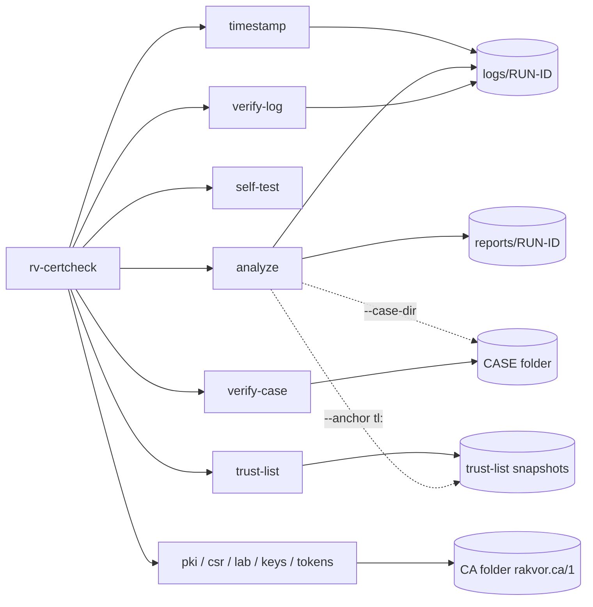

# Command-line reference

<!-- Generated by `rv-certcheck docs-cli`. Do not edit by hand: CI fails if this file differs. -->



## rv-certcheck

```text
DESCRIPTION:
  rv-certcheck analyzes a single file, a whole folder (bulk) or a list of files. For every file it:
    1. opens the file read-only and hashes it in one pass with one or two algorithms;
    2. recognises its content (not its extension): certificate, PEM bundle, PKCS#7, PKCS#12, CRL,
       OCSP response, RFC 3161 timestamp token, private key or CSR;
    3. reads every certificate field, builds and checks each chain with OpenSSL at the date and for
    the
       purpose chosen (--at, --purpose) against the anchors chosen (--anchor), checks revocation
       with the
       CRLs and OCSP responses supplied, verifies timestamp tokens and matches keys to certificates;
    4. writes chain.json and certificate.txt, a technical report and a customer-friendly summary.
  Each run also writes a statistics report and an audit trail under <OUT>/logs/<RUN-ID>/.
  Every action is appended to a hash-chained log that `rv-certcheck verify-log` can check later.
  Offline by default: nothing is fetched from the network.

  CASE FOLDER (--case-dir): Rakvor tools share one folder per case. rv-certcheck is an analysis
  tool: it
  verifies every item against the registry written at intake (evidence ids E0001, E0002, ...), so
  the
  report shows it examined bit-identical copies. `rv-certcheck verify-case <CASE>` checks it all.

  CREATION: pki, csr, lab, keys and tokens create Rakvor's internal certificates (internal use only:
  not a firma digital under Ley 527 de 1999 art. 28, not qualified under eIDAS), CSRs, reproducible
  lab sets and PKCS#11 keys; trust-list imports EU and Colombian trust lists as dated snapshots.

Usage: rv-certcheck <COMMAND>

Commands:
  analyze      Analyze certificates, chains, CRLs, OCSP responses, timestamp tokens, keys and CSRs
  pki          Rakvor internal PKI: init-root, import, issue, revoke, crl, ocsp-sign, show, verify
  csr          Certificate signing requests: new, show
  lab          Reproducible lab and test certificate sets
  keys         Private keys: match a key with a certificate
  tokens       PKCS#11 hardware tokens: list slots, tokens and keys
  trust-list   EU and Colombian trust lists: import, list, show dated snapshots
  verify-log   Verify an audit log (audit.jsonl): edited, deleted or re-ordered entries, and
               truncation
  self-test    Check every hash algorithm against known-answer test vectors
  timestamp    Add an RFC 3161 timestamp to a finished run (e.g. after working offline)
  verify-case  Verify a whole case folder: case log, evidence registry and every run's audit log
  help         Print this message or the help of the given subcommand(s)

Options:
  -h, --help
          Print help (see a summary with '-h')

  -V, --version
          Print version

Run `rv-certcheck <COMMAND> --help` for the options, examples and exit codes of each command.
```

## rv-certcheck analyze

```text
DESCRIPTION:
  rv-certcheck analyzes a single file, a whole folder (bulk) or a list of files. For every file it:
    1. opens the file read-only and hashes it in one pass with one or two algorithms;
    2. recognises its content (not its extension): certificate, PEM bundle, PKCS#7, PKCS#12, CRL,
       OCSP response, RFC 3161 timestamp token, private key or CSR;
    3. reads every certificate field, builds and checks each chain with OpenSSL at the date and for
    the
       purpose chosen (--at, --purpose) against the anchors chosen (--anchor), checks revocation
       with the
       CRLs and OCSP responses supplied, verifies timestamp tokens and matches keys to certificates;
    4. writes chain.json and certificate.txt, a technical report and a customer-friendly summary.
  Each run also writes a statistics report and an audit trail under <OUT>/logs/<RUN-ID>/.
  Every action is appended to a hash-chained log that `rv-certcheck verify-log` can check later.
  Offline by default: nothing is fetched from the network.

  CASE FOLDER (--case-dir): Rakvor tools share one folder per case. rv-certcheck is an analysis
  tool: it
  verifies every item against the registry written at intake (evidence ids E0001, E0002, ...), so
  the
  report shows it examined bit-identical copies. `rv-certcheck verify-case <CASE>` checks it all.

  CREATION: pki, csr, lab, keys and tokens create Rakvor's internal certificates (internal use only:
  not a firma digital under Ley 527 de 1999 art. 28, not qualified under eIDAS), CSRs, reproducible
  lab sets and PKCS#11 keys; trust-list imports EU and Colombian trust lists as dated snapshots.

Usage: rv-certcheck analyze [OPTIONS]

Options:
  -i, --input <PATH>
          File or folder to review. Repeat for several.
          
          Folders are reviewed one level deep unless --recursive is given. Symbolic links are not
          followed.
          Default: none (required unless --input-list, --case-dir or --evidence is given).
          Example: --input D:\evidence --input E:\phone-export\chat.txt

  -L, --input-list <FILE>
          Text file with one path per line (bulk review). Lines starting with # are ignored.
          
          Relative paths are resolved from the list file's folder.
          Default: none. Example: --input-list case-014-files.txt

  -r, --recursive
          Also review files in subfolders.
          
          Default: off (only the first level of each folder). Example: -i D:\evidence --recursive

  -H, --hash <ALGO>
          Hash algorithm(s): one or two of md5, sha1, sha256, sha512, sha3-256, blake3.
          
          Both are computed in the same read of each file. More than two is refused (exit code 2).
          Default: sha256. Example: --hash sha256,md5   or   --hash sha256 --hash blake3

  -o, --out <DIR>
          Folder where logs/ and reports/ are created. Created if missing. Ignored with --case-dir.
          
          Default: ./rakvor-out. Example: --out E:\case-014\rv-certcheck

  -l, --lang <LANG>
          Report language: en, es, fr, or all (one HTML and PDF per language). JSON is
          language-neutral.
          
          Default: en. Example: --lang es   or   --lang all

  -a, --actor <NAME>
          Name of the examiner, written in every audit entry and report.
          
          Default: the operating-system user name. Example: --actor "Ana Ruiz"

  -c, --case <ID>
          Case or engagement identifier printed on the reports. With --case-dir it names the case
          when the folder is created, and must match case.json afterwards (it can be left out).
          Default: none. Example: --case CASE-2026-014

  -p, --progress <MODE>
          How progress is shown: bar, jsonl or none.
          
          Default: bar (hidden automatically when stderr is not a terminal).
          Example: --progress jsonl

          Possible values:
          - bar:   Progress bar with elapsed time, throughput and ETA on stderr
          - jsonl: One JSON event per line on stdout (for scripts and other tools)
          - none:  No progress output; only the final summary

  -j, --jurisdiction <CC>
          Chain-of-custody form per item: co (Colombia, Fiscalía style, Spanish) or fr (France,
          scellés, French).
          An English copy is always added. With --case-dir the case's jurisdiction applies.
          Default: co
          Example: --jurisdiction fr

      --tsa-url <URL>
          RFC 3161 time-stamping authority for the audit chain head.
          Default: http://timestamp.digicert.com
          Example: --tsa-url https://freetsa.org/tsr

      --no-timestamp
          Do not request a trusted timestamp (offline labs). Also set by RV_NO_TIMESTAMP=1.
          Default: off (a timestamp is requested)
          Example: --no-timestamp

      --sign-cert <P12>
          Examiner's certificate (.p12/.pfx, RSA) used to sign every PDF report. The password is
          read from
          the environment variable named by --sign-pass-env, or asked for interactively.
          Default: none (PDFs are not signed)
          Example: --sign-cert C:\certs\ana-ruiz.p12

      --sign-pass-env <VAR>
          Environment variable holding the certificate password.
          Default: RV_SIGN_PASSWORD
          Example: --sign-pass-env CERT_PASS

      --case-dir <DIR>
          Shared case folder that links the Rakvor tools of one case (created with --case if
          missing).
          Outputs go to <DIR>/runs/rv-certcheck/<RUN-ID>/; every hashed file is registered in
          <DIR>/evidence/registry.json; the run is recorded in <DIR>/case-log.jsonl.
          With no --input, every registered item is examined again.
          Default: none (standalone run in --out)
          Example: --case-dir E:\CASE-014 --case CASE-014

  -E, --evidence <IDS>
          Registered evidence ids to examine (needs --case-dir), comma-separated or repeated.
          Default: none (the --input files, or every registered item)
          Example: --evidence E0001,E0007

      --anchor <ANCHOR>
          Trust anchor: certificates to trust. Repeat for several. A FILE (PEM, DER or PKCS#7),
          `rakvor`
          (the bundled Rakvor internal root), `system` (the operating system's store), or a
          trust-list
          snapshot `tl:eu@SNAPSHOT` / `tl:co@SNAPSHOT` (`latest` = newest; see `trust-list list`).
          Default: none (nothing is trusted: chains are built and checked, and reported untrusted)
          Example: --anchor roots/ca-root.pem --anchor tl:eu@latest

      --at <WHEN>
          Instant the chains are judged at: now, a date (YYYY-MM-DD, midnight UTC), an RFC 3339
          time, or
          signing-time. In v0.1 only a timestamp token (.tsr/.tst) has a signing time: its genTime,
          used for
          its own TSA chain (which is always judged at genTime). Every other item has no signing
          time yet and
          is judged now; the run's reports carry a note saying so. A token is checked against the
          evidence
          file with the same stem in the run (data.tsr with data or data.*); without one it is not
          linked
          to any file (imprint_checked=no).
          Default: now
          Example: --at 2025-03-14   or   --at 2025-03-14T09:30:00-05:00   or   --at signing-time

      --purpose <PURPOSE>
          Purpose checked against key usage and extended key usage: any, tls-server, tls-client,
          code-signing, document-signing, email, timestamping.
          Default: any
          Example: --purpose document-signing

      --crl <FILE>
          CRL file (DER or PEM) used for revocation, in addition to the CRLs among the evidence.
          Repeatable.
          Each file is hashed and recorded in the audit log.
          Default: none
          Example: --crl ca-2025-03.crl

      --ocsp <FILE>
          OCSP response file (DER) used for revocation, in addition to those among the evidence.
          Repeatable.
          Default: none
          Example: --ocsp signer-2025-03-14.ocsp

      --online
          Fetch CRLs and OCSP responses from the CRL distribution points and AIA OCSP URLs of every
          certificate of each built path (HTTP/HTTPS, 15 s timeout, no cache). Every URL, response
          SHA-256
          and time is audited (revocation_fetched) and listed in chain.json.
          Default: off (offline)
          Example: --online

      --p12-pass-env <VAR>
          Environment variable holding the password of PKCS#12 items and encrypted keys (never
          logged).
          Default: RV_P12_PASSWORD (when unset, PKCS#12 items are read without a password)
          Example: --p12-pass-env CASE_P12_PASS

  -h, --help
          Print help (see a summary with '-h')

EXAMPLES:
  Analyze one certificate against a root you trust, today, for any purpose:
    rv-certcheck analyze --input evidence/signer.cer --anchor roots/ca-root.pem
  A folder of certificates, CRLs and tokens, judged at the signing date, for document signing:
    rv-certcheck analyze -i D:\evidence -r --anchor roots/ca-root.pem --at 2025-03-14 --purpose
    document-signing
  With revocation information supplied offline, Spanish reports, case CASE-2026-014:
    rv-certcheck analyze -i D:\evidence --anchor roots/ca-root.pem --crl ca.crl --ocsp leaf.ocsp
    --lang es --case CASE-2026-014
  Against the EU trust list snapshot imported earlier (rv-certcheck trust-list import):
    rv-certcheck analyze -i D:\evidence --anchor tl:eu@latest
  Verify the audit log afterwards:
    rv-certcheck verify-log rakvor-out/logs/<RUN-ID>/audit.jsonl
  Analyze the evidence registered in a case folder (intake by rv-hashinv), then verify the whole
  case:
    rv-certcheck analyze --case-dir E:\CASE-014 --anchor roots/ca-root.pem
    rv-certcheck verify-case E:\CASE-014
  Re-examine two registered items of the case:
    rv-certcheck analyze --case-dir E:\CASE-014 --evidence E0001,E0002

EXIT CODES:
  0    Completed; no high-severity finding.
  1    Runtime error (input not found, output not writable, case log locked, ...).
       See the audit log.
  2    Usage error (unknown option, more than two hash algorithms, unsupported language, bad
       --anchor/--at/--purpose value).
       With --case-dir: folder of another case or schema, --case missing when creating the
       case, unknown evidence id.
  3    Completed with at least one high-severity finding (e.g. untrusted or invalid chain, revoked
       or expired certificate, key that does not match, invalid timestamp token, evidence that
       differs from the case registry), or the case folder fails verification (nothing is
       written to it).
  130  Cancelled with Ctrl+C. Partial reports and the cancellation are written to the audit log.

FILES WRITTEN:
  <OUT>/logs/<RUN-ID>/audit.jsonl         Hash-chained log of every action (one JSON object per
  line).
  <OUT>/logs/<RUN-ID>/audit.log           The same actions, human-readable.
  <OUT>/logs/<RUN-ID>/hashes.csv          Hash register: index, path, size, digests, status.
  <OUT>/logs/<RUN-ID>/environment.json    Tool and dependency versions, OS, host, user, command
  line.
  <OUT>/reports/<RUN-ID>/statistics.json  Run statistics (+ statistics.<LANG>.html and .pdf).
  <OUT>/reports/<RUN-ID>/items/<NNNNN>-<NAME>/chain.json        Chain per end-entity certificate,
  per-depth
                                                                OpenSSL code and reason, revocation,
                                                                trust list.
  <OUT>/reports/<RUN-ID>/items/<NNNNN>-<NAME>/certificate.txt   OpenSSL-style dump of every
  certificate.
  <OUT>/reports/<RUN-ID>/items/<NNNNN>-<NAME>/technical.json|.<LANG>.html|.<LANG>.pdf   Technical
  review.
  <OUT>/reports/<RUN-ID>/items/<NNNNN>-<NAME>/summary.json|.<LANG>.html|.<LANG>.pdf     Customer
  summary.
  <OUT>/reports/<RUN-ID>/items/<NNNNN>-<NAME>/custody.json|.<es|fr>.html|.pdf|.en.html|.pdf  Custody
  form.
  <OUT>/logs/<RUN-ID>/timestamp-<SEQ>.tsr|.json  RFC 3161 token for the audit chain head.
  With --case-dir <CASE>, logs/ and reports/ go to <CASE>/runs/rv-certcheck/<RUN-ID>/, plus:
  <CASE>/case.json                        Case id, jurisdiction, creation (written once).
  <CASE>/case-log.jsonl                   Hash-chained case log of every tool: case_created,
                                          run_started, evidence_registered, run_finished.
  <CASE>/evidence/registry.json|.csv      Evidence registry (written at intake): E0001..., path,
  hashes.

FORENSIC NOTES:
  - Evidence is opened read-only and never modified; modification times are compared before and
  after.
  - Work on a verified copy (write-blocked image or export), not on original media.
  - Each audit entry stores the SHA-256 of the previous one; editing, deleting or re-ordering any
    line is detected by `verify-log`. Removing the last lines is detected only against a record
    kept outside the log: the RFC 3161 timestamp or, with --case-dir, the case log. Keep the log
    folder with the reports.
  - A file without findings is not proven authentic; read the Limitations section of each report.
  - A chain is judged at one instant (--at): an expired certificate can be normal for an old
    signature, whose validity matters at signing time. Offline, revocation is only as complete as
    the CRLs and OCSP responses supplied. Private keys and passwords never reach a log or report.
  - MD5 and SHA-1 are accepted for compatibility with older case files; pair them with SHA-256 or
  BLAKE3.
  - The chain head is timestamped by an RFC 3161 authority (proves when the log existed). Offline?
  The run
    finishes with `timestamp_pending`; run `rv-certcheck timestamp <LOG>` later.
  - With --sign-cert every PDF is signed with the examiner's certificate; the password is never
  logged.
  - Case folder: every tool re-verifies case-log.jsonl and the registry digest before
    writing, and refuses a broken case (exit 3). Appends happen under case-log.lock; a lock
    older than 10 minutes is reported as stale and never deleted automatically.
  - Each run's audit.jsonl records case_linked (the case-log entry it started from); the case
    log records the run's final audit head, so the two chains vouch for each other.
```

## rv-certcheck pki

```text
Rakvor internal PKI: init-root, import, issue, revoke, crl, ocsp-sign, show, verify

Usage: rv-certcheck pki <COMMAND>

Commands:
  init-root  Create an offline root CA (key on a token with --confirm-root, else in an encrypted
             file)
  import     Bring an existing CA certificate and its key under management (e.g. the code-signing
             root)
  issue      Issue a certificate with a profile: intermediate, code-signing, examiner, tsa,
             tls-server (client-internal is disabled until the CP/CPS exists)
  revoke     Revoke an issued certificate (takes effect in the next CRL / OCSP response)
  crl        Sign a CRL with every revoked serial
  ocsp-sign  Sign an OCSP response for a serial at a given time (lab use; there is no OCSP server)
  show       Show a CA folder: ca.json and every certificate issued, with its revocation state
  set        Change ca.json the recorded way (never edit it by hand: an edit outside the tool fails
             every operation and `pki verify`). Sets or clears the CRL distribution point of future
             certificates
  verify     Verify a CA folder: the issued.jsonl hash chain, certs/ca.crt, ca.json, crl/latest.crl
             and the SHA-256 of every recorded file
  help       Print this message or the help of the given subcommand(s)

Options:
  -h, --help
          Print help (see a summary with '-h')

DESCRIPTION:
  Rakvor's internal PKI. A CA folder (schema rakvor.ca/1) holds ca.json, the hash-chained
  issued.jsonl,
  certs/ (ca.crt and <serial>.crt), crl/ (<n>.crl, latest.crl), ocsp/ and keys/ (encrypted CA key,
  owner-only; a token key is only referenced). Every certificate carries a random 128-bit serial,
  AKI/SKI, the CRL URL of ca.json (crl_url) when set, and the Rakvor internal policy
  2.25.130074246409705057913773883974790544206.1.1 with its user notice.

  INTERNAL USE ONLY: these certificates are not a firma digital under Ley 527 de 1999 art. 28
  (Colombia) and not qualified certificates under eIDAS (EU 910/2014). Client certificates
  (profile client-internal) wait for Rakvor's CP/CPS reviewed by the lawyer (rv-certcheck#2).

EXAMPLES:
  Offline root on a YubiKey (key ceremony: docs/company-pki.md), then an intermediate in a file:
    rv-certcheck pki init-root --ca E:\pki\root --ca-id rakvor-root-2026 --subject
    "C=CO,O=Rakvor,CN=Rakvor Root CA 2026" \
      --key-type p-384 --pkcs11-module "C:\Program Files\Yubico\Yubico PIV Tool\bin\libykcs11.dll" \
      --token-serial 0012345678 --pin-env YUBIKEY_PIN --confirm-root
    rv-certcheck pki issue --ca E:\pki\root --ca-pass-env YUBIKEY_PIN --profile intermediate \
      --subject "C=CO,O=Rakvor,CN=Rakvor Issuing CA 2026" --key-type p-384 --key-file
      E:\pki\issuing.key.p8
  Examiner certificate for signing reports (rv-hashinv --sign-cert):
    rv-certcheck pki issue --ca E:\pki\issuing --profile examiner --subject "C=CO,O=Rakvor,CN=Ana
    Ruiz" \
      --san email:ana.ruiz@rakvor.co --key-type rsa-3072
  Revoke, then publish a CRL:
    rv-certcheck pki revoke --ca E:\pki\issuing --serial 5f3a09c1... --reason keyCompromise
    rv-certcheck pki crl --ca E:\pki\issuing
  Check a CA folder:
    rv-certcheck pki verify --ca E:\pki\issuing

SECURITY NOTES:
  - Encrypted keys: PKCS#8 PBES2, PBKDF2-HMAC-SHA256 600 000 iterations, AES-256-CBC; files 0600 on
  Unix,
    inside the user profile on Windows; never overwritten.
  - A root key on a token needs --confirm-root. Keep the root offline; issue from an intermediate.
  - issued.jsonl is verified before every operation: an edited, deleted or re-ordered record, or a
    modified certificate or CRL file, stops the CA (exit 3).
```

### rv-certcheck pki init-root

```text
Create an offline root CA (key on a token with --confirm-root, else in an encrypted file)

Usage: rv-certcheck pki init-root [OPTIONS] --ca <DIR> --ca-id <ID>

Options:
      --ca <DIR>
          CA folder to create (must be empty or missing).
          Default: none (required)
          Example: --ca E:\rakvor-pki\root-2026

      --ca-id <ID>
          Short id of the CA, used in file names and audit entries (letters, digits, - _ .).
          Default: none (required)
          Example: --ca-id rakvor-root-2026

      --subject <DN>
          Subject as comma-separated attributes in order (C, ST, L, O, OU, CN, emailAddress,
          serialNumber, ...).
          Default: none (required, except when issuing from a CSR, whose subject is then used)
          Example: --subject "C=CO,O=Rakvor,CN=Ana Ruiz"

      --san <TYPE:VALUE>
          Subject alternative name, repeatable: dns:NAME, ip:ADDRESS, email:ADDRESS, uri:URI.
          Default: none (tls-server needs at least one dns: or ip:)
          Example: --san dns:hub.rakvor.local --san email:ana.ruiz@rakvor.co

      --key-type <TYPE>
          Key type: rsa-2048, rsa-3072, rsa-4096, p-256, p-384, ed25519.
          Default: rsa-4096 (the library's root default)
          Example: --key-type p-384

      --key-file <FILE>
          Encrypted key file (PKCS#8, created owner-only, never overwritten).
          Default: see the command (init-root: <CA>/keys/<CA-ID>.key.p8; issue:
          <CA>/subjects/<PROFILE>-<TIME>.key.p8;
          csr new: <OUT-FILE>.key.p8)
          Example: --key-file E:\pki\ana-ruiz.key.p8

      --pass-env <VAR>
          Environment variable holding the key-file password (never logged; prompted without echo
          when unset).
          Default: RV_KEY_PASSWORD
          Example: --pass-env ROOT_KEY_PASS

      --pkcs11-module <LIB>
          PKCS#11 module of the token (vendor library). With it the key lives on the token.
          Default: none (encrypted key file)
          Example: --pkcs11-module "C:\Program Files\Yubico\Yubico PIV Tool\bin\libykcs11.dll"

      --token-serial <SERIAL>
          Serial number of the token to use (see `tokens list`).
          Default: none (required with --pkcs11-module)
          Example: --token-serial 0012345678

      --key-label <LABEL>
          Label of a new key on the token.
          Default: the CA id, the profile or "csr-key"
          Example: --key-label rakvor-root-2026

      --key-id <HEX>
          CKA_ID (hex) of an existing key on the token (pki import).
          Default: none
          Example: --key-id 3f9a0c...

      --pin-env <VAR>
          Environment variable holding the token PIN (never logged; prompted without echo when
          unset).
          Default: RV_TOKEN_PIN
          Example: --pin-env YUBIKEY_PIN

      --validity-days <DAYS>
          Validity in days.
          Default: 7300 (20 years)
          Example: --validity-days 3650

      --confirm-root
          Required to create a root key on a token (a lost or exposed root key puts every Rakvor
          signature in doubt: follow the key ceremony in docs/company-pki.md).
          Default: off (a token root is refused)
          Example: --confirm-root

      --out <DIR>
          Folder for the run's audit log and report: <OUT>/logs/<RUN-ID>/ and
          <OUT>/reports/<RUN-ID>/.
          Default: rakvor-out
          Example: --out D:\pki-runs

      --json
          Print the result as JSON on stdout instead of a summary.
          Default: off (human-readable summary)
          Example: --json

      --actor <NAME>
          Name written in the audit log and in issued.jsonl.
          Default: the operating-system user name
          Example: --actor "Ana Ruiz"

  -h, --help
          Print help (see a summary with '-h')

EXIT CODES:
  0  Done.
  1  Runtime error (file not readable, wrong password or PIN, token or crypto failure). Audited.
  2  Usage error (bad option value, empty subject, unknown profile or reason).
  3  Refused by a safety rule, or verification failed: root key on a token without --confirm-root,
     client-internal profile (needs the CP/CPS, rv-certcheck#2), a file that would be overwritten, a
     key that does not match its certificate, a CA folder whose issued.jsonl or files do not verify,
     a key that does not match (keys match). Nothing is issued. Audited.

FILES WRITTEN (every command):
  <OUT>/logs/<RUN-ID>/audit.jsonl        Hash-chained log of the run (rv-certcheck verify-log checks
  it).
  <OUT>/logs/<RUN-ID>/audit.log          The same, human-readable.
  <OUT>/logs/<RUN-ID>/environment.json   Tool version, OS, host, user, command line.
  <OUT>/reports/<RUN-ID>/report.json|.txt  What was created or checked, with the SHA-256 of every
  file.
  <CA>/ca.json, <CA>/issued.jsonl, <CA>/certs/ca.crt, <CA>/keys/<CA-ID>.key.p8 (file key)
```

### rv-certcheck pki import

```text
Bring an existing CA certificate and its key under management (e.g. the code-signing root)

Usage: rv-certcheck pki import [OPTIONS] --ca <DIR> --ca-id <ID> --cert <FILE>

Options:
      --ca <DIR>
          CA folder to create (must be empty or missing).
          Default: none (required)
          Example: --ca E:\rakvor-pki\code-signing-root

      --ca-id <ID>
          Short id of the CA.
          Default: none (required)
          Example: --ca-id rakvor-code-signing-root

      --cert <FILE>
          The CA certificate (PEM or DER).
          Default: none (required)
          Example: --cert packaging/signing/rakvor-code-signing-root.cer

      --issuer-cert <FILE>
          The certificate of the CA that issued --cert (PEM or DER), for an intermediate. It must
          have issued
          --cert (name and signature); its SHA-256 is recorded as the parent in ca.json. The
          issuer's
          subject and key id are recorded from --cert in any case.
          Default: none (parent certificate SHA-256 not recorded)
          Example: --issuer-cert E:\rakvor-pki\root-2026\certs\ca.crt

      --key-file <FILE>
          Encrypted key file (PKCS#8, created owner-only, never overwritten).
          Default: see the command (init-root: <CA>/keys/<CA-ID>.key.p8; issue:
          <CA>/subjects/<PROFILE>-<TIME>.key.p8;
          csr new: <OUT-FILE>.key.p8)
          Example: --key-file E:\pki\ana-ruiz.key.p8

      --pass-env <VAR>
          Environment variable holding the key-file password (never logged; prompted without echo
          when unset).
          Default: RV_KEY_PASSWORD
          Example: --pass-env ROOT_KEY_PASS

      --pkcs11-module <LIB>
          PKCS#11 module of the token (vendor library). With it the key lives on the token.
          Default: none (encrypted key file)
          Example: --pkcs11-module "C:\Program Files\Yubico\Yubico PIV Tool\bin\libykcs11.dll"

      --token-serial <SERIAL>
          Serial number of the token to use (see `tokens list`).
          Default: none (required with --pkcs11-module)
          Example: --token-serial 0012345678

      --key-label <LABEL>
          Label of a new key on the token.
          Default: the CA id, the profile or "csr-key"
          Example: --key-label rakvor-root-2026

      --key-id <HEX>
          CKA_ID (hex) of an existing key on the token (pki import).
          Default: none
          Example: --key-id 3f9a0c...

      --pin-env <VAR>
          Environment variable holding the token PIN (never logged; prompted without echo when
          unset).
          Default: RV_TOKEN_PIN
          Example: --pin-env YUBIKEY_PIN

      --out <DIR>
          Folder for the run's audit log and report: <OUT>/logs/<RUN-ID>/ and
          <OUT>/reports/<RUN-ID>/.
          Default: rakvor-out
          Example: --out D:\pki-runs

      --json
          Print the result as JSON on stdout instead of a summary.
          Default: off (human-readable summary)
          Example: --json

      --actor <NAME>
          Name written in the audit log and in issued.jsonl.
          Default: the operating-system user name
          Example: --actor "Ana Ruiz"

  -h, --help
          Print help (see a summary with '-h')

EXIT CODES:
  0  Done.
  1  Runtime error (file not readable, wrong password or PIN, token or crypto failure). Audited.
  2  Usage error (bad option value, empty subject, unknown profile or reason).
  3  Refused by a safety rule, or verification failed: root key on a token without --confirm-root,
     client-internal profile (needs the CP/CPS, rv-certcheck#2), a file that would be overwritten, a
     key that does not match its certificate, a CA folder whose issued.jsonl or files do not verify,
     a key that does not match (keys match). Nothing is issued. Audited.

FILES WRITTEN (every command):
  <OUT>/logs/<RUN-ID>/audit.jsonl        Hash-chained log of the run (rv-certcheck verify-log checks
  it).
  <OUT>/logs/<RUN-ID>/audit.log          The same, human-readable.
  <OUT>/logs/<RUN-ID>/environment.json   Tool version, OS, host, user, command line.
  <OUT>/reports/<RUN-ID>/report.json|.txt  What was created or checked, with the SHA-256 of every
  file.
  <CA>/ca.json, <CA>/issued.jsonl, <CA>/certs/ca.crt (the key stays where it is)
```

### rv-certcheck pki issue

```text
Issue a certificate with a profile: intermediate, code-signing, examiner, tsa, tls-server
(client-internal is disabled until the CP/CPS exists)

Usage: rv-certcheck pki issue [OPTIONS] --ca <DIR> --profile <PROFILE>

Options:
      --ca <DIR>
          CA folder that signs.
          Default: none (required)
          Example: --ca E:\rakvor-pki\issuing-2026

      --profile <PROFILE>
          Profile: intermediate, code-signing, examiner, tsa, tls-server.
          Default: none (required)
          Example: --profile examiner

      --subject <DN>
          Subject as comma-separated attributes in order (C, ST, L, O, OU, CN, emailAddress,
          serialNumber, ...).
          Default: none (required, except when issuing from a CSR, whose subject is then used)
          Example: --subject "C=CO,O=Rakvor,CN=Ana Ruiz"

      --san <TYPE:VALUE>
          Subject alternative name, repeatable: dns:NAME, ip:ADDRESS, email:ADDRESS, uri:URI.
          Default: none (tls-server needs at least one dns: or ip:)
          Example: --san dns:hub.rakvor.local --san email:ana.ruiz@rakvor.co

      --csr <FILE>
          Certify the key of this CSR (PEM or DER; its self-signature must verify) instead of making
          a key.
          Default: none (a new key is generated)
          Example: --csr requests/hub.csr

      --key-type <TYPE>
          Key type of the new key (ignored with --csr): rsa-2048, rsa-3072, rsa-4096, p-256, p-384,
          ed25519.
          The examiner profile needs RSA (rv-hashinv signs PDF reports with RSA keys only): an EC or
          Ed25519 examiner key is refused unless --allow-non-rsa-examiner is given.
          Default: per profile: p-384 intermediate; p-256 tsa, tls-server; rsa-3072 code-signing,
          examiner
          Example: --key-type p-256

      --allow-non-rsa-examiner
          Issue an examiner certificate with an EC or Ed25519 key anyway. Such a certificate cannot
          sign
          rv-hashinv PDF reports (RSA only).
          Default: off (a non-RSA examiner key is refused, exit 3)
          Example: --allow-non-rsa-examiner

      --key-file <FILE>
          Encrypted key file (PKCS#8, created owner-only, never overwritten).
          Default: see the command (init-root: <CA>/keys/<CA-ID>.key.p8; issue:
          <CA>/subjects/<PROFILE>-<TIME>.key.p8;
          csr new: <OUT-FILE>.key.p8)
          Example: --key-file E:\pki\ana-ruiz.key.p8

      --pass-env <VAR>
          Environment variable holding the key-file password (never logged; prompted without echo
          when unset).
          Default: RV_KEY_PASSWORD
          Example: --pass-env ROOT_KEY_PASS

      --pkcs11-module <LIB>
          PKCS#11 module of the token (vendor library). With it the key lives on the token.
          Default: none (encrypted key file)
          Example: --pkcs11-module "C:\Program Files\Yubico\Yubico PIV Tool\bin\libykcs11.dll"

      --token-serial <SERIAL>
          Serial number of the token to use (see `tokens list`).
          Default: none (required with --pkcs11-module)
          Example: --token-serial 0012345678

      --key-label <LABEL>
          Label of a new key on the token.
          Default: the CA id, the profile or "csr-key"
          Example: --key-label rakvor-root-2026

      --key-id <HEX>
          CKA_ID (hex) of an existing key on the token (pki import).
          Default: none
          Example: --key-id 3f9a0c...

      --pin-env <VAR>
          Environment variable holding the token PIN (never logged; prompted without echo when
          unset).
          Default: RV_TOKEN_PIN
          Example: --pin-env YUBIKEY_PIN

      --ca-pass-env <VAR>
          Environment variable with the CA key password (file key) or the CA token PIN.
          Default: RV_CA_PASSWORD
          Example: --ca-pass-env ROOT_KEY_PASS

      --p12-pass-env <VAR>
          Examiner profile: environment variable with the password of the .p12 written.
          Default: RV_P12_PASSWORD
          Example: --p12-pass-env ANA_P12_PASS

      --validity-days <DAYS>
          Validity in days (capped at the CA certificate's notAfter).
          Default: 825
          Example: --validity-days 365

      --out <DIR>
          Folder for the run's audit log and report: <OUT>/logs/<RUN-ID>/ and
          <OUT>/reports/<RUN-ID>/.
          Default: rakvor-out
          Example: --out D:\pki-runs

      --json
          Print the result as JSON on stdout instead of a summary.
          Default: off (human-readable summary)
          Example: --json

      --actor <NAME>
          Name written in the audit log and in issued.jsonl.
          Default: the operating-system user name
          Example: --actor "Ana Ruiz"

  -h, --help
          Print help (see a summary with '-h')

PROFILES:
  intermediate  CA:TRUE pathlen 0, keyCertSign + cRLSign (manage it with `pki import` as its own CA
  folder).
  code-signing  digitalSignature, EKU codeSigning (Rakvor release signing).
  examiner      digitalSignature + nonRepudiation, EKU emailProtection + documentSigning (RFC 9336
  and
                Microsoft); also writes <serial>.p12 next to the key for rv-hashinv --sign-cert (RSA
                keys).
  tsa           digitalSignature, EKU timeStamping (critical).
  tls-server    digitalSignature (+keyEncipherment for RSA), EKU serverAuth, at least one dns:/ip:
  SAN.

EXIT CODES:
  0  Done.
  1  Runtime error (file not readable, wrong password or PIN, token or crypto failure). Audited.
  2  Usage error (bad option value, empty subject, unknown profile or reason).
  3  Refused by a safety rule, or verification failed: root key on a token without --confirm-root,
     client-internal profile (needs the CP/CPS, rv-certcheck#2), a file that would be overwritten, a
     key that does not match its certificate, a CA folder whose issued.jsonl or files do not verify,
     a key that does not match (keys match). Nothing is issued. Audited.

FILES WRITTEN (every command):
  <OUT>/logs/<RUN-ID>/audit.jsonl        Hash-chained log of the run (rv-certcheck verify-log checks
  it).
  <OUT>/logs/<RUN-ID>/audit.log          The same, human-readable.
  <OUT>/logs/<RUN-ID>/environment.json   Tool version, OS, host, user, command line.
  <OUT>/reports/<RUN-ID>/report.json|.txt  What was created or checked, with the SHA-256 of every
  file.
  <CA>/certs/<SERIAL>.crt, the new key (encrypted), <SERIAL>.p12 (examiner), a record in
  <CA>/issued.jsonl
```

### rv-certcheck pki revoke

```text
Revoke an issued certificate (takes effect in the next CRL / OCSP response)

Usage: rv-certcheck pki revoke [OPTIONS] --ca <DIR> --serial <HEX>

Options:
      --ca <DIR>
          CA folder that issued the certificate.
          Default: none (required)
          Example: --ca E:\rakvor-pki\issuing-2026

      --serial <HEX>
          Serial number in hex (as `pki show` prints it; case and colons ignored).
          Default: none (required)
          Example: --serial 5f3a09c1d2e4...

      --reason <REASON>
          RFC 5280 reason: unspecified, keyCompromise, cACompromise, affiliationChanged, superseded,
          cessationOfOperation, certificateHold, privilegeWithdrawn, aACompromise.
          Default: unspecified
          Example: --reason keyCompromise

      --at <TIME>
          Revocation time (RFC 3339 or YYYY-MM-DD).
          Default: now
          Example: --at 2026-11-02T09:00:00Z

      --out <DIR>
          Folder for the run's audit log and report: <OUT>/logs/<RUN-ID>/ and
          <OUT>/reports/<RUN-ID>/.
          Default: rakvor-out
          Example: --out D:\pki-runs

      --json
          Print the result as JSON on stdout instead of a summary.
          Default: off (human-readable summary)
          Example: --json

      --actor <NAME>
          Name written in the audit log and in issued.jsonl.
          Default: the operating-system user name
          Example: --actor "Ana Ruiz"

  -h, --help
          Print help (see a summary with '-h')

EXIT CODES:
  0  Done.
  1  Runtime error (file not readable, wrong password or PIN, token or crypto failure). Audited.
  2  Usage error (bad option value, empty subject, unknown profile or reason).
  3  Refused by a safety rule, or verification failed: root key on a token without --confirm-root,
     client-internal profile (needs the CP/CPS, rv-certcheck#2), a file that would be overwritten, a
     key that does not match its certificate, a CA folder whose issued.jsonl or files do not verify,
     a key that does not match (keys match). Nothing is issued. Audited.

FILES WRITTEN (every command):
  <OUT>/logs/<RUN-ID>/audit.jsonl        Hash-chained log of the run (rv-certcheck verify-log checks
  it).
  <OUT>/logs/<RUN-ID>/audit.log          The same, human-readable.
  <OUT>/logs/<RUN-ID>/environment.json   Tool version, OS, host, user, command line.
  <OUT>/reports/<RUN-ID>/report.json|.txt  What was created or checked, with the SHA-256 of every
  file.
  a `revoked` record in <CA>/issued.jsonl
```

### rv-certcheck pki crl

```text
Sign a CRL with every revoked serial

Usage: rv-certcheck pki crl [OPTIONS] --ca <DIR>

Options:
      --ca <DIR>
          CA folder.
          Default: none (required)
          Example: --ca E:\rakvor-pki\issuing-2026

      --ca-pass-env <VAR>
          Environment variable with the CA key password or the CA token PIN.
          Default: RV_CA_PASSWORD
          Example: --ca-pass-env ISSUING_KEY_PASS

      --next-update-days <DAYS>
          Days until nextUpdate.
          Default: 30
          Example: --next-update-days 7

      --this-update <TIME>
          thisUpdate (RFC 3339).
          Default: now
          Example: --this-update 2026-11-01T00:00:00Z

      --out <DIR>
          Folder for the run's audit log and report: <OUT>/logs/<RUN-ID>/ and
          <OUT>/reports/<RUN-ID>/.
          Default: rakvor-out
          Example: --out D:\pki-runs

      --json
          Print the result as JSON on stdout instead of a summary.
          Default: off (human-readable summary)
          Example: --json

      --actor <NAME>
          Name written in the audit log and in issued.jsonl.
          Default: the operating-system user name
          Example: --actor "Ana Ruiz"

  -h, --help
          Print help (see a summary with '-h')

EXIT CODES:
  0  Done.
  1  Runtime error (file not readable, wrong password or PIN, token or crypto failure). Audited.
  2  Usage error (bad option value, empty subject, unknown profile or reason).
  3  Refused by a safety rule, or verification failed: root key on a token without --confirm-root,
     client-internal profile (needs the CP/CPS, rv-certcheck#2), a file that would be overwritten, a
     key that does not match its certificate, a CA folder whose issued.jsonl or files do not verify,
     a key that does not match (keys match). Nothing is issued. Audited.

FILES WRITTEN (every command):
  <OUT>/logs/<RUN-ID>/audit.jsonl        Hash-chained log of the run (rv-certcheck verify-log checks
  it).
  <OUT>/logs/<RUN-ID>/audit.log          The same, human-readable.
  <OUT>/logs/<RUN-ID>/environment.json   Tool version, OS, host, user, command line.
  <OUT>/reports/<RUN-ID>/report.json|.txt  What was created or checked, with the SHA-256 of every
  file.
  <CA>/crl/<NUMBER>.crl and <CA>/crl/latest.crl (DER), a record in <CA>/issued.jsonl
```

### rv-certcheck pki ocsp-sign

```text
Sign an OCSP response for a serial at a given time (lab use; there is no OCSP server)

Usage: rv-certcheck pki ocsp-sign [OPTIONS] --ca <DIR> --serial <HEX> --ocsp-out <FILE>

Options:
      --ca <DIR>
          CA folder.
          Default: none (required)
          Example: --ca E:\rakvor-pki\issuing-2026

      --serial <HEX>
          Serial number in hex.
          Default: none (required)
          Example: --serial 5f3a09c1d2e4...

      --ocsp-out <FILE>
          Output file (DER), never overwritten.
          Default: none (required)
          Example: --out leaf.ocsp

      --produced-at <TIME>
          producedAt / thisUpdate (RFC 3339).
          Default: now
          Example: --produced-at 2026-11-01T00:00:00Z

      --next-update-days <DAYS>
          Days until nextUpdate.
          Default: none (no nextUpdate)
          Example: --next-update-days 7

      --ca-pass-env <VAR>
          Environment variable with the CA key password or the CA token PIN.
          Default: RV_CA_PASSWORD
          Example: --ca-pass-env ISSUING_KEY_PASS

      --out <DIR>
          Folder for the run's audit log and report: <OUT>/logs/<RUN-ID>/ and
          <OUT>/reports/<RUN-ID>/.
          Default: rakvor-out
          Example: --out D:\pki-runs

      --json
          Print the result as JSON on stdout instead of a summary.
          Default: off (human-readable summary)
          Example: --json

      --actor <NAME>
          Name written in the audit log and in issued.jsonl.
          Default: the operating-system user name
          Example: --actor "Ana Ruiz"

  -h, --help
          Print help (see a summary with '-h')

EXIT CODES:
  0  Done.
  1  Runtime error (file not readable, wrong password or PIN, token or crypto failure). Audited.
  2  Usage error (bad option value, empty subject, unknown profile or reason).
  3  Refused by a safety rule, or verification failed: root key on a token without --confirm-root,
     client-internal profile (needs the CP/CPS, rv-certcheck#2), a file that would be overwritten, a
     key that does not match its certificate, a CA folder whose issued.jsonl or files do not verify,
     a key that does not match (keys match). Nothing is issued. Audited.

FILES WRITTEN (every command):
  <OUT>/logs/<RUN-ID>/audit.jsonl        Hash-chained log of the run (rv-certcheck verify-log checks
  it).
  <OUT>/logs/<RUN-ID>/audit.log          The same, human-readable.
  <OUT>/logs/<RUN-ID>/environment.json   Tool version, OS, host, user, command line.
  <OUT>/reports/<RUN-ID>/report.json|.txt  What was created or checked, with the SHA-256 of every
  file.
  --out (DER) and a copy in <CA>/ocsp/, a record in <CA>/issued.jsonl
```

### rv-certcheck pki show

```text
Show a CA folder: ca.json and every certificate issued, with its revocation state

Usage: rv-certcheck pki show [OPTIONS] --ca <DIR>

Options:
      --ca <DIR>
          CA folder.
          Default: none (required)
          Example: --ca E:\rakvor-pki\issuing-2026

      --out <DIR>
          Folder for the run's audit log and report: <OUT>/logs/<RUN-ID>/ and
          <OUT>/reports/<RUN-ID>/.
          Default: rakvor-out
          Example: --out D:\pki-runs

      --json
          Print the result as JSON on stdout instead of a summary.
          Default: off (human-readable summary)
          Example: --json

      --actor <NAME>
          Name written in the audit log and in issued.jsonl.
          Default: the operating-system user name
          Example: --actor "Ana Ruiz"

  -h, --help
          Print help (see a summary with '-h')

EXIT CODES:
  0  Done.
  1  Runtime error (file not readable, wrong password or PIN, token or crypto failure). Audited.
  2  Usage error (bad option value, empty subject, unknown profile or reason).
  3  Refused by a safety rule, or verification failed: root key on a token without --confirm-root,
     client-internal profile (needs the CP/CPS, rv-certcheck#2), a file that would be overwritten, a
     key that does not match its certificate, a CA folder whose issued.jsonl or files do not verify,
     a key that does not match (keys match). Nothing is issued. Audited.

FILES WRITTEN (every command):
  <OUT>/logs/<RUN-ID>/audit.jsonl        Hash-chained log of the run (rv-certcheck verify-log checks
  it).
  <OUT>/logs/<RUN-ID>/audit.log          The same, human-readable.
  <OUT>/logs/<RUN-ID>/environment.json   Tool version, OS, host, user, command line.
  <OUT>/reports/<RUN-ID>/report.json|.txt  What was created or checked, with the SHA-256 of every
  file.
```

### rv-certcheck pki set

```text
Change ca.json the recorded way (never edit it by hand: an edit outside the tool fails every
operation and `pki verify`). Sets or clears the CRL distribution point of future certificates

Usage: rv-certcheck pki set [OPTIONS] --ca <DIR> --crl-url <URL>

Options:
      --ca <DIR>
          CA folder.
          Default: none (required)
          Example: --ca E:\rakvor-pki\issuing-2026

      --crl-url <URL>
          CRL distribution point (http:// or https://) written into every certificate issued from
          now on;
          an empty value clears it. Certificates already issued keep the CDP they have.
          Default: none (required)
          Example: --crl-url http://pki.rakvor.example/issuing-2026.crl

      --out <DIR>
          Folder for the run's audit log and report: <OUT>/logs/<RUN-ID>/ and
          <OUT>/reports/<RUN-ID>/.
          Default: rakvor-out
          Example: --out D:\pki-runs

      --json
          Print the result as JSON on stdout instead of a summary.
          Default: off (human-readable summary)
          Example: --json

      --actor <NAME>
          Name written in the audit log and in issued.jsonl.
          Default: the operating-system user name
          Example: --actor "Ana Ruiz"

  -h, --help
          Print help (see a summary with '-h')

EXIT CODES:
  0  Done.
  1  Runtime error (file not readable, wrong password or PIN, token or crypto failure). Audited.
  2  Usage error (bad option value, empty subject, unknown profile or reason).
  3  Refused by a safety rule, or verification failed: root key on a token without --confirm-root,
     client-internal profile (needs the CP/CPS, rv-certcheck#2), a file that would be overwritten, a
     key that does not match its certificate, a CA folder whose issued.jsonl or files do not verify,
     a key that does not match (keys match). Nothing is issued. Audited.

FILES WRITTEN (every command):
  <OUT>/logs/<RUN-ID>/audit.jsonl        Hash-chained log of the run (rv-certcheck verify-log checks
  it).
  <OUT>/logs/<RUN-ID>/audit.log          The same, human-readable.
  <OUT>/logs/<RUN-ID>/environment.json   Tool version, OS, host, user, command line.
  <OUT>/reports/<RUN-ID>/report.json|.txt  What was created or checked, with the SHA-256 of every
  file.
  <CA>/ca.json rewritten, a ca_json_written record (its SHA-256) in <CA>/issued.jsonl
```

### rv-certcheck pki verify

```text
Verify a CA folder: the issued.jsonl hash chain, certs/ca.crt, ca.json, crl/latest.crl and the
SHA-256 of every recorded file

Usage: rv-certcheck pki verify [OPTIONS] --ca <DIR>

Options:
      --ca <DIR>
          CA folder.
          Default: none (required)
          Example: --ca E:\rakvor-pki\issuing-2026

      --out <DIR>
          Folder for the run's audit log and report: <OUT>/logs/<RUN-ID>/ and
          <OUT>/reports/<RUN-ID>/.
          Default: rakvor-out
          Example: --out D:\pki-runs

      --json
          Print the result as JSON on stdout instead of a summary.
          Default: off (human-readable summary)
          Example: --json

      --actor <NAME>
          Name written in the audit log and in issued.jsonl.
          Default: the operating-system user name
          Example: --actor "Ana Ruiz"

  -h, --help
          Print help (see a summary with '-h')

EXIT CODES:
  0  Done.
  1  Runtime error (file not readable, wrong password or PIN, token or crypto failure). Audited.
  2  Usage error (bad option value, empty subject, unknown profile or reason).
  3  Refused by a safety rule, or verification failed: root key on a token without --confirm-root,
     client-internal profile (needs the CP/CPS, rv-certcheck#2), a file that would be overwritten, a
     key that does not match its certificate, a CA folder whose issued.jsonl or files do not verify,
     a key that does not match (keys match). Nothing is issued. Audited.

FILES WRITTEN (every command):
  <OUT>/logs/<RUN-ID>/audit.jsonl        Hash-chained log of the run (rv-certcheck verify-log checks
  it).
  <OUT>/logs/<RUN-ID>/audit.log          The same, human-readable.
  <OUT>/logs/<RUN-ID>/environment.json   Tool version, OS, host, user, command line.
  <OUT>/reports/<RUN-ID>/report.json|.txt  What was created or checked, with the SHA-256 of every
  file.
```

## rv-certcheck csr

```text
Certificate signing requests: new, show

Usage: rv-certcheck csr <COMMAND>

Commands:
  new   Create a key (token or encrypted file) and a CSR for a public or qualified CA
  show  Display a CSR and check its self-signature
  help  Print this message or the help of the given subcommand(s)

Options:
  -h, --help
          Print help
```

### rv-certcheck csr new

```text
Create a key (token or encrypted file) and a CSR for a public or qualified CA

Usage: rv-certcheck csr new [OPTIONS] --csr-out <FILE>

Options:
      --subject <DN>
          Subject as comma-separated attributes in order (C, ST, L, O, OU, CN, emailAddress,
          serialNumber, ...).
          Default: none (required, except when issuing from a CSR, whose subject is then used)
          Example: --subject "C=CO,O=Rakvor,CN=Ana Ruiz"

      --san <TYPE:VALUE>
          Subject alternative name, repeatable: dns:NAME, ip:ADDRESS, email:ADDRESS, uri:URI.
          Default: none (tls-server needs at least one dns: or ip:)
          Example: --san dns:hub.rakvor.local --san email:ana.ruiz@rakvor.co

      --key-type <TYPE>
          Key type: rsa-2048, rsa-3072, rsa-4096, p-256, p-384, ed25519.
          Default: rsa-3072
          Example: --key-type p-256

      --key-file <FILE>
          Encrypted key file (PKCS#8, created owner-only, never overwritten).
          Default: see the command (init-root: <CA>/keys/<CA-ID>.key.p8; issue:
          <CA>/subjects/<PROFILE>-<TIME>.key.p8;
          csr new: <OUT-FILE>.key.p8)
          Example: --key-file E:\pki\ana-ruiz.key.p8

      --pass-env <VAR>
          Environment variable holding the key-file password (never logged; prompted without echo
          when unset).
          Default: RV_KEY_PASSWORD
          Example: --pass-env ROOT_KEY_PASS

      --pkcs11-module <LIB>
          PKCS#11 module of the token (vendor library). With it the key lives on the token.
          Default: none (encrypted key file)
          Example: --pkcs11-module "C:\Program Files\Yubico\Yubico PIV Tool\bin\libykcs11.dll"

      --token-serial <SERIAL>
          Serial number of the token to use (see `tokens list`).
          Default: none (required with --pkcs11-module)
          Example: --token-serial 0012345678

      --key-label <LABEL>
          Label of a new key on the token.
          Default: the CA id, the profile or "csr-key"
          Example: --key-label rakvor-root-2026

      --key-id <HEX>
          CKA_ID (hex) of an existing key on the token (pki import).
          Default: none
          Example: --key-id 3f9a0c...

      --pin-env <VAR>
          Environment variable holding the token PIN (never logged; prompted without echo when
          unset).
          Default: RV_TOKEN_PIN
          Example: --pin-env YUBIKEY_PIN

      --csr-out <FILE>
          CSR file to write (PEM), never overwritten.
          Default: none (required)
          Example: --csr-out ana-ruiz.csr

      --out <DIR>
          Folder for the run's audit log and report: <OUT>/logs/<RUN-ID>/ and
          <OUT>/reports/<RUN-ID>/.
          Default: rakvor-out
          Example: --out D:\pki-runs

      --json
          Print the result as JSON on stdout instead of a summary.
          Default: off (human-readable summary)
          Example: --json

      --actor <NAME>
          Name written in the audit log and in issued.jsonl.
          Default: the operating-system user name
          Example: --actor "Ana Ruiz"

  -h, --help
          Print help (see a summary with '-h')

EXAMPLES:
  rv-certcheck csr new --subject "C=CO,O=Rakvor SAS,CN=www.rakvor.co" --san dns:www.rakvor.co
  --key-type p-256 --csr-out www.csr
  Key on a YubiKey (qualified CAs often require it):
    rv-certcheck csr new --subject "C=CO,CN=Ana Ruiz,serialNumber=CC79123456" --csr-out ana.csr \
      --pkcs11-module libykcs11.so --token-serial 0012345678 --pin-env YUBIKEY_PIN

EXIT CODES:
  0  Done.
  1  Runtime error (file not readable, wrong password or PIN, token or crypto failure). Audited.
  2  Usage error (bad option value, empty subject, unknown profile or reason).
  3  Refused by a safety rule, or verification failed: root key on a token without --confirm-root,
     client-internal profile (needs the CP/CPS, rv-certcheck#2), a file that would be overwritten, a
     key that does not match its certificate, a CA folder whose issued.jsonl or files do not verify,
     a key that does not match (keys match). Nothing is issued. Audited.

FILES WRITTEN (every command):
  <OUT>/logs/<RUN-ID>/audit.jsonl        Hash-chained log of the run (rv-certcheck verify-log checks
  it).
  <OUT>/logs/<RUN-ID>/audit.log          The same, human-readable.
  <OUT>/logs/<RUN-ID>/environment.json   Tool version, OS, host, user, command line.
  <OUT>/reports/<RUN-ID>/report.json|.txt  What was created or checked, with the SHA-256 of every
  file.
  --out (PEM CSR) and the encrypted key (default <OUT-FILE>.key.p8)
```

### rv-certcheck csr show

```text
Display a CSR and check its self-signature

Usage: rv-certcheck csr show [OPTIONS] <FILE>

Arguments:
  <FILE>
          The CSR (PEM or DER).
          Default: none (required)
          Example: requests/ana-ruiz.csr

Options:
      --out <DIR>
          Folder for the run's audit log and report: <OUT>/logs/<RUN-ID>/ and
          <OUT>/reports/<RUN-ID>/.
          Default: rakvor-out
          Example: --out D:\pki-runs

      --json
          Print the result as JSON on stdout instead of a summary.
          Default: off (human-readable summary)
          Example: --json

      --actor <NAME>
          Name written in the audit log and in issued.jsonl.
          Default: the operating-system user name
          Example: --actor "Ana Ruiz"

  -h, --help
          Print help (see a summary with '-h')

EXIT CODES:
  0  Done.
  1  Runtime error (file not readable, wrong password or PIN, token or crypto failure). Audited.
  2  Usage error (bad option value, empty subject, unknown profile or reason).
  3  Refused by a safety rule, or verification failed: root key on a token without --confirm-root,
     client-internal profile (needs the CP/CPS, rv-certcheck#2), a file that would be overwritten, a
     key that does not match its certificate, a CA folder whose issued.jsonl or files do not verify,
     a key that does not match (keys match). Nothing is issued. Audited.

FILES WRITTEN (every command):
  <OUT>/logs/<RUN-ID>/audit.jsonl        Hash-chained log of the run (rv-certcheck verify-log checks
  it).
  <OUT>/logs/<RUN-ID>/audit.log          The same, human-readable.
  <OUT>/logs/<RUN-ID>/environment.json   Tool version, OS, host, user, command line.
  <OUT>/reports/<RUN-ID>/report.json|.txt  What was created or checked, with the SHA-256 of every
  file.
```

## rv-certcheck lab

```text
Reproducible lab and test certificate sets

Usage: rv-certcheck lab <COMMAND>

Commands:
  make  Write a reproducible lab set and its expected_findings.json
  help  Print this message or the help of the given subcommand(s)

Options:
  -h, --help
          Print help
```

### rv-certcheck lab make

```text
Write a reproducible lab set and its expected_findings.json

Usage: rv-certcheck lab make [OPTIONS] --lab-out <DIR>

Options:
      --set <NAME>
          Set name: full or minimal.
          Default: full
          Example: --set minimal

      --seed <N>
          Seed (same seed, set and base time = byte-identical set).
          Default: 1
          Example: --seed 42

      --base-time <TIME>
          Reference time every validity period derives from (never the wall clock).
          Default: 2026-01-01T00:00:00Z
          Example: --base-time 2027-06-01

      --lab-out <DIR>
          Folder for the set (empty or missing).
          Default: none (required)
          Example: --lab-out lab-full-1

      --out <DIR>
          Folder for the run's audit log and report: <OUT>/logs/<RUN-ID>/ and
          <OUT>/reports/<RUN-ID>/.
          Default: rakvor-out
          Example: --out D:\pki-runs

      --json
          Print the result as JSON on stdout instead of a summary.
          Default: off (human-readable summary)
          Example: --json

      --actor <NAME>
          Name written in the audit log and in issued.jsonl.
          Default: the operating-system user name
          Example: --actor "Ana Ruiz"

  -h, --help
          Print help (see a summary with '-h')

CASES (full): valid-chain, expired, not-yet-valid, revoked-by-crl, revoked-by-ocsp, wrong-root,
  rsa-1024, sha1-signed, md5-signed, bad-eku, name-constraint-violation, broken-signature,
  key-mismatch.
  minimal: valid-chain, expired, revoked-by-crl, key-mismatch. Each case lists its expected and
  forbidden finding codes and the code `openssl verify` gives at the base time.

EXAMPLES:
  rv-certcheck lab make --set full --seed 1 --lab-out lab-full-1
  rv-certcheck lab make --set minimal --seed 7 --base-time 2027-06-01 --lab-out lab-min-7

EXIT CODES:
  0  Done.
  1  Runtime error (file not readable, wrong password or PIN, token or crypto failure). Audited.
  2  Usage error (bad option value, empty subject, unknown profile or reason).
  3  Refused by a safety rule, or verification failed: root key on a token without --confirm-root,
     client-internal profile (needs the CP/CPS, rv-certcheck#2), a file that would be overwritten, a
     key that does not match its certificate, a CA folder whose issued.jsonl or files do not verify,
     a key that does not match (keys match). Nothing is issued. Audited.

FILES WRITTEN (every command):
  <OUT>/logs/<RUN-ID>/audit.jsonl        Hash-chained log of the run (rv-certcheck verify-log checks
  it).
  <OUT>/logs/<RUN-ID>/audit.log          The same, human-readable.
  <OUT>/logs/<RUN-ID>/environment.json   Tool version, OS, host, user, command line.
  <OUT>/reports/<RUN-ID>/report.json|.txt  What was created or checked, with the SHA-256 of every
  file.
  --lab-out/ca/*, --lab-out/<case>/*, --lab-out/expected_findings.json

Lab material: every key, salt and serial of a lab set derives from its seed and is public. Never use
a lab certificate or key for anything real.
```

## rv-certcheck keys

```text
Private keys: match a key with a certificate

Usage: rv-certcheck keys <COMMAND>

Commands:
  match  Check whether a private key belongs to a certificate (the key never leaves memory)
  help   Print this message or the help of the given subcommand(s)

Options:
  -h, --help
          Print help
```

### rv-certcheck keys match

```text
Check whether a private key belongs to a certificate (the key never leaves memory)

Usage: rv-certcheck keys match [OPTIONS] <KEY> <CERT>

Arguments:
  <KEY>
          Private key (PEM/DER, PKCS#8/PKCS#1/SEC1) or PKCS#12.
          Default: none (required)
          Example: keys/ana-ruiz.key.p8

  <CERT>
          Certificate (PEM or DER).
          Default: none (required)
          Example: certs/5f3a09c1.crt

Options:
      --pass-env <VAR>
          Environment variable with the key or PKCS#12 password (prompted without echo when unset).
          Default: RV_KEY_PASSWORD
          Example: --pass-env ANA_KEY_PASS

      --out <DIR>
          Folder for the run's audit log and report: <OUT>/logs/<RUN-ID>/ and
          <OUT>/reports/<RUN-ID>/.
          Default: rakvor-out
          Example: --out D:\pki-runs

      --json
          Print the result as JSON on stdout instead of a summary.
          Default: off (human-readable summary)
          Example: --json

      --actor <NAME>
          Name written in the audit log and in issued.jsonl.
          Default: the operating-system user name
          Example: --actor "Ana Ruiz"

  -h, --help
          Print help (see a summary with '-h')

EXIT CODES:
  0  The key belongs to the certificate.
  1  Runtime error (unreadable file, wrong password, not implemented in this build).
  3  The key does NOT belong to the certificate.

FILES WRITTEN (every command):
  <OUT>/logs/<RUN-ID>/audit.jsonl        Hash-chained log of the run (rv-certcheck verify-log checks
  it).
  <OUT>/logs/<RUN-ID>/audit.log          The same, human-readable.
  <OUT>/logs/<RUN-ID>/environment.json   Tool version, OS, host, user, command line.
  <OUT>/reports/<RUN-ID>/report.json|.txt  What was created or checked, with the SHA-256 of every
  file.
```

## rv-certcheck tokens

```text
PKCS#11 hardware tokens: list slots, tokens and keys

Usage: rv-certcheck tokens <COMMAND>

Commands:
  list  List PKCS#11 slots and tokens; with --token-serial, log in and list that token's keys
  help  Print this message or the help of the given subcommand(s)

Options:
  -h, --help
          Print help
```

### rv-certcheck tokens list

```text
List PKCS#11 slots and tokens; with --token-serial, log in and list that token's keys

Usage: rv-certcheck tokens list [OPTIONS] --pkcs11-module <LIB>

Options:
      --pkcs11-module <LIB>
          PKCS#11 module (vendor library).
          Default: none (required)
          Example: --pkcs11-module /usr/lib/softhsm/libsofthsm2.so

      --token-serial <SERIAL>
          Log in to this token and list its keys (public facts only).
          Default: none (no login)
          Example: --token-serial 0012345678

      --pin-env <VAR>
          Environment variable holding the token PIN (never logged; prompted without echo when
          unset).
          Default: RV_TOKEN_PIN
          Example: --pin-env YUBIKEY_PIN

      --out <DIR>
          Folder for the run's audit log and report: <OUT>/logs/<RUN-ID>/ and
          <OUT>/reports/<RUN-ID>/.
          Default: rakvor-out
          Example: --out D:\pki-runs

      --json
          Print the result as JSON on stdout instead of a summary.
          Default: off (human-readable summary)
          Example: --json

      --actor <NAME>
          Name written in the audit log and in issued.jsonl.
          Default: the operating-system user name
          Example: --actor "Ana Ruiz"

  -h, --help
          Print help (see a summary with '-h')

EXAMPLES:
  rv-certcheck tokens list --pkcs11-module "C:\Program Files\Yubico\Yubico PIV
  Tool\bin\libykcs11.dll"
  rv-certcheck tokens list --pkcs11-module /usr/lib/softhsm/libsofthsm2.so --token-serial
  7e29d86a112d890d --pin-env SOFTHSM_PIN

EXIT CODES:
  0  Done.
  1  Runtime error (file not readable, wrong password or PIN, token or crypto failure). Audited.
  2  Usage error (bad option value, empty subject, unknown profile or reason).
  3  Refused by a safety rule, or verification failed: root key on a token without --confirm-root,
     client-internal profile (needs the CP/CPS, rv-certcheck#2), a file that would be overwritten, a
     key that does not match its certificate, a CA folder whose issued.jsonl or files do not verify,
     a key that does not match (keys match). Nothing is issued. Audited.

FILES WRITTEN (every command):
  <OUT>/logs/<RUN-ID>/audit.jsonl        Hash-chained log of the run (rv-certcheck verify-log checks
  it).
  <OUT>/logs/<RUN-ID>/audit.log          The same, human-readable.
  <OUT>/logs/<RUN-ID>/environment.json   Tool version, OS, host, user, command line.
  <OUT>/reports/<RUN-ID>/report.json|.txt  What was created or checked, with the SHA-256 of every
  file.
```

## rv-certcheck trust-list

```text
EU and Colombian trust lists: import, list, show dated snapshots

Usage: rv-certcheck trust-list <COMMAND>

Commands:
  import  Import a trust list as a dated, hashed snapshot: eu (LOTL/TL XML) or co (curated CSV)
  list    List stored snapshots, newest first
  show    Show one snapshot (services, status history)
  help    Print this message or the help of the given subcommand(s)

Options:
  -h, --help
          Print help
```

### rv-certcheck trust-list import

```text
Import a trust list as a dated, hashed snapshot: eu (LOTL/TL XML) or co (curated CSV)

Usage: rv-certcheck trust-list import [OPTIONS] --list <LIST> <FILE>

Arguments:
  <FILE>
          The XML or CSV file

Options:
      --list <LIST>
          eu or co
          
          [possible values: eu, co]

      --store <DIR>
          Snapshot folder. Default: the tool's data folder (RV_CERTCHECK_DATA overrides)

  -h, --help
          Print help
```

### rv-certcheck trust-list list

```text
List stored snapshots, newest first

Usage: rv-certcheck trust-list list [OPTIONS]

Options:
      --store <DIR>
          

  -h, --help
          Print help
```

### rv-certcheck trust-list show

```text
Show one snapshot (services, status history)

Usage: rv-certcheck trust-list show [OPTIONS] --list <LIST> <ID>

Arguments:
  <ID>
          Snapshot id or latest

Options:
      --list <LIST>
          eu or co
          
          [possible values: eu, co]

      --store <DIR>
          

  -h, --help
          Print help
```

## rv-certcheck verify-log

```text
Verify an audit log (audit.jsonl): edited, deleted or re-ordered entries, and truncation

Usage: rv-certcheck verify-log <LOG>

Arguments:
  <LOG>
          Path to audit.jsonl, or to the run's log folder that contains it.
          
          Example: rakvor-out/logs/20261019T101500Z-a1b2c3

Options:
  -h, --help
          Print help (see a summary with '-h')

CHECKS:
  - every entry links to the previous one (hash chain): an edited, deleted or re-ordered entry
    breaks it;
  - every timestamp token (timestamp-<SEQ>.tsr) covers the hash of the entry it names, and every
    timestamp_obtained entry still has its token file;
  - truncation: a chain alone cannot show that entries were removed from its end. The log must
    still contain the entry covered by its RFC 3161 timestamp (covers_seq) and, for a run inside
    a case folder (<CASE>/runs/<TOOL>/<RUN-ID>/logs), end with the audit head that the case log
    recorded at run_finished (only timestamp_obtained may follow). Entries after the last
    anchored one are listed as not provable; with neither record the output says
    "truncation not detectable without a timestamp or case record".

EXAMPLES:
  rv-certcheck verify-log rakvor-out/logs/20261019T101500Z-a1b2c3/audit.jsonl
  rv-certcheck verify-log rakvor-out/logs/20261019T101500Z-a1b2c3
  rv-certcheck verify-log E:\CASE-014\runs\rv-certcheck\20261019T101500Z-a1b2c3\logs

EXIT CODES:
  0  The chain is intact and agrees with its timestamps and case record (if any).
  1  The log cannot be read.
  3  The chain is broken (an entry was edited, deleted or re-ordered), a timestamp does not
     match, or the log is shorter than its timestamp or case record says (truncated).
```

## rv-certcheck self-test

```text
Check every hash algorithm against known-answer test vectors

Usage: rv-certcheck self-test

Options:
  -h, --help
          Print help (see a summary with '-h')

EXAMPLES:
  rv-certcheck self-test

EXIT CODES:
  0  All algorithms give the published answer for the input "abc".
  1  At least one algorithm failed: do not use this build for evidence.
```

## rv-certcheck timestamp

```text
Add an RFC 3161 timestamp to a finished run (e.g. after working offline)

Usage: rv-certcheck timestamp [OPTIONS] <LOG>

Arguments:
  <LOG>
          The run's log folder (or its audit.jsonl).
          
          Example: rakvor-out/logs/20261019T101500Z-a1b2c3

Options:
      --tsa-url <URL>
          RFC 3161 time-stamping authority.
          Default: http://timestamp.digicert.com
          Example: --tsa-url https://freetsa.org/tsr

  -a, --actor <NAME>
          Name written in the new audit entry.
          Default: the operating-system user name
          Example: --actor "Ana Ruiz"

  -h, --help
          Print help (see a summary with '-h')

EXAMPLES:
  rv-certcheck timestamp rakvor-out/logs/20261019T101500Z-a1b2c3
  rv-certcheck timestamp rakvor-out/logs/20261019T101500Z-a1b2c3 --tsa-url https://freetsa.org/tsr

EXIT CODES:
  0  Timestamp obtained and logged.
  1  The TSA could not be reached (nothing changed; try again).
  3  The log is missing or broken: no timestamp is added.
```

## rv-certcheck verify-case

```text
Verify a whole case folder: case log, evidence registry and every run's audit log

Usage: rv-certcheck verify-case [OPTIONS] <CASE>

Arguments:
  <CASE>
          The case folder (the one that holds case.json).
          
          Example: E:\CASE-014

Options:
      --rehash
          Also re-hash every registered item still reachable and compare it with the registry.
          Default: off (only the registry's digest is checked)
          Example: --rehash

  -h, --help
          Print help (see a summary with '-h')

CHECKS:
  - case-log.jsonl is an intact hash chain starting with case_created; case.json is unchanged;
  - evidence/registry.json has the SHA-256 recorded at the last registry change;
  - every run announced in the case log has an intact audit.jsonl (and valid timestamp
    tokens), its case_linked entry points to its run_started entry, and the audit head
    recorded at run_finished is its final entry (only timestamp_obtained may follow);
  - with --rehash: every registered item still reachable at its registered path is read again
    and its digests are compared with the registry (the latest registration of a path).

EXAMPLES:
  rv-certcheck verify-case E:\CASE-014
  rv-certcheck verify-case E:\CASE-014 --rehash

EXIT CODES:
  0  The case folder is intact (warnings, e.g. a run still in progress or an item not
     reachable for --rehash, are printed).
  1  The folder is not a case folder (no case.json).
  3  At least one check failed: the case was edited, truncated or re-ordered, or (--rehash)
     an evidence file differs from the registry.
```

## rv-certcheck describe

```text
Describe this tool as JSON (schema rakvor.describe/1) for RV Hub and scripts

Usage: rv-certcheck describe [OPTIONS]

Options:
      --json
          Print JSON: one pretty-printed object with sorted keys.
          Default: on (JSON is the only format)
          Example: --json

  -h, --help
          Print help (see a summary with '-h')

DESCRIPTION:
  Prints what this tool is, what it accepts and how to launch it, validated by
  schemas/describe.schema.json. RV Hub reads it to list the tool, start its GUI on a case
  folder (rv-certcheck-gui.exe --case-dir <CASE> [FILES...]) and suggest the tool for a file.
  Fields: schema, tool, title, version, role (analysis), main_verb (analyze), accepts
  (extensions crt, cer, der, pem, p7b, p7c, p12, pfx, crl, tsr, tst, key, csr; signatures:
  a DER SEQUENCE 30 82, a PEM -----BEGIN), case_formats, log_formats, cli_exe, gui_exe,
  exit_codes. Nothing is read or written; no audit log is created.

EXAMPLES:
  rv-certcheck describe --json

EXIT CODES:
  0  The description was printed.
```

