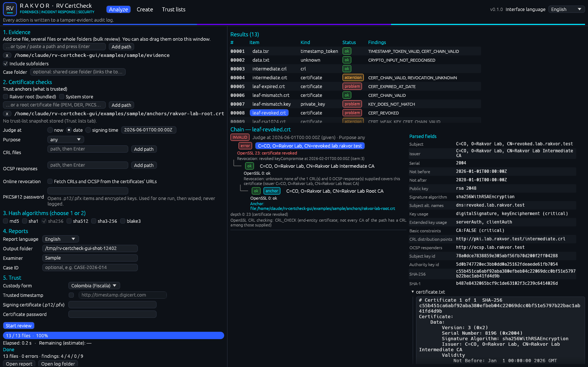
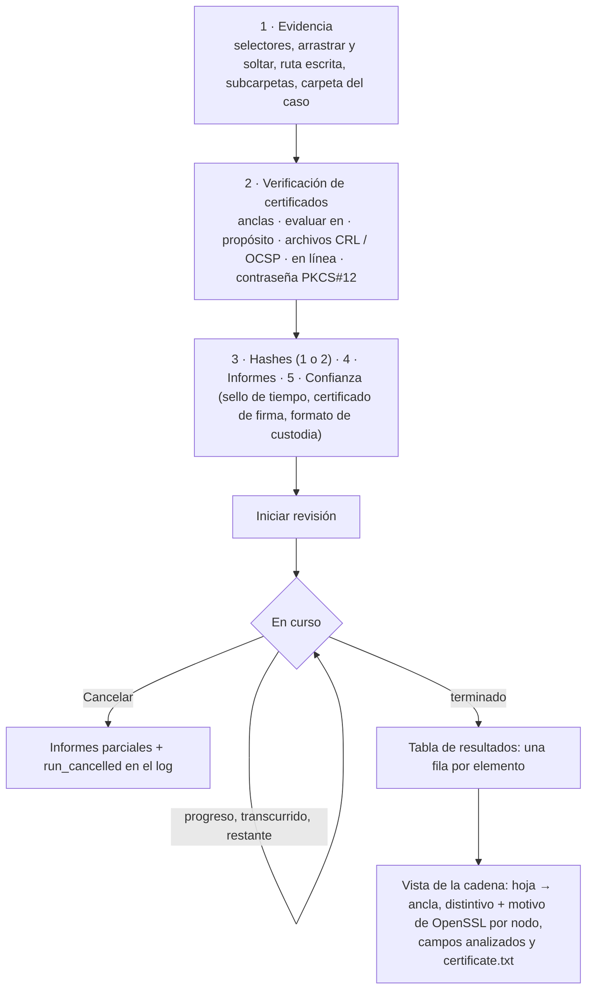
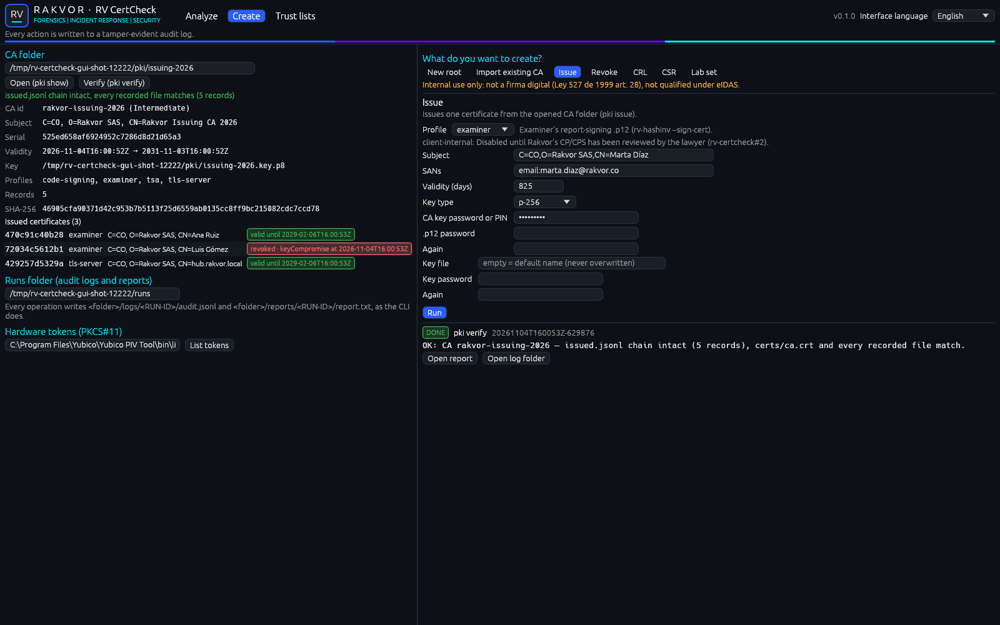

> La versión de referencia es la inglesa ([usage-gui.md](usage-gui.md)); esta traducción la sigue.

# Uso de la aplicación de escritorio (Windows 10/11)

Inicie **RV CertCheck** desde el menú Inicio (instalador) o haga doble clic en `rv-certcheck-gui.exe` (zip portable).
No hace falta instalar ningún otro programa; la aplicación también funciona en máquinas virtuales sin controlador
gráfico (renderizado por software). La ventana tiene tres pestañas: **Analizar**, **Crear** y **Listas de confianza**.
El idioma de la interfaz (English, Español, Français) se elige arriba a la derecha y cambia todas las etiquetas a la
vez; es independiente del idioma de los informes.

Cada pestaña llama al mismo motor que la línea de comandos: una ejecución de Analizar es `rv-certcheck analyze`, y cada
operación de Crear o de Listas de confianza es el comando `pki`, `csr`, `lab`, `tokens` o `trust-list` correspondiente,
con la misma ejecución auditada (`<out>/logs/<RUN-ID>/audit.jsonl`, `<out>/reports/<RUN-ID>/…`) y `"frontend": "gui"`
en `environment.json`.

## Analizar





| Zona | Qué hace |
| --- | --- |
| **1. Evidencia** | *Agregar archivos…* / *Agregar carpeta…* (selectores de Windows), arrastrar y soltar en la ventana o en el icono del `.exe`, o escribir una ruta y pulsar Enter. *Incluir subcarpetas* está activada por defecto. Quite una entrada con **x**. *Carpeta del caso* vincula la ejecución a una carpeta compartida del caso (ver [case-folder.md](case-folder.md), en inglés). |
| **2. Verificación de certificados** | **Anclas de confianza**: la *Raíz Rakvor* incluida, el *Almacén del sistema*, archivos de certificados raíz (PEM, DER, PKCS#7) e instantáneas de listas de confianza de la pestaña Listas de confianza. Sin ningún ancla, cada cadena se informa como no confiable (una advertencia lo indica). **Evaluar en**: *ahora*, una *fecha* (`2026-06-01` o `2026-06-01T12:00:00Z`) o la *hora de firma* del objeto. **Propósito**: any, tls-server, tls-client, code-signing, document-signing, email, timestamping. **Archivos CRL** y **Respuestas OCSP**: fuentes de revocación que se suman a las encontradas entre la evidencia. **Revocación en línea**: descarga CRL y OCSP desde las URL de los certificados; desactivada por defecto, y cada descarga (URL, hora, estado HTTP, SHA-256 de la respuesta) se escribe en el log de auditoría y en el `chain.json` del elemento. **Contraseña PKCS#12**: abre los elementos `.p12`/`.pfx` y las claves cifradas (ver *Secretos* abajo). Corresponden uno a uno a `--anchor`, `--at`, `--purpose`, `--crl`, `--ocsp`, `--online` y la contraseña PKCS#12 de `analyze`. |
| **3. Algoritmos de hash** | Marque uno o dos; con dos marcados los demás se desactivan, y el último no se puede desmarcar. |
| **4. Informes** | Idioma de los informes (uno o los tres), carpeta de salida (bloqueada en la carpeta del caso cuando hay una), perito, ID del caso. |
| **5. Confianza** | Formato de custodia (Colombia / Francia), sello de tiempo confiable (dirección de la TSA editable), certificado de firma de los informes y su contraseña. |
| **Iniciar revisión / Cancelar** | Durante una ejecución los ajustes quedan bloqueados y el botón pasa a ser *Cancelar*. Progreso por bytes, archivos hechos / total, tiempo transcurrido y tiempo restante estimado. |
| **Resultados** | Una fila por elemento: número, archivo, tipo (certificate, crl, ocsp_response, timestamp_token, pkcs12, private_key, csr, o el tipo del inventario), distintivo de estado (ok / atención / problema) y los códigos de hallazgo, tras la etapa entre elementos. *Abrir informe* abre la página de estadísticas; *Abrir carpeta de logs*, los logs de la ejecución. |
| **Vista de la cadena** | Haga clic en una fila. Cada cadena se dibuja desde la hoja (arriba) hasta su ancla, con el veredicto global de la cadena (VALID / UNTRUSTED / INVALID), la fecha y cómo se eligió, y el propósito. Cada nodo muestra su sujeto, un distintivo (ok, error, incomplete, más *anchor* para el certificado de confianza), el código y el motivo de OpenSSL a esa profundidad, su estado de revocación y cualquier coincidencia con una lista de confianza. Haga clic en un nodo para ver sus campos analizados a la derecha; el `certificate.txt` del elemento (el volcado de texto de OpenSSL) está debajo. Un token de sello de tiempo muestra también la cadena de su TSA. |

## Crear



La pestaña Crear maneja la PKI interna de Rakvor como se describe paso a paso en [company-pki.md](company-pki.md) (en
inglés).

**Izquierda: la carpeta de la CA.** Escriba o elija una carpeta de CA y pulse **Abrir (pki show)**: se muestran el id
de la CA, el tipo, el sujeto, el serial, la validez, la ubicación de la clave, los perfiles permitidos y el número de
registros, con los **certificados emitidos** y el estado de revocación de cada uno (*válido hasta …* o *revocado ·
motivo a las …*). **Verificar (pki verify)** vuelve a comprobar la cadena de hashes de `issued.jsonl` y cada archivo
registrado y muestra el resultado. La **Carpeta de ejecuciones** es donde van el log de auditoría y el informe de cada
operación. **Tokens físicos**: escriba el módulo PKCS#11 (para una YubiKey,
`C:\Program Files\Yubico\Yubico PIV Tool\bin\libykcs11.dll`) y pulse **Listar tokens** (no hace falta PIN); los
seriales de los tokens aparecen entonces en cada opción de clave *token*.

**Derecha: los asistentes.** Elija uno, complételo y pulse **Ejecutar**. La operación se ejecuta en segundo plano; el
resultado muestra el resumen, cada archivo escrito con su SHA-256, **Abrir carpeta**, **Abrir informe** y **Abrir
carpeta de logs**.

| Asistente | Comando | Notas |
| --- | --- | --- |
| **Nueva raíz** | `pki init-root` | Carpeta nueva (vacía), id de la CA, sujeto, tipo de clave (por defecto rsa-4096), validez (por defecto 7300 días). Clave en un **archivo cifrado** (contraseña dos veces) o en un **token** (módulo, serial, etiqueta, PIN). Una raíz en token exige marcar **Confirmo: crear la clave RAÍZ en este token** (`--confirm-root`). La nueva CA queda abierta. |
| **Importar CA existente** | `pki import` | Pone bajo gestión, en una carpeta nueva, un certificado de CA y su clave (archivo cifrado o id de clave en el token). Tras emitir un intermedio, este asistente se rellena con su certificado y su archivo de clave. |
| **Emitir** | `pki issue` | Perfil: intermediate, code-signing, examiner, tsa, tls-server; **client-internal aparece desactivado** con su motivo (espera la CP/CPS, rv-certcheck#2). Sujeto, SAN (`dns:`, `ip:`, `email:`, `uri:`; **tls-server necesita un SAN dns: o ip:**), validez (por defecto 825 días), una clave nueva (archivo o token) o un CSR, y la contraseña o el PIN de la clave de la CA. El tipo de clave sigue al perfil cuando este cambia (p-384 intermediate, p-256 tsa / tls-server, rsa-3072 code-signing / examiner). **examiner** pide además la contraseña del `.p12` (dos veces), usa siempre una clave nueva en archivo y rechaza una clave EC o Ed25519: el `.p12` es lo que carga `rv-hashinv --sign-cert`, y rv-hashinv firma solo con RSA (`--allow-non-rsa-examiner` de la CLI no tiene equivalente en la GUI). |
| **Revocar** | `pki revoke` | Elija un certificado emitido y un motivo RFC 5280; opcionalmente una hora de revocación. Publíquelo con una CRL. |
| **CRL** | `pki crl` | Próxima actualización en días (por defecto 30) y la contraseña o el PIN de la clave de la CA. |
| **CSR** | `csr new` | Sujeto, SAN, tipo de clave, clave (archivo o token) y el archivo CSR que se escribe, para una CA pública o calificada. |
| **Conjunto de laboratorio** | `lab make` | full o minimal, semilla, hora base, carpeta. Las claves de laboratorio son públicas: nunca las use para nada real. |

El formulario se comprueba antes de tomar nada de un campo enmascarado; un formulario rechazado conserva lo escrito e
indica lo que falta.

## Listas de confianza

Importe una lista de confianza de la **UE** (LOTL o TL nacional, XML ETSI TS 119 612) o el CSV **colombiano** curado
(columnas listadas en [usage-cli.md](usage-cli.md), `trust-list import`, en inglés). Cada importación es una ejecución
auditada de `trust-list import` que registra el SHA-256 del archivo de origen y escribe una instantánea fechada y con
hash en la carpeta de instantáneas (por defecto la carpeta de datos de la herramienta; `RV_CERTCHECK_DATA` la
sustituye). La tabla lista cada instantánea guardada con su fecha de importación, id, SHA-256 y número de servicios y
certificados; haga clic en una para examinar sus metadatos y servicios (filtrables por nombre, proveedor, tipo, país o
estado). Marque **ancla** para usar una instantánea como ancla de confianza en la pestaña Analizar
(`tl:<list>@<id>`). En v0.1 no se verifica la propia firma XAdES de la lista de confianza (se indica en la pestaña).

## Secretos

Las contraseñas y los PIN (contraseña PKCS#12, contraseña de firma de los informes, contraseñas de los archivos de
clave, contraseña del `.p12`, contraseña o PIN de la clave de la CA, PIN del token) se escriben solo en campos
enmascarados. Cada uno pasa a un búfer que se pone a cero para exactamente una operación (una ejecución de Analizar o
una operación de Crear) y el campo queda vacío después; cambiar de asistente o abrir otra carpeta de CA también borra
los campos. Nunca se escriben en una entrada de auditoría, un informe, una carpeta de CA ni en `environment.json`: los
parámetros registran `entered in the GUI (masked, not recorded)` en su lugar. Una prueba unitaria escribe contraseñas
distintas a lo largo de todo un flujo raíz → intermedio → examiner → revocación → CRL y comprueba que ninguna aparece en
ningún archivo escrito.

## Qué registra la GUI

Sus elecciones forman parte del registro de la evidencia. Se escriben, con la hora de cada una (`at_utc`), al inicio de
la siguiente ejecución auditada (una ejecución de Analizar o una operación de Crear / Listas de confianza):

| Acción | Se registra como |
| --- | --- |
| Cambiar de pestaña, idioma de la interfaz | `ui_tab_changed`, `ui_interface_language_changed` |
| Agregar / quitar evidencia, subcarpetas, carpeta del caso | `ui_input_added`, `ui_input_removed`, `ui_recursive_changed`, `ui_case_dir_changed` |
| Hashes, idioma de los informes | `ui_hash_selection_changed`, `ui_language_changed` |
| Anclas, fecha, propósito, archivos de revocación, en línea | `ui_anchor_changed`, `ui_at_changed`, `ui_purpose_changed`, `ui_revocation_file_added` / `_removed`, `ui_online_revocation_changed` |
| Sello de tiempo, certificado de firma, formato de custodia | `ui_timestamp_changed`, `ui_signing_certificate_changed`, `ui_jurisdiction_changed` |
| Pulsar Iniciar (ajustes finales) | `ui_start_clicked` |
| Abrir una fila de resultado | `ui_item_selected` |
| Abrir una carpeta de CA, asistente, perfil, modo de clave, token, confirm-root | `ui_ca_folder_opened`, `ui_wizard_opened`, `ui_profile_changed`, `ui_key_mode_changed`, `ui_token_selected`, `ui_confirm_root_changed` |
| Ejecutar un asistente u operación | `ui_wizard_submitted`, `ui_operation_started` (comando y parámetros, nunca un secreto) |
| Listas de confianza | `ui_trust_list_kind_changed`, `ui_trust_list_inspected` |

Los errores durante una ejecución aparecen en **Advertencias** y en el log como `item_error`. Los mensajes de
validación mostrados antes de una ejecución (p. ej. "Add at least one file or folder") no se registran, porque todavía
no existe ninguna ejecución, y por tanto ningún log.

## Capturas de pantalla

Las imágenes de arriba se renderizan sin pantalla a partir del código real de la ventana:

```sh
cargo run -p rv-certcheck-gui --example gui_screenshot -- docs/images/gui-analyze.png analyze en
cargo run -p rv-certcheck-gui --example gui_screenshot -- docs/images/gui-create.png create en
```
