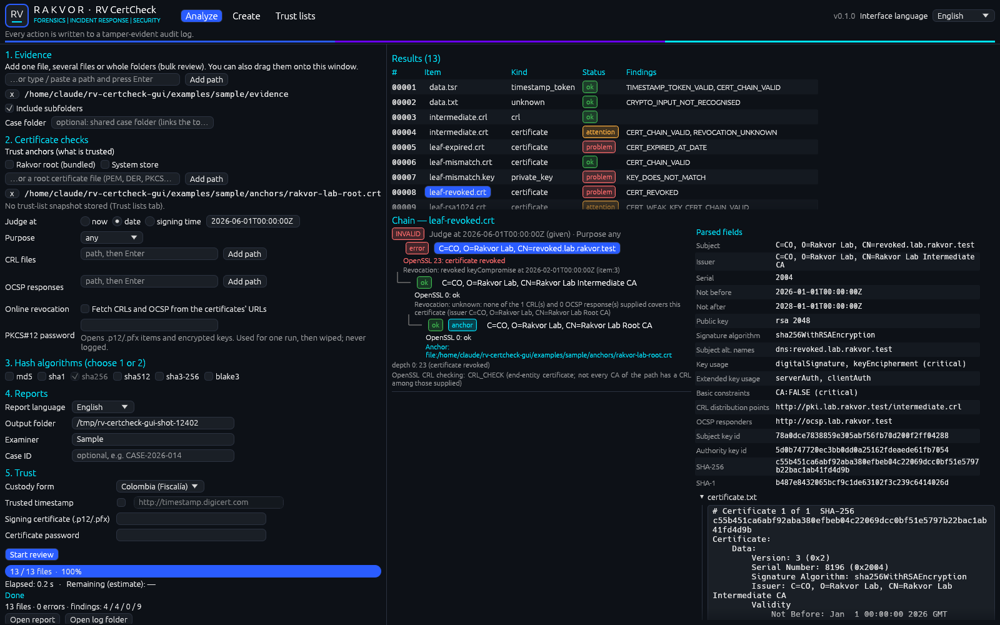
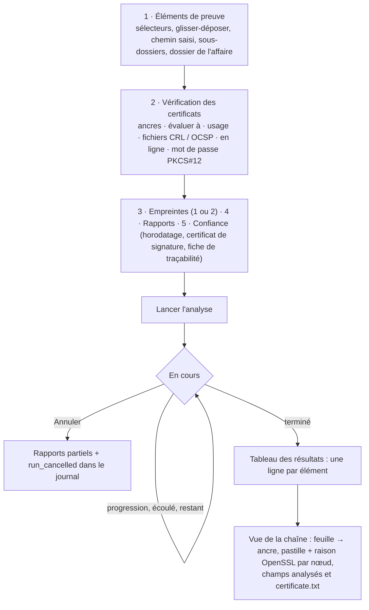
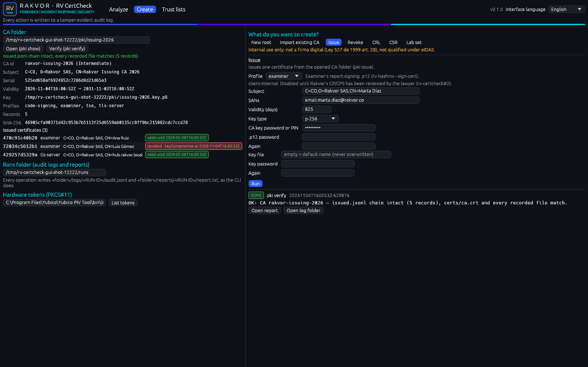

> La version de référence est la version anglaise ([usage-gui.md](usage-gui.md)) ; cette traduction la suit.

# Utiliser l'application de bureau (Windows 10/11)

Lancez **RV CertCheck** depuis le menu Démarrer (programme d'installation) ou double-cliquez sur `rv-certcheck-gui.exe`
(zip portable). Aucun autre logiciel n'est à installer ; l'application fonctionne aussi sur des machines virtuelles
sans pilote graphique (rendu logiciel). La fenêtre a trois onglets : **Analyser**, **Créer** et **Listes de
confiance**. La langue de l'interface (English, Español, Français) se choisit en haut à droite et change tous les
libellés d'un coup ; elle est indépendante de la langue des rapports.

Chaque onglet appelle le même moteur que la ligne de commande : une exécution d'Analyser est `rv-certcheck analyze`,
et chaque opération de Créer ou de Listes de confiance est la commande `pki`, `csr`, `lab`, `tokens` ou `trust-list`
correspondante, avec la même exécution auditée (`<out>/logs/<RUN-ID>/audit.jsonl`, `<out>/reports/<RUN-ID>/…`) et
`"frontend": "gui"` dans `environment.json`.

## Analyser





| Zone | Ce qu'elle fait |
| --- | --- |
| **1. Éléments de preuve** | *Ajouter des fichiers…* / *Ajouter un dossier…* (sélecteurs de Windows), glisser-déposer sur la fenêtre ou sur l'icône du `.exe`, ou saisir un chemin et appuyer sur Entrée. *Inclure les sous-dossiers* est coché par défaut. Retirez une entrée avec **x**. *Dossier de l'affaire* rattache l'exécution à un dossier partagé de l'affaire (voir [case-folder.md](case-folder.md), en anglais). |
| **2. Vérification des certificats** | **Ancres de confiance** : la *Racine Rakvor* fournie, le *Magasin du système*, des fichiers de certificats racine (PEM, DER, PKCS#7) et des instantanés de listes de confiance de l'onglet Listes de confiance. Sans aucune ancre, chaque chaîne est déclarée non approuvée (un avertissement le dit). **Évaluer à** : *maintenant*, une *date* (`2026-06-01` ou `2026-06-01T12:00:00Z`) ou l'*heure de signature* de l'objet. **Usage** : any, tls-server, tls-client, code-signing, document-signing, email, timestamping. **Fichiers CRL** et **Réponses OCSP** : sources de révocation qui s'ajoutent à celles trouvées parmi les éléments. **Révocation en ligne** : télécharge les CRL et OCSP depuis les URL des certificats ; désactivée par défaut, et chaque téléchargement (URL, heure, statut HTTP, SHA-256 de la réponse) est écrit dans le journal d'audit et dans le `chain.json` de l'élément. **Mot de passe PKCS#12** : ouvre les éléments `.p12`/`.pfx` et les clés chiffrées (voir *Secrets* ci-dessous). Ils correspondent un à un à `--anchor`, `--at`, `--purpose`, `--crl`, `--ocsp`, `--online` et au mot de passe PKCS#12 d'`analyze`. |
| **3. Algorithmes d'empreinte** | Cochez-en un ou deux ; quand deux sont cochés les autres sont désactivés, et le dernier ne peut pas être décoché. |
| **4. Rapports** | Langue des rapports (une ou les trois), dossier de sortie (verrouillé sur le dossier de l'affaire s'il y en a un), expert, référence du dossier. |
| **5. Confiance** | Fiche de traçabilité (Colombie / France), horodatage de confiance (adresse de la TSA modifiable), certificat de signature des rapports et son mot de passe. |
| **Lancer l'analyse / Annuler** | Pendant une exécution, les réglages sont verrouillés et le bouton devient *Annuler*. Progression selon les octets, fichiers traités / total, temps écoulé et temps restant estimé. |
| **Résultats** | Une ligne par élément : numéro, fichier, type (certificate, crl, ocsp_response, timestamp_token, pkcs12, private_key, csr, ou le type de l'inventaire), pastille d'état (ok / attention / problème) et codes des constatations, après l'étape entre éléments. *Ouvrir le rapport* ouvre la page des statistiques ; *Ouvrir le dossier des journaux*, les journaux de l'exécution. |
| **Vue de la chaîne** | Cliquez sur une ligne. Chaque chaîne est dessinée de la feuille (en haut) jusqu'à son ancre, avec l'état global de la chaîne (VALID / UNTRUSTED / INVALID), la date et la façon dont elle a été choisie, et l'usage. Chaque nœud affiche son sujet, une pastille (ok, error, incomplete, plus *anchor* pour le certificat de confiance), le code et la raison d'OpenSSL à cette profondeur, son état de révocation et toute correspondance avec une liste de confiance. Cliquez sur un nœud pour voir ses champs analysés à droite ; le `certificate.txt` de l'élément (le vidage texte d'OpenSSL) est en dessous. Un jeton d'horodatage montre aussi la chaîne de sa TSA. |

## Créer



L'onglet Créer gère la PKI interne de Rakvor comme décrit étape par étape dans [company-pki.md](company-pki.md) (en
anglais).

**À gauche : le dossier de l'AC.** Saisissez ou choisissez un dossier d'AC et appuyez sur **Ouvrir (pki show)** :
l'identifiant de l'AC, son type, son sujet, son numéro de série, sa validité, l'emplacement de la clé, les profils
autorisés et le nombre d'enregistrements s'affichent, avec les **certificats émis** et l'état de révocation de chacun
(*valide jusqu'au …* ou *révoqué · raison à …*). **Vérifier (pki verify)** revérifie la chaîne d'empreintes
d'`issued.jsonl` et chaque fichier consigné, et affiche le résultat. Le **Dossier des exécutions** est l'endroit où vont
le journal d'audit et le rapport de chaque opération. **Jetons matériels** : saisissez le module PKCS#11 (pour une
YubiKey, `C:\Program Files\Yubico\Yubico PIV Tool\bin\libykcs11.dll`) et appuyez sur **Lister les jetons** (aucun PIN
n'est nécessaire) ; les numéros de série des jetons apparaissent alors dans chaque choix de clé *jeton*.

**À droite : les assistants.** Choisissez-en un, remplissez-le et appuyez sur **Exécuter**. L'opération s'exécute en
arrière-plan ; le résultat montre le résumé, chaque fichier écrit avec son SHA-256, **Ouvrir le dossier**, **Ouvrir le
rapport** et **Ouvrir le dossier des journaux**.

| Assistant | Commande | Remarques |
| --- | --- | --- |
| **Nouvelle racine** | `pki init-root` | Dossier nouveau (vide), identifiant de l'AC, sujet, type de clé (par défaut rsa-4096), validité (par défaut 7300 jours). Clé dans un **fichier chiffré** (mot de passe deux fois) ou sur un **jeton** (module, numéro de série, libellé, PIN). Une racine sur jeton exige de cocher **Je confirme : créer la clé RACINE sur ce jeton** (`--confirm-root`). La nouvelle AC est ouverte. |
| **Importer une AC existante** | `pki import` | Place sous gestion, dans un nouveau dossier, un certificat d'AC et sa clé (fichier chiffré ou identifiant de clé sur le jeton). Après l'émission d'un intermédiaire, cet assistant est prérempli avec son certificat et son fichier de clé. |
| **Émettre** | `pki issue` | Profil : intermediate, code-signing, examiner, tsa, tls-server ; **client-internal est affiché désactivé** avec sa raison (il attend la PC/DPC, rv-certcheck#2). Sujet, SAN (`dns:`, `ip:`, `email:`, `uri:` ; **tls-server exige un SAN dns: ou ip:**), validité (par défaut 825 jours), une nouvelle clé (fichier ou jeton) ou un CSR, et le mot de passe ou le PIN de la clé de l'AC. Le type de clé suit le profil quand celui-ci change (p-384 intermediate, p-256 tsa / tls-server, rsa-3072 code-signing / examiner). **examiner** demande aussi le mot de passe du `.p12` (deux fois), utilise toujours une nouvelle clé dans un fichier et refuse une clé EC ou Ed25519 : le `.p12` est ce que charge `rv-hashinv --sign-cert`, et rv-hashinv ne signe qu'en RSA (`--allow-non-rsa-examiner` de la CLI n'a pas d'équivalent dans la GUI). |
| **Révoquer** | `pki revoke` | Choisissez un certificat émis et une raison RFC 5280 ; facultativement une heure de révocation. Publiez-la avec une CRL. |
| **CRL** | `pki crl` | Prochaine mise à jour en jours (par défaut 30) et le mot de passe ou le PIN de la clé de l'AC. |
| **CSR** | `csr new` | Sujet, SAN, type de clé, clé (fichier ou jeton) et le fichier CSR à écrire, pour une AC publique ou qualifiée. |
| **Jeu de laboratoire** | `lab make` | full ou minimal, graine, heure de base, dossier. Les clés de laboratoire sont publiques : ne les utilisez jamais pour quoi que ce soit de réel. |

Le formulaire est vérifié avant que quoi que ce soit ne soit pris dans un champ masqué ; un formulaire refusé garde ce
qui a été saisi et dit ce qui manque.

## Listes de confiance

Importez une liste de confiance de l'**UE** (LOTL ou TL nationale, XML ETSI TS 119 612) ou le CSV **colombien**
organisé (colonnes listées dans [usage-cli.md](usage-cli.md), `trust-list import`, en anglais). Chaque import est une
exécution auditée de `trust-list import` qui consigne le SHA-256 du fichier source et écrit un instantané daté et haché
dans le dossier des instantanés (par défaut le dossier de données de l'outil ; `RV_CERTCHECK_DATA` le remplace). Le
tableau liste chaque instantané enregistré avec sa date d'import, son identifiant, son SHA-256 et le nombre de services
et de certificats ; cliquez sur l'un d'eux pour examiner ses métadonnées et ses services (filtrables par nom,
prestataire, type, pays ou statut). Cochez **ancre** pour utiliser un instantané comme ancre de confiance dans l'onglet
Analyser (`tl:<list>@<id>`). En v0.1, la signature XAdES de la liste de confiance elle-même n'est pas vérifiée (c'est
indiqué sur l'onglet).

## Secrets

Les mots de passe et les PIN (mot de passe PKCS#12, mot de passe de signature des rapports, mots de passe des fichiers
de clé, mot de passe du `.p12`, mot de passe ou PIN de la clé de l'AC, PIN du jeton) ne se saisissent que dans des
champs masqués. Chacun est déplacé dans un tampon remis à zéro pour exactement une opération (une exécution d'Analyser
ou une opération de Créer) et le champ est vide ensuite ; changer d'assistant ou ouvrir un autre dossier d'AC efface
aussi les champs. Ils ne sont jamais écrits dans une entrée d'audit, un rapport, un dossier d'AC ni dans
`environment.json` : les paramètres consignent `entered in the GUI (masked, not recorded)` à la place. Un test unitaire
saisit des mots de passe distincts tout au long d'un parcours racine → intermédiaire → examiner → révocation → CRL et
vérifie qu'aucun n'apparaît dans un fichier écrit.

## Ce que la GUI consigne

Vos choix font partie du registre de la preuve. Ils sont écrits, avec l'heure de chacun (`at_utc`), au début de la
prochaine exécution auditée (une exécution d'Analyser ou une opération de Créer / Listes de confiance) :

| Action | Journalisée comme |
| --- | --- |
| Changer d'onglet, langue de l'interface | `ui_tab_changed`, `ui_interface_language_changed` |
| Ajouter / retirer des éléments, sous-dossiers, dossier de l'affaire | `ui_input_added`, `ui_input_removed`, `ui_recursive_changed`, `ui_case_dir_changed` |
| Empreintes, langue des rapports | `ui_hash_selection_changed`, `ui_language_changed` |
| Ancres, date, usage, fichiers de révocation, en ligne | `ui_anchor_changed`, `ui_at_changed`, `ui_purpose_changed`, `ui_revocation_file_added` / `_removed`, `ui_online_revocation_changed` |
| Horodatage, certificat de signature, fiche de traçabilité | `ui_timestamp_changed`, `ui_signing_certificate_changed`, `ui_jurisdiction_changed` |
| Appuyer sur Lancer (réglages finaux) | `ui_start_clicked` |
| Ouvrir une ligne de résultat | `ui_item_selected` |
| Ouvrir un dossier d'AC, un assistant, un profil, un mode de clé, un jeton, confirm-root | `ui_ca_folder_opened`, `ui_wizard_opened`, `ui_profile_changed`, `ui_key_mode_changed`, `ui_token_selected`, `ui_confirm_root_changed` |
| Exécuter un assistant ou une opération | `ui_wizard_submitted`, `ui_operation_started` (commande et paramètres, jamais un secret) |
| Listes de confiance | `ui_trust_list_kind_changed`, `ui_trust_list_inspected` |

Les erreurs pendant une exécution apparaissent sous **Avertissements** et dans le journal comme `item_error`. Les
messages de validation affichés avant une exécution (par ex. « Add at least one file or folder ») ne sont pas
journalisés, car aucune exécution, et donc aucun journal, n'existe encore.

## Captures d'écran

Les images ci-dessus sont rendues sans écran à partir du vrai code de la fenêtre :

```sh
cargo run -p rv-certcheck-gui --example gui_screenshot -- docs/images/gui-analyze.png analyze en
cargo run -p rv-certcheck-gui --example gui_screenshot -- docs/images/gui-create.png create en
```
