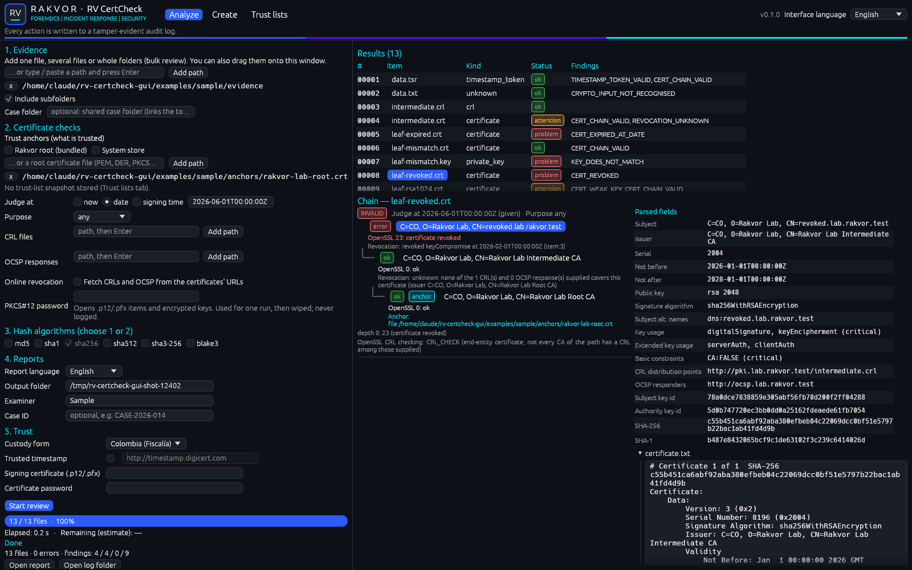
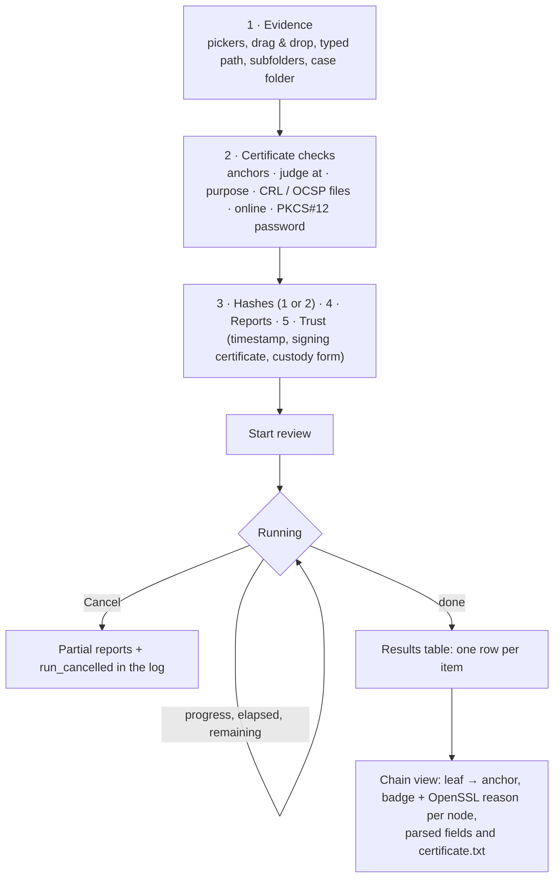
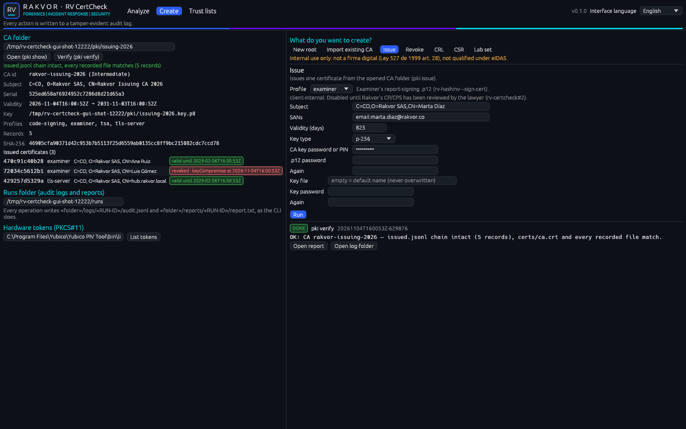

# Using the desktop app (Windows 10/11)

Start **RV CertCheck** from the Start menu (installer) or double-click `rv-certcheck-gui.exe` (portable zip).
No installation of other software is required; the app also runs on virtual machines without a graphics
driver (software rendering). The window has three tabs: **Analyze**, **Create** and **Trust lists**. The
interface language (English, Español, Français) is chosen top right and changes every label at once; it is
independent of the report language.

Every tab calls the same engine as the command line: an Analyze run is `rv-certcheck analyze`, and each Create or
Trust-lists operation is the matching `pki`, `csr`, `lab`, `tokens` or `trust-list` command, with the same audited
run (`<out>/logs/<RUN-ID>/audit.jsonl`, `<out>/reports/<RUN-ID>/…`) and `"frontend": "gui"` in `environment.json`.

## Analyze





| Area | What it does |
| --- | --- |
| **1. Evidence** | *Add files…* / *Add folder…* (Windows pickers), drag and drop onto the window or the `.exe` icon, or type a path and press Enter. *Include subfolders* is on by default. Remove an entry with **x**. *Case folder* links the run to a shared case folder (see [case-folder.md](case-folder.md)). |
| **2. Certificate checks** | **Trust anchors**: the bundled *Rakvor root*, the *System store*, root certificate files (PEM, DER, PKCS#7), and trust-list snapshots from the Trust lists tab. With no anchor every chain is reported as untrusted (a warning says so). **Judge at**: *now*, a *date* (`2026-06-01` or `2026-06-01T12:00:00Z`) or the object's *signing time*. **Purpose**: any, tls-server, tls-client, code-signing, document-signing, email, timestamping. **CRL files** and **OCSP responses**: revocation sources added to those found among the evidence. **Online revocation**: fetches CRLs and OCSP from the certificates' URLs; off by default, and every fetch (URL, time, HTTP status, response SHA-256) is written to the audit log and to the item's `chain.json`. **PKCS#12 password**: opens `.p12`/`.pfx` items and encrypted keys (see *Secrets* below). These map one to one to `--anchor`, `--at`, `--purpose`, `--crl`, `--ocsp`, `--online` and the PKCS#12 password of `analyze`. |
| **3. Hash algorithms** | Tick one or two; when two are ticked the others are disabled, and the last one cannot be unticked. |
| **4. Reports** | Report language (one or all three), output folder (locked to the case folder when one is set), examiner, case ID. |
| **5. Trust** | Custody form (Colombia / France), trusted timestamp (TSA address editable), report-signing certificate and its password. |
| **Start review / Cancel** | During a run the settings are locked and the button becomes *Cancel*. Progress by bytes, files done / total, elapsed time and estimated time remaining. |
| **Results** | One row per item: number, file, kind (certificate, crl, ocsp_response, timestamp_token, pkcs12, private_key, csr, or the inventory type), status badge (ok / attention / problem) and the finding codes, after the cross-item stage. *Open report* opens the statistics page; *Open log folder* the run's logs. |
| **Chain view** | Click a row. Each chain is drawn from the leaf (top) to its anchor, with the overall verdict (VALID / UNTRUSTED / INVALID), the date and how it was chosen, and the purpose. Each node shows its subject, a badge (ok, error, incomplete, plus *anchor* for the trusted certificate), OpenSSL's code and reason at that depth, its revocation status and any trust-list match. Click a node to see its parsed fields on the right; the item's `certificate.txt` (the OpenSSL text dump) is below them. A timestamp token also shows its TSA's chain. |

## Create



The Create tab runs Rakvor's internal PKI as described step by step in [company-pki.md](company-pki.md).

**Left: the CA folder.** Type or pick a CA folder and press **Open (pki show)**: the CA's id, kind, subject,
serial, validity, key location, allowed profiles and record count are shown, with the **issued certificates** and
each one's revocation status (*valid until …* or *revoked · reason at …*). **Verify (pki verify)** re-checks the
hash chain of `issued.jsonl` and every recorded file and shows the result. The **Runs folder** is where each
operation's audit log and report go. **Hardware tokens**: type the PKCS#11 module (for a YubiKey,
`C:\Program Files\Yubico\Yubico PIV Tool\bin\libykcs11.dll`) and press **List tokens** (no PIN needed); the token
serials then appear in every *token* key choice.

**Right: the wizards.** Choose one, fill it in and press **Run**. The operation runs in the background; the result
shows the summary, every file written with its SHA-256, **Open folder**, **Open report** and **Open log folder**.

| Wizard | Command | Notes |
| --- | --- | --- |
| **New root** | `pki init-root` | New (empty) folder, CA id, subject, key type (default rsa-4096), validity (default 7300 days). Key in an **encrypted file** (password twice) or on a **token** (module, serial, label, PIN). A token root requires ticking **I confirm: create the ROOT key on this token** (`--confirm-root`). The new CA is opened. |
| **Import existing CA** | `pki import` | Brings a CA certificate and its key (encrypted file or token key id) under management in a new folder. After an intermediate is issued, this wizard is pre-filled with its certificate and key file. |
| **Issue** | `pki issue` | Profile: intermediate, code-signing, examiner, tsa, tls-server; **client-internal is shown disabled** with its reason (it waits for the CP/CPS, rv-certcheck#2). Subject, SANs (`dns:`, `ip:`, `email:`, `uri:`; **tls-server needs a dns: or ip: SAN**), validity (default 825 days), a new key (file or token) or a CSR, and the CA key's password or PIN. The key type follows the profile when it changes (p-384 intermediate, p-256 tsa / tls-server, rsa-3072 code-signing / examiner). **examiner** also asks for the `.p12` password (twice), always uses a new file key, and refuses an EC or Ed25519 key: the `.p12` is what `rv-hashinv --sign-cert` loads, and rv-hashinv signs with RSA only (the CLI's `--allow-non-rsa-examiner` has no GUI equivalent). |
| **Revoke** | `pki revoke` | Pick an issued certificate and an RFC 5280 reason; optionally a revocation time. Publish it with a CRL. |
| **CRL** | `pki crl` | Next update in days (default 30) and the CA key's password or PIN. |
| **CSR** | `csr new` | Subject, SANs, key type, key (file or token) and the CSR file to write, for a public or qualified CA. |
| **Lab set** | `lab make` | full or minimal, seed, base time, folder. Lab keys are public: never use them for anything real. |

The form is checked before anything is taken from a masked field; a refused form keeps what was typed and says
what is missing.

## Trust lists

Import an **EU** trust list (LOTL or national TL, ETSI TS 119 612 XML) or the curated **Colombian** CSV (columns
listed in [usage-cli.md](usage-cli.md), `trust-list import`). Each import is an audited `trust-list import` run that records the source
file's SHA-256 and writes a dated, hashed snapshot to the snapshot folder (the tool's data folder by default;
`RV_CERTCHECK_DATA` overrides it). The table lists every stored snapshot with its import date, id, SHA-256 and
number of services and certificates; click one to inspect its metadata and services (filterable by name,
provider, type, country or status). Tick **anchor** to use a snapshot as a trust anchor in the Analyze tab
(`tl:<list>@<id>`). In v0.1 the trust list's own XAdES signature is not verified (stated on the tab).

## Secrets

Passwords and PINs (PKCS#12 password, report-signing password, key-file passwords, `.p12` password, CA key
password or PIN, token PIN) are typed into masked fields only. Each is moved into a zeroizing buffer for exactly
one operation (an Analyze run, or one Create operation) and the field is empty afterwards; switching wizard or
opening another CA folder also wipes the fields. They are never written to an audit entry, a report, a CA folder
or `environment.json`: the parameters record `entered in the GUI (masked, not recorded)` instead. A unit test types
distinct passwords through a whole root → intermediate → examiner → revoke → CRL flow and checks that none of them
appears in any file written.

## What the GUI records

Your choices are part of the evidence record. They are written, with the time of each (`at_utc`), at the start of
the next audited run (an Analyze run or a Create / Trust-lists operation):

| Action | Logged as |
| --- | --- |
| Switch tab, interface language | `ui_tab_changed`, `ui_interface_language_changed` |
| Add / remove evidence, subfolders, case folder | `ui_input_added`, `ui_input_removed`, `ui_recursive_changed`, `ui_case_dir_changed` |
| Hashes, report language | `ui_hash_selection_changed`, `ui_language_changed` |
| Anchors, date, purpose, revocation files, online | `ui_anchor_changed`, `ui_at_changed`, `ui_purpose_changed`, `ui_revocation_file_added` / `_removed`, `ui_online_revocation_changed` |
| Timestamp, signing certificate, custody form | `ui_timestamp_changed`, `ui_signing_certificate_changed`, `ui_jurisdiction_changed` |
| Press Start (final settings) | `ui_start_clicked` |
| Open a result row | `ui_item_selected` |
| Open a CA folder, wizard, profile, key mode, token, confirm-root | `ui_ca_folder_opened`, `ui_wizard_opened`, `ui_profile_changed`, `ui_key_mode_changed`, `ui_token_selected`, `ui_confirm_root_changed` |
| Run a wizard or operation | `ui_wizard_submitted`, `ui_operation_started` (command and parameters, never a secret) |
| Trust lists | `ui_trust_list_kind_changed`, `ui_trust_list_inspected` |

Errors during a run appear under **Warnings** and in the log as `item_error`. Validation messages shown before a
run (e.g. "Add at least one file or folder") are not logged, because no run, and therefore no log, exists yet.

## Screenshots

The images above are rendered headless from the real window code:

```sh
cargo run -p rv-certcheck-gui --example gui_screenshot -- docs/images/gui-analyze.png analyze en
cargo run -p rv-certcheck-gui --example gui_screenshot -- docs/images/gui-create.png create en
```
