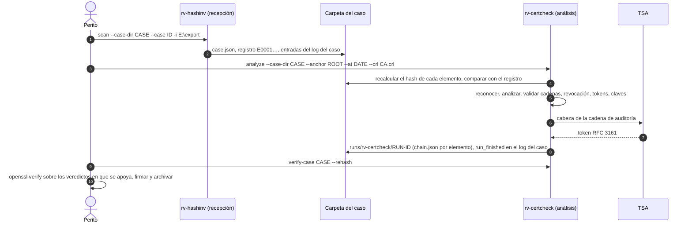
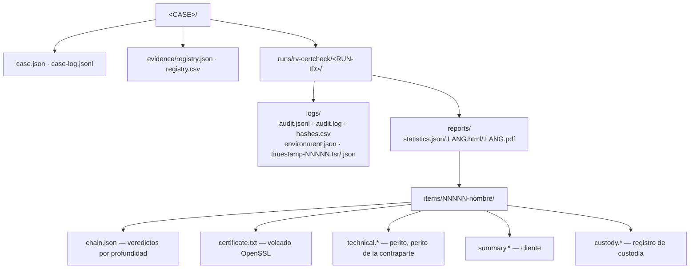

> La versión de referencia es la inglesa ([usage.md](usage.md)); esta traducción la sigue.

# Guía de uso: analizar evidencia de certificados y crear certificados

Esta es la guía completa para el perito. Recorre un caso, explica cada salida, indica cómo leer cada hallazgo y cómo
demostrar después que nada cambió; luego cubre la parte de creación. Las listas de opciones no se repiten aquí:

- las tareas habituales en breve: [quick-guide.es.md](quick-guide.es.md);
- cada comando, opción, valor por defecto, ejemplo y código de salida: [usage-cli.md](usage-cli.md) (generado a partir de `--help`, en inglés);
- la aplicación de escritorio: [usage-gui.es.md](usage-gui.es.md);
- la PKI propia de Rakvor paso a paso: [company-pki.md](company-pki.md) (en inglés);
- el contrato de la carpeta del caso: [case-folder.md](case-folder.md) (en inglés);
- por qué funciona cada comprobación: [theory.md](theory.md); peso legal: [admissibility.md](admissibility.md) (en inglés);
- instalación y verificación de la herramienta: [installation.es.md](installation.es.md).



## 1. Antes de empezar

| Comprobación | Por qué | Cómo |
| --- | --- | --- |
| Trabaje sobre una **copia verificada** (imagen forense, exportación con bloqueador de escritura), nunca sobre el soporte original | La herramienta es de solo lectura por software, no un bloqueador de escritura | Herramienta de imagen + bloqueador de escritura; anote modelo y número de serie |
| La herramienta instalada es la versión auténtica | Pregunta del tribunal: "¿cómo sabe qué ejecutó?" | [installation.es.md](installation.es.md) pasos 2–4 y 6 |
| **Anclas** | No se confía en nada si usted no lo indica | Obtenga cada raíz del repositorio oficial de su CA (o de una lista de confianza de la UE / el CSV colombiano curado); registre de dónde vino |
| **El instante** | Una cadena se evalúa en un instante | La fecha de firma, a partir de un token de sello de tiempo u otro registro fiable; `--at signing-time` solo da una hora de firma a los tokens de sello de tiempo en v0.1 (los demás elementos se evalúan ahora, y los informes lo indican) |
| **Datos de revocación** | Sin red, solo cuentan las CRL / OCSP entregadas | La CRL de la CA que cubre el instante (`--crl`), una respuesta OCSP (`--ocsp`), o `--online` en una máquina conectada (cada URL auditada) |
| **Propósito** | Un certificado se comprueba para un uso | `--purpose document-signing` para documentos firmados, `code-signing` para software, `tls-server` para sitios web, `timestamping` para una TSA |
| Política de hash | MD5/SHA-1 solos no son resistentes a colisiones | Incluya siempre `sha256`: `--hash sha256,md5` cuando un registro anterior usa MD5 |
| Contraseña PKCS#12 | Los almacenes de claves de la evidencia pueden estar protegidos | `RV_P12_PASSWORD` (o `--p12-pass-env VAR`); nunca se registra |
| Reloj | Las horas de auditoría vienen del reloj del puesto | Compruebe la sincronización horaria de Windows antes de la ejecución |
| Sello de tiempo del log | TSA en línea por defecto | `--no-timestamp` sin red y luego `rv-certcheck timestamp` |
| Certificado del perito | Firma cada informe PDF | `--sign-cert examiner.p12` ([firma](#7-firmar-los-informes-con-el-certificado-del-perito)) |

## 2. Recorrido de un caso

El caso de ejemplo: `CASE-2026-014`, un contrato firmado cuyo certificado del firmante, intermedio, CRL de la CA y un
token RFC 3161 fueron exportados por el cliente a `E:\export` y registrados en la recepción por rv-hashinv. Las
salidas siguientes usan la muestra de laboratorio (`examples/sample`), evaluada el 2026-06-01 frente a la raíz de
laboratorio.

<!-- forge:domain -->
### 2.1 Análisis: volver a verificar y analizar cada elemento registrado

```powershell
rv-certcheck analyze --case-dir D:\cases\CASE-2026-014 `
  --anchor D:\roots\lab-root.crt --at 2026-06-01T00:00:00Z --purpose any `
  --hash sha256,md5 --lang es --actor "Ana Ruiz"
```

```text
DONE (high-severity findings)  run 20261104T154553Z-60bc38
  items: 13  bytes: 18185  errors: 0  elapsed: 0.1 s
  findings: high 4, medium 4, low 0, info 9
```

Con `--case-dir`, una última línea `case: CASE-2026-014 (analysis) registered 0 (new 0), verified …, mismatched …, not
in registry …` da la comparación con el registro.

Código de salida 3: cuatro hallazgos altos (un certificado caducado, uno revocado y uno de raíz equivocada, y una clave
que no es la de su certificado). Para cada elemento la herramienta:

1. volvió a calcular el hash del archivo y lo comparó con el registro (`evidence_verified_against_case`; una
   diferencia da `EVIDENCE_HASH_MISMATCH_WITH_CASE`, alto, y el análisis se hace igualmente);
2. lo leyó una segunda vez para analizarlo, y comprobó que esa lectura tiene el mismo hash;
3. lo reconoció por su contenido (las extensiones `.crl`, `.tsr`, `.key` no intervienen) y extrajo cada campo;
4. tras todos los elementos: construyó y comprobó la cadena de cada certificado de entidad final con **cada
   certificado de la ejecución** como posibles intermedios y **cada CRL y respuesta OCSP de la ejecución** como
   fuentes de revocación, verificó el token de sello de tiempo y emparejó la clave con los certificados.

Sin `--anchor`, cada cadena se informa `CERT_CHAIN_UNTRUSTED`: esa es la respuesta esperada cuando no se confía en
nada.

### 2.2 Volver a examinar con otra ancla, fecha o propósito

Las anclas, el instante y el propósito son elecciones del perito, registradas en cada informe. Vuelva a ejecutar
cuando cambie la pregunta, por ejemplo los mismos elementos en la fecha de firma, para firma de documentos, frente a
una instantánea de lista de confianza de la UE:

```powershell
rv-certcheck trust-list import --list eu D:\tl\ES-TL-2026-06.xml
rv-certcheck trust-list list
rv-certcheck analyze --case-dir D:\cases\CASE-2026-014 --evidence E0003,E0004 `
  --anchor tl:eu@latest --at 2025-03-14T09:30:00-05:00 --purpose document-signing --crl D:\rev\ca-2025-03.crl
```

Cada ejecución es una carpeta de ejecución nueva; las ejecuciones anteriores nunca se cambian.
<!-- /forge:domain -->

### 2.3 Verificar el caso completo

```powershell
rv-certcheck verify-case D:\cases\CASE-2026-014 --rehash
```

Todas las herramientas Rakvor tienen `verify-case` y coinciden. Comprueba la cadena del log del caso, `case.json`, el
hash del registro, la cadena de auditoría y los tokens de sello de tiempo de cada ejecución, cada archivo de salida que
registra el log de auditoría de cada ejecución (con nuevo cálculo del hash; las versiones publicadas antes de que
existiera esta comprobación no lo hacen), y los enlaces cruzados entre el log del caso y cada ejecución
([case-folder.md](case-folder.md#how-a-reviewer-verifies-a-case), en inglés). Código 0 = intacto (advertencias
impresas), 3 = roto, 1 = no es una carpeta de caso. `--rehash` vuelve a leer además cada elemento registrado que siga
accesible en su ruta registrada.

### 2.4 Lo mismo desde la aplicación de escritorio

Ver [usage-gui.es.md](usage-gui.es.md). El motor, las salidas y los hallazgos son los mismos que los de la CLI; cada
ajuste cambiado antes de una ejecución se escribe en su log de auditoría (acciones `ui_*`).

### Inicio desde RV Hub: `--case-dir` y `describe --json`

RV Hub (el lanzador de Rakvor) encuentra las herramientas instaladas, las abre sobre una carpeta del caso y sugiere
cuál conviene para un archivo. Se apoya en dos puntos de entrada de RV CertCheck:

- **`rv-certcheck-gui.exe --case-dir <CASE> [FILES...]`** inicia la aplicación de escritorio con **Carpeta del caso**
  ya completada (`--case-dir=<CASE>` también funciona). Los demás argumentos se cargan como evidencia, como cuando se
  sueltan archivos sobre el icono. El ajuste previo se escribe en el log de auditoría de la ejecución como
  `ui_case_dir_from_launcher` (ruta y `at_utc`) seguido de `ui_case_dir_changed`. Un `--case-dir` sin carpeta se
  ignora: la ventana lo indica y el log de auditoría registra `ui_launch_argument_ignored`.
- **`rv-certcheck describe --json`** imprime un objeto JSON (claves ordenadas) que lee RV Hub; está oculto en
  `rv-certcheck --help` pero figura en [usage-cli.md](usage-cli.md). No lee ni escribe nada. Esquema:
  [`schemas/describe.schema.json`](../schemas/describe.schema.json) (`rakvor.describe/1`, idéntico en todas las
  herramientas Rakvor).

| Campo | Significado |
| --- | --- |
| `schema` | `rakvor.describe/1` |
| `tool`, `title`, `version` | `rv-certcheck`, `RV CertCheck`, la versión del producto (`version.txt`) |
| `role` | `analysis` (examina evidencia registrada en la carpeta del caso por rv-hashinv) |
| `main_verb` | `analyze`: el comando que hace el trabajo principal |
| `accepts` | `extensions` crt, cer, der, pem, p7b, p7c, p12, pfx, crl, tsr, tst, key, csr; `signatures` `30 82` (una SEQUENCE DER, desplazamiento 0) y `-----BEGIN` (PEM). Las entradas se siguen reconociendo por su contenido, sea cual sea su nombre |
| `case_formats`, `log_formats` | `rakvor.case/1`; `rakvor.audit/1` = `logs/audit.jsonl` |
| `cli_exe`, `gui_exe` | `rv-certcheck.exe`, `rv-certcheck-gui.exe` |
| `exit_codes` | El significado de 0, 1, 2, 3 y 130 |

```powershell
rv-certcheck describe --json
```

## 3. Leer las salidas



Sin `--case-dir`, `logs\<RUN-ID>\` y `reports\<RUN-ID>\` se crean dentro de `--out` (por defecto `.\rakvor-out`).

| Salida | Para | Para qué sirve |
| --- | --- | --- |
| `chain.json` | Perito, perito de la contraparte | Por veredicto: estado, el instante usado y cómo se eligió (`at`, `at_source`), anclas, la primera respuesta de OpenSSL y **cada** error con su profundidad, cada nodo (certificado, código de OpenSSL, ancla, revocación con fuente y fechas, estado en la lista de confianza), notas sobre cómo se llegó al veredicto, descargas en línea ([reports.md](reports.md#chainjson-schema-rakvorcert-chain1), en inglés) |
| `certificate.txt` | Perito de la contraparte | Volcado al estilo de `openssl x509 -text` de cada certificado, con su SHA-256 |
| `statistics.*` | Perito, abogado | Visión general de la ejecución: quién, cuándo, totales, hallazgos por severidad y código, elementos por tipo, sección de la carpeta del caso, estado del sello de tiempo, firmante, cabeza de auditoría |
| `technical.*` | Perito, perito de la contraparte | Un elemento: ruta, tamaño, tipo, hashes, el resumen de la etapa de certificados, hallazgos con *lo que muestra / lo que no demuestra*, entradas de auditoría, limitaciones |
| `summary.*` | Cliente | Estado y hallazgos en lenguaje sencillo, siguiente paso |
| `custody.*` | Registro de custodia | Formato de la jurisdicción + copia en inglés; un registro interno que se usa **junto con** el formato oficial (G9) |
| `audit.jsonl` | Verificación | Cada acción, encadenada por hashes, incluido `validation_options` (anclas y archivos de revocación con SHA-256) |
| `hashes.csv`, `environment.json`, `timestamp-*` | Verificación | Registro de hashes; versiones (incluida OpenSSL); token RFC 3161 del log |

**Estado por elemento:** `problem` (un hallazgo alto), `attention` (medio o bajo), `ok` (solo informativo). **El código
de salida 3** significa "terminado, al menos un hallazgo de severidad alta", un resultado normal para una evidencia.

**Leer un veredicto en `chain.json`, en este orden:** `at` y `at_source` (¿es el instante que quería?), `anchors`
(¿confió en lo que quería?), `status`, luego `errors` (cada error de OpenSSL con su profundidad), luego la `revocation`
y la `revocation_note` de cada nodo, luego `notes` (indicadores de CRL usados, dónde se detuvo el recorrido, cómo se
resolvió `signing-time`, las comprobaciones de política propias de la herramienta).

## 4. Interpretar cada hallazgo

"Qué comprobar después" es lo que un perito debe hacer antes de apoyarse en el hallazgo; "no concluya" es la
extralimitación que hay que evitar en un informe. Severidades y textos completos:
[reports.md](reports.md#findings-catalogue) (en inglés).

<!-- forge:domain -->
| Código | Qué comprobar después | No concluya |
| --- | --- | --- |
| `CERT_CHAIN_VALID` | El ancla nombrada; `at`; los hallazgos de revocación que lo acompañan (`REVOCATION_UNKNOWN` significa que la revocación **no** se estableció); hallazgos de criptografía débil o de listas de confianza; vuelva a ejecutar con `openssl verify` | Que el certificado no estaba revocado, que el titular firmó el documento, o que el ancla merece confianza |
| `CERT_CHAIN_UNTRUSTED` | La profundidad y el código de OpenSSL: falta un intermedio (agréguelo a la ejecución) o el ancla es equivocada. Con un ancla `tl:`, `service` / `service_status` nombran un servicio listado que no estaba concedido (retirado, suspendido…) en `--at` | Que el certificado es falso |
| `CERT_CHAIN_INVALID` | El código y el motivo de OpenSSL a la profundidad indicada (p. ej. 25 longitud de ruta, 32 / 79 CA sin keyCertSign, 34 extensión crítica); el `certificate.txt` de esa profundidad | Que el certificado se falsificó |
| `CERT_SIGNATURE_INVALID` | Vuelva a exportar el certificado; compruébelo frente al emisor que eligió la cadena | Quién lo alteró |
| `CERT_EXPIRED_AT_DATE` / `CERT_NOT_YET_VALID_AT_DATE` | Si `--at` es la hora de firma; zonas horarias; vuelva a ejecutar en el instante correcto | Que una firma hecha antes es inválida; antedatado |
| `CERT_REVOKED` | La fecha de revocación frente a la fecha de firma; el motivo; la fuente (CRL u OCSP, SHA-256) | Una conducta indebida del titular; la invalidez de firmas anteriores |
| `REVOCATION_UNKNOWN` | Los motivos listados; obtenga la CRL de la CA para la fecha, una respuesta OCSP, o use `--online` | Revocado, o no revocado |
| `CERT_PURPOSE_MISMATCH` | El uso de clave y el EKU impresos; si `--purpose` corresponde al uso en el caso | Un uso indebido deliberado |
| `CERT_NAME_CONSTRAINT_VIOLATION` | El nombre y la CA nombrada | Malicia |
| `CERT_WEAK_KEY` / `CERT_WEAK_SIGNATURE_ALGORITHM` | La fecha de emisión (frecuente en certificados antiguos) | Que una clave se rompió o un certificado se falsificó |
| `CERT_SELF_SIGNED` | Si es una raíz en la que confía, o un certificado aislado | Falta de fiabilidad |
| `CERT_IN_TRUST_LIST` | El **tipo de servicio y el estado en la fecha**; la fecha de la instantánea; verifique la firma de la TL por separado (v0.1) | Estatus cualificado o validez legal |
| `CERT_NOT_IN_TRUST_LIST` | Si se usó la lista correcta y una instantánea actual | Invalidez |
| `CERT_ISSUED_BY_RAKVOR_INTERNAL` | Nada: revela un certificado interno | Ninguna presunción legal |
| `KEY_MATCHES_CERTIFICATE` / `KEY_DOES_NOT_MATCH` / `KEY_NOT_PAIRED` | Cómo se encontró la clave; con qué certificado se entregó | Quién usó la clave; manipulación |
| `TIMESTAMP_TOKEN_VALID` / `_INVALID` | `imprint_checked` e `imprint_file`: el token se comprueba frente al archivo de evidencia con la misma raíz de nombre en la ejecución (`data.tsr` ↔ `data`, `data.*`); con `imprint_checked=no` no está vinculado a ningún archivo, así que compare a mano (`openssl ts -verify -data`); los motivos listados | Con `imprint_checked=no`, qué archivo cubre; que la hora indicada es falsa |
| `PKCS12_UNREADABLE` | Entregue la contraseña (`RV_P12_PASSWORD`) y vuelva a ejecutar | Daño |
| `CRYPTO_INPUT_UNPARSABLE` / `ANALYSIS_STEP_FAILED` | El error; vuelva a exportar el objeto; corrija el archivo de ancla | Manipulación |
| `EVIDENCE_CHANGED_DURING_READ` | Otro programa que escribe en la evidencia; almacenamiento; vuelva a ejecutar sobre una copia estable | Quién la cambió |
<!-- /forge:domain -->

| Código (carpeta del caso, herramientas de análisis) | Qué comprobar después | No concluya |
| --- | --- | --- |
| `EVIDENCE_HASH_MISMATCH_WITH_CASE` (alto) | Hash esperado y real en el hallazgo; vuelva a calcular a mano el hash del archivo y de la copia de recepción; revise el almacenamiento, las transferencias y quién tuvo acceso desde la recepción (log del caso) | Quién lo cambió, cuándo, ni que fuera deliberado |
| `EVIDENCE_NOT_IN_CASE_REGISTRY` (medio) | Si el archivo debía haber pasado por la recepción; regístrelo (ejecución de recepción) si es evidencia nueva | Que el archivo está alterado o es irrelevante |

## 5. Trabajar sin carpeta del caso, y los comandos de creación

El mismo comando funciona de forma independiente (sin registro ni log del caso):

```powershell
rv-certcheck analyze -i D:\evidence -r --anchor D:\roots\ca.pem --at 2025-03-14 --out D:\work\certs
rv-certcheck analyze --input-list files.txt --anchor rakvor --progress jsonl > events.jsonl
```

`--progress jsonl` imprime cada evento para scripts. **Ctrl+C** se detiene tras el bloque actual: se escriben informes
parciales, se registra `run_cancelled`, código de salida 130.

**Los comandos de creación** escriben cada uno una ejecución auditada independiente dentro de `--out` (por defecto
`rakvor-out`) y un `report.json` / `report.txt`; los secretos vienen de variables de entorno (`--pass-env`,
`--pin-env`, `--ca-pass-env`, `--p12-pass-env`) o de una solicitud sin eco:

| Tarea | Comando | Guía |
| --- | --- | --- |
| Raíz de Rakvor, intermedio, firma de código, `.p12` del perito, TLS, TSA de prueba | `pki init-root`, `pki issue --profile …` (el tipo de clave por defecto depende del perfil; una clave examiner debe ser RSA), `pki import [--issuer-cert]` | [company-pki.md](company-pki.md) |
| URL de la CRL escrita en los certificados futuros (nunca edite `ca.json` a mano) | `pki set --crl-url URL` | [company-pki.md](company-pki.md) |
| Revocar, CRL, respuesta OCSP de laboratorio | `pki revoke`, `pki crl`, `pki ocsp-sign` | [company-pki.md §8](company-pki.md#8-renewal-and-revocation) |
| Estado e integridad de una carpeta de CA | `pki show`, `pki verify` | [forensic-audit.md](forensic-audit.md#creation-runs-and-the-ca-folders-issuedjsonl) |
| CSR para una CA pública o calificada | `csr new`, `csr show` | [company-pki.md §7](company-pki.md#7-csrs-for-a-public-or-qualified-ca) |
| Material de formación y de prueba | `lab make --set full --seed N --lab-out DIR` | [theory.md B16](theory.md#b16-lab-sets-and-determinism) |
| ¿Esta clave pertenece a este certificado? | `keys match KEY CERT` | [theory.md B12](theory.md#b12-private-key-matching) |
| Tokens en esta máquina | `tokens list --pkcs11-module LIB` | [installation.es.md 5d](installation.es.md#5d-módulos-pkcs11-tokens-físicos) |
| Instantáneas de listas de confianza | `trust-list import --list eu|co FILE`, `list`, `show` | [theory.md B14](theory.md#b14-trust-list-formats-and-snapshots) |

Comprobar un conjunto de laboratorio frente a la herramienta (lo que hace el oráculo de laboratorio de CI), para
formación:

```powershell
rv-certcheck lab make --set full --seed 1 --lab-out D:\lab\full-1
# cada caso de D:\lab\full-1\expected_findings.json lista sus archivos, anclas, at, propósito, CRL/OCSP,
# los códigos que analyze debe y no debe informar, y el código de openssl verify
rv-certcheck analyze -i D:\lab\full-1\revoked-by-crl\leaf.crt -i D:\lab\full-1\ca\intermediate.crt `
  --anchor D:\lab\full-1\ca\root.crt --crl D:\lab\full-1\ca\intermediate.crl --at 2026-01-01T00:00:00Z
# esperado: CERT_REVOKED (más CERT_ISSUED_BY_RAKVOR_INTERNAL: los certificados de laboratorio llevan la política de laboratorio de Rakvor)
```

`trust-list import`, `list` y `show` escriben cada uno una ejecución auditada dentro de `--out`, como los comandos de
creación; la propia instantánea registra su origen, su hora de importación y su SHA-256, y las anclas que se obtienen
de ella quedan registradas en cada ejecución de `analyze` que las usa. Una instantánea alterada se rechaza
(código 3).

## 6. Sellos de tiempo

Por defecto cada ejecución pide a la TSA (`http://timestamp.digicert.com`, se cambia con `--tsa-url`) que firme la
cabeza de la cadena de auditoría justo antes de escribir el informe de estadísticas. El token cubre cada hash de
evidencia, hallazgo y hash de informe por elemento registrado antes de él, no el informe de estadísticas ni el
`run_finished` escritos después ([forensic-audit.md](forensic-audit.md#trusted-timestamp-rfc-3161), en inglés).

| Situación | Qué ocurre | Qué hacer |
| --- | --- | --- |
| TSA accesible | `timestamp_obtained`; archivos `timestamp-NNNNN.tsr` y `.json` en la carpeta de logs; el informe de estadísticas muestra la hora | Verifique con OpenSSL (abajo) |
| Sin red | `timestamp_pending`; la ejecución termina; advertencia en el informe de estadísticas y en la consola | Más tarde, con red: `rv-certcheck timestamp <log folder>` |
| `--no-timestamp` / `RV_NO_TIMESTAMP=1` / GUI desmarcada | Sin solicitud | Use `rv-certcheck timestamp` más tarde si hace falta |
| Cadena rota | `rv-certcheck timestamp` se niega (código 3): a un log roto no se le agrega ningún sello de tiempo | Investigue; no repare |

`verify-log` comprueba el hash del token, que cubre la cabeza registrada y la firma CMS de la TSA
(`TSA signature valid (signer: …)`). La cadena del certificado de la TSA solo se valida con `--tsa-ca`:

```bash
rv-certcheck verify-log <log folder> --tsa-ca <TSA roots.pem>
# → … TSA signature valid (signer: …); chain validated to … (revocation not checked)
# sin --tsa-ca: … chain not checked (pass --tsa-ca <CA bundle> to validate it)
```

Un paquete ilegible da el código 1; un fallo de firma o de cadena da el código 3; un token que registra el log y cuyo
`.tsr` o `.json` falta da también el código 3. La revocación nunca se comprueba (brecha G18). Como comprobación
independiente de la **firma y la cadena**, use OpenSSL (Git for Windows incluye `openssl.exe`); tampoco comprueba la
revocación (no se le da ninguna CRL y OpenSSL no consulta OCSP):

```bash
cd <log folder>
N=00022                                                   # del nombre de archivo timestamp-00022.tsr
H=$(python -c "import json;print(json.load(open('timestamp-$N.json'))['head'])")
openssl ts -reply -in timestamp-$N.tsr -text              # genTime, OID de política, nombre de la TSA, serie, nonce, precisión
openssl ts -reply -in timestamp-$N.tsr -token_out -out token.der
openssl pkcs7 -inform DER -in token.der -print_certs > tsa-certs.pem   # certificados enviados por la TSA
openssl ts -verify -digest "$H" -in timestamp-$N.tsr -CAfile <TSA root.pem> -untrusted tsa-certs.pem
# → "Verification: OK"  (solo firma y cadena, no revocación)
```

Obtenga el certificado raíz de la TSA del repositorio de la propia TSA, no del token. Registre la salida en el
expediente: es la evidencia de que la TSA firmó esa cabeza a esa hora. La misma cadena de la TSA se puede comprobar con
esta herramienta: `rv-certcheck analyze -i timestamp-$N.tsr --anchor <TSA root.pem>` informa `TIMESTAMP_TOKEN_VALID` y
la cadena de la TSA en genTime. La revocación debe establecerse por separado, a partir de evidencia CRL/OCSP que cubra
genTime (una CRL emitida después de genTime por la CA de la TSA, o una respuesta OCSP archivada en el momento del
sellado): agregue `--crl <file>` / `--ocsp <file>` a esa ejecución de `analyze`, o use
`openssl verify -crl_check -CRLfile <crl> -attime <genTime-epoch> …`.

> **Fechas de la CRL y `-attime`.** OpenSSL aplica `-attime` también a la CRL, así que `openssl verify -crl_check -attime <genTime-epoch>` solo funciona con una CRL cuyo intervalo `thisUpdate`–`nextUpdate` contenga genTime; una CRL emitida después de genTime falla con "CRL is not yet valid". Para usar una CRL posterior como evidencia, compruebe su firma (`openssl crl -in tsa-ca.crl -CAfile <TSA root.pem> -noout -verify`) y luego busque en ella el número de serie del certificado de la TSA (`openssl crl -in tsa-ca.crl -noout -text`): si no figura, o figura con una fecha de revocación posterior a genTime, no estaba revocado en genTime. Una CA puede quitar de sus CRL los certificados caducados, así que para un certificado de TSA que ya caducó un número de serie ausente no es concluyente: use una CRL anterior a su caducidad, o una respuesta OCSP archivada en el momento del sellado.

## 7. Firmar los informes con el certificado del perito

`--sign-cert <file.p12|.pfx>` firma **cada informe PDF** (estadísticas, técnico, resumen, custodia) con su propio
certificado (solo claves RSA). La contraseña se lee de la variable de entorno indicada por `--sign-pass-env` (por
defecto `RV_SIGN_PASSWORD`) o se pide en el terminal (no se muestra nada mientras escribe). Nunca se registra; el log
registra `signing_certificate_loaded` con el sujeto y el SHA-256 del certificado, y cada informe imprime ambos
(`Signed by <subject> (certificate SHA-256 <fingerprint>)`). Una contraseña incorrecta detiene la ejecución (`run_failed`, código 1) antes de leer ninguna evidencia. En la GUI: *4. Confianza →
Certificado de firma* y *Contraseña del certificado* (solo en memoria).

```powershell
$s = Read-Host "Certificate password" -AsSecureString
$env:RV_SIGN_PASSWORD = [Runtime.InteropServices.Marshal]::PtrToStringBSTR(
    [Runtime.InteropServices.Marshal]::SecureStringToBSTR($s))
rv-certcheck analyze --case-dir D:\cases\CASE-2026-014 -i E:\export -r --sign-cert C:\certs\ana-ruiz.p12
Remove-Item Env:RV_SIGN_PASSWORD
(Get-PfxCertificate C:\certs\ana-ruiz.p12).GetCertHashString("SHA256")   # publique esta huella
```

Compruebe un informe firmado con Adobe Acrobat/Reader (panel Firma) o pyHanko:
`pyhanko sign validate --pretty-print --trust <your CA or certificate .pem> technical.en.pdf` (esperado: intacto,
cobertura de todo el archivo). Los informes HTML y JSON no se firman; sus hashes están en la cadena de auditoría con
sello de tiempo. El peso legal de esta firma depende del certificado ([admissibility.md](admissibility.md) G3).

## 8. Verificar una ejecución

Cualquiera (usted, un colega, un perito de la contraparte) puede comprobar una ejecución con su carpeta de logs, su
carpeta de informes y la copia de la evidencia:

```powershell
rv-certcheck verify-log D:\cases\CASE-2026-014\runs\rv-certcheck\20261021T154339Z-6e298b\logs
# OK  25 entries, chain intact: …\audit.jsonl
#     timestamp 2026-10-21T15:43:40Z by http://127.0.0.1:33481/tsr covers entry #22
#     truncation: the final entry #25 is anchored by the case log (run_finished)
#     outputs: 38 verified of 39 recorded (md5, sha256), 1 skipped
#     not re-hashed: logs/timestamp-00022.tsr (RFC 3161 token: checked by the timestamp verification)
```

La última línea dice qué respalda la longitud del log. Una ejecución independiente con sello de tiempo imprime
`truncation: entries up to #22 are anchored by the RFC 3161 timestamp (timestamp-00022.json); 3 entries after it
(timestamp_obtained, statistics_report_written, run_finished) cannot be proven complete`; una ejecución independiente
sin sello de tiempo imprime `truncation not detectable without a timestamp or case record`. Un log más corto que su
sello de tiempo o su registro del caso es `BROKEN` (`truncated: …`, código 3).

La línea `outputs:` es el recálculo del hash de cada archivo que, según el log, escribió la ejecución (los informes y
los archivos `output_written` de cada elemento, los informes de estadísticas, `hashes.csv`, `environment.json`; para
una ejecución de creación, `report.json` y `report.txt`), con cada algoritmo que registró el log; la entrada más
reciente de un archivo prevalece. Un archivo editado, borrado o sustituido después de la ejecución deja la ejecución
en `BROKEN` (código 3) y se nombra:

```text
BROKEN  …udit.jsonl
  - output reports/statistics.json: sha256 differs from audit entry #37 (recorded e8ed…, now 73cb…): edited or replaced after the run
  - output reports/items/00002-leaf.pem/technical.en.pdf: missing (recorded by audit entry #31): deleted or moved after the run
    outputs: 36 verified of 38 recorded (sha256), 1 missing, 1 changed
```

Una ruta registrada que es absoluta, contiene `..` o se resuelve fuera de la carpeta de la ejecución a través de un
enlace simbólico o una unión se rechaza y nunca se lee. El token de sello de tiempo aparece como `not re-hashed`
porque la comprobación del sello de tiempo de arriba ya lo verifica; lo mismo ocurre con los archivos que una ejecución
de creación escribió en rutas elegidas por el operador (`file_written`: claves, certificados, CSR, archivos de CA;
`pki verify` comprueba una carpeta de CA). Los archivos que la ejecución no registró no se comprueban.

| Paso | Comando | Muestra |
| --- | --- | --- |
| 1 | `rv-certcheck verify-log <log>` (código 0 intacto, 3 roto, truncado o una salida cambiada) | Ninguna entrada editada, borrada ni reordenada; el token de sello de tiempo coincide con la cabeza que cubre; el log sigue llegando a la entrada que cubre su sello de tiempo y, en una carpeta del caso, a la entrada final registrada en el log del caso (la línea `truncation:` nombra el ancla) |
| 2 | `python tests/verify_chain.py <log>` (árbol de código fuente) | Lo mismo, con una implementación independiente; además vuelve a calcular el hash de la evidencia listada en `hashes.csv` y de cada salida que registra el log de auditoría |
| 3 | OpenSSL ([Sellos de tiempo](#6-sellos-de-tiempo)) | La TSA firmó esa cabeza a esa hora |
| 4 | Paso 1 (línea `outputs:`); script de abajo para una comprobación independiente | Cada archivo de informe, `environment.json` y `hashes.csv` conserva el hash registrado en el log |
| 5 | `rv-certcheck verify-case <CASE> --rehash` | La ejecución es la que anunció el log del caso, completa hasta su entrada final registrada, con cada salida registrada sin cambios; la evidencia accesible sigue coincidiendo con el registro |
| 6 | `python tests/validate_reports.py <CASE or report folder>` | Cada informe JSON, `case.json` y `registry.json` corresponden a sus esquemas |

El paso 4 está integrado en `verify-log` y `verify-case`. Para comprobarlo con un código que se lee en una pantalla
(una implementación independiente, p. ej. para un perito de la contraparte), vuelva a calcular el hash de cada archivo
que registró la ejecución (informes por elemento y de estadísticas, registros; los archivos `output_written` quedan
para el paso 1):

```bash
python - "<log folder>" "<report folder>" <<'EOF'
import hashlib, json, pathlib, sys
log, rep = pathlib.Path(sys.argv[1]), pathlib.Path(sys.argv[2])
def digest(p, algo):
    h = hashlib.new({"sha3-256": "sha3_256"}.get(algo, algo)); h.update(p.read_bytes()); return h.hexdigest()
checked = bad = 0
for line in (log / "audit.jsonl").open(encoding="utf-8"):
    e = json.loads(line); a, d = e["action"], e["details"]
    if a == "item_reports_written":
        files = {rep / d["folder"] / k: v for k, v in d["files"].items()}
    elif a == "statistics_report_written":
        files = {rep / k: v for k, v in d["files"].items()}
    elif a in ("environment_recorded", "hash_register_written"):
        files = {log / e["item"]: d}
    else:
        continue
    for p, digests in files.items():
        algo = next(x for x in ("sha256", "sha512", "sha3-256", "sha1", "md5") if x in digests)
        checked += 1
        got = digest(p, algo) if p.is_file() else "missing"
        if got != digests[algo]:
            bad += 1; print("MISMATCH", p, algo, got)
print(f"{checked} files checked, {bad} mismatches"); sys.exit(3 if bad else 0)
EOF
```

En una ejecución de la muestra (13 elementos, un idioma) se comprueban cada informe por elemento y `statistics.*`; agregar un byte a `statistics.json` da
`MISMATCH … statistics.json` y el código de salida 3. Un solo archivo en PowerShell: `(Get-FileHash <file> -Algorithm
SHA256).Hash.ToLower()` y busque el valor en `audit.jsonl`.

## 9. Solución de problemas

### Códigos de salida

| Comando | 0 | 1 | 2 | 3 | 130 |
| --- | --- | --- | --- | --- | --- |
| `analyze` | terminado, sin hallazgo alto | error de ejecución (entrada no encontrada, salida no escribible, contraseña de certificado incorrecta, log del caso bloqueado) | error de uso (opción o algoritmo desconocidos, tres algoritmos, idioma desconocido; con `--case-dir`: carpeta de otro caso, falta `--case` en la creación, ID de evidencia desconocido) | terminado, ≥ 1 hallazgo alto; o la carpeta del caso no pasa la verificación (no se escribe nada) | cancelado (Ctrl+C), informes parciales escritos |
| `verify-log` | intacto | log ilegible | — | cadena rota, token que no coincide, truncado (más corto que su sello de tiempo o su registro del caso), o una salida registrada editada, borrada o sustituida | — |
| `verify-case` | caso intacto (advertencias impresas) | no es una carpeta de caso (sin `case.json`) | — | al menos una comprobación falló (una salida registrada de una ejecución cambió; con `--rehash`: un archivo de evidencia difiere del registro) | — |
| `timestamp` | obtenido y registrado | TSA inalcanzable (no cambió nada) | — | log ausente, roto o ilegible (no se agrega nada) | — |
| `self-test` | todo pasa | un fallo: no use la compilación | — | — | — |
| `pki`, `csr`, `lab`, `keys`, `tokens` | hecho | error de ejecución (archivo ilegible, contraseña o PIN incorrectos, fallo del token o criptográfico) | error de uso (valor incorrecto, sujeto vacío, perfil o motivo desconocidos) | rechazado por una regla de seguridad o verificación fallida (raíz en token sin `--confirm-root`, `client-internal`, un archivo que se sobrescribiría, una clave que no corresponde, una carpeta de CA que no se verifica, discrepancia en `keys match`); no se emite nada | — |

### Mensajes

<!-- forge:domain -->
| Mensaje | Solución |
| --- | --- |
| `invalid --at '…': use now, signing-time, YYYY-MM-DD or an RFC 3339 time` | p. ej. `--at 2025-03-14` o `--at 2025-03-14T09:30:00-05:00` |
| `unknown purpose '…'` | Uno de any, tls-server, tls-client, code-signing, document-signing, email, timestamping |
| `cannot read anchor …` / `anchor …: no certificate found (PEM, DER or PKCS#7 expected)` | Compruebe la ruta y el formato del archivo de `--anchor` |
| `system store not available on this platform in v0.1 (the Windows ROOT store is not read)` | Exporte la raíz y use `--anchor FILE` |
| `no eu trust-list snapshot in … (import one with trust-list import)` | Ejecute antes `trust-list import --list eu FILE`, o defina `RV_CERTCHECK_DATA` |
| `trust-list snapshot … was altered: SHA-256 …, recorded …` | La instantánea guardada se editó: vuelva a importarla desde el archivo de origen |
| `--at signing-time: the item has no signing time, so the chain was judged now` (nota del veredicto; la ejecución imprime además `AT_SIGNING_TIME_TOKENS_ONLY_V01`) | Indique la fecha explícitamente con `--at` (v0.1); los tokens de sello de tiempo son la excepción |
| `the examiner profile needs an RSA key (… given)` (código 3) | Use `--key-type rsa-3072` (el valor por defecto) o `rsa-4096`: rv-hashinv firma los informes solo con RSA. `--allow-non-rsa-examiner` solo para un certificado que no firmará informes |
| `ca.json (record …) was modified after it was recorded` / `crl/latest.crl is not the newest recorded CRL` (código 3) | Alguien cambió la carpeta de la CA fuera de la herramienta: restaure el archivo registrado desde la copia de seguridad e investigue; cambie `crl_url` solo con `pki set` |
| `OpenSSL walk stopped after error … : later checks of the path could not be run` (nota del veredicto) | Corrija o explique el primer error; las demás comprobaciones de esa ruta no se ejecutaron |
| `creating a root CA key on a token needs --confirm-root` | Siga la ceremonia de claves y luego agregue `--confirm-root` |
| `the client-internal profile is disabled in v0.1` | Esperado: los certificados de clientes esperan la CP/CPS |
| `CA folder … does not verify, nothing will be issued: …` | Ejecute `pki verify`; investigue; no edite `issued.jsonl` a mano |
| `… already exists: key files are never overwritten` | Elija otro `--key-file` |
| `the CA key does not match certs/ca.crt: refusing to sign` | Archivo de clave o clave del token equivocados para esta carpeta de CA |
| `at most 2 hash algorithms can run at the same time (got 3)` | Elija uno o dos algoritmos |
<!-- /forge:domain -->

| Mensaje | Solución |
| --- | --- |
| `… is not a case folder yet: give --case ID (and --jurisdiction) to create it` | Primera ejecución en una carpeta del caso nueva: agregue `--case` |
| `the case folder … belongs to case X, not Y` | Carpeta equivocada o `--case` equivocado; omita `--case` tras la creación |
| `evidence id(s) not in the case registry: E0042` | Revise `evidence\registry.csv`; los ID son `E` + número (`e7` = `E0007`) |
| `--evidence needs an existing case folder with a registry` | Haga primero la recepción |
| `refusing to extend a broken case (…)` / `the case folder … fails verification` | Ejecute `verify-case`; investigue qué cambió; **no repare** un log del caso a mano: abra una carpeta del caso nueva y documente por qué |
| `the case log is locked by <tool> run <id> (since …)` | Otra herramienta está escribiendo; espere y vuelva a ejecutar |
| `stale case lock … held by … for more than 10 minutes` | Asegúrese de que ninguna herramienta Rakvor trabaja en el caso, luego borre `case-log.lock` a mano (nunca automáticamente) y anótelo en el expediente |
| `cannot load signing certificate …: wrong password or unsupported file` | Compruebe `RV_SIGN_PASSWORD`; el archivo debe ser un `.p12`/`.pfx` con clave privada |
| `only RSA signing certificates are supported` | Use un certificado RSA (ECDSA no se admite para firmar informes) |
| `warning: timestamp pending (…)` | Ver [Sellos de tiempo](#6-sellos-de-tiempo) |
| `refusing to append to a broken audit log` (`timestamp`) | El log se editó; investigue con `verify-log`; no repare |
| `no audit log at …: nothing to timestamp` (`timestamp`) | Indique la carpeta `logs\<RUN-ID>` de la ejecución (o su `audit.jsonl`) |
| `truncated: …` (`verify-log`) | Se quitaron entradas del final del log después de hacerse el sello de tiempo o el registro del caso; investigue, no repare |
