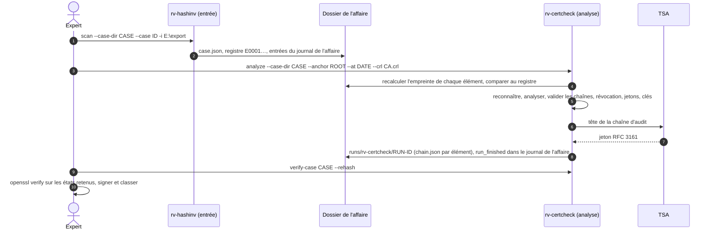
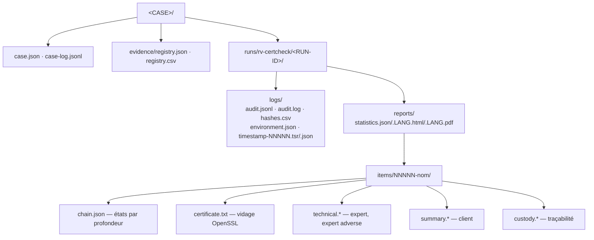

> La version de référence est la version anglaise ([usage.md](usage.md)) ; cette traduction la suit.

# Guide d'utilisation : analyser des éléments de type certificat, et créer des certificats

Voici le guide complet de l'expert. Il suit une affaire, explique chaque sortie, indique comment lire chaque
constatation et comment montrer ensuite que rien n'a changé ; puis il couvre la partie création. Les listes d'options
ne sont pas reprises ici :

- les tâches courantes en bref : [quick-guide.fr.md](quick-guide.fr.md) ;
- chaque commande, option, valeur par défaut, exemple et code de sortie : [usage-cli.md](usage-cli.md) (généré à partir de `--help`, en anglais) ;
- l'application de bureau : [usage-gui.fr.md](usage-gui.fr.md) ;
- la PKI propre de Rakvor étape par étape : [company-pki.md](company-pki.md) (en anglais) ;
- le contrat du dossier de l'affaire : [case-folder.md](case-folder.md) (en anglais) ;
- pourquoi chaque contrôle fonctionne : [theory.md](theory.md) ; portée juridique : [admissibility.md](admissibility.md) (en anglais) ;
- installer et vérifier l'outil : [installation.fr.md](installation.fr.md).



## 1. Avant de commencer

| Contrôle | Pourquoi | Comment |
| --- | --- | --- |
| Travaillez sur une **copie vérifiée** (image forensique, export avec bloqueur d'écriture), jamais sur le support d'origine | L'outil est en lecture seule au niveau logiciel, ce n'est pas un bloqueur d'écriture | Outil d'imagerie + bloqueur d'écriture ; notez le modèle et le numéro de série |
| L'outil installé est la version authentique | Question du tribunal : « comment savez-vous ce que vous avez exécuté ? » | [installation.fr.md](installation.fr.md) étapes 2–4 et 6 |
| **Ancres** | Rien n'est approuvé si vous ne le dites pas | Obtenez chaque racine depuis le dépôt officiel de son AC (ou une liste de confiance de l'UE / le CSV colombien organisé) ; consignez d'où elle vient |
| **L'instant** | Une chaîne est évaluée à un instant | La date de signature, d'après un jeton d'horodatage ou un autre registre fiable ; `--at signing-time` ne donne une heure de signature qu'aux jetons d'horodatage en v0.1 (les autres éléments sont évalués maintenant, et les rapports le disent) |
| **Données de révocation** | Hors ligne, seules comptent les CRL / OCSP fournies | La CRL de l'AC couvrant l'instant (`--crl`), une réponse OCSP (`--ocsp`), ou `--online` sur une machine connectée (chaque URL auditée) |
| **Usage** | Un certificat est vérifié pour un usage | `--purpose document-signing` pour des documents signés, `code-signing` pour des logiciels, `tls-server` pour des sites web, `timestamping` pour une TSA |
| Politique d'empreinte | MD5/SHA-1 seuls ne résistent pas aux collisions | Incluez toujours `sha256` : `--hash sha256,md5` quand un registre antérieur utilise MD5 |
| Mot de passe PKCS#12 | Les magasins de clés parmi les éléments peuvent être protégés | `RV_P12_PASSWORD` (ou `--p12-pass-env VAR`) ; jamais journalisé |
| Horloge | Les heures d'audit viennent de l'horloge du poste | Vérifiez la synchronisation horaire de Windows avant l'exécution |
| Horodatage du journal | TSA en ligne par défaut | `--no-timestamp` hors ligne, puis `rv-certcheck timestamp` plus tard |
| Certificat de l'expert | Signe chaque rapport PDF | `--sign-cert examiner.p12` ([signature](#7-signer-les-rapports-avec-le-certificat-de-lexpert)) |

## 2. Parcours d'une affaire

L'affaire d'exemple : `CASE-2026-014`, un contrat signé dont le certificat du signataire, l'intermédiaire, la CRL de
l'AC et un jeton RFC 3161 ont été exportés par le client vers `E:\export` et enregistrés à l'entrée par rv-hashinv.
Les sorties ci-dessous utilisent l'exemple de laboratoire (`examples/sample`), évalué au 2026-06-01 par rapport à la
racine de laboratoire.

<!-- forge:domain -->
### 2.1 Analyse : revérifier et analyser chaque élément enregistré

```powershell
rv-certcheck analyze --case-dir D:\cases\CASE-2026-014 `
  --anchor D:\roots\lab-root.crt --at 2026-06-01T00:00:00Z --purpose any `
  --hash sha256,md5 --lang es --actor "Ana Ruiz"
```

```text
DONE (high-severity findings)  run 20261104T154553Z-60bc38
  items: 13  bytes: 18185  errors: 0  elapsed: 0.1 s
  findings: high 4, medium 4, low 0, info 9
```

Avec `--case-dir`, une dernière ligne `case: CASE-2026-014 (analysis) registered 0 (new 0), verified …, mismatched …,
not in registry …` donne la comparaison avec le registre.

Code de sortie 3 : quatre constatations élevées (un certificat expiré, un révoqué et un de mauvaise racine, et une clé
qui n'est pas celle de son certificat). Pour chaque élément, l'outil :

1. a recalculé l'empreinte du fichier et l'a comparée au registre (`evidence_verified_against_case` ; une différence
   donne `EVIDENCE_HASH_MISMATCH_WITH_CASE`, élevée, et l'analyse a quand même lieu) ;
2. l'a lu une seconde fois pour l'analyser, et a vérifié que cette lecture a la même empreinte ;
3. l'a reconnu par son contenu (les extensions `.crl`, `.tsr`, `.key` n'y jouent aucun rôle) et en a extrait chaque
   champ ;
4. après tous les éléments : a construit et vérifié la chaîne de chaque certificat d'entité finale avec **chaque
   certificat de l'exécution** comme intermédiaire possible et **chaque CRL et réponse OCSP de l'exécution** comme
   source de révocation, a vérifié le jeton d'horodatage et a rapproché la clé des certificats.

Sans `--anchor`, chaque chaîne est déclarée `CERT_CHAIN_UNTRUSTED` : c'est la réponse attendue quand rien n'est
approuvé.

### 2.2 Réexaminer avec une autre ancre, date ou usage

Les ancres, l'instant et l'usage sont les choix de l'expert, consignés dans chaque rapport. Relancez quand la question
change, par exemple les mêmes éléments à la date de signature, pour la signature de documents, par rapport à un
instantané de liste de confiance de l'UE :

```powershell
rv-certcheck trust-list import --list eu D:\tl\ES-TL-2026-06.xml
rv-certcheck trust-list list
rv-certcheck analyze --case-dir D:\cases\CASE-2026-014 --evidence E0003,E0004 `
  --anchor tl:eu@latest --at 2025-03-14T09:30:00-05:00 --purpose document-signing --crl D:\rev\ca-2025-03.crl
```

Chaque exécution est un nouveau dossier d'exécution ; les exécutions antérieures ne sont jamais modifiées.
<!-- /forge:domain -->

### 2.3 Vérifier toute l'affaire

```powershell
rv-certcheck verify-case D:\cases\CASE-2026-014 --rehash
```

Chaque outil Rakvor a `verify-case` et ils concordent. Il vérifie la chaîne du journal de l'affaire, `case.json`,
l'empreinte du registre, la chaîne d'audit et les jetons d'horodatage de chaque exécution, chaque fichier de sortie que
consigne le journal d'audit de chaque exécution (recalcul de l'empreinte ; les versions publiées avant ce contrôle ne
le font pas), et les liens croisés entre le journal de l'affaire et chaque exécution
([case-folder.md](case-folder.md#how-a-reviewer-verifies-a-case), en anglais). Code 0 = intact (avertissements
affichés), 3 = rompu, 1 = pas un dossier d'affaire. `--rehash` relit aussi chaque élément enregistré encore accessible
à son chemin enregistré.

### 2.4 La même chose depuis l'application de bureau

Voir [usage-gui.fr.md](usage-gui.fr.md). Le moteur, les sorties et les constatations sont les mêmes que ceux de la
CLI ; chaque réglage modifié avant une exécution est écrit dans son journal d'audit (actions `ui_*`).

### Démarrage depuis RV Hub : `--case-dir` et `describe --json`

RV Hub (le lanceur de Rakvor) trouve les outils installés, les ouvre sur un dossier de l'affaire et suggère celui qui
convient à un fichier. Il s'appuie sur deux points d'entrée de RV CertCheck :

- **`rv-certcheck-gui.exe --case-dir <CASE> [FILES...]`** démarre l'application de bureau avec **Dossier de
  l'affaire** déjà renseigné (`--case-dir=<CASE>` fonctionne aussi). Les autres arguments sont chargés comme
  éléments, comme lorsque des fichiers sont déposés sur l'icône. Ce préréglage est écrit dans le journal d'audit de
  l'exécution comme `ui_case_dir_from_launcher` (chemin et `at_utc`) suivi de `ui_case_dir_changed`. Un `--case-dir`
  sans dossier est ignoré : la fenêtre l'indique et le journal d'audit consigne `ui_launch_argument_ignored`.
- **`rv-certcheck describe --json`** affiche un objet JSON (clés triées) que lit RV Hub ; il est masqué dans
  `rv-certcheck --help` mais figure dans [usage-cli.md](usage-cli.md). Il ne lit et n'écrit rien. Schéma :
  [`schemas/describe.schema.json`](../schemas/describe.schema.json) (`rakvor.describe/1`, identique dans tous les
  outils Rakvor).

| Champ | Signification |
| --- | --- |
| `schema` | `rakvor.describe/1` |
| `tool`, `title`, `version` | `rv-certcheck`, `RV CertCheck`, la version du produit (`version.txt`) |
| `role` | `analysis` (examine des éléments enregistrés dans le dossier de l'affaire par rv-hashinv) |
| `main_verb` | `analyze` : la commande qui fait le travail principal |
| `accepts` | `extensions` crt, cer, der, pem, p7b, p7c, p12, pfx, crl, tsr, tst, key, csr ; `signatures` `30 82` (une SEQUENCE DER, décalage 0) et `-----BEGIN` (PEM). Les entrées restent reconnues par leur contenu, quel que soit leur nom |
| `case_formats`, `log_formats` | `rakvor.case/1` ; `rakvor.audit/1` = `logs/audit.jsonl` |
| `cli_exe`, `gui_exe` | `rv-certcheck.exe`, `rv-certcheck-gui.exe` |
| `exit_codes` | La signification de 0, 1, 2, 3 et 130 |

```powershell
rv-certcheck describe --json
```

## 3. Lire les sorties



Sans `--case-dir`, `logs\<RUN-ID>\` et `reports\<RUN-ID>\` sont créés sous `--out` (par défaut `.\rakvor-out`).

| Sortie | Pour | À quoi elle sert |
| --- | --- | --- |
| `chain.json` | Expert, expert adverse | Par état : statut, l'instant utilisé et la façon dont il a été choisi (`at`, `at_source`), ancres, la première réponse d'OpenSSL et **chaque** erreur avec sa profondeur, chaque nœud (certificat, code OpenSSL, ancre, révocation avec source et dates, statut dans la liste de confiance), notes sur la façon dont l'état a été obtenu, téléchargements en ligne ([reports.md](reports.md#chainjson-schema-rakvorcert-chain1), en anglais) |
| `certificate.txt` | Expert adverse | Vidage au format `openssl x509 -text` de chaque certificat, avec son SHA-256 |
| `statistics.*` | Expert, avocat | Vue d'ensemble de l'exécution : qui, quand, totaux, constatations par gravité et par code, éléments par type, section du dossier de l'affaire, état de l'horodatage, signataire, tête d'audit |
| `technical.*` | Expert, expert adverse | Un élément : chemin, taille, type, empreintes, le résumé de l'étape certificats, constatations avec *ce qu'elle montre / ce qu'elle ne prouve pas*, entrées d'audit, limites |
| `summary.*` | Client | État et constatations en langage courant, étape suivante |
| `custody.*` | Traçabilité | Fiche de la juridiction + copie anglaise ; un registre interne utilisé **avec** le formulaire officiel (G9) |
| `audit.jsonl` | Vérification | Chaque action, chaînée par empreintes, y compris `validation_options` (ancres et fichiers de révocation avec SHA-256) |
| `hashes.csv`, `environment.json`, `timestamp-*` | Vérification | Registre des empreintes ; versions (dont OpenSSL) ; jeton RFC 3161 du journal |

**État par élément :** `problem` (une constatation élevée), `attention` (moyenne ou faible), `ok` (informatif
seulement). **Le code de sortie 3** signifie « terminé, au moins une constatation de gravité élevée », un résultat
normal pour des éléments de preuve.

**Lire un état dans `chain.json`, dans cet ordre :** `at` et `at_source` (est-ce l'instant voulu ?), `anchors`
(avez-vous approuvé ce que vous vouliez ?), `status`, puis `errors` (chaque erreur OpenSSL avec sa profondeur), puis la
`revocation` et la `revocation_note` de chaque nœud, puis `notes` (indicateurs de CRL utilisés, où le parcours s'est
arrêté, comment `signing-time` a été résolu, les contrôles de politique propres à l'outil).

## 4. Interpréter chaque constatation

« À vérifier ensuite » est ce qu'un expert doit faire avant de s'appuyer sur la constatation ; « ne concluez pas » est
l'excès à éviter dans un rapport. Gravités et libellés complets : [reports.md](reports.md#findings-catalogue) (en
anglais).

<!-- forge:domain -->
| Code | À vérifier ensuite | Ne concluez pas |
| --- | --- | --- |
| `CERT_CHAIN_VALID` | L'ancre nommée ; `at` ; les constatations de révocation qui l'accompagnent (`REVOCATION_UNKNOWN` signifie que la révocation n'a **pas** été établie) ; constatations de cryptographie faible ou de listes de confiance ; relancez avec `openssl verify` | Que le certificat n'était pas révoqué, que le titulaire a signé le document, ou que l'ancre mérite la confiance |
| `CERT_CHAIN_UNTRUSTED` | La profondeur et le code OpenSSL : un intermédiaire manquant (ajoutez-le à l'exécution) ou la mauvaise ancre. Avec une ancre `tl:`, `service` / `service_status` nomment un service listé qui n'était pas accordé (retiré, suspendu…) à `--at` | Que le certificat est faux |
| `CERT_CHAIN_INVALID` | Le code et la raison d'OpenSSL à la profondeur indiquée (par ex. 25 longueur de chemin, 32 / 79 AC sans keyCertSign, 34 extension critique) ; le `certificate.txt` de cette profondeur | Que le certificat a été contrefait |
| `CERT_SIGNATURE_INVALID` | Réexportez le certificat ; vérifiez-le par rapport à l'émetteur choisi par la chaîne | Qui l'a modifié |
| `CERT_EXPIRED_AT_DATE` / `CERT_NOT_YET_VALID_AT_DATE` | Si `--at` est l'heure de signature ; fuseaux horaires ; relancez au bon instant | Qu'une signature faite plus tôt est invalide ; une antidatation |
| `CERT_REVOKED` | La date de révocation par rapport à la date de signature ; la raison ; la source (CRL ou OCSP, SHA-256) | Une faute du titulaire ; l'invalidité de signatures antérieures |
| `REVOCATION_UNKNOWN` | Les raisons listées ; obtenez la CRL de l'AC pour la date, une réponse OCSP, ou utilisez `--online` | Révoqué, ou non révoqué |
| `CERT_PURPOSE_MISMATCH` | L'usage de clé et l'EKU affichés ; si `--purpose` correspond à l'usage dans l'affaire | Un détournement délibéré |
| `CERT_NAME_CONSTRAINT_VIOLATION` | Le nom et l'AC nommée | Une malveillance |
| `CERT_WEAK_KEY` / `CERT_WEAK_SIGNATURE_ALGORITHM` | La date d'émission (fréquent pour les certificats anciens) | Qu'une clé a été cassée ou un certificat contrefait |
| `CERT_SELF_SIGNED` | S'il s'agit d'une racine que vous approuvez, ou d'un certificat isolé | Un manque de fiabilité |
| `CERT_IN_TRUST_LIST` | Le **type de service et le statut à la date** ; la date de l'instantané ; vérifiez la signature de la TL à part (v0.1) | Un statut qualifié ou une validité juridique |
| `CERT_NOT_IN_TRUST_LIST` | Si la bonne liste et un instantané récent ont été utilisés | L'invalidité |
| `CERT_ISSUED_BY_RAKVOR_INTERNAL` | Rien : il signale un certificat interne | Une quelconque présomption juridique |
| `KEY_MATCHES_CERTIFICATE` / `KEY_DOES_NOT_MATCH` / `KEY_NOT_PAIRED` | Comment la clé a été trouvée ; avec quel certificat elle a été fournie | Qui a utilisé la clé ; une manipulation |
| `TIMESTAMP_TOKEN_VALID` / `_INVALID` | `imprint_checked` et `imprint_file` : le jeton est vérifié par rapport à l'élément ayant la même racine de nom dans l'exécution (`data.tsr` ↔ `data`, `data.*`) ; avec `imprint_checked=no` il n'est lié à aucun fichier, comparez donc à la main (`openssl ts -verify -data`) ; les raisons listées | Avec `imprint_checked=no`, quel fichier il couvre ; que l'heure indiquée est fausse |
| `PKCS12_UNREADABLE` | Fournissez le mot de passe (`RV_P12_PASSWORD`) et relancez | Un endommagement |
| `CRYPTO_INPUT_UNPARSABLE` / `ANALYSIS_STEP_FAILED` | L'erreur ; réexportez l'objet ; corrigez le fichier d'ancre | Une manipulation |
| `EVIDENCE_CHANGED_DURING_READ` | Un autre programme qui écrit dans l'élément ; le stockage ; relancez sur une copie stable | Qui l'a modifié |
<!-- /forge:domain -->

| Code (dossier de l'affaire, outils d'analyse) | À vérifier ensuite | Ne concluez pas |
| --- | --- | --- |
| `EVIDENCE_HASH_MISMATCH_WITH_CASE` (élevée) | Empreinte attendue et empreinte réelle dans la constatation ; recalculez à la main l'empreinte du fichier et de la copie d'entrée ; vérifiez le stockage, les transferts et qui y a eu accès depuis l'entrée (journal de l'affaire) | Qui l'a modifié, quand, ni que c'était délibéré |
| `EVIDENCE_NOT_IN_CASE_REGISTRY` (moyenne) | Si le fichier aurait dû passer par l'entrée ; enregistrez-le (exécution d'entrée) s'il s'agit d'un nouvel élément | Que le fichier est altéré ou sans intérêt |

## 5. Travailler sans dossier de l'affaire, et les commandes de création

La même commande fonctionne de façon autonome (sans registre ni journal de l'affaire) :

```powershell
rv-certcheck analyze -i D:\evidence -r --anchor D:\roots\ca.pem --at 2025-03-14 --out D:\work\certs
rv-certcheck analyze --input-list files.txt --anchor rakvor --progress jsonl > events.jsonl
```

`--progress jsonl` affiche chaque événement pour les scripts. **Ctrl+C** s'arrête après le bloc en cours : des
rapports partiels sont écrits, `run_cancelled` est journalisé, code de sortie 130.

**Les commandes de création** écrivent chacune une exécution auditée autonome sous `--out` (par défaut `rakvor-out`)
et un `report.json` / `report.txt` ; les secrets viennent de variables d'environnement (`--pass-env`, `--pin-env`,
`--ca-pass-env`, `--p12-pass-env`) ou d'une invite sans écho :

| Tâche | Commande | Guide |
| --- | --- | --- |
| Racine Rakvor, intermédiaire, signature de code, `.p12` de l'expert, TLS, TSA de test | `pki init-root`, `pki issue --profile …` (le type de clé par défaut dépend du profil ; une clé examiner doit être RSA), `pki import [--issuer-cert]` | [company-pki.md](company-pki.md) |
| URL de CRL écrite dans les futurs certificats (n'éditez jamais `ca.json` à la main) | `pki set --crl-url URL` | [company-pki.md](company-pki.md) |
| Révoquer, CRL, réponse OCSP de laboratoire | `pki revoke`, `pki crl`, `pki ocsp-sign` | [company-pki.md §8](company-pki.md#8-renewal-and-revocation) |
| État et intégrité d'un dossier d'AC | `pki show`, `pki verify` | [forensic-audit.md](forensic-audit.md#creation-runs-and-the-ca-folders-issuedjsonl) |
| CSR pour une AC publique ou qualifiée | `csr new`, `csr show` | [company-pki.md §7](company-pki.md#7-csrs-for-a-public-or-qualified-ca) |
| Matériel de formation et de test | `lab make --set full --seed N --lab-out DIR` | [theory.md B16](theory.md#b16-lab-sets-and-determinism) |
| Cette clé appartient-elle à ce certificat ? | `keys match KEY CERT` | [theory.md B12](theory.md#b12-private-key-matching) |
| Jetons sur cette machine | `tokens list --pkcs11-module LIB` | [installation.fr.md 5d](installation.fr.md#5d-modules-pkcs11-jetons-matériels) |
| Instantanés de listes de confiance | `trust-list import --list eu|co FILE`, `list`, `show` | [theory.md B14](theory.md#b14-trust-list-formats-and-snapshots) |

Vérifier un jeu de laboratoire avec l'outil (ce que fait l'oracle de laboratoire de la CI), pour la formation :

```powershell
rv-certcheck lab make --set full --seed 1 --lab-out D:\lab\full-1
# chaque cas de D:\lab\full-1\expected_findings.json liste ses fichiers, ancres, at, usage, CRL/OCSP,
# les codes qu'analyze doit et ne doit pas signaler, et le code d'openssl verify
rv-certcheck analyze -i D:\lab\full-1\revoked-by-crl\leaf.crt -i D:\lab\full-1\ca\intermediate.crt `
  --anchor D:\lab\full-1\ca\root.crt --crl D:\lab\full-1\ca\intermediate.crl --at 2026-01-01T00:00:00Z
# attendu : CERT_REVOKED (plus CERT_ISSUED_BY_RAKVOR_INTERNAL : les certificats de laboratoire portent la politique de laboratoire Rakvor)
```

`trust-list import`, `list` et `show` écrivent chacun une exécution auditée sous `--out`, comme les commandes de
création ; l'instantané lui-même consigne sa source, son heure d'import et son SHA-256, et les ancres qui en sont tirées
sont journalisées par chaque exécution d'`analyze` qui les utilise. Un instantané altéré est refusé (code 3).

## 6. Horodatages

Par défaut, chaque exécution demande à la TSA (`http://timestamp.digicert.com`, modifiable avec `--tsa-url`) de signer
la tête de la chaîne d'audit juste avant l'écriture du rapport de statistiques. Le jeton couvre chaque empreinte
d'élément, constatation et empreinte de rapport par élément consignée avant lui, pas le rapport de statistiques ni le
`run_finished` écrits après ([forensic-audit.md](forensic-audit.md#trusted-timestamp-rfc-3161), en anglais).

| Situation | Ce qui se passe | Que faire |
| --- | --- | --- |
| TSA joignable | `timestamp_obtained` ; fichiers `timestamp-NNNNN.tsr` et `.json` dans le dossier des journaux ; le rapport de statistiques affiche l'heure | Vérifiez avec OpenSSL (ci-dessous) |
| Hors ligne | `timestamp_pending` ; l'exécution se termine ; avertissement sur le rapport de statistiques et la console | Plus tard, en ligne : `rv-certcheck timestamp <log folder>` |
| `--no-timestamp` / `RV_NO_TIMESTAMP=1` / GUI décochée | Aucune demande | Utilisez `rv-certcheck timestamp` plus tard si nécessaire |
| Chaîne rompue | `rv-certcheck timestamp` refuse (code 3) : aucun horodatage n'est ajouté à un journal rompu | Enquêtez ; ne réparez pas |

`verify-log` vérifie l'empreinte du jeton, qu'il couvre la tête consignée et la signature CMS de la TSA
(`TSA signature valid (signer: …)`). La chaîne du certificat de la TSA n'est validée qu'avec `--tsa-ca` :

```bash
rv-certcheck verify-log <log folder> --tsa-ca <TSA roots.pem>
# → … TSA signature valid (signer: …); chain validated to … (revocation not checked)
# sans --tsa-ca : … chain not checked (pass --tsa-ca <CA bundle> to validate it)
```

Un paquet illisible donne le code 1 ; un échec de signature ou de chaîne donne le code 3 ; un jeton consigné par le
journal dont le `.tsr` ou le `.json` manque donne aussi le code 3. La révocation n'est jamais vérifiée (écart G18).
Comme contrôle indépendant de la **signature et de la chaîne**, utilisez OpenSSL (Git for Windows fournit
`openssl.exe`) ; il ne vérifie pas non plus la révocation (aucune CRL n'est fournie et OpenSSL n'interroge pas OCSP) :

```bash
cd <log folder>
N=00022                                                   # d'après le nom de fichier timestamp-00022.tsr
H=$(python -c "import json;print(json.load(open('timestamp-$N.json'))['head'])")
openssl ts -reply -in timestamp-$N.tsr -text              # genTime, OID de politique, nom de la TSA, numéro de série, nonce, précision
openssl ts -reply -in timestamp-$N.tsr -token_out -out token.der
openssl pkcs7 -inform DER -in token.der -print_certs > tsa-certs.pem   # certificats envoyés par la TSA
openssl ts -verify -digest "$H" -in timestamp-$N.tsr -CAfile <TSA root.pem> -untrusted tsa-certs.pem
# → "Verification: OK"  (signature et chaîne seulement, pas la révocation)
```

Obtenez le certificat racine de la TSA depuis le dépôt de la TSA elle-même, pas depuis le jeton. Consignez la sortie
dans le dossier : c'est la preuve que la TSA a signé cette tête à cette heure. La même chaîne de TSA peut être vérifiée
avec cet outil : `rv-certcheck analyze -i timestamp-$N.tsr --anchor <TSA root.pem>` signale `TIMESTAMP_TOKEN_VALID` et
la chaîne de la TSA à genTime. La révocation doit être établie à part, à partir d'éléments CRL/OCSP couvrant genTime
(une CRL émise après genTime par l'AC de la TSA, ou une réponse OCSP archivée au moment de l'horodatage) : ajoutez
`--crl <file>` / `--ocsp <file>` à cette exécution d'`analyze`, ou utilisez
`openssl verify -crl_check -CRLfile <crl> -attime <genTime-epoch> …`.

> **Dates de la CRL et `-attime`.** OpenSSL applique aussi `-attime` à la CRL, donc `openssl verify -crl_check -attime <genTime-epoch>` ne fonctionne qu'avec une CRL dont l'intervalle `thisUpdate`–`nextUpdate` contient genTime ; une CRL émise après genTime échoue avec « CRL is not yet valid ». Pour utiliser une CRL ultérieure comme élément de preuve, vérifiez sa signature (`openssl crl -in tsa-ca.crl -CAfile <TSA root.pem> -noout -verify`), puis cherchez-y le numéro de série du certificat de la TSA (`openssl crl -in tsa-ca.crl -noout -text`) : absent, ou listé avec une date de révocation postérieure à genTime, il n'était pas révoqué à genTime. Une AC peut retirer de ses CRL les certificats expirés ; pour un certificat de TSA expiré depuis, un numéro absent n'est donc pas concluant : utilisez une CRL antérieure à son expiration, ou une réponse OCSP archivée au moment de l'horodatage.

## 7. Signer les rapports avec le certificat de l'expert

`--sign-cert <file.p12|.pfx>` signe **chaque rapport PDF** (statistiques, technique, synthèse, traçabilité) avec votre
propre certificat (clés RSA uniquement). Le mot de passe est lu dans la variable d'environnement désignée par
`--sign-pass-env` (par défaut `RV_SIGN_PASSWORD`) ou demandé dans le terminal (rien ne s'affiche pendant la saisie). Il
n'est jamais journalisé ; le journal consigne `signing_certificate_loaded` avec le sujet et le SHA-256 du certificat, et
chaque rapport affiche les deux (`Signed by <subject> (certificate SHA-256 <fingerprint>)`). Un mauvais mot de passe arrête l'exécution (`run_failed`, code 1) avant la lecture du moindre élément. Dans la
GUI : *4. Confiance → Certificat de signature* et *Mot de passe du certificat* (en mémoire seulement).

```powershell
$s = Read-Host "Certificate password" -AsSecureString
$env:RV_SIGN_PASSWORD = [Runtime.InteropServices.Marshal]::PtrToStringBSTR(
    [Runtime.InteropServices.Marshal]::SecureStringToBSTR($s))
rv-certcheck analyze --case-dir D:\cases\CASE-2026-014 -i E:\export -r --sign-cert C:\certs\ana-ruiz.p12
Remove-Item Env:RV_SIGN_PASSWORD
(Get-PfxCertificate C:\certs\ana-ruiz.p12).GetCertHashString("SHA256")   # publiez cette empreinte
```

Vérifiez un rapport signé avec Adobe Acrobat/Reader (panneau Signatures) ou pyHanko :
`pyhanko sign validate --pretty-print --trust <your CA or certificate .pem> technical.en.pdf` (attendu : intact,
couverture du fichier entier). Les rapports HTML et JSON ne sont pas signés ; leurs empreintes sont dans la chaîne
d'audit horodatée. La portée juridique de cette signature dépend du certificat ([admissibility.md](admissibility.md)
G3).

## 8. Vérifier une exécution

N'importe qui (vous, un collègue, un expert adverse) peut vérifier une exécution avec son dossier des journaux, son
dossier des rapports et la copie des éléments de preuve :

```powershell
rv-certcheck verify-log D:\cases\CASE-2026-014\runs\rv-certcheck\20261021T154339Z-6e298b\logs
# OK  25 entries, chain intact: …\audit.jsonl
#     timestamp 2026-10-21T15:43:40Z by http://127.0.0.1:33481/tsr covers entry #22
#     truncation: the final entry #25 is anchored by the case log (run_finished)
#     outputs: 38 verified of 39 recorded (md5, sha256), 1 skipped
#     not re-hashed: logs/timestamp-00022.tsr (RFC 3161 token: checked by the timestamp verification)
```

La dernière ligne dit ce qui garantit la longueur du journal. Une exécution autonome horodatée affiche
`truncation: entries up to #22 are anchored by the RFC 3161 timestamp (timestamp-00022.json); 3 entries after it
(timestamp_obtained, statistics_report_written, run_finished) cannot be proven complete` ; une exécution autonome sans
horodatage affiche `truncation not detectable without a timestamp or case record`. Un journal plus court que son
horodatage ou que le registre de l'affaire est `BROKEN` (`truncated: …`, code 3).

La ligne `outputs:` est le recalcul de l'empreinte de chaque fichier que, selon le journal, l'exécution a écrit (les
rapports et les fichiers `output_written` de chaque élément, les rapports de statistiques, `hashes.csv`,
`environment.json` ; pour une exécution de création, `report.json` et `report.txt`), avec chaque algorithme consigné par
le journal ; l'entrée la plus récente pour un fichier l'emporte. Un fichier modifié, supprimé ou remplacé après
l'exécution rend l'exécution `BROKEN` (code 3) et est nommé :

```text
BROKEN  …udit.jsonl
  - output reports/statistics.json: sha256 differs from audit entry #37 (recorded e8ed…, now 73cb…): edited or replaced after the run
  - output reports/items/00002-leaf.pem/technical.en.pdf: missing (recorded by audit entry #31): deleted or moved after the run
    outputs: 36 verified of 38 recorded (sha256), 1 missing, 1 changed
```

Un chemin consigné qui est absolu, contient `..` ou mène hors du dossier de l'exécution par un lien symbolique ou une
jonction est rejeté et jamais lu. Le jeton d'horodatage est listé comme `not re-hashed` parce que le contrôle
d'horodatage ci-dessus le vérifie déjà ; il en va de même des fichiers qu'une exécution de création a écrits à des
chemins choisis par l'opérateur (`file_written` : clés, certificats, CSR, fichiers d'AC ; `pki verify` vérifie un
dossier d'AC). Les fichiers que l'exécution n'a pas consignés ne sont pas vérifiés.

| Étape | Commande | Montre |
| --- | --- | --- |
| 1 | `rv-certcheck verify-log <log>` (code 0 intact, 3 rompu, tronqué ou sortie modifiée) | Aucune entrée modifiée, supprimée ni réordonnée ; le jeton d'horodatage correspond à la tête qu'il couvre ; le journal atteint toujours l'entrée couverte par son horodatage et, dans un dossier de l'affaire, l'entrée finale consignée dans le journal de l'affaire (la ligne `truncation:` nomme l'ancre) |
| 2 | `python tests/verify_chain.py <log>` (arbre des sources) | La même chose, avec une implémentation indépendante ; recalcule aussi l'empreinte des éléments listés dans `hashes.csv` et de chaque sortie consignée par le journal d'audit |
| 3 | OpenSSL ([Horodatages](#6-horodatages)) | La TSA a signé cette tête à cette heure |
| 4 | Étape 1 (ligne `outputs:`) ; script ci-dessous pour un contrôle indépendant | Chaque fichier de rapport, `environment.json` et `hashes.csv` a toujours l'empreinte consignée dans le journal |
| 5 | `rv-certcheck verify-case <CASE> --rehash` | L'exécution est celle que le journal de l'affaire a annoncée, complète jusqu'à son entrée finale consignée, avec chaque sortie consignée inchangée ; les éléments accessibles correspondent toujours au registre |
| 6 | `python tests/validate_reports.py <CASE or report folder>` | Chaque rapport JSON, `case.json` et `registry.json` sont conformes à leurs schémas |

L'étape 4 est intégrée à `verify-log` et `verify-case`. Pour la vérifier avec un code qui tient sur un écran (une
implémentation indépendante, par ex. pour un expert adverse), recalculez l'empreinte de chaque fichier consigné par
l'exécution (rapports par élément et de statistiques, registres ; les fichiers `output_written` sont laissés à
l'étape 1) :

```bash
python - "<log folder>" "<report folder>" <<'EOF'
import hashlib, json, pathlib, sys
log, rep = pathlib.Path(sys.argv[1]), pathlib.Path(sys.argv[2])
def digest(p, algo):
    h = hashlib.new({"sha3-256": "sha3_256"}.get(algo, algo)); h.update(p.read_bytes()); return h.hexdigest()
checked = bad = 0
for line in (log / "audit.jsonl").open(encoding="utf-8"):
    e = json.loads(line); a, d = e["action"], e["details"]
    if a == "item_reports_written":
        files = {rep / d["folder"] / k: v for k, v in d["files"].items()}
    elif a == "statistics_report_written":
        files = {rep / k: v for k, v in d["files"].items()}
    elif a in ("environment_recorded", "hash_register_written"):
        files = {log / e["item"]: d}
    else:
        continue
    for p, digests in files.items():
        algo = next(x for x in ("sha256", "sha512", "sha3-256", "sha1", "md5") if x in digests)
        checked += 1
        got = digest(p, algo) if p.is_file() else "missing"
        if got != digests[algo]:
            bad += 1; print("MISMATCH", p, algo, got)
print(f"{checked} files checked, {bad} mismatches"); sys.exit(3 if bad else 0)
EOF
```

Sur une exécution de l'exemple (13 éléments, une langue), chaque rapport par élément et `statistics.*` sont vérifiés ; ajouter un octet à `statistics.json` donne
`MISMATCH … statistics.json` et le code de sortie 3. Un seul fichier en PowerShell : `(Get-FileHash <file> -Algorithm
SHA256).Hash.ToLower()` puis cherchez la valeur dans `audit.jsonl`.

## 9. Dépannage

### Codes de sortie

| Commande | 0 | 1 | 2 | 3 | 130 |
| --- | --- | --- | --- | --- | --- |
| `analyze` | terminé, sans constatation élevée | erreur d'exécution (entrée introuvable, sortie non inscriptible, mauvais mot de passe du certificat, journal de l'affaire verrouillé) | erreur d'utilisation (option ou algorithme inconnu, trois algorithmes, langue inconnue ; avec `--case-dir` : dossier d'une autre affaire, `--case` absent à la création, identifiant d'élément inconnu) | terminé, ≥ 1 constatation élevée ; ou le dossier de l'affaire échoue à la vérification (rien n'est écrit) | annulé (Ctrl+C), rapports partiels écrits |
| `verify-log` | intact | journal illisible | — | chaîne rompue, jeton discordant, tronqué (plus court que son horodatage ou le registre de l'affaire), ou une sortie consignée modifiée, supprimée ou remplacée | — |
| `verify-case` | affaire intacte (avertissements affichés) | pas un dossier d'affaire (pas de `case.json`) | — | au moins un contrôle en échec (une sortie consignée d'une exécution a changé ; avec `--rehash` : un élément diffère du registre) | — |
| `timestamp` | obtenu et journalisé | TSA injoignable (rien n'a changé) | — | journal absent, rompu ou illisible (rien n'est ajouté) | — |
| `self-test` | tout passe | un échec : n'utilisez pas cette version | — | — | — |
| `pki`, `csr`, `lab`, `keys`, `tokens` | fait | erreur d'exécution (fichier illisible, mauvais mot de passe ou PIN, échec du jeton ou cryptographique) | erreur d'utilisation (valeur incorrecte, sujet vide, profil ou raison inconnus) | refusé par une règle de sécurité ou vérification en échec (racine sur jeton sans `--confirm-root`, `client-internal`, un fichier qui serait écrasé, une clé qui ne correspond pas, un dossier d'AC qui ne se vérifie pas, discordance de `keys match`) ; rien n'est émis | — |

### Messages

<!-- forge:domain -->
| Message | Correction |
| --- | --- |
| `invalid --at '…': use now, signing-time, YYYY-MM-DD or an RFC 3339 time` | par ex. `--at 2025-03-14` ou `--at 2025-03-14T09:30:00-05:00` |
| `unknown purpose '…'` | L'un de any, tls-server, tls-client, code-signing, document-signing, email, timestamping |
| `cannot read anchor …` / `anchor …: no certificate found (PEM, DER or PKCS#7 expected)` | Vérifiez le chemin et le format du fichier de `--anchor` |
| `system store not available on this platform in v0.1 (the Windows ROOT store is not read)` | Exportez la racine et utilisez `--anchor FILE` |
| `no eu trust-list snapshot in … (import one with trust-list import)` | Lancez d'abord `trust-list import --list eu FILE`, ou définissez `RV_CERTCHECK_DATA` |
| `trust-list snapshot … was altered: SHA-256 …, recorded …` | L'instantané enregistré a été modifié : réimportez-le depuis le fichier source |
| `--at signing-time: the item has no signing time, so the chain was judged now` (note de l'état ; l'exécution affiche aussi `AT_SIGNING_TIME_TOKENS_ONLY_V01`) | Donnez la date explicitement avec `--at` (v0.1) ; les jetons d'horodatage sont l'exception |
| `the examiner profile needs an RSA key (… given)` (code 3) | Utilisez `--key-type rsa-3072` (la valeur par défaut) ou `rsa-4096` : rv-hashinv ne signe les rapports qu'en RSA. `--allow-non-rsa-examiner` seulement pour un certificat qui ne signera pas de rapports |
| `ca.json (record …) was modified after it was recorded` / `crl/latest.crl is not the newest recorded CRL` (code 3) | Quelqu'un a modifié le dossier de l'AC hors de l'outil : restaurez le fichier consigné depuis la sauvegarde et enquêtez ; ne changez `crl_url` qu'avec `pki set` |
| `OpenSSL walk stopped after error … : later checks of the path could not be run` (note de l'état) | Corrigez ou expliquez la première erreur ; les autres contrôles de ce chemin n'ont pas été faits |
| `creating a root CA key on a token needs --confirm-root` | Suivez la cérémonie des clés, puis ajoutez `--confirm-root` |
| `the client-internal profile is disabled in v0.1` | Attendu : les certificats clients attendent la PC/DPC |
| `CA folder … does not verify, nothing will be issued: …` | Lancez `pki verify` ; enquêtez ; n'éditez pas `issued.jsonl` à la main |
| `… already exists: key files are never overwritten` | Choisissez un autre `--key-file` |
| `the CA key does not match certs/ca.crt: refusing to sign` | Mauvais fichier de clé ou mauvaise clé de jeton pour ce dossier d'AC |
| `at most 2 hash algorithms can run at the same time (got 3)` | Choisissez un ou deux algorithmes |
<!-- /forge:domain -->

| Message | Correction |
| --- | --- |
| `… is not a case folder yet: give --case ID (and --jurisdiction) to create it` | Première exécution dans un nouveau dossier d'affaire : ajoutez `--case` |
| `the case folder … belongs to case X, not Y` | Mauvais dossier ou mauvais `--case` ; omettez `--case` après la création |
| `evidence id(s) not in the case registry: E0042` | Vérifiez `evidence\registry.csv` ; les identifiants sont `E` + numéro (`e7` = `E0007`) |
| `--evidence needs an existing case folder with a registry` | Faites d'abord l'entrée |
| `refusing to extend a broken case (…)` / `the case folder … fails verification` | Lancez `verify-case` ; cherchez ce qui a changé ; **ne réparez pas** un journal d'affaire à la main : ouvrez un nouveau dossier d'affaire et documentez pourquoi |
| `the case log is locked by <tool> run <id> (since …)` | Un autre outil écrit ; attendez et relancez |
| `stale case lock … held by … for more than 10 minutes` | Assurez-vous qu'aucun outil Rakvor ne travaille sur l'affaire, puis supprimez `case-log.lock` à la main (jamais automatiquement) et notez-le dans le dossier |
| `cannot load signing certificate …: wrong password or unsupported file` | Vérifiez `RV_SIGN_PASSWORD` ; le fichier doit être un `.p12`/`.pfx` avec clé privée |
| `only RSA signing certificates are supported` | Utilisez un certificat RSA (ECDSA n'est pas pris en charge pour signer les rapports) |
| `warning: timestamp pending (…)` | Voir [Horodatages](#6-horodatages) |
| `refusing to append to a broken audit log` (`timestamp`) | Le journal a été modifié ; enquêtez avec `verify-log` ; ne réparez pas |
| `no audit log at …: nothing to timestamp` (`timestamp`) | Indiquez le dossier `logs\<RUN-ID>` de l'exécution (ou son `audit.jsonl`) |
| `truncated: …` (`verify-log`) | Des entrées ont été retirées de la fin du journal après l'horodatage ou l'inscription au registre de l'affaire ; enquêtez, ne réparez pas |
