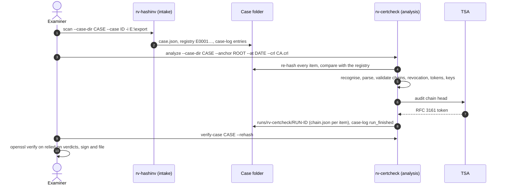
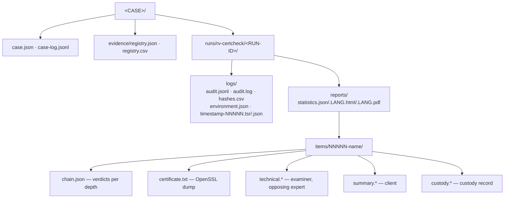

# Usage guide: analysing certificate evidence, and creating certificates

This is the end-to-end guide for an examiner. It walks through one case, explains every output, says how to read
each finding, and how to show afterwards that nothing changed; then it covers the creation side. Option lists are
not repeated here:

- every command, option, default, example and exit code: [usage-cli.md](usage-cli.md) (generated from `--help`);
- the desktop app: [usage-gui.md](usage-gui.md);
- Rakvor's own PKI step by step: [company-pki.md](company-pki.md);
- the case folder contract: [case-folder.md](case-folder.md);
- why each check works: [theory.md](theory.md); legal weight: [admissibility.md](admissibility.md);
- installing and verifying the tool: [installation.md](installation.md).



## 1. Before you start

| Check | Why | How |
| --- | --- | --- |
| Work on a **verified copy** (forensic image, write-blocked export), never the original media | The tool is read-only in software, not a write blocker | Imaging tool + write blocker; note model and serial |
| The installed tool is the genuine release | Court question: "how do you know what you ran?" | [installation.md](installation.md) steps 2–4 and 6 |
| **Anchors** | Nothing is trusted unless you say so | Obtain each root from its CA's official repository (or an EU trusted list / the curated Colombian CSV); record where it came from |
| **The instant** | A chain is judged at one instant | The signing date, from a timestamp token or another reliable record; `--at signing-time` gives a signing time only to timestamp tokens in v0.1 (other items are judged now, and the reports say so) |
| **Revocation data** | Offline, only supplied CRLs / OCSP count | The CA's CRL covering the instant (`--crl`), an OCSP response (`--ocsp`), or `--online` on a connected machine (every URL audited) |
| **Purpose** | A certificate is checked for one use | `--purpose document-signing` for signed documents, `code-signing` for software, `tls-server` for web sites, `timestamping` for a TSA |
| Hash policy | MD5/SHA-1 alone are not collision-resistant | Always include `sha256`: `--hash sha256,md5` when an older record uses MD5 |
| PKCS#12 password | Key stores in evidence may be protected | `RV_P12_PASSWORD` (or `--p12-pass-env VAR`); never logged |
| Clock | Audit times come from the workstation clock | Check Windows time sync before the run |
| Timestamp of the log | Online TSA by default | `--no-timestamp` offline, then `rv-certcheck timestamp` later |
| Examiner certificate | Signs every PDF report | `--sign-cert examiner.p12` ([signing](#7-signing-reports-with-the-examiner-certificate)) |

## 2. Case walkthrough

The example case: `CASE-2026-014`, a signed contract whose signer certificate, intermediate, CA CRL and an
RFC 3161 token were exported by the client to `E:\export` and registered at intake by rv-hashinv. The outputs
below use the lab sample (`examples/sample`), judged at 2026-06-01 against the lab root.

<!-- forge:domain -->
### 2.1 Analysis: re-verify and analyse every registered item

```powershell
rv-certcheck analyze --case-dir D:\cases\CASE-2026-014 `
  --anchor D:\roots\lab-root.crt --at 2026-06-01T00:00:00Z --purpose any `
  --hash sha256,md5 --lang es --actor "Ana Ruiz"
```

```text
DONE (high-severity findings)  run 20261104T154553Z-60bc38
  items: 13  bytes: 18185  errors: 0  elapsed: 0.1 s
  findings: high 4, medium 4, low 0, info 9
```

With `--case-dir` a last line `case: CASE-2026-014 (analysis) registered 0 (new 0), verified …, mismatched …, not
in registry …` gives the comparison with the registry.

Exit code 3: four high findings (an expired, a revoked and a wrong-root certificate, and a key that is not its
certificate's). For each item the tool:

1. re-hashed the file and compared it with the registry (`evidence_verified_against_case`; a difference gives
   `EVIDENCE_HASH_MISMATCH_WITH_CASE`, high, and the analysis still runs);
2. read it a second time to parse it, and checked that this read has the same digest;
3. recognised it by content (the `.crl`, `.tsr`, `.key` extensions play no part) and extracted every field;
4. after all items: built and checked every end-entity certificate's chain with **every certificate of the run**
   as possible intermediates and **every CRL and OCSP response of the run** as revocation sources, verified the
   timestamp token, and matched the key with the certificates.

Without `--anchor`, every chain is reported `CERT_CHAIN_UNTRUSTED`: that is the expected answer when nothing is
trusted.

### 2.2 Re-examine with another anchor, date or purpose

The anchors, instant and purpose are the examiner's choices, recorded in each report. Re-run when the question
changes, for example the same items at the signing date, for document signing, against an EU trust-list
snapshot:

```powershell
rv-certcheck trust-list import --list eu D:\tl\ES-TL-2026-06.xml
rv-certcheck trust-list list
rv-certcheck analyze --case-dir D:\cases\CASE-2026-014 --evidence E0003,E0004 `
  --anchor tl:eu@latest --at 2025-03-14T09:30:00-05:00 --purpose document-signing --crl D:\rev\ca-2025-03.crl
```

Each run is a new run folder; earlier runs are never changed.
<!-- /forge:domain -->

### 2.3 Verify the whole case

```powershell
rv-certcheck verify-case D:\cases\CASE-2026-014 --rehash
```

Every Rakvor tool has `verify-case` and they agree. It checks the case-log chain, `case.json`, the registry digest,
every run's audit chain and timestamp tokens, every output file each run's audit log records (re-hashed; releases
made before this check existed do not do it), and the cross-links between the case log and each run
([case-folder.md](case-folder.md#how-a-reviewer-verifies-a-case)). Exit 0 = intact (warnings printed), 3 = broken,
1 = not a case folder. `--rehash` also re-reads every registered item still reachable at its registered path.

### 2.4 The same from the desktop app

See [usage-gui.md](usage-gui.md). The engine, outputs and findings are the same as the CLI's; every setting
changed before a run is written to its audit log (`ui_*` actions).

### Starting from RV Hub: `--case-dir` and `describe --json`

RV Hub (the Rakvor launcher) finds the installed tools, opens them on a case folder and suggests which one fits a
file. It relies on two entry points of RV CertCheck:

- **`rv-certcheck-gui.exe --case-dir <CASE> [FILES...]`** starts the desktop app with **Case folder** already
  filled (`--case-dir=<CASE>` also works). Other arguments are pre-loaded as evidence, as when files are dropped on
  the icon. The preset is written to the run's audit log as `ui_case_dir_from_launcher` (path and `at_utc`)
  followed by `ui_case_dir_changed`. `--case-dir` without a folder is ignored: the window says so and the audit log
  records `ui_launch_argument_ignored`.
- **`rv-certcheck describe --json`** prints one JSON object (sorted keys) that RV Hub reads; it is hidden from
  `rv-certcheck --help` but listed in [usage-cli.md](usage-cli.md). It reads and writes nothing. Schema:
  [`schemas/describe.schema.json`](../schemas/describe.schema.json) (`rakvor.describe/1`, identical in every Rakvor
  tool).

| Field | Meaning |
| --- | --- |
| `schema` | `rakvor.describe/1` |
| `tool`, `title`, `version` | `rv-certcheck`, `RV CertCheck`, the product version (`version.txt`) |
| `role` | `analysis` (examines evidence registered in the case folder by rv-hashinv) |
| `main_verb` | `analyze`: the command that does the main work |
| `accepts` | `extensions` crt, cer, der, pem, p7b, p7c, p12, pfx, crl, tsr, tst, key, csr; `signatures` `30 82` (a DER SEQUENCE, offset 0) and `-----BEGIN` (PEM). Inputs are still recognised by content, whatever their name |
| `case_formats`, `log_formats` | `rakvor.case/1`; `rakvor.audit/1` = `logs/audit.jsonl` |
| `cli_exe`, `gui_exe` | `rv-certcheck.exe`, `rv-certcheck-gui.exe` |
| `exit_codes` | The meaning of 0, 1, 2, 3 and 130 |

```powershell
rv-certcheck describe --json
```

## 3. Reading the outputs



Without `--case-dir`, `logs\<RUN-ID>\` and `reports\<RUN-ID>\` are created under `--out` (default `.\rakvor-out`).

| Output | For | What to use it for |
| --- | --- | --- |
| `chain.json` | Examiner, opposing expert | Per verdict: status, the instant used and how it was chosen (`at`, `at_source`), anchors, OpenSSL's first answer and **every** error with its depth, each node (certificate, OpenSSL code, anchor, revocation with source and dates, trust-list status), notes on how the verdict was reached, online fetches ([reports.md](reports.md#chainjson-schema-rakvorcert-chain1)) |
| `certificate.txt` | Opposing expert | `openssl x509 -text`-style dump of every certificate, with its SHA-256 |
| `statistics.*` | Examiner, lawyer | Run overview: who, when, totals, findings by severity and code, items by type, case-folder section, timestamp status, signer, audit head |
| `technical.*` | Examiner, opposing expert | One item: path, size, type, digests, the certificate stage summary, findings with *what it shows / what it does not prove*, audit entries, limitations |
| `summary.*` | Client | Plain-language status and findings, next step |
| `custody.*` | Custody record | Jurisdiction form + English copy; an internal record used **alongside** the official form (G9) |
| `audit.jsonl` | Verification | Every action, hash-chained, including `validation_options` (anchors and revocation files with SHA-256) |
| `hashes.csv`, `environment.json`, `timestamp-*` | Verification | Hash register; versions (incl. OpenSSL); RFC 3161 token of the log |

**Status per item:** `problem` (a high finding), `attention` (medium or low), `ok` (informational only). **Exit
code 3** means "completed, at least one high-severity finding", a normal outcome for evidence.

**Reading a verdict in `chain.json`, in this order:** `at` and `at_source` (is this the instant you meant?),
`anchors` (did you trust what you meant to?), `status`, then `errors` (every OpenSSL error with its depth), then
each node's `revocation` and `revocation_note`, then `notes` (CRL flags used, where the walk stopped, how
`signing-time` was resolved, the tool's own policy checks).

## 4. Interpreting each finding

"Check next" is what an examiner should do before relying on the finding; "do not conclude" is the overreach to
avoid in a report. Severities and full wording: [reports.md](reports.md#findings-catalogue).

<!-- forge:domain -->
| Code | Check next | Do not conclude |
| --- | --- | --- |
| `CERT_CHAIN_VALID` | The anchor named; `at`; the revocation findings beside it (`REVOCATION_UNKNOWN` means revocation was **not** established); weak-crypto or trust-list findings; re-run with `openssl verify` | That the certificate was not revoked, that the holder signed the document, or that the anchor deserves trust |
| `CERT_CHAIN_UNTRUSTED` | The depth and OpenSSL code: a missing intermediate (add it to the run) or the wrong anchor. With a `tl:` anchor, `service` / `service_status` name a listed service that was not granted (withdrawn, suspended…) at `--at` | That the certificate is false |
| `CERT_CHAIN_INVALID` | OpenSSL's code and reason at the depth given (e.g. 25 path length, 32 / 79 CA without keyCertSign, 34 critical extension); `certificate.txt` of that depth | That the certificate was forged |
| `CERT_SIGNATURE_INVALID` | Re-export the certificate; check it against the issuer the chain chose | Who altered it |
| `CERT_EXPIRED_AT_DATE` / `CERT_NOT_YET_VALID_AT_DATE` | Whether `--at` is the signing time; time zones; re-run at the right instant | That a signature made earlier is invalid; back-dating |
| `CERT_REVOKED` | The revocation date versus the signing date; the reason; the source (CRL or OCSP, SHA-256) | Wrongdoing by the holder; invalidity of earlier signatures |
| `REVOCATION_UNKNOWN` | The reasons listed; obtain the CA's CRL for the date, an OCSP response, or use `--online` | Revoked, or not revoked |
| `CERT_PURPOSE_MISMATCH` | The key usage and EKU printed; whether `--purpose` matches the use in the case | Deliberate misuse |
| `CERT_NAME_CONSTRAINT_VIOLATION` | The name and the CA named | Malice |
| `CERT_WEAK_KEY` / `CERT_WEAK_SIGNATURE_ALGORITHM` | The date of issue (common in older certificates) | That a key was broken or a certificate forged |
| `CERT_SELF_SIGNED` | Whether it is a root you trust, or a stand-alone certificate | Untrustworthiness |
| `CERT_IN_TRUST_LIST` | The **service type and the status at the date**; the snapshot date; verify the TL signature separately (v0.1) | Qualified status or legal validity |
| `CERT_NOT_IN_TRUST_LIST` | Whether the right list and a current snapshot were used | Invalidity |
| `CERT_ISSUED_BY_RAKVOR_INTERNAL` | Nothing: it discloses an internal certificate | Any legal presumption |
| `KEY_MATCHES_CERTIFICATE` / `KEY_DOES_NOT_MATCH` / `KEY_NOT_PAIRED` | How the key was found; which certificate it was supplied with | Who used the key; tampering |
| `TIMESTAMP_TOKEN_VALID` / `_INVALID` | `imprint_checked` and `imprint_file`: the token is checked against the evidence file of the same stem in the run (`data.tsr` ↔ `data`, `data.*`); with `imprint_checked=no` it is not linked to any file, so compare by hand (`openssl ts -verify -data`); the reasons listed | With `imprint_checked=no`, which file it covers; that the stated time is false |
| `PKCS12_UNREADABLE` | Supply the password (`RV_P12_PASSWORD`) and re-run | Damage |
| `CRYPTO_INPUT_UNPARSABLE` / `ANALYSIS_STEP_FAILED` | The error; re-export the object; fix the anchor file | Tampering |
| `EVIDENCE_CHANGED_DURING_READ` | Another program writing to the evidence; storage; re-run on a stable copy | Who changed it |
<!-- /forge:domain -->

| Code (case folder, analysis tools) | Check next | Do not conclude |
| --- | --- | --- |
| `EVIDENCE_HASH_MISMATCH_WITH_CASE` (high) | Expected and actual digest in the finding; re-hash the file and the intake copy by hand; check storage, transfers and who had access since intake (case log) | Who changed it, when, or that it was deliberate |
| `EVIDENCE_NOT_IN_CASE_REGISTRY` (medium) | Whether the file should have gone through intake; register it (intake run) if it is new evidence | That the file is altered or irrelevant |

## 5. Working without a case folder, and the creation commands

The same command works standalone (no registry, no case log):

```powershell
rv-certcheck analyze -i D:\evidence -r --anchor D:\roots\ca.pem --at 2025-03-14 --out D:\work\certs
rv-certcheck analyze --input-list files.txt --anchor rakvor --progress jsonl > events.jsonl
```

`--progress jsonl` prints every event for scripts. **Ctrl+C** stops after the current chunk: partial reports are
written, `run_cancelled` is logged, exit code 130.

**Creation commands** each write a standalone audited run under `--out` (default `rakvor-out`) and a
`report.json` / `report.txt`; secrets come from environment variables (`--pass-env`, `--pin-env`,
`--ca-pass-env`, `--p12-pass-env`) or a prompt without echo:

| Task | Command | Guide |
| --- | --- | --- |
| Rakvor root, intermediate, code signing, examiner `.p12`, TLS, test TSA | `pki init-root`, `pki issue --profile …` (key type defaults per profile; an examiner key must be RSA), `pki import [--issuer-cert]` | [company-pki.md](company-pki.md) |
| CRL URL written into future certificates (never edit `ca.json` by hand) | `pki set --crl-url URL` | [company-pki.md](company-pki.md) |
| Revoke, CRL, lab OCSP response | `pki revoke`, `pki crl`, `pki ocsp-sign` | [company-pki.md §8](company-pki.md#8-renewal-and-revocation) |
| State and integrity of a CA folder | `pki show`, `pki verify` | [forensic-audit.md](forensic-audit.md#creation-runs-and-the-ca-folders-issuedjsonl) |
| CSR for a public or qualified CA | `csr new`, `csr show` | [company-pki.md §7](company-pki.md#7-csrs-for-a-public-or-qualified-ca) |
| Training and test material | `lab make --set full --seed N --lab-out DIR` | [theory.md B16](theory.md#b16-lab-sets-and-determinism) |
| Does this key belong to this certificate? | `keys match KEY CERT` | [theory.md B12](theory.md#b12-private-key-matching) |
| Tokens on this machine | `tokens list --pkcs11-module LIB` | [installation.md 5d](installation.md#5d-pkcs11-modules-hardware-tokens) |
| Trust-list snapshots | `trust-list import --list eu|co FILE`, `list`, `show` | [theory.md B14](theory.md#b14-trust-list-formats-and-snapshots) |

Checking a lab set against the tool (what CI's lab oracle does), for training:

```powershell
rv-certcheck lab make --set full --seed 1 --lab-out D:\lab\full-1
# each case of D:\lab\full-1\expected_findings.json lists its files, anchors, at, purpose, CRLs/OCSP,
# the codes analyze must and must not report, and the openssl verify code
rv-certcheck analyze -i D:\lab\full-1\revoked-by-crl\leaf.crt -i D:\lab\full-1\ca\intermediate.crt `
  --anchor D:\lab\full-1\ca\root.crt --crl D:\lab\full-1\ca\intermediate.crl --at 2026-01-01T00:00:00Z
# expected: CERT_REVOKED (plus CERT_ISSUED_BY_RAKVOR_INTERNAL: lab certificates carry the Rakvor lab policy)
```

`trust-list import`, `list` and `show` each write an audited run under `--out`, like the creation commands; the
snapshot itself records its source, import time and SHA-256, and the anchors resolved from it are logged by every
`analyze` run that uses them. An altered snapshot is refused (exit 3).

## 6. Timestamps

By default each run asks the TSA (`http://timestamp.digicert.com`, change with `--tsa-url`) to sign the audit
chain head just before the statistics report is written. The token covers every evidence digest, finding and
item-report digest recorded before it, not the statistics report and `run_finished` written after it
([forensic-audit.md](forensic-audit.md#trusted-timestamp-rfc-3161)).

| Situation | What happens | What to do |
| --- | --- | --- |
| TSA reachable | `timestamp_obtained`; files `timestamp-NNNNN.tsr` and `.json` in the log folder; statistics report shows the time | Verify with OpenSSL (below) |
| Offline | `timestamp_pending`; the run completes; warning on the statistics report and the console | Later, online: `rv-certcheck timestamp <log folder>` |
| `--no-timestamp` / `RV_NO_TIMESTAMP=1` / GUI unticked | No request | Use `rv-certcheck timestamp` later if needed |
| Broken chain | `rv-certcheck timestamp` refuses (exit 3): no timestamp is added to a broken log | Investigate; do not repair |

`verify-log` checks the token's digest, that it covers the logged head and the TSA's CMS signature
(`TSA signature valid (signer: …)`). The TSA certificate chain is validated only with `--tsa-ca`:

```bash
rv-certcheck verify-log <log folder> --tsa-ca <TSA roots.pem>
# → … TSA signature valid (signer: …); chain validated to … (revocation not checked)
# without --tsa-ca: … chain not checked (pass --tsa-ca <CA bundle> to validate it)
```

An unreadable bundle exits 1; a signature or chain failure exits 3; a token the log records whose `.tsr` or
`.json` is missing exits 3 too. Revocation is never checked (gap G18). As an independent **signature and chain**
check, use OpenSSL (Git for Windows ships `openssl.exe`); it does not check revocation either (no CRL is supplied
and OpenSSL does not query OCSP):

```bash
cd <log folder>
N=00022                                                   # from the file name timestamp-00022.tsr
H=$(python -c "import json;print(json.load(open('timestamp-$N.json'))['head'])")
openssl ts -reply -in timestamp-$N.tsr -text              # genTime, policy OID, TSA name, serial, nonce, accuracy
openssl ts -reply -in timestamp-$N.tsr -token_out -out token.der
openssl pkcs7 -inform DER -in token.der -print_certs > tsa-certs.pem   # certificates sent by the TSA
openssl ts -verify -digest "$H" -in timestamp-$N.tsr -CAfile <TSA root.pem> -untrusted tsa-certs.pem
# → "Verification: OK"  (signature and chain only, not revocation)
```

Get the TSA root certificate from the TSA's own repository, not from the token. Record the output in the case file:
it is the evidence that the TSA signed that head at that time. The same TSA chain can be checked with this tool:
`rv-certcheck analyze -i timestamp-$N.tsr --anchor <TSA root.pem>` reports `TIMESTAMP_TOKEN_VALID` and the TSA chain
at genTime. Revocation must be established separately, from CRL/OCSP evidence that covers genTime (a CRL issued
after genTime by the TSA's CA, or an OCSP response archived at stamping time): add `--crl <file>` / `--ocsp <file>`
to that `analyze` run, or use `openssl verify -crl_check -CRLfile <crl> -attime <genTime-epoch> …`.

> **CRL dates and `-attime`.** OpenSSL applies `-attime` to the CRL as well, so `openssl verify -crl_check -attime <genTime-epoch>` only works with a CRL whose `thisUpdate`–`nextUpdate` interval contains genTime; a CRL issued after genTime fails with "CRL is not yet valid". To use a later CRL as evidence, check its signature (`openssl crl -in tsa-ca.crl -CAfile <TSA root.pem> -noout -verify`), then look up the TSA certificate's serial in it (`openssl crl -in tsa-ca.crl -noout -text`): absent, or listed with a revocation date after genTime, means not revoked at genTime. A CA may drop expired certificates from its CRLs, so for a TSA certificate that has since expired an absent serial is not conclusive: use a CRL from before its expiry, or an OCSP response archived at stamping time.

## 7. Signing reports with the examiner certificate

`--sign-cert <file.p12|.pfx>` signs **every PDF report** (statistics, technical, summary, custody) with your own
certificate (RSA keys only). The password is read from the environment variable named by `--sign-pass-env`
(default `RV_SIGN_PASSWORD`) or asked for on the terminal (nothing is echoed while you type). It is never logged;
the log records `signing_certificate_loaded` with the subject and the certificate's SHA-256, and every report prints
both (`Signed by <subject> (certificate SHA-256 <fingerprint>)`). A wrong password stops the run (`run_failed`, exit 1) before any evidence is read. In the GUI: *4. Trust →
Signing certificate* and *Certificate password* (kept in memory only).

```powershell
$s = Read-Host "Certificate password" -AsSecureString
$env:RV_SIGN_PASSWORD = [Runtime.InteropServices.Marshal]::PtrToStringBSTR(
    [Runtime.InteropServices.Marshal]::SecureStringToBSTR($s))
rv-certcheck analyze --case-dir D:\cases\CASE-2026-014 -i E:\export -r --sign-cert C:\certs\ana-ruiz.p12
Remove-Item Env:RV_SIGN_PASSWORD
(Get-PfxCertificate C:\certs\ana-ruiz.p12).GetCertHashString("SHA256")   # publish this fingerprint
```

Check a signed report with Adobe Acrobat/Reader (Signature panel) or pyHanko:
`pyhanko sign validate --pretty-print --trust <your CA or certificate .pem> technical.en.pdf` (expected: intact,
coverage of the entire file). HTML and JSON reports are not signed; their digests are in the timestamped audit
chain. The legal weight of this signature depends on the certificate ([admissibility.md](admissibility.md) G3).

## 8. Verifying a run

Anyone — you, a colleague, an opposing expert — can check a run with its log folder, its report folder and the
evidence copy:

```powershell
rv-certcheck verify-log D:\cases\CASE-2026-014\runs\rv-certcheck\20261021T154339Z-6e298b\logs
# OK  25 entries, chain intact: …\audit.jsonl
#     timestamp 2026-10-21T15:43:40Z by http://127.0.0.1:33481/tsr covers entry #22
#     truncation: the final entry #25 is anchored by the case log (run_finished)
#     outputs: 38 verified of 39 recorded (md5, sha256), 1 skipped
#     not re-hashed: logs/timestamp-00022.tsr (RFC 3161 token: checked by the timestamp verification)
```

The last line says what vouches for the length of the log. A standalone run with a timestamp prints
`truncation: entries up to #22 are anchored by the RFC 3161 timestamp (timestamp-00022.json); 3 entries after it
(timestamp_obtained, statistics_report_written, run_finished) cannot be proven complete`; a standalone run without
a timestamp prints `truncation not detectable without a timestamp or case record`. A log shorter than its
timestamp or case record is `BROKEN` (`truncated: …`, exit 3).

The `outputs:` line is the re-hash of every file the log says the run wrote (each item's reports and
`output_written` files, the statistics reports, `hashes.csv`, `environment.json`; for a creation run, `report.json`
and `report.txt`), with every algorithm the log recorded; the latest entry for a file wins. A file edited, deleted
or replaced after the run makes the run `BROKEN` (exit 3) and is named:

```text
BROKEN  …udit.jsonl
  - output reports/statistics.json: sha256 differs from audit entry #37 (recorded e8ed…, now 73cb…): edited or replaced after the run
  - output reports/items/00002-leaf.pem/technical.en.pdf: missing (recorded by audit entry #31): deleted or moved after the run
    outputs: 36 verified of 38 recorded (sha256), 1 missing, 1 changed
```

A recorded path that is absolute, contains `..`, or resolves outside the run folder through a symlink or junction is
rejected and never read. The timestamp token is listed as `not re-hashed` because the timestamp check above
already verifies it; so are the files a creation run wrote at paths the operator chose (`file_written`: keys,
certificates, CSRs, CA files; `pki verify` checks a CA folder). Files the run did not record are not checked.

| Step | Command | Shows |
| --- | --- | --- |
| 1 | `rv-certcheck verify-log <log>` (exit 0 intact, 3 broken, truncated or an output changed) | No entry edited, deleted or reordered; timestamp token matches the head it covers; the log still reaches the entry its timestamp covers and, in a case folder, the final entry recorded in the case log (the `truncation:` line names the anchor) |
| 2 | `python tests/verify_chain.py <log>` (source tree) | Same, with an independent implementation; also re-hashes the evidence listed in `hashes.csv` |
| 3 | OpenSSL ([Timestamps](#6-timestamps)) | The TSA signed that head at that time |
| 4 | Step 1 (`outputs:` line); script below for an independent check | Every report file, `environment.json` and `hashes.csv` still has the digest recorded in the log |
| 5 | `rv-certcheck verify-case <CASE> --rehash` | The run is the one the case log announced, complete up to its recorded final entry, with every recorded output unchanged; the reachable evidence still matches the registry |
| 6 | `python tests/validate_reports.py <CASE or report folder>` | Every JSON report, `case.json` and `registry.json` match their schemas |

Step 4 is built into `verify-log` and `verify-case`. To check it with code you can read in one screen (an
independent implementation, e.g. for an opposing expert), re-hash every file the run recorded (item and
statistics reports, registers; `output_written` files are left to step 1):

```bash
python - "<log folder>" "<report folder>" <<'EOF'
import hashlib, json, pathlib, sys
log, rep = pathlib.Path(sys.argv[1]), pathlib.Path(sys.argv[2])
def digest(p, algo):
    h = hashlib.new({"sha3-256": "sha3_256"}.get(algo, algo)); h.update(p.read_bytes()); return h.hexdigest()
checked = bad = 0
for line in (log / "audit.jsonl").open(encoding="utf-8"):
    e = json.loads(line); a, d = e["action"], e["details"]
    if a == "item_reports_written":
        files = {rep / d["folder"] / k: v for k, v in d["files"].items()}
    elif a == "statistics_report_written":
        files = {rep / k: v for k, v in d["files"].items()}
    elif a in ("environment_recorded", "hash_register_written"):
        files = {log / e["item"]: d}
    else:
        continue
    for p, digests in files.items():
        algo = next(x for x in ("sha256", "sha512", "sha3-256", "sha1", "md5") if x in digests)
        checked += 1
        got = digest(p, algo) if p.is_file() else "missing"
        if got != digests[algo]:
            bad += 1; print("MISMATCH", p, algo, got)
print(f"{checked} files checked, {bad} mismatches"); sys.exit(3 if bad else 0)
EOF
```

On a run of the sample (13 items, one language) every item report and `statistics.*` are checked; appending one byte to `statistics.json` gives
`MISMATCH … statistics.json` and exit code 3. A single file in PowerShell: `(Get-FileHash <file> -Algorithm
SHA256).Hash.ToLower()` and search the value in `audit.jsonl`.

## 9. Troubleshooting

### Exit codes

| Command | 0 | 1 | 2 | 3 | 130 |
| --- | --- | --- | --- | --- | --- |
| `analyze` | done, no high finding | runtime error (input not found, output not writable, wrong certificate password, case log locked) | usage error (unknown option or algorithm, three algorithms, unknown language; with `--case-dir`: another case's folder, `--case` missing at creation, unknown evidence id) | done, ≥ 1 high finding; or the case folder fails verification (nothing written) | cancelled (Ctrl+C), partial reports written |
| `verify-log` | intact | log unreadable | — | broken chain, token mismatch, truncated (shorter than its timestamp or case record), or a recorded output edited, deleted or replaced | — |
| `verify-case` | case intact (warnings printed) | not a case folder (no `case.json`) | — | at least one check failed (a run's recorded output changed; with `--rehash`: an evidence file differs from the registry) | — |
| `timestamp` | obtained and logged | TSA unreachable (nothing changed) | — | log missing, broken or unreadable (nothing added) | — |
| `self-test` | all pass | a failure: do not use the build | — | — | — |
| `pki`, `csr`, `lab`, `keys`, `tokens` | done | runtime error (file not readable, wrong password or PIN, token or crypto failure) | usage error (bad value, empty subject, unknown profile or reason) | refused by a safety rule or verification failed (token root without `--confirm-root`, `client-internal`, a file that would be overwritten, a key that does not match, a CA folder that does not verify, `keys match` mismatch); nothing issued | — |

### Messages

<!-- forge:domain -->
| Message | Fix |
| --- | --- |
| `invalid --at '…': use now, signing-time, YYYY-MM-DD or an RFC 3339 time` | e.g. `--at 2025-03-14` or `--at 2025-03-14T09:30:00-05:00` |
| `unknown purpose '…'` | One of any, tls-server, tls-client, code-signing, document-signing, email, timestamping |
| `cannot read anchor …` / `anchor …: no certificate found (PEM, DER or PKCS#7 expected)` | Check the path and format of the `--anchor` file |
| `system store not available on this platform in v0.1 (the Windows ROOT store is not read)` | Export the root and use `--anchor FILE` |
| `no eu trust-list snapshot in … (import one with trust-list import)` | Run `trust-list import --list eu FILE` first, or set `RV_CERTCHECK_DATA` |
| `trust-list snapshot … was altered: SHA-256 …, recorded …` | The stored snapshot was edited: re-import from the source file |
| `--at signing-time: the item has no signing time, so the chain was judged now` (verdict note; the run also prints `AT_SIGNING_TIME_TOKENS_ONLY_V01`) | Give the date explicitly with `--at` (v0.1); timestamp tokens are the exception |
| `the examiner profile needs an RSA key (… given)` (exit 3) | Use `--key-type rsa-3072` (the default) or `rsa-4096`: rv-hashinv signs reports with RSA only. `--allow-non-rsa-examiner` only for a certificate that will not sign reports |
| `ca.json (record …) was modified after it was recorded` / `crl/latest.crl is not the newest recorded CRL` (exit 3) | Someone changed the CA folder outside the tool: restore the recorded file from backup and investigate; change `crl_url` only with `pki set` |
| `OpenSSL walk stopped after error … : later checks of the path could not be run` (verdict note) | Fix or explain the first error; the other checks of that path were not run |
| `creating a root CA key on a token needs --confirm-root` | Follow the key ceremony, then add `--confirm-root` |
| `the client-internal profile is disabled in v0.1` | Expected: client certificates wait for the CP/CPS |
| `CA folder … does not verify, nothing will be issued: …` | Run `pki verify`; investigate; do not edit `issued.jsonl` by hand |
| `… already exists: key files are never overwritten` | Choose another `--key-file` |
| `the CA key does not match certs/ca.crt: refusing to sign` | Wrong key file or token key for this CA folder |
| `at most 2 hash algorithms can run at the same time (got 3)` | Pick one or two algorithms |
<!-- /forge:domain -->

| Message | Fix |
| --- | --- |
| `… is not a case folder yet: give --case ID (and --jurisdiction) to create it` | First run in a new case folder: add `--case` |
| `the case folder … belongs to case X, not Y` | Wrong folder or wrong `--case`; leave `--case` out after creation |
| `evidence id(s) not in the case registry: E0042` | Check `evidence\registry.csv`; ids are `E` + number (`e7` = `E0007`) |
| `--evidence needs an existing case folder with a registry` | Run the intake first |
| `refusing to extend a broken case (…)` / `the case folder … fails verification` | Run `verify-case`; investigate what changed; **do not repair** a case log by hand — open a new case folder and document why |
| `the case log is locked by <tool> run <id> (since …)` | Another tool is writing; wait and run again |
| `stale case lock … held by … for more than 10 minutes` | Make sure no Rakvor tool is working on the case, then delete `case-log.lock` by hand (never automatic) and note it in the case file |
| `cannot load signing certificate …: wrong password or unsupported file` | Check `RV_SIGN_PASSWORD`; the file must be a `.p12`/`.pfx` with a private key |
| `only RSA signing certificates are supported` | Use an RSA certificate (ECDSA is not supported for report signing) |
| `warning: timestamp pending (…)` | See [Timestamps](#6-timestamps) |
| `refusing to append to a broken audit log` (`timestamp`) | The log was edited; investigate with `verify-log`; do not repair |
| `no audit log at …: nothing to timestamp` (`timestamp`) | Point at the run's `logs\<RUN-ID>` folder (or its `audit.jsonl`) |
| `truncated: …` (`verify-log`) | Entries were removed from the end of the log after the timestamp or the case record was made; investigate, do not repair |
