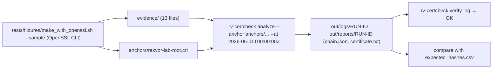

# Examples

## `sample/`: a small lab certificate set

Every file was made by `tests/fixtures/make_with_openssl.sh --sample`, which uses the OpenSSL command line only, so
the tool is never checked against its own output. The certificates are lab certificates (`O=Rakvor Lab`) and must
never be used outside tests. The sample is analysed at **2026-06-01T00:00:00Z** with `anchors/rakvor-lab-root.crt`
as the only trust anchor; the root is kept out of `evidence/` so that trusting it is an explicit choice.

| File | What it demonstrates | Expected finding (once the certificate layer is complete) |
| --- | --- | --- |
| `evidence/intermediate.crt` | Lab intermediate CA (root → intermediate) | CERT_CHAIN_VALID |
| `evidence/leaf.crt` | TLS leaf, valid 2026-01-01 → 2028-01-01 | CERT_CHAIN_VALID |
| `evidence/leaf-expired.crt` | Valid 2024-01-01 → 2025-01-01 | CERT_EXPIRED_AT_DATE |
| `evidence/leaf-revoked.crt` | Revoked 2026-02-01, keyCompromise | CERT_REVOKED |
| `evidence/intermediate.crl` | The intermediate's CRL (DER, 2026-03-01 → 2027-01-01) | used as revocation source |
| `evidence/leaf-wrong-root.crt` | Issued under an unrelated root | CERT_CHAIN_UNTRUSTED |
| `evidence/leaf-rsa1024.crt` | 1024-bit RSA key | CERT_WEAK_KEY |
| `evidence/leaf-sha1.crt` | Signed with SHA-1 | CERT_WEAK_SIGNATURE_ALGORITHM |
| `evidence/leaf-mismatch.crt` + `leaf-mismatch.key` | A key presented with a certificate that is not its own | KEY_DOES_NOT_MATCH |
| `evidence/tsa.crt` | Lab TSA, EKU timeStamping (critical) | CERT_CHAIN_VALID |
| `evidence/data.txt` + `data.tsr` | RFC 3161 token over `data.txt` | TIMESTAMP_TOKEN_VALID; `data.txt`: CRYPTO_INPUT_NOT_RECOGNISED |

While the certificate layer is still a stub (v0.1 freeze), every item reports `ANALYSIS_NOT_IMPLEMENTED` (info)
and the run exits 0; with the layer complete it exits 3 (high findings above). What `openssl verify` itself answers
for each leaf at the same date is recorded in `tests/fixtures/openssl/openssl-verify.tsv`.

`expected_hashes.csv` holds the digests of the 13 evidence files in all six algorithms, computed independently with
Python's `hashlib` and `blake3`, so you can check the tool's hash register.



Run it:

```bash
examples/sample/run.sh target/release/rv-certcheck          # Linux / macOS
```

```powershell
.\examples\sample\run.ps1 -Bin .\rv-certcheck.exe          # Windows
```

Regenerating the set: re-running the script reuses the committed keys and gives byte-identical certificates, CRL,
bundle, PKCS#7 and CSR. The timestamp token, the OCSP response and the PKCS#12 depend on the clock or on random
salts, so the script keeps the committed copies (`REGEN_TIME_BOUND=1` makes new ones; then regenerate
`expected_hashes.csv`).
