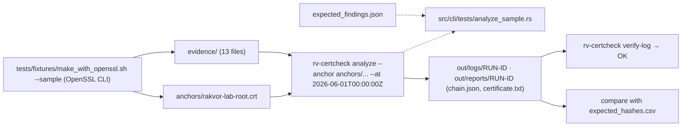

# Examples

## `sample/`: a small lab certificate set

Every file was made by `tests/fixtures/make_with_openssl.sh --sample`, which uses the OpenSSL command line only, so
the tool is never checked against its own output. The certificates are lab certificates (`O=Rakvor Lab`) and must
never be used outside tests. The sample is analysed at **2026-06-01T00:00:00Z** with `anchors/rakvor-lab-root.crt`
as the only trust anchor; the root is kept out of `evidence/` so that trusting it is an explicit choice.

Expected findings come from [`sample/expected_findings.json`](sample/expected_findings.json) (schema
`rakvor.sample-expected/1`), which `src/cli/tests/analyze_sample.rs` checks against a real run: every code under
"must report" must appear for that file, every code under "must not report" must not.

| File | What it demonstrates | Must report | Must not report |
| --- | --- | --- | --- |
| `evidence/intermediate.crt` | Lab intermediate CA (root → intermediate); no root CRL is supplied | `CERT_CHAIN_VALID`, `REVOCATION_UNKNOWN` | `CERT_CHAIN_UNTRUSTED` |
| `evidence/leaf.crt` | TLS leaf, valid 2026-01-01 → 2028-01-01, covered by `intermediate.crl` | `CERT_CHAIN_VALID` | `REVOCATION_UNKNOWN`, `CERT_REVOKED`, `CERT_WEAK_KEY` |
| `evidence/leaf-expired.crt` | Valid 2024-01-01 → 2025-01-01 | `CERT_EXPIRED_AT_DATE` | `CERT_CHAIN_VALID` |
| `evidence/leaf-revoked.crt` | Revoked 2026-02-01, keyCompromise, listed in `intermediate.crl` | `CERT_REVOKED` | `CERT_CHAIN_VALID`, `REVOCATION_UNKNOWN` |
| `evidence/intermediate.crl` | The intermediate's CRL (DER, thisUpdate 2026-03-01, nextUpdate 2027-01-01): used as a revocation source for every item of the run | — | `CRYPTO_INPUT_UNPARSABLE`, `CRYPTO_INPUT_NOT_RECOGNISED` |
| `evidence/leaf-wrong-root.crt` | Issued under an unrelated root that is not an anchor | `CERT_CHAIN_UNTRUSTED`, `REVOCATION_UNKNOWN` | `CERT_CHAIN_VALID` |
| `evidence/leaf-rsa1024.crt` | 1024-bit RSA key; the chain itself is valid | `CERT_WEAK_KEY`, `CERT_CHAIN_VALID` | — |
| `evidence/leaf-sha1.crt` | Signed with SHA-1; the chain itself is valid (OpenSSL accepts SHA-1) | `CERT_WEAK_SIGNATURE_ALGORITHM`, `CERT_CHAIN_VALID` | — |
| `evidence/leaf-mismatch.crt` | A valid leaf presented with a key that is not its own | `CERT_CHAIN_VALID` | — |
| `evidence/leaf-mismatch.key` | That key (same file stem as the certificate) | `KEY_DOES_NOT_MATCH` | `KEY_MATCHES_CERTIFICATE` |
| `evidence/tsa.crt` | Lab TSA, EKU timeStamping (critical) | `CERT_CHAIN_VALID` | — |
| `evidence/data.tsr` | RFC 3161 token issued by the lab TSA over `data.txt`; its TSA chain is judged at genTime | `TIMESTAMP_TOKEN_VALID`, `CERT_CHAIN_VALID` | `TIMESTAMP_TOKEN_INVALID` |
| `evidence/data.txt` | The timestamped data: not a cryptographic object | `CRYPTO_INPUT_NOT_RECOGNISED` | — |

Totals of a run (checked on this commit): **13 items, findings high 4, medium 4, low 0, info 9, exit code 3**
(expired, revoked, wrong root and key mismatch are high; that is the expected outcome, not an error). `analyze` does
not compare `data.tsr`'s message imprint with `data.txt` in v0.1; check it with
`openssl ts -verify -data evidence/data.txt -in evidence/data.tsr -CAfile anchors/rakvor-lab-root.crt -untrusted evidence/tsa.crt`.
What `openssl verify` itself answers for each leaf at the same date is recorded in
`tests/fixtures/openssl/openssl-verify.tsv`.

`expected_hashes.csv` holds the digests of the 13 evidence files in all six algorithms, computed independently with
Python's `hashlib` and `blake3`, so you can check the tool's hash register.



For a larger, reproducible set made by the tool itself (13 cases with their own expected findings and
`openssl verify` codes), use `rv-certcheck lab make --set full --seed 1 --lab-out DIR`
([theory.md B16](../docs/theory.md#b16-lab-sets-and-determinism)).

Run it:

```bash
examples/sample/run.sh target/release/rv-certcheck          # Linux / macOS
```

```powershell
.\examples\sample\run.ps1 -Bin .\rv-certcheck.exe          # Windows
```

Regenerating the set: re-running the script reuses the committed keys and gives byte-identical certificates, CRL,
bundle, PKCS#7 and CSR. The timestamp token, the OCSP response and the PKCS#12 depend on the clock or on random
salts, so the script keeps the committed copies (`REGEN_TIME_BOUND=1` makes new ones; then regenerate
`expected_hashes.csv`).
